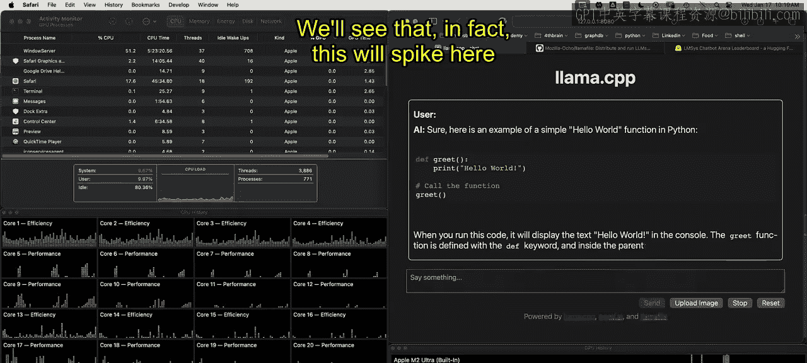

# Llamafile入门：P8：监控本地系统指标 🖥️

在本节课中，我们将学习如何在使用Llamafile运行本地大型语言模型时，监控系统的各项性能指标。这对于评估模型运行效率、资源占用情况以及判断本地部署的可行性至关重要。

## 模型性能评估

上一节我们介绍了Llamafile的基本使用，本节中我们来看看如何评估其性能。首先，我们可以参考Elo评分来了解社区对该模型能力的普遍认知。

下图展示了该混合模型与商业模型的Elo评分对比，两者差距非常小。这表明，只要本地模型的性能足够好，就会有大量用户对本地运行模型产生兴趣。

## 实时监控系统指标

那么，本地模型的性能是否足够好呢？让我们直接查看Llamafile项目运行时的实时指标。

我现在已经在网页浏览器窗口中运行了Llamafile，并且旁边显示了所有实时监控指标。我们需要关注的关键指标包括：

*   **GPU时间**：模型推理过程中GPU的活跃时间。
*   **CPU核心使用率**：所有CPU核心的负载情况。
*   **特定GPU利用率**：例如我使用的M2 Ultra芯片的GPU核心使用情况。

M2 Ultra拥有60个GPU核心。得益于Llamafile和Llama.cpp开发者的出色工作，在Mac操作系统上能够充分利用所有这些GPU核心。

## 通过示例观察资源占用

让我们通过一个具体操作来观察资源变化。如果我向下滚动并请求Llamafile执行一个Python函数，我们可以看到GPU使用率的变化。

我们将看到GPU使用率在此刻出现峰值。同时，我们也应该能看到相应的GPU活动。

事实上，我们可以看到这个`.a1`模型确实在调用GPU。我们再来运行一个示例，比如要求它：“给我一个Python递归函数的例子。”然后观察其表现。

模型输出了一个Python递归函数示例。同时，我们再次确认它确实在使用GPU。因此，其性能表现实际上非常出色。历史GPU数据图也显示它能够有效利用GPU资源。

## 本地与商业模型的思考

对于正在使用商业模型的用户而言，商业模型当然有其价值。但这无疑引出了一个长期问题：**如果你可以下载一个性能足够好、表现惊人且完全免费的模型，为什么还要长期使用商业模型呢？**

因此，当你在体验Llamafile，甚至考虑为大型语言模型签署商业协议之前，首先应该审视本地模型的真实性能。仔细观察各项系统指标，你会发现它的表现令人印象深刻。

---

**本节课总结**：我们一起学习了如何通过Llamafile的监控界面观察关键系统指标（如GPU时间、CPU和GPU利用率），并通过实际运行示例验证了本地模型能有效利用硬件资源（如M2 Ultra的60个GPU核心）。最后，我们对比了本地免费模型与商业模型的性价比，强调了在依赖商业方案前评估本地性能的重要性。