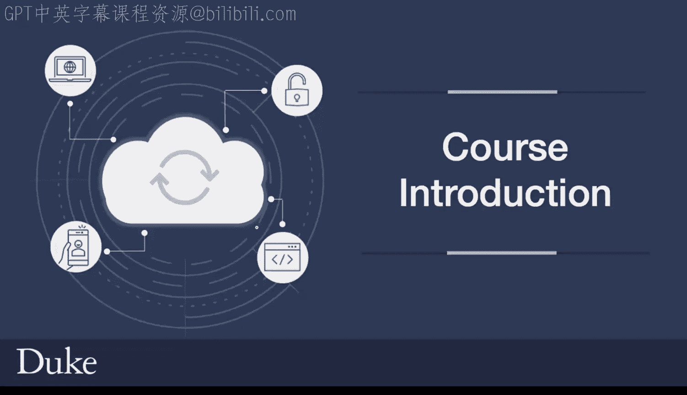
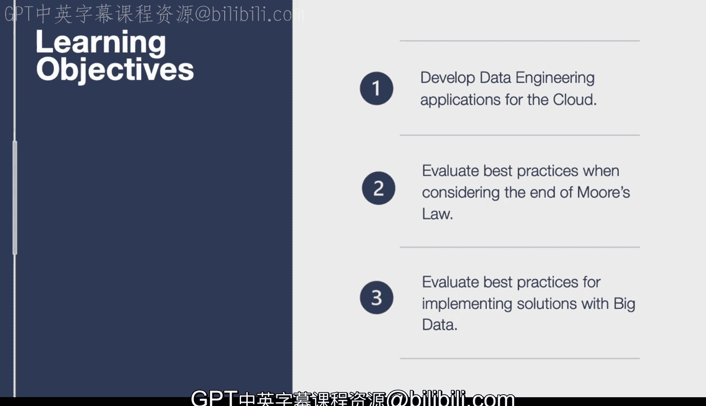

#  002：课程介绍 🎯



在本节课中，我们将要学习《构建大规模云计算解决方案》课程的核心内容与学习目标。课程将聚焦于数据工程的基础知识、关键概念以及如何在云环境中构建可扩展的解决方案。

## 课程内容概述

首先，我们将深入数据工程的基础知识，并评估相关的核心概念。

以下是本课程将涵盖的主要数据工程概念：
*   如何创建数据处理管道。
*   如何使用无服务器等技术。
*   批处理与流式处理之间的区别。

上一节我们介绍了课程的整体方向，本节中我们来看看具体的技能培养。我们还将学习开发数据工程解决方案。这些解决方案可能涉及以下技术领域：
*   大数据。
*   微服务。
*   无服务器计算。

我们将详细探讨这些技术的一些特性。

此外，我们会深入学习开发ETL管道。ETL管道代表**提取（Extract）、转换（Transform）、加载（Load）**，是数据工程师的常见实践。一个基础的ETL流程可以用以下伪代码描述：
```
数据 = 从源系统提取()
处理后的数据 = 转换(数据)
加载(处理后的数据, 目标数据库)
```

## 学习目标详解

接下来，让我们逐一审视本课程的具体学习目标。

首先，我们将深入开发数据工程应用程序。云计算最有前景的方面之一，就是开发能够大规模扩展并为后续机器学习系统提供数据的数据工程应用。

我们还将评估应对摩尔定律终结的最佳实践。**摩尔定律**描述了芯片性能持续快速提升的过程，但它现已趋于终结。我们将讨论其带来的一些影响。

最后，我们将评估实施大数据解决方案的最佳实践。大数据开发是一种完全不同的软件开发模式，在处理大数据时必须考虑一些独特的特性。

---




本节课中，我们一起学习了本课程的核心内容与学习目标，包括数据工程基础、ETL管道开发、应对后摩尔定律时代的策略以及大数据解决方案的独特考量。这些知识将为后续构建大规模云解决方案打下坚实基础。