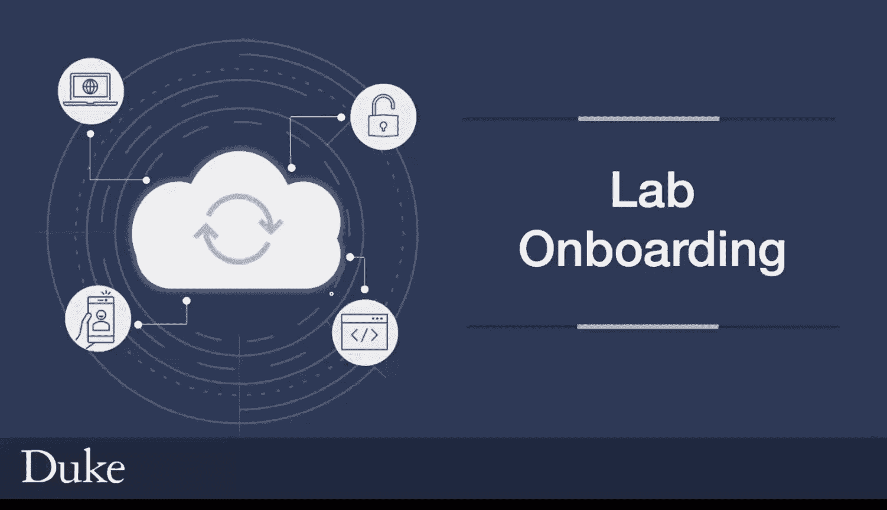
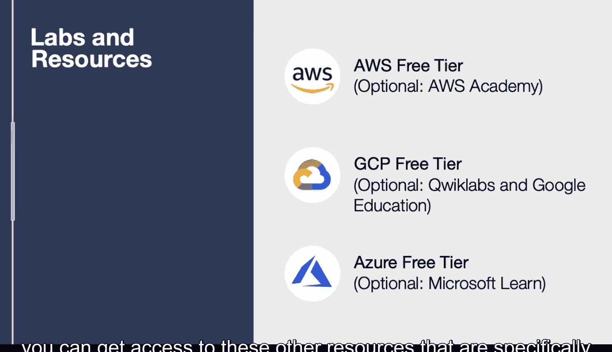

#  003：实验环境配置 🛠️

在本节课中，我们将学习如何为课程配置实验环境，包括AWS、GCP和Azure三大云平台的免费资源获取方式。

## 课程实验与资源概述

本课程提供了针对AWS、GCP和Azure的实验内容。同时，这些平台也提供了免费套餐，足以支持你完成所有课程任务。

## 各平台资源配置详解

上一节我们介绍了课程的整体实验资源，本节中我们来看看每个云平台的具体配置方法。

### AWS 资源配置

AWS平台推荐使用其免费套餐。通过该套餐，你几乎可以完成所有必需的实验操作。

以下是获取AWS实验资源的几种途径：
*   **AWS免费套餐**：这是完成课程基础实验的主要方式。
*   **AWS Academy**：如果你是教育机构的成员，可以通过AWS Academy获取许多免费的实验资源，这些资源对学习非常有帮助，并能为你考取AWS认证做准备。

### GCP 资源配置

GCP平台提供了非常慷慨的免费套餐。仅使用免费套餐，你就能完成本课程的所有作业。

以下是GCP平台的额外资源途径：
*   **免费套餐**：完成课程核心内容的主要资源。
*   **Quicklas与Google教育**：作为学生，你可以申请Google教育来获取一些Quicklab积分，并进行试运行。这是可选的补充资源。

### Azure 资源配置

Azure平台同样提供了非常慷慨的免费套餐。作为学生，你可以访问该套餐。

以下是利用Azure资源的建议：
*   **免费套餐**：学生可以免费获取并使用。
*   **Microsoft Learn**：如果你想自行完成更多实验，可以通过Microsoft Learn平台进行学习。

总而言之，本课程涵盖的所有内容都可以通过使用AWS、GCP和Azure的免费功能来完成。此外，如果你是像杜克大学这样的教育机构的一员，还可以获取专门为教育环境设计的额外实验资源。