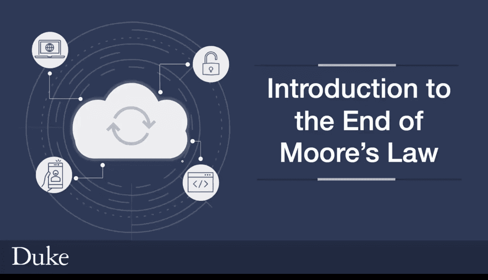
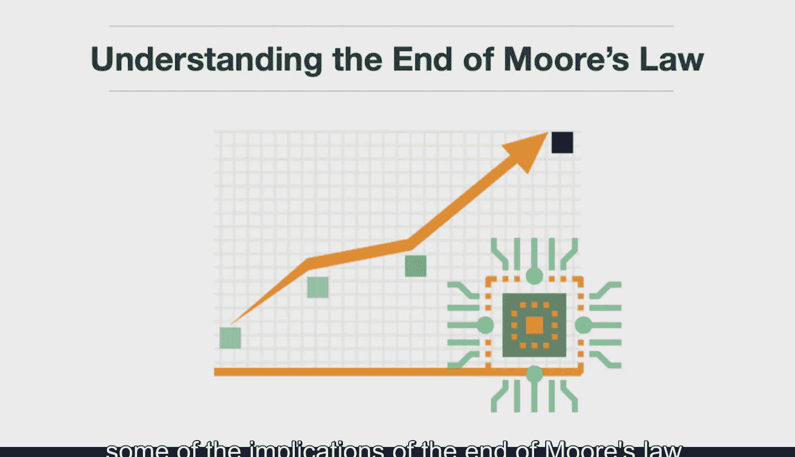
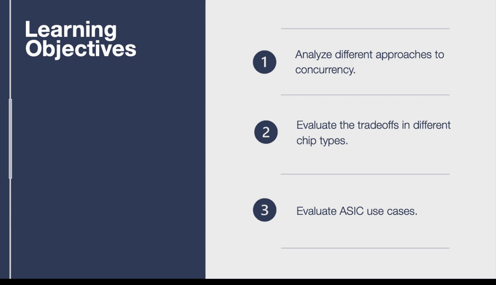
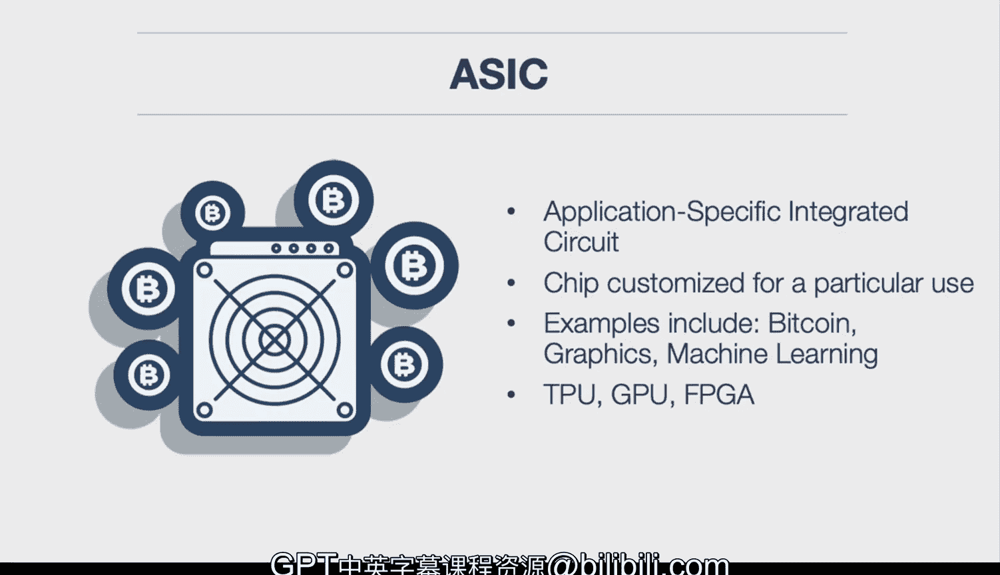

#  005：摩尔定律终结导论 🚀

在本节课中，我们将要学习摩尔定律的终结及其对现代计算架构，特别是云计算领域的影响。我们将探讨处理器性能增长放缓后，业界如何通过并发计算、专用芯片等新范式来应对挑战。

---

## 学习目标 🎯

首先，我们分析不同的并发处理方法，包括网络并发、进程并发和GPU并发，并讨论它们之间的权衡。

然后，我们评估不同类型芯片的优缺点。我们将深入了解多种专用芯片，并探讨使用CPU之外的其他芯片时会发生什么。

我们还将评估ASIC（专用集成电路）的使用场景。ASIC用于机器学习或图形处理等非常专业的场景。

---

## 核心概念解析 💡

以下是本节课涉及的关键术语和概念。

**CUDA**
CUDA代表**Compute Unified Device Architecture**。它是英伟达（NVIDIA）公司为其GPU（图形处理单元）提供的API。CUDA SDK是实现并行计算和编程的核心工具。

**并行计算**
我们结合CUDA来深入探讨并行计算。使用CUDA SDK可以实现并行计算和编程。

**ASIC**
ASIC代表**Application Specific Integrated Circuit**（专用集成电路）。它们是针对特定用例定制的芯片，是机器学习和云计算领域的一个新趋势。例如，用于比特币挖矿、图形处理、机器学习或低功耗设备的芯片。在云计算中，我们会反复遇到这个概念。

**当今使用的ASIC示例**
当今使用的一些优秀ASIC示例包括：
*   **TPU**：谷歌的TensorFlow处理单元。
*   **GPU**：图形处理单元。
*   **FPGA**：一种可编程芯片，用于专用工作流，例如加密货币挖矿。

---

## 课程总结 📝

本节课中，我们一起学习了摩尔定律的终结如何推动计算范式从依赖单一CPU的性能提升，转向利用并发处理和专用芯片（如GPU和ASIC）来满足大规模、高性能的计算需求。理解这些不同的架构和它们的权衡，对于设计和构建高效的大规模云计算解决方案至关重要。