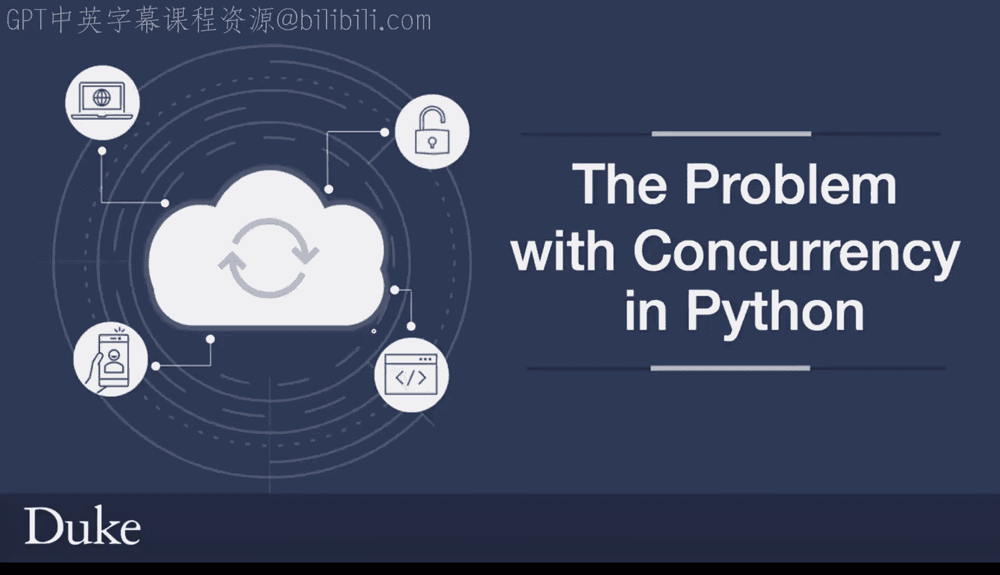

#  006：Python并发编程的问题

## 概述
在本节课中，我们将要学习Python语言在处理并发编程时面临的核心挑战。我们将探讨其历史背景、技术限制，以及在实际应用场景中可能导致的资源浪费问题。最后，我们将了解如何利用云计算服务来规避这些限制，构建高效的并发系统。

## Python并发问题的历史背景
上一节我们概述了课程内容，本节中我们来看看Python并发问题的起源。Python的设计可以追溯到互联网的黎明时期，即20世纪90年代。当时，计算机的处理能力有限，网络速度缓慢，下载一张图片可能需要一个小时。那时的机器大多是单核的，没有现代意义上的多核并发概念。

因此，Python实现了一个名为**全局解释器锁（GIL）**的机制。GIL的作用是将Python中的线程锁定在单个CPU核心上运行。

## GIL带来的限制与挑战
了解了历史背景后，本节我们深入探讨GIL带来的具体问题。当你的计算机只有一个CPU核心时，GIL的存在并不是一个大问题。然而，现代服务器通常拥有多个核心，例如48核、128核甚至更多。

此时，问题就出现了：Python程序无法有效利用这些多核资源。对于某些需要高并发的服务器端应用，Python可能就不再是一个合适的选择。

## 一个真实案例：资源浪费问题
为了更具体地理解这个问题，我们来看一个真实世界的案例。我曾在一家软件即服务公司工作，我们处理大数据业务。一位顶尖的开发者花了九个月时间，开发了一个异步Python网络服务器。

这个服务器的性能指标非常出色：
*   每个进程每秒能处理约10,000个请求。

然而，当我们将其部署在一台拥有四个CPU核心的机器上时，问题暴露了：**由于GIL的限制，实际上只有一个核心被利用**。这意味着我们为四个核心的硬件付费，但只使用了其中四分之一的计算能力，造成了巨大的资源浪费和经济损失。

最终，我们不得不放弃这个方案，转而使用另一种能够支持真正并发（即能利用多核）的编程语言来重建服务。

## 解决方案：利用云计算处理并发
既然Python自身在服务器端高并发场景下存在局限，那么我们应该如何应对呢？本节我们将探讨解决方案。

核心建议是：**不要试图用Python自身去解决高并发问题，而是利用云计算平台来处理并发细节。**

以下是具体的实施思路：
1.  **将云计算视为操作系统**：你可以使用像AWS Lambda（无服务器计算）和SQS（简单队列服务）这样的云服务。
2.  **构建事件驱动的并发系统**：通过将任务分解并交由云服务并行处理，你可以构建出高度并发的系统，而无需关心底层线程或进程的管理。

## 总结
本节课中我们一起学习了Python在并发编程方面的核心问题。我们了解到，由于历史原因设计的**全局解释器锁（GIL）** 限制了Python线程在多核CPU上的并行执行能力，这可能导致服务器应用无法充分利用硬件资源，造成成本浪费。关键的应对策略是，避免在应用层用Python硬扛高并发，转而**利用AWS Lambda、SQS等云计算服务**来构建架构，让云平台来负责复杂的并发处理任务。