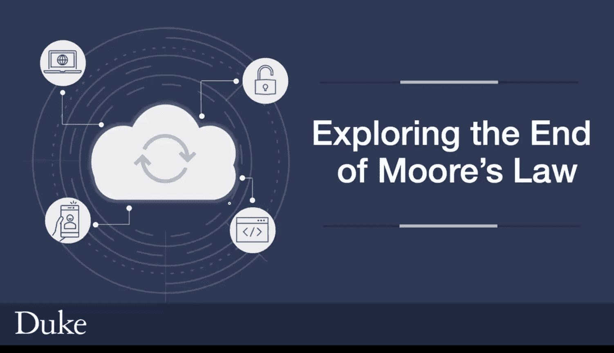
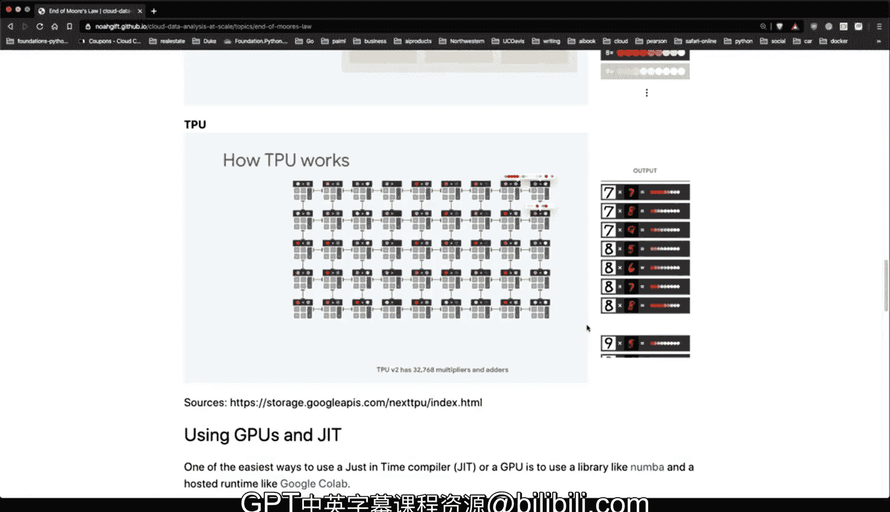

#  007：探索摩尔定律的终结 🚀

在本节课中，我们将探讨一个对现代计算和云计算发展至关重要的概念：摩尔定律的终结。我们将了解其历史背景、当前面临的挑战，以及行业如何通过专用硬件来应对这一变化，从而为大规模数据工程和机器学习解决方案开辟新的可能性。

---

上一节我们介绍了课程背景，本节中我们来看看摩尔定律的发展历程与现状。描述当前情况的最佳方式之一是跟随加州大学伯克利分校的David Patterson博士的研究。他也是TPU（张量处理单元）的架构师之一。

他指出，单程序性能增长的终结大致发生在过去40年的这个时期。具体增长趋势如下：

以下是不同时期的年度性能提升百分比：
*   **1980年代**：年度性能提升为 **22%**。
*   **RISC处理器出现后**：年度性能提升达到 **52%**。
*   **约2003年**：随着多核机器的出现，性能提升率降至 **23%**。这是因为多核架构在扩展时会因**阿姆达尔定律**而损失效率。
*   **当前**：年度性能提升仅为 **3%**。

这里提到的**阿姆达尔定律**可以用一个公式来描述其核心思想：`S = 1 / ((1 - P) + P/N)`。其中，`S`代表加速比，`P`是程序中可并行部分的比例，`N`是处理器的数量。该定律表明，程序的并行部分会带来收益递减。

---

虽然摩尔定律的放缓带来了重大挑战，但它也创造了新的机遇。人们利用这一“死胡同”的一种方式是转向**ASIC**。

**ASIC**是“专用集成电路”的缩写。一个常见的ASIC例子是许多人电脑上都有的**GPU**，特别是像英伟达的GPU。围绕它已经设计了一整套用于并行编程的工具包，称为**CUDA**。其他厂商也开始加入竞争，例如AMD。此外，还有像**TPU**这样的新参与者，它们甚至超越了GPU的功能，专门为TensorFlow等机器学习框架生成工作负载。

以下是Google的TPU在生产环境中的应用实例：
*   Google于**2015年**开始在生产中使用TPU。
*   应用场景包括：**搜索**、**翻译**、**图像识别**等。
*   图中展示的是包含多个TPU的整机架部署。

---

那么，CPU、GPU和TPU之间有什么区别呢？了解它们的差异有助于我们理解为何要转向专用硬件。

以下是三种处理器的核心区别：
*   **CPU**：这是一种**通用处理单元**，设计用于处理各种不同的任务。
*   **GPU**：它专为**并行处理**而设计。CPU与GPU的最大区别在于，GPU是为并行计算设计的，而CPU旨在执行计算机上各种不同的任务。
*   **TPU**：它比GPU的**密度更高**。TPU不仅关心并行化，更专注于为**特定工作负载**（如机器学习中的矩阵运算）进行优化并行。这正是ASIC的优势之一：作为软件供应商，你可以控制整个技术栈，设计出与你的软件、你的云环境以及你的处理器协同工作的解决方案。

---

本节课中我们一起学习了摩尔定律的终结及其对计算领域的影响。我们回顾了单核性能增长的放缓历程，认识了**阿姆达尔定律**对并行计算的限制。随后，我们探讨了行业如何通过采用**GPU**、**TPU**等**专用集成电路**来应对挑战，并比较了CPU、GPU和TPU在设计目标与应用场景上的关键区别。理解这些硬件演进是构建高效、大规模云计算解决方案，特别是在数据工程和机器学习领域的重要基础。