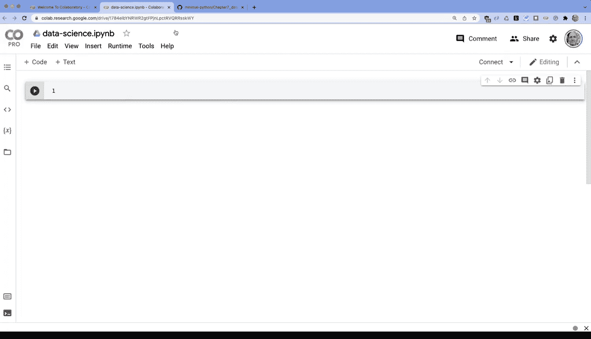
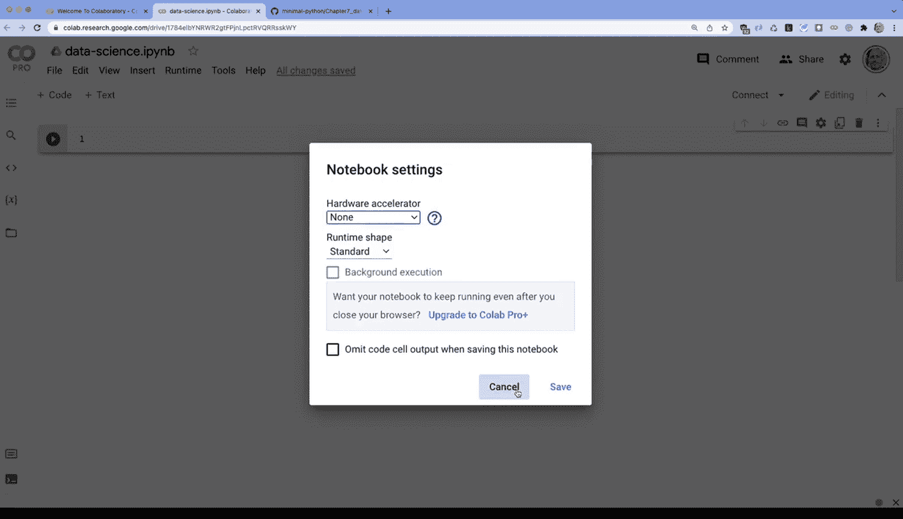
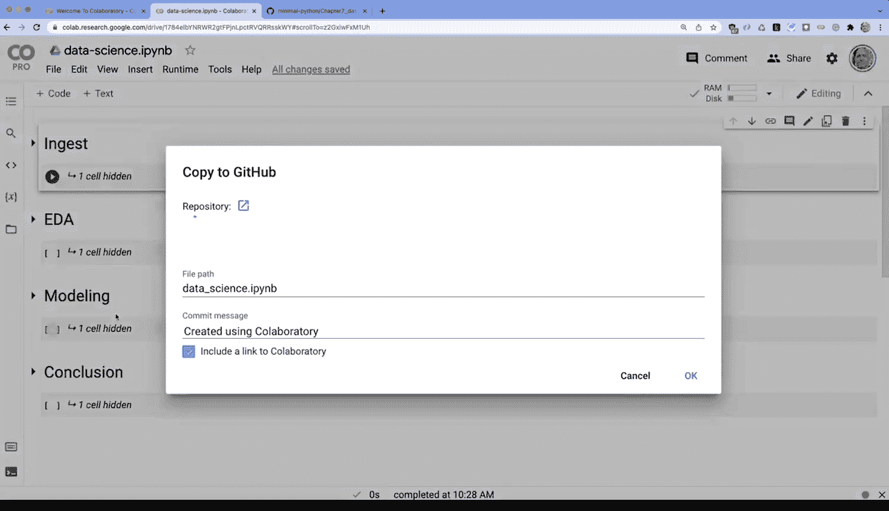
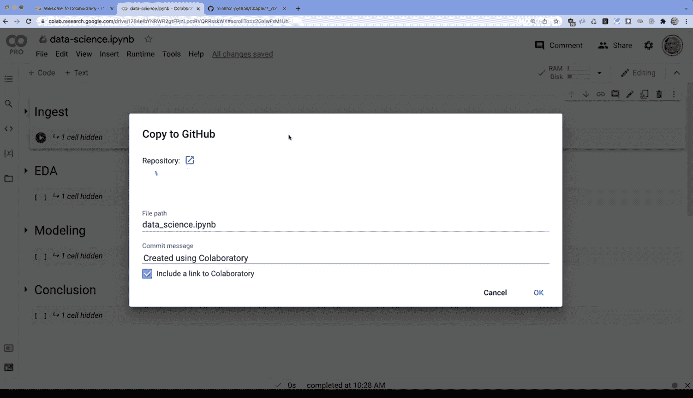
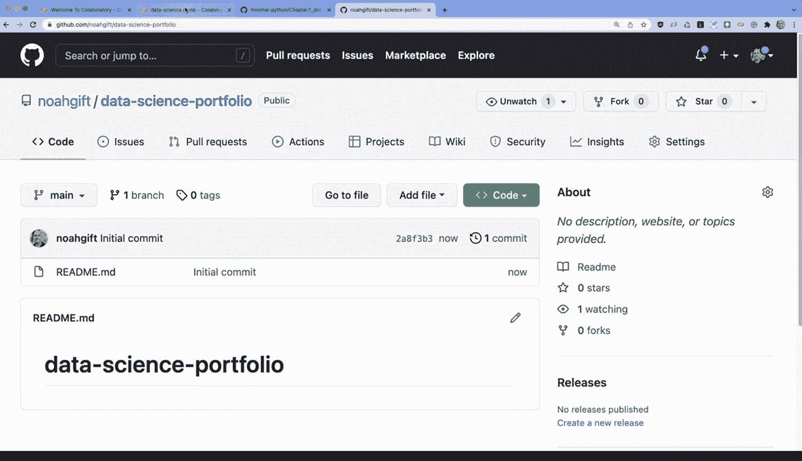
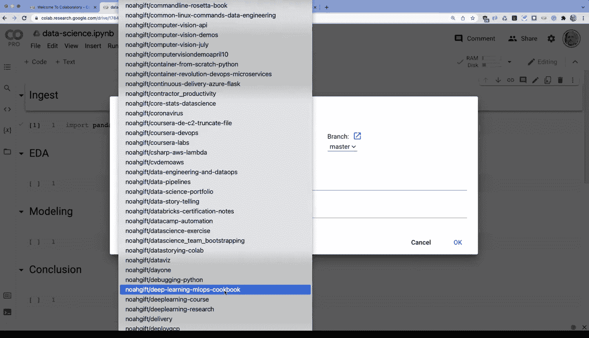
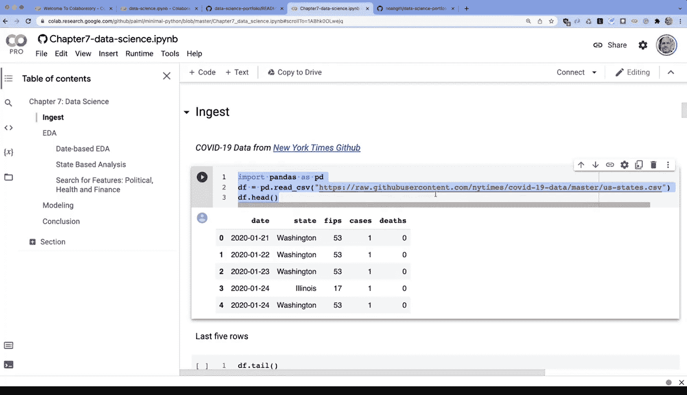
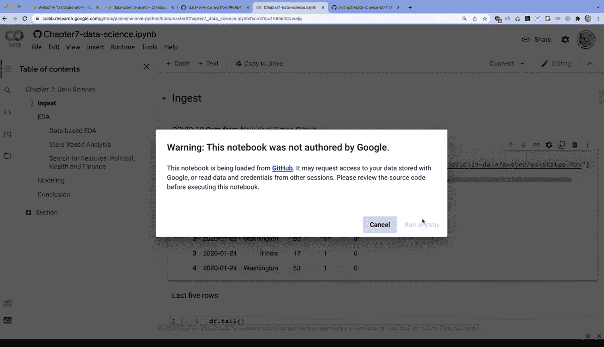
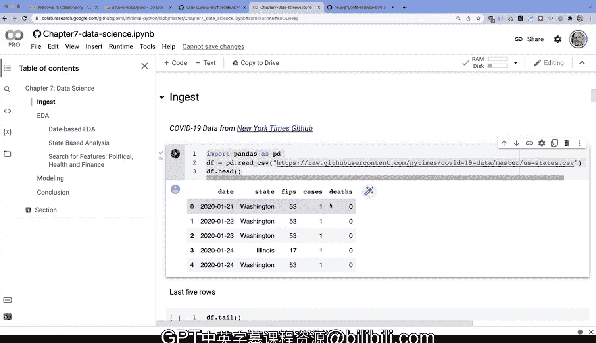

#  010：利用Colab Pro优势

在本节课中，我们将学习如何使用Google Colab Notebook进行数据科学项目与作品集项目。我们将涵盖从创建笔记本、组织项目结构到分享代码的完整流程，旨在帮助你高效地利用Colab环境。

## 创建与命名笔记本

首先，我们来看看如何创建一个新的Colab笔记本。

打开Colab后，你会看到默认界面，其中包含一些使用说明。创建新笔记本的方法是：点击 **File** -> **New Notebook**。系统会创建一个空白的笔记本模板。

创建后，你可以为笔记本命名。例如，将其命名为 `data_science`。良好的命名习惯能让项目意图更清晰，便于他人理解笔记本的内容。

此外，在 **Runtime** 菜单中，你可以更改运行时类型。如果你使用的是Colab Pro版本，可以使用更高性能的GPU或TPU。无论是免费版还是Pro版，Colab作为托管运行时环境都非常有用。






## 构建项目结构

上一节我们介绍了如何创建笔记本，本节中我们来看看如何组织项目代码结构。

对于学生或数据科学专业人士，我特别推荐在项目中创建清晰的层级结构。以下是一个推荐的结构示例：

以下是构建项目结构的步骤：
1.  创建一个单元格，并输入 `# ingest` 作为标题。这代表数据获取阶段。
2.  在下方创建另一个单元格，输入 `# EDA`。这代表探索性数据分析阶段。
3.  继续创建单元格，输入 `# modeling`。这代表建模阶段。
4.  最后，可以创建一个 `# conclusion` 单元格作为结论部分。

通过创建这种层级结构，他人可以轻松理解你的项目流程，而无需浏览成千上万行代码。同时，这些标题单元格可以被折叠起来，使界面更整洁。

在左侧，你还可以通过目录来导航整个项目，这对于分享项目非常有用。





## 编写与执行代码

在构建好结构后，我们可以在相应的部分编写代码。Colab支持直接执行Python代码。


例如，在 `ingest` 部分，你可以输入：
```python
import pandas as pd
```
来导入所需的库。每个阶段（如ingest, EDA）的代码可以根据需要选择隐藏或展开。

## 分享你的项目

现在我们已经构建了一个结构化的项目，接下来看看如何分享它。



分享Colab笔记本主要有两种简单的方法。



**第一种方法是保存到GitHub。**
1.  点击 **File** -> **Save a copy in GitHub**。
2.  你需要提前在GitHub上创建一个代码仓库（Repository）。例如，创建一个名为 `data_science_portfolio` 的仓库。
3.  在Colab的保存界面中，选择你刚创建的仓库，然后确认保存。

这是一种极佳的分享方式，无论是与团队成员、同事还是未来的雇主分享。保存后会产生一个公开的Colab链接，任何人都可以点击并执行你的代码。


**第二种方法是利用Google Drive的分享功能。**
1.  点击笔记本右上角的 **Share** 图标。
2.  将分享设置修改为 **Anyone with the link**（任何拥有链接的人）。
3.  复制生成的链接。
4.  你可以将这个链接放入项目的README文件中，例如写上“Open my notebook”。

这种方法非常适合用于大型笔记本的演示或与他人进行代码协作。其优点是访问者无需进行身份验证即可打开笔记本。建议根据情况选择一种或同时使用这两种方式来分享你的工作。

## 查看完整项目示例

最后，我们来看一个更复杂、更贴近传统数据科学工作流的项目示例。

点击一个项目的 **Open in Colab** 链接后，你可以轻松地通过左侧目录导航整个项目，查看 `ingest`、`EDA`、`modeling`、`conclusion` 各个部分。

例如，在 `ingest` 部分，代码可能读取一个 `New_York_Times.csv` 数据文件，并为后续分析提供数据。这种方法的优点是，你无需担心数据存储路径问题，因为数据可以直接从云端或URL加载。

确保项目100%可复现且易于导航，是使用Colab Notebook进行数据科学工作的一个高度推荐的做法。









## 总结


本节课中我们一起学习了如何高效利用Google Colab进行数据科学项目。我们从创建和命名笔记本开始，然后探讨了如何通过创建清晰的层级结构（如ingest, EDA, modeling, conclusion）来组织项目，使代码更易读、易导航。接着，我们介绍了两种主要的分享方式：保存到GitHub和通过Google Drive链接分享，这两种方法都能方便地与他人协作或展示你的作品。最后，我们浏览了一个完整项目的示例，强调了确保项目可复现性的重要性。无论你是学生、数据科学专业人士还是任何想要开始自己项目的人，掌握这些技巧都将大有裨益。