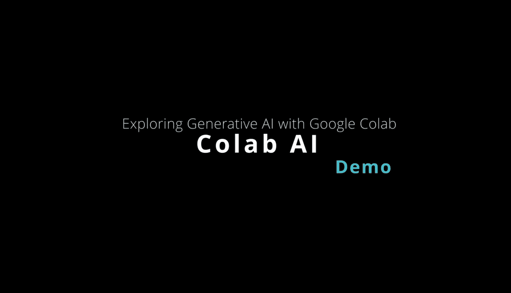
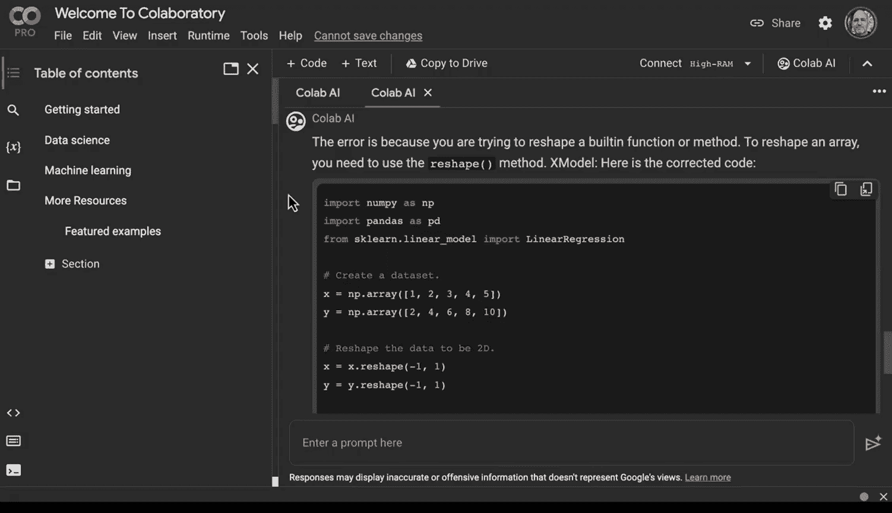

#  011：探索Colab AI 🚀



在本节课中，我们将要学习如何使用Google Colaboratory（Colab）及其内置的AI助手功能。Colab是一个著名的云端Jupyter Notebook解决方案，它提供了强大的计算能力和新兴的生成式AI辅助编程功能。

## 强大的硬件加速能力 💪

上一节我们介绍了Colab的基本概念，本节中我们来看看它提供的硬件加速选项。在Colab中，我们可以轻松更改运行时类型，以利用各种高性能硬件进行加速计算。

以下是可用的硬件加速类型：
*   使用TensorFlow处理单元（TPU）
*   NVIDIA A100 GPU
*   NVIDIA V100 GPU
*   NVIDIA T4 GPU

这些内置的硬件加速能力为运行计算密集型任务（如机器学习和数据分析）提供了强大的支持。

## 内置的生成式AI助手 🤖

除了硬件加速，Colab另一个新兴的功能是可以在Notebook内部直接使用生成式AI。这本质上是一个内置的AI编程助手。

我们可以通过侧边栏激活“Colab AI”功能，甚至可以将整个会话聚焦于生成式AI任务。例如，我们可以向它提出编程问题。

## 实践：向AI助手提问 💡

让我们尝试使用这个AI助手。首先，我们可以使用一个默认查询，例如：“如何过滤Pandas DataFrame”。

AI助手会给出一个很好的代码示例。我们也可以要求更具体的示例，比如：“我想要一个如何进行简单线性回归的示例”。

AI助手会生成相应的代码样本。我们可以复制这段代码，创建一个新的Notebook文件，并将其粘贴进去运行。

## 调试与迭代：与AI协作 🔄

运行代码时，我们可能会遇到错误。例如，可能出现“2D数组与1D数组不匹配”的问题。这时，我们可以将错误信息反馈给AI助手。

我们可以输入：“出现了一个错误”，然后看看AI如何建议我们修复。它可能会建议使用`reshape`函数来调整数组维度。

我们按照建议修改代码，将`x`和`y`数组进行重塑：
```python
x = x.reshape(-1, 1)
y = y.reshape(-1, 1)
```
值得注意的是，AI助手甚至能帮助我们自动补全代码。然而，修改后可能仍然会遇到问题，例如提示“没有‘reshape’属性”。

## 掌握有效使用AI的技巧 🧠

这时，很容易让人想直接放弃。但就像解决真正的编程问题一样，使用生成式AI的关键在于预期并处理其输出可能存在的问题。

使用这类AI助手的技巧之一是，必须假设其生成的代码有一定概率（例如25%的时间）会存在问题。核心问题在于，当答案不完美时，你如何继续推进。

一个有效的方法是缩小问题范围，并将错误追踪信息反馈给助手，持续向前推进。这样，你就能将问题分解为正确的部分和错误的部分。

这本质上是传统的调试和问题解决思维，只是我们有了一个能提供大量帮助的先进新工具。通过Colab AI，我们可以看到成功使用它的一个核心策略：进行迭代式对话和调试。

## 总结 📝



本节课中我们一起学习了Google Colab的两个核心功能：一是其提供的多种硬件加速选项（如GPU和TPU），用于提升计算性能；二是其内置的生成式AI编程助手。我们实践了如何向AI提问、获取代码示例，并重点学习了当AI生成的代码出现错误时，如何通过迭代反馈、缩小问题范围和分解问题来进行有效调试和协作。这强调了一个重要理念：AI是一个强大的辅助工具，但成功使用它需要结合传统的问题解决技能。