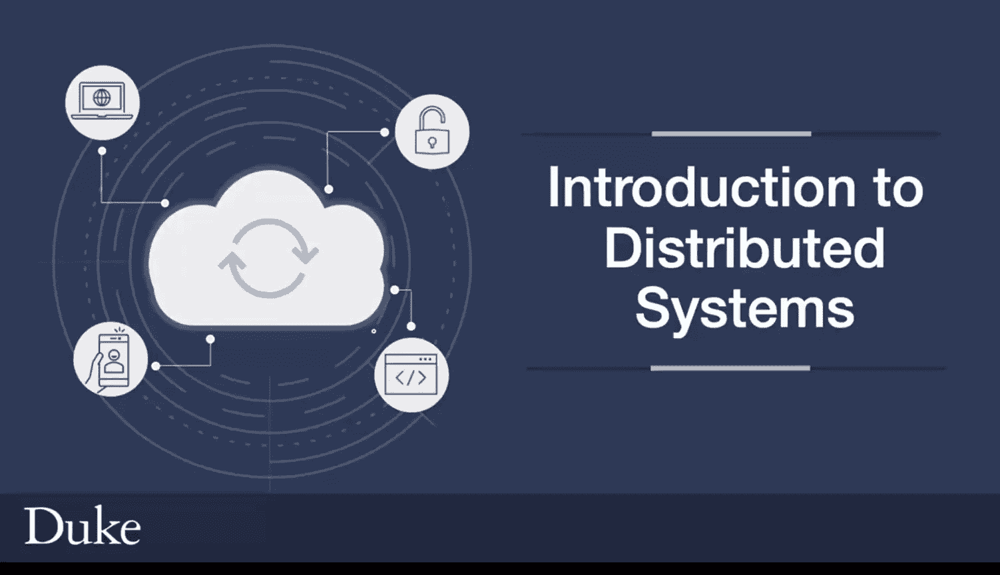
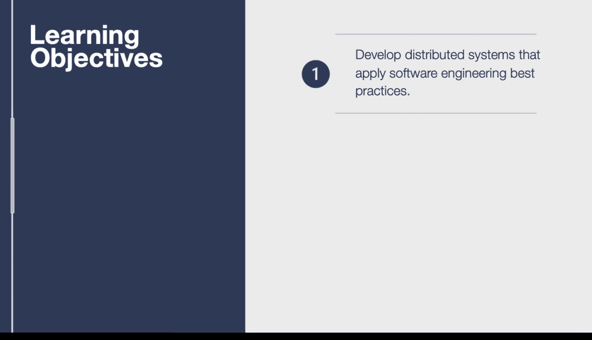

#  012：分布式系统导论 🚀

在本节课中，我们将学习构建分布式系统的基础知识。我们将探讨分布式系统的核心概念、设计权衡以及构建高可用、可扩展系统所需的关键实践。



---

## 什么是分布式系统？ 🤔

分布式系统是由多台通过网络连接的计算机组成的系统，这些计算机协同工作，以实现一个共同的目标。它们看起来像是一个单一、连贯的系统。

上一节我们介绍了课程概述，本节中我们来看看分布式系统的具体定义。

---

## 核心概念与权衡 ⚖️

构建分布式系统涉及多个核心概念和不可避免的权衡。理解这些是设计稳健系统的关键。

### 1. 仪表化与日志记录

在分布式系统中，由于组件分布在多台机器上，故障排查变得复杂。因此，**仪表化**（为系统添加可观测性代码）和**日志记录**至关重要。

以下是仪表化的主要目的：
*   **追踪请求流**：了解一个请求在系统中的完整路径。
*   **监控性能**：收集延迟、吞吐量等指标。
*   **调试故障**：当系统出现问题时，日志是首要的排查工具。

一个简单的Python日志记录示例如下：
```python
import logging
logging.basicConfig(level=logging.INFO)
logger = logging.getLogger(__name__)

def process_data(data):
    logger.info(f"开始处理数据: {data}")
    # ... 处理逻辑 ...
    logger.info("数据处理完成")
```

### 2. CAP定理

CAP定理描述了分布式数据存储的三个核心属性之间的权衡：
*   **一致性**：所有节点看到的数据在同一时刻是相同的。
*   **可用性**：每个请求都能收到响应（不保证是最新数据）。
*   **分区容错性**：系统在遇到网络分区（部分节点无法通信）时仍能继续运行。

**定理指出，在发生网络分区时，你只能在一致性和可用性之间选择其一。**

### 3. 阿姆达尔定律

阿姆达尔定律指出了并行计算的收益递减规律。它通过一个公式描述了系统并行化后可能获得的最大加速比：

**`Speedup = 1 / [(1 - P) + (P / N)]`**

其中：
*   **`P`**：代码中可以被并行化的部分所占的比例。
*   **`N`**：处理器的数量。

这意味着，即使无限增加处理器数量，系统的加速比也会受限于代码中必须串行执行的部分（`1-P`）。

### 4. 弹性

弹性是指系统能够根据负载变化自动调整资源的能力。例如，当流量激增时，系统可以自动启动更多虚拟机或分配更多网络资源；当流量下降时，则释放多余资源以节省成本。

### 5. 高可用性架构

高可用性架构旨在确保系统能够持续响应请求，即使在某些组件发生故障或流量激增时。其核心组件通常包括：
*   **冗余**：消除单点故障，关键组件有多个副本。
*   **故障转移**：当主组件失效时，能自动切换到备用组件。
*   **负载均衡**：将流量均匀分发到多个服务器，防止任一服务器过载。

---

## 学习目标 🎯

我们的目标是开发遵循软件工程最佳实践的分布式系统。

上一节我们探讨了分布式系统的理论概念，本节中我们来看看实践这些概念的具体目标。

以下是构建有效分布式系统的关键实践：
*   **应用仪表化与日志记录**：如前所述，这是可观测性的基础。
*   **遵循DevOps最佳实践**：例如持续集成和持续交付，以实现快速、可靠的部署。
*   **实施健全的调试策略**：这对于现代数据系统至关重要。

---

## 调试Python代码 🐛

Python是构建现代数据系统的常用语言，掌握其调试技巧非常重要。

以下是两种主要的调试方法：
1.  **使用Python调试器**：例如`pdb`，允许你逐行执行代码、检查变量。
    ```python
    import pdb; pdb.set_trace() # 在代码中设置断点
    ```
2.  **使用日志语句**：在关键位置插入日志输出，追踪程序执行流和状态（如前面仪表化部分所示）。

---



## 总结 📝


本节课中我们一起学习了分布式系统的基础。我们首先定义了分布式系统，然后深入探讨了其核心概念，包括**仪表化与日志记录**的重要性、**CAP定理**揭示的一致性、可用性与分区容错性之间的权衡、**阿姆达尔定律**对并行计算收益的限制、系统的**弹性**以及**高可用性架构**的组成。最后，我们强调了遵循软件工程最佳实践（如DevOps）和掌握**Python调试技巧**对于构建和维护一个健壮、可扩展的分布式系统至关重要。