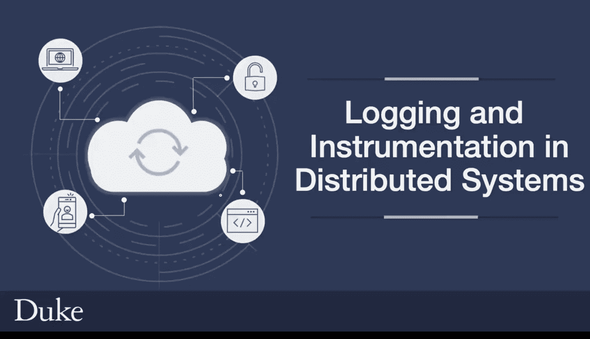

#  013：分布式系统的日志记录与监控

在本节课中，我们将要学习分布式系统中日志记录与监控的重要性。它们是确保系统可观测性和可维护性的基石。

## 🧩 概述：为什么需要日志与监控

在云端构建系统时，日志记录与监控是一个至关重要的组成部分。你可以将其理解为**软件工程的数据科学**。如果没有日志，你就无法查看展示CPU、内存和磁盘使用情况的仪表盘，也就无法真正了解系统内部正在发生什么。

因此，构建分布式系统时需要考虑的最重要事项之一，就是你是否能在一个集中的位置查看所有日志，并发现问题。例如，在你拥有的100个节点中，有3个出现了特定问题，并且它们恰好都位于西北区域。如果你的系统不具备这种跨节点的可见性，那么维护系统将变得极其困难。

简而言之，请务必设置好日志记录与监控，这是成为高级软件工程师的关键组成部分。

## 🔍 核心概念解析

上一节我们介绍了日志与监控的必要性，本节中我们来看看其核心价值。其核心在于提供**系统的可观测性**，公式可以表示为：

**系统可观测性 = 日志(Logs) + 指标(Metrics) + 追踪(Traces)**

以下是实现有效监控的几个关键点：

*   **集中化日志**：所有服务器和服务的日志都应汇聚到一个统一的平台，便于搜索和分析。
*   **关键指标监控**：需要持续跟踪如CPU使用率、内存消耗、磁盘I/O、网络延迟等核心系统指标。
*   **问题定位与关联**：能够将日志、指标与具体的事件、用户请求或错误关联起来，快速定位问题根源。

## 🛠️ 实践要点总结

本节课中我们一起学习了分布式系统日志与监控的基础。它不仅是技术工具，更是一种工程实践文化。确保你的系统具备良好的可观测性，是构建稳定、可靠的大规模云解决方案不可或缺的一环。记住，**无法监控的系统，就是无法维护的系统**。