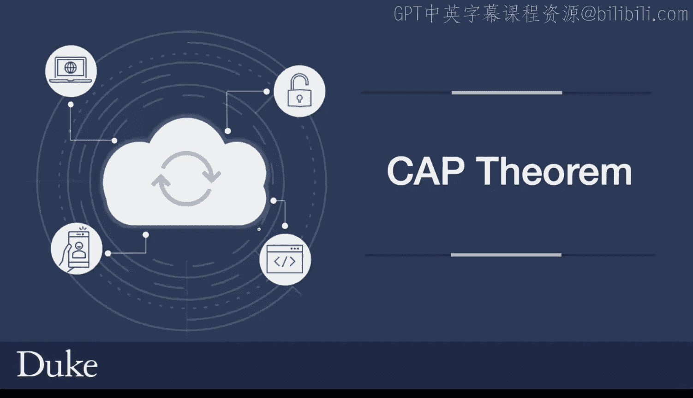
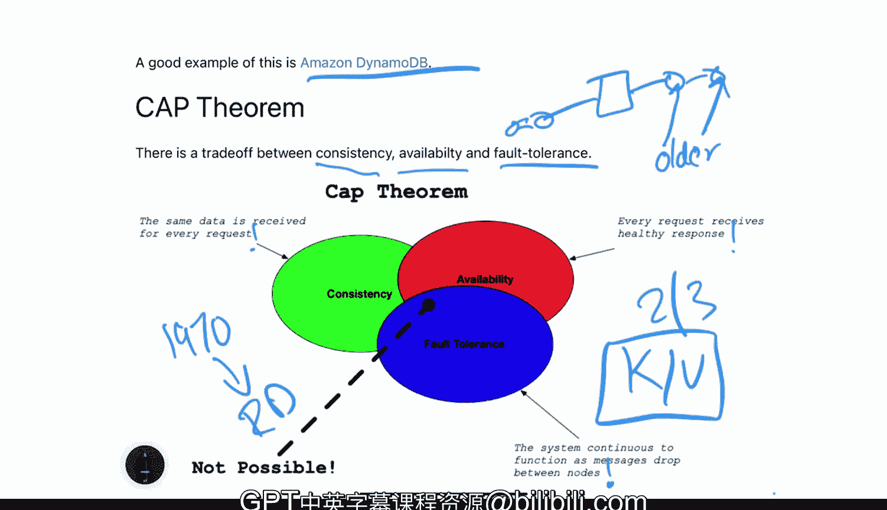

#  014：CAP定理

## 概述
在本节课中，我们将要学习分布式计算中的一个基本定理——CAP定理。我们将了解它如何揭示了在一致性、可用性和分区容错性之间的权衡，以及这种权衡在实际系统设计中的体现。

## CAP定理简介
分布式计算的一个基本定理是CAP定理。它的含义是，在一致性、可用性和分区容错性之间存在权衡。

## 核心概念解析
上一节我们介绍了CAP定理，本节中我们来看看这三个核心概念的具体含义。

在实践中，这意味着：
*   **一致性**：每个请求都能收到相同的数据。
*   **可用性**：每个请求都能收到一个健康的响应。
*   **分区容错性**：即使节点间的消息传递出现故障，系统也能继续运行。

你只能同时满足这三个特性中的两个。

## 关系型数据库中的权衡
从20世纪70年代起，关系型数据库主要将一致性作为首要驱动力，例如处理银行交易。然而，这种选择的代价是，很多时候会面临扩展性问题，因为你必须在分区容错性和可用性之间做出选择。

以下是关系型数据库中的一个典型权衡示例：
*   假设你有一个关系型数据库，并为其配置了一些只读副本。
*   当你调用这些只读副本时，它们会具有高可用性。
*   但由于只读副本的工作机制，其分区容错性可能会略有改变。
*   同样，在一致性方面，如果只读副本未能与主数据库在同一时刻获取数据，你可能会读到稍旧版本的数据。这是因为只读副本只复制读取操作，而写入操作的发生时机略有不同。

因此，在关系型数据库中，存在这种权衡。

## 键值数据库中的权衡
随着键值数据库的发展，在一致性、可用性和分区容错性之间的选择变得更加深入。一个很好的例子是亚马逊的DynamoDB。

DynamoDB采用最终一致性模型，这意味着它可以扩展到处理任意数量的请求。例如，两个人访问一个网站，看到的新闻标题可能有三四个词不同，这种不一致并不重要，刷新页面后就会更新。然而，对于银行余额这类数据，情况就完全不同，这正是关系型数据库更适合此类场景的原因。

## 总结
本节课中我们一起学习了CAP定理。在云计算环境中，你有很多不同的选择来权衡这三个选项，但你无法同时获得全部三个特性。理解这种权衡对于设计适合特定场景的分布式系统至关重要。