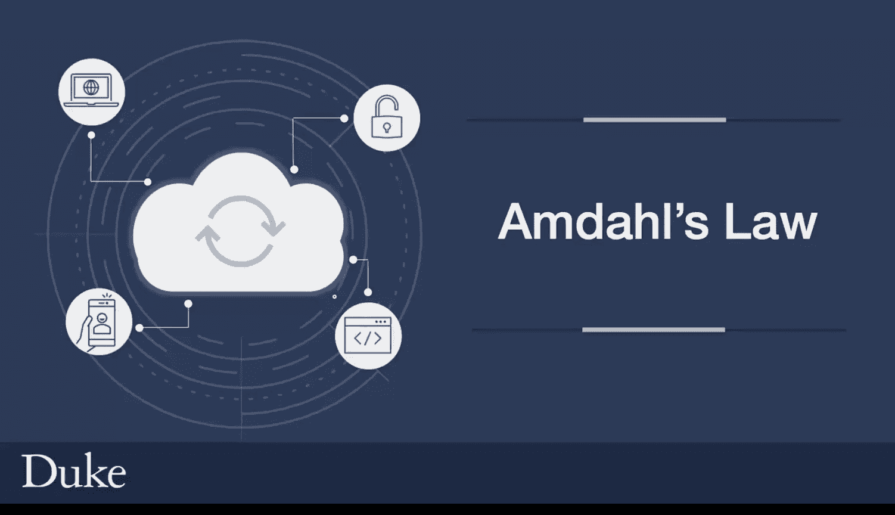
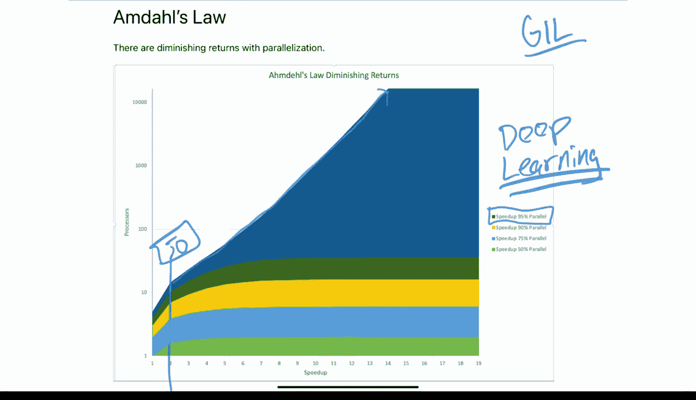

#  015：阿姆达尔定律 📈

在本节课中，我们将要学习阿姆达尔定律。这个定律描述了并行化计算中存在的收益递减现象。我们将探讨其核心概念、影响因素，并理解为何在现实世界中，单纯增加计算核心并不总能带来线性的性能提升。

---

## 什么是阿姆达尔定律？🤔

阿姆达尔定律的核心观点是：并行化带来的性能提升存在收益递减效应。

上一节我们讨论了Python的全局解释器锁（GIL）如何限制多核并行。但即使你使用Java或C#这类没有GIL限制的语言，能够将代码分配到所有核心上，这种收益递减现象依然存在。

## 收益递减现象 📉

从本质上讲，即使对于高度并行的操作（例如，并行度高达95%的深度学习运算），其性能提升也会随着核心数量的增加而递减。最终，即使是高度并行的代码，其加速效果也会达到瓶颈。

以下是一个具体的例子：
*   在高度并行的例子中，性能最初可能翻倍。
*   但在大约50个核心之后，增加核心带来的收益就微乎其微了。
*   即使是高度并行的任务，其加速比也往往是线性的或非常平缓的增长，与核心数量的增加不成正比。

## 并行化的代价与限制 ⚙️

总而言之，并行化的一个重要启示是：由于需要在不同核心之间分配和处理计算任务，这个过程本身就会带来损耗。

以下是并行化过程中常见的开销：
*   你需要对代码进行**锁定**。
*   你需要将任务**分发**到各个核心。
*   事实上，大多数代码并非纯粹并行。代码中可能包含休眠、超时、等待网络响应或等待磁盘I/O等操作。

## 现实世界的应用场景 🌍

在现实世界中，多核编程对于日常任务的投资回报率（ROI）往往并不高。它真正能带来巨大效益的，是那些专门化的任务。

深度学习就是一个典型的例子，它能够通过高度并行的方式获得巨大收益。因此，当你进行并行处理时，收益大小实际上取决于以下两个关键因素：
*   **你正在处理的问题类型**。
*   **你运行代码的环境**，特别是你是否能有效访问所有核心。

但请记住，天下没有免费的午餐。并行化必然会带来收益递减。

---

## 总结 ✨

本节课中我们一起学习了阿姆达尔定律。我们了解到，并行计算虽然能提升性能，但由于任务分发、同步等固有开销，其加速效果存在上限和收益递减规律。这项定律提醒我们，在设计分布式或并行系统时，需要理性评估并行化的潜力，重点关注任务本身的并行度以及运行环境的特性，而不是盲目增加计算资源。