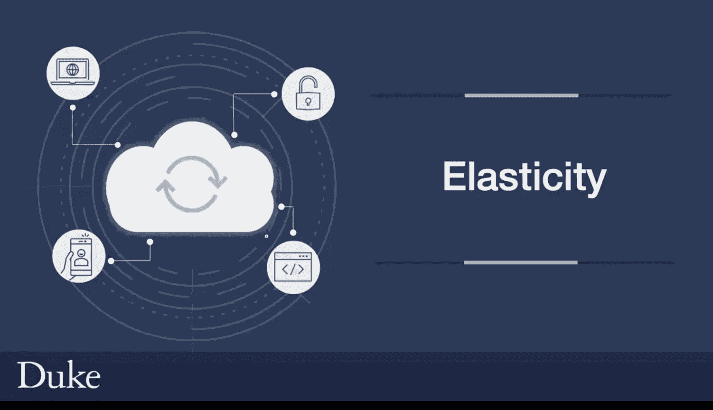
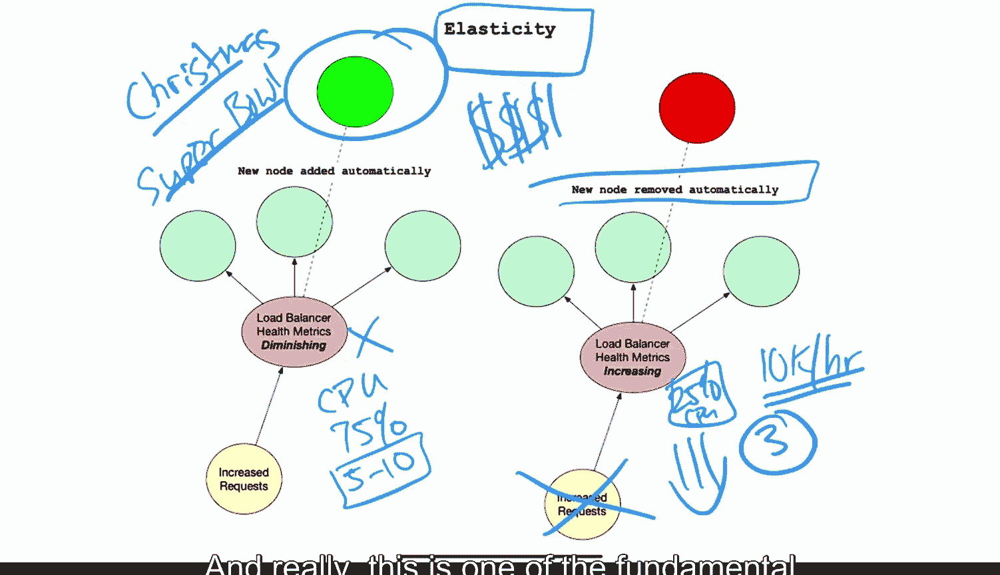
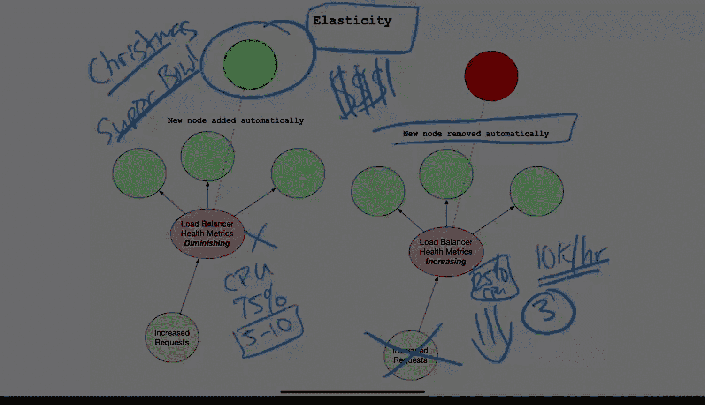

#  016：弹性伸缩

## 📖 概述
在本节课中，我们将要学习云计算中的一个核心概念——弹性伸缩。我们将探讨其重要性、工作原理，以及它如何通过自动扩展和收缩资源来优化成本与性能。

---

## 🔍 什么是弹性伸缩？
弹性伸缩是现代云计算最佳实践的核心属性。它之所以重要，是因为它允许系统根据实际需求动态调整资源。

## 🚀 弹性伸缩的重要性
为了理解弹性伸缩的重要性，我们可以看一个具体的例子。假设这里有一个负载均衡器。随着请求量的增加，系统可以根据每台机器的CPU指标自动添加新节点。

以下是实现自动扩展的一种方法：可以设定一个规则，当任何节点的CPU使用率达到75%时，自动将节点数量从5个扩展到10个。这意味着，如果初始有5个节点，系统可以在触发警报并采取不同措施之前，一直扩展到10个节点。这种机制允许在需求增加时实现完全自动化。

## 🎯 弹性伸缩的应用场景
那么，为什么需要这种机制呢？我们可以举几个例子。例如，在圣诞节期间，零售销售额会激增；或者在美国超级碗期间，流量会暴涨。在这些大型活动期间，与其依赖人工操作并可能出错，不如让基于云的系统自动扩展以满足这些需求。这是在云环境中进行正确工程实践的关键组成部分。如果无法实现这一点，就意味着没有遵循云计算的软件工程最佳实践。

因此，弹性伸缩是衡量你是否在云计算中做了重要事情的关键因素。

## ⬇️ 扩展与收缩
以上我们讨论了扩展的部分。然而，另一种情况是，如果场景中的请求量不是增加而是减少了，会发生什么？假设超级碗结束后，流量回落。如果我仍然维持扩展后的规模，可能会产生高昂的费用，例如每小时一万美元，具体取决于负载。我不希望让所有资源持续运行。

我也可以设置另一条规则。例如，如果机器的CPU使用率降至25%以下，则移除节点，直到数量减少到预设的最小值，比如3个节点。我希望最多只运行3个节点。这样，系统也可以自动收缩。

## 💡 弹性的核心价值
因此，弹性不仅仅意味着能够扩展，也意味着能够收缩。这一切的核心是什么？核心是关于成本。如果你能优化公司的基础设施，使其能够根据需求扩展和收缩，那么作为软件工程师，你对这个组织就非常有价值。因为你自动化了以前需要大量人力来完成的工作。

真正衡量你是否在正确运用云计算的一个基本方式，就是看你的基础设施是否具备弹性。

---

## 📝 总结
本节课中我们一起学习了弹性伸缩的概念。我们了解到，弹性伸缩是云计算的核心，它允许系统根据需求自动增加或减少资源。这不仅提高了系统的可靠性和性能，更重要的是，它通过优化资源使用，为公司节省了成本。掌握并实施弹性伸缩，是实践云计算最佳软件工程的关键一步。