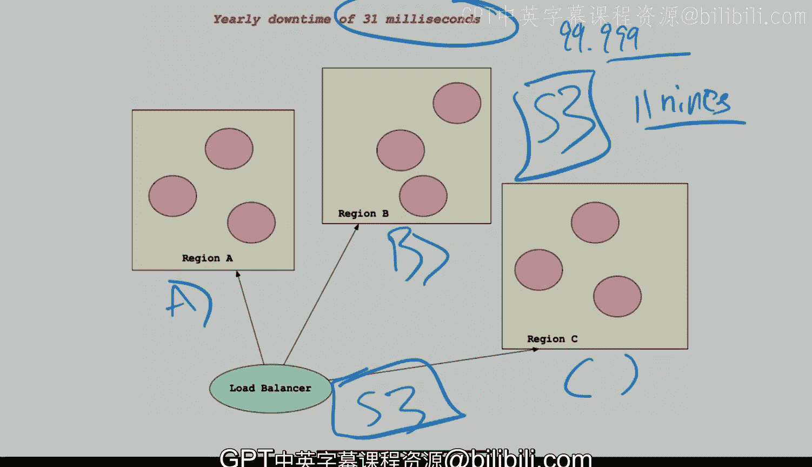

#  017：高可用性与九个九

在本节课中，我们将要学习云计算中的一个核心概念——高可用性。我们将探讨其含义、衡量标准（特别是“九个九”可用性），以及云服务提供商如何实现它。理解这些概念对于设计可靠、稳定的云架构至关重要。

## 什么是高可用性？

高可用性是云计算中的一个关键术语。它指的是你的系统能够提供服务的时间量。

在SaaS系统的服务合同中，你经常会听到高可用性这个术语，以及正常运行时间或服务级别协议。其中，“9”的个数是一个特别重要的衡量指标。

## 理解“九个九”可用性

上一节我们介绍了高可用性的基本概念，本节中我们来看看具体的衡量标准——“9”的可用性。

“9”的可用性意味着系统有99.999...%的可用性，一直可以到“九个九”。这等同于每年仅有31毫秒的停机时间。以亚马逊S3为例，它拥有“十一个九”的可用性。这意味着每年只有大约1毫秒的停机时间。

## 如何实现高可用性？

了解了高可用性的目标后，你可能会问，云提供商是如何做到这一点的呢？

其核心方法是**冗余**与**负载均衡**。以下是实现高可用性的关键步骤：

1.  **数据多副本存储**：同一份数据在全球多个不同的区域存储多次。
2.  **全局分布式架构**：这些副本被放置在全球分布的多个数据中心。
3.  **负载均衡**：用户请求被智能地分发到所有这些不同的区域副本上。

通过这种方式，即使某个区域发生故障，其他区域的副本依然可以提供服务，从而构建出高可用的架构。

## 云计算的优势

对于普通公司而言，自行构建一个如此高可用的基础设施几乎是不可能的。这正是云计算的一大优势所在。

你可以直接使用像亚马逊S3这样的高可用基础设施，将对象存储服务分布到全球。你无需自己构建和维护这套复杂的系统，只需按使用量付费即可。这极大地降低了企业获得顶级可靠性的门槛和成本。

## 总结

本节课中我们一起学习了高可用性的核心知识。我们了解到，高可用性衡量的是系统的服务可用时间，常用“九个九”（如99.999%）等指标来表示，其背后对应着极短的年度停机时间。云服务商通过**数据多区域冗余存储**和**全局负载均衡**来实现这一目标。对于用户而言，云计算使得利用这些高可用的基础设施变得简单且经济，只需按需付费，而无需自行构建。理解这些概念和数字，有助于你评估和选择能够满足业务需求的服务级别。