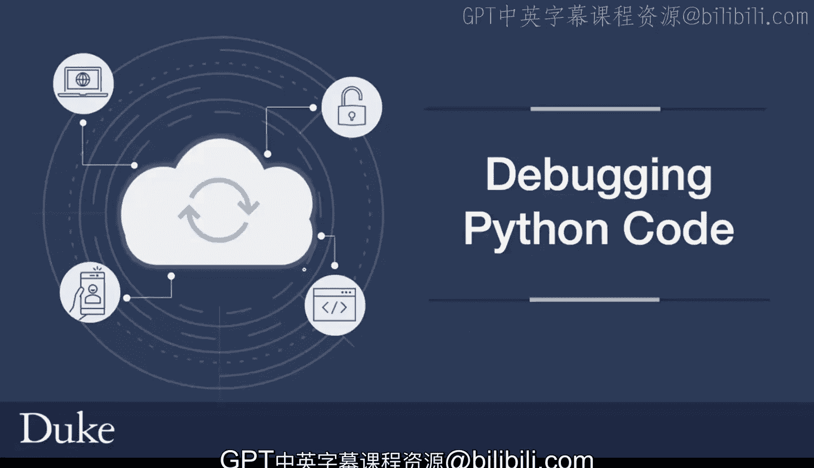
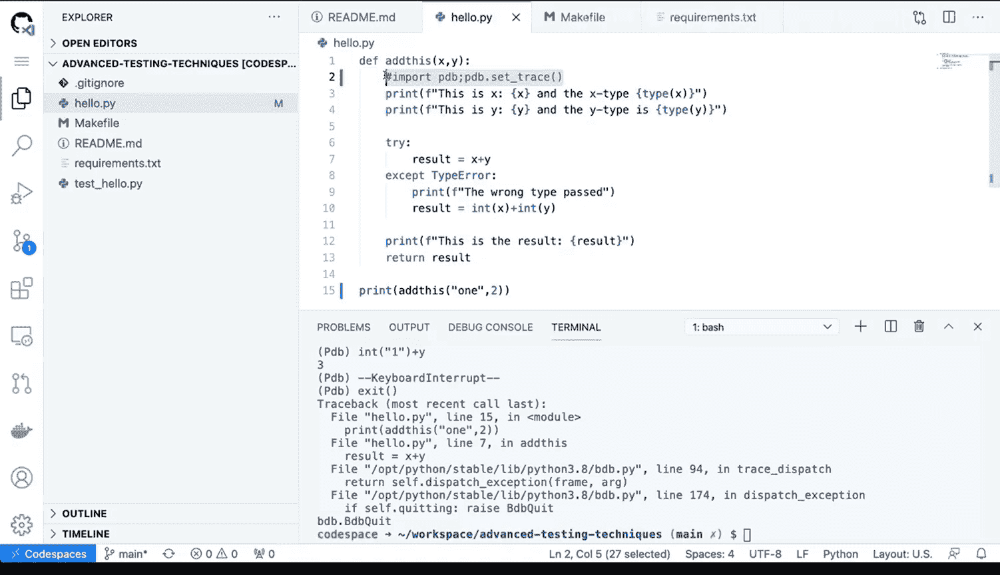

#  018：Python代码调试



## 概述

在本节课中，我们将要学习Python代码调试的核心方法，并了解如何为项目搭建一个包含自动化测试和持续集成的基础环境。我们将从调试理论开始，逐步实践几种关键的调试技术。

## 调试与测试理论框架

上一节我们介绍了课程的整体目标，本节中我们来看看与代码质量和交付相关的核心概念。这些概念可以组织成一个四象限矩阵。

以下是测试与交付相关的核心主题：

*   **构建系统**：用于自动化构建、测试和部署代码的工具链。
*   **工具**：用于提升代码质量的辅助工具，如代码检查器和格式化器。
*   **代码调试**：定位和修复代码中错误的过程。
*   **持续交付**：一种软件开发实践，确保代码可以随时可靠地发布到生产环境。

## 项目环境搭建

理解了核心概念后，我们需要一个实践环境。我们将使用GitHub Codespaces来创建一个云端开发环境，并初始化一个Python项目。

1.  **创建GitHub仓库**：在GitHub上创建一个名为 `advanced-testing-techniques` 的新仓库，并添加README和Python的.gitignore文件。
2.  **启动Codespace**：使用GitHub Codespaces功能，基于新仓库创建一个云端开发环境。
3.  **创建项目脚手架**：在终端中创建项目的基础文件结构。
    ```bash
    touch Makefile requirements.txt hello.py hello_test.py
    ```
4.  **创建并激活虚拟环境**：为项目创建一个独立的Python环境。
    ```bash
    virtualenv ~/.advanced_testing
    source ~/.advanced_testing/bin/activate
    ```

## 配置项目与基础调试

环境准备好后，我们来配置项目依赖并开始实践最基础的调试方法。

首先，编辑 `requirements.txt` 文件，添加一些常用库，例如 `pylint`, `pytest`, `click` 等。然后使用 `Makefile` 来运行安装命令 `make install`。

现在，让我们在 `hello.py` 中编写一个简单的函数，并开始调试。

```python
def add_this(x, y):
    return x + y

if __name__ == "__main__":
    print(add_this(1, 2))
```

运行 `python hello.py`，如果代码有语法错误（例如忘记冒号），会直接报错。这是最直接的错误反馈。

## 核心调试方法 🐛

当代码逻辑出现问题时，我们需要更系统的方法。以下是三种最有效的Python调试方法。

### 方法一：使用打印语句

打印语句是解决大多数问题的首选方法。通过在函数内部打印输入、输出和变量类型，可以快速了解程序状态。

```python
def add_this(x, y):
    print(f"调试信息：x的值是 {x}，类型是 {type(x)}")
    print(f"调试信息：y的值是 {y}，类型是 {type(y)}")
    result = x + y
    print(f"调试信息：计算结果是 {result}")
    return result
```

例如，如果意外传入字符串 `"1"` 和整数 `2`，打印信息会立刻显示类型不匹配，帮助我们定位问题。

### 方法二：使用PDB调试器

对于复杂的、难以通过打印定位的问题，可以使用Python内置的调试器PDB。它允许我们逐行执行代码，并检查任意时刻的变量状态。

在代码中插入 `pdb.set_trace()` 来启动调试器：

```python
import pdb

def add_this(x, y):
    pdb.set_trace()  # 程序运行到这里会暂停，进入调试模式
    result = x + y
    return result
```

在PDB提示符下，你可以使用命令如 `n`（执行下一行）、`c`（继续运行）、`p x`（打印变量x的值）来交互式地调试。

### 方法三：编写测试

预防优于调试。为代码编写自动化测试（如使用 `pytest`）可以从根源上减少错误，并确保代码修改不会破坏原有功能。

创建一个测试文件 `hello_test.py`：

```python
from hello import add_this

def test_add_this_integers():
    assert add_this(1, 2) == 3

def test_add_this_strings_error():
    # 这个测试会失败，帮助我们识别边界情况
    try:
        add_this("1", 2)
        assert False, "Expected a TypeError"
    except TypeError:
        assert True
```

运行 `pytest hello_test.py` 来执行测试。测试不仅能捕获错误，其本身也是描述代码预期行为的文档。

## 总结



本节课中我们一起学习了Python代码调试的核心流程。我们从搭建一个集成了虚拟环境和基础工具的云开发环境开始。接着，我们深入探讨了三种实用的调试方法：使用**打印语句**进行快速排查，利用**PDB调试器**进行交互式深度调试，以及通过**编写自动化测试**来预防错误并保障代码质量。掌握这些方法，你将能有效应对Python开发中的大多数调试场景。