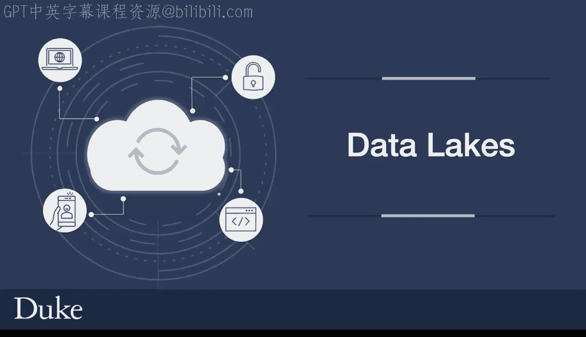
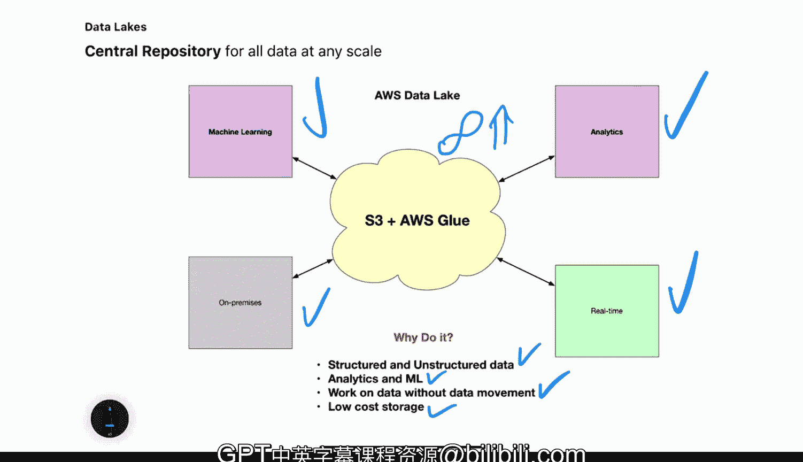

#  021：数据湖

## 概述
在本节课中，我们将要学习大数据领域中的一个核心概念——数据湖。我们将探讨数据湖的定义、核心优势以及它在数据分析、实时处理和机器学习等场景下的应用。

---

## 什么是数据湖？🌊

数据湖是一个用于存储企业所有原始数据的集中式存储库。它的概念类似于自然界中的湖泊。

一个湖泊是一个巨大的水体，为城镇或城市储存水源，人们可以从中捕鱼或获取饮用水。数据湖的概念与此类似，企业的各种数据都流入其中。

数据流入这个中心湖后，可以在数据存储的同一位置进行处理。这是数据湖的一个关键特性。

---

## 数据湖的核心优势与架构

上一节我们介绍了数据湖的基本概念，本节中我们来看看它的核心优势与典型架构。数据湖的核心在于数据无需移动即可被处理。

以下是数据湖架构的几个关键组成部分及其优势：

*   **高可靠与无限扩展**：以亚马逊S3为例，它具有高可靠性，并且在请求处理能力上可以无限扩展。
*   **统一数据分析**：如果你想创建分析仪表板，可以直接访问S3中的数据湖位置，并对数据进行即时分析。
*   **实时流处理**：同样，你也可以在数据流入S3时进行连接，并对数据进行实时处理。

---

## 数据湖的应用场景

理解了数据湖的架构优势后，我们来看看它的具体应用。数据湖支持多样化的数据处理模式。

以下是数据湖的几个主要应用场景：

*   **混合云与数据同步**：你可以拥有一个本地系统或第三方数据中心，并与这个S3位置保持同步。你可以将数据上传到云端，然后让云服务执行某些操作。
*   **机器学习与深度学习**：这是一个关键应用。很多时候，尤其是处理深度学习问题时，在笔记本电脑甚至物理数据中心上运行是不可能的。如果数据已经存在于S3或你使用的任何基于云的数据湖系统中，你的机器学习系统就可以直接访问这些数据，进行处理和训练，然后将模型存回数据湖。

---

## 总结

本节课中我们一起学习了数据湖的概念。其核心理念是，你无需来回移动数据。你可以在数据原地进行工作，执行分析和机器学习任务，同时处理结构化和非结构化数据。数据湖实际上是一种低成本的存储系统，其成本可能远低于自行购买和维护硬件。

