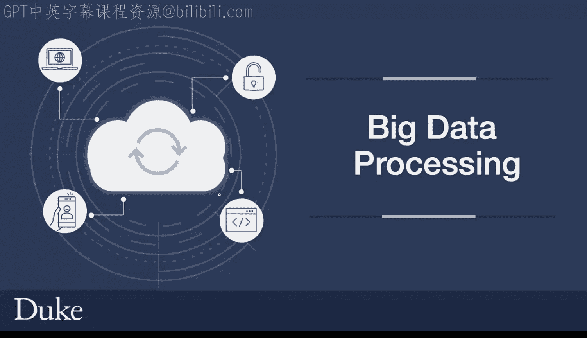
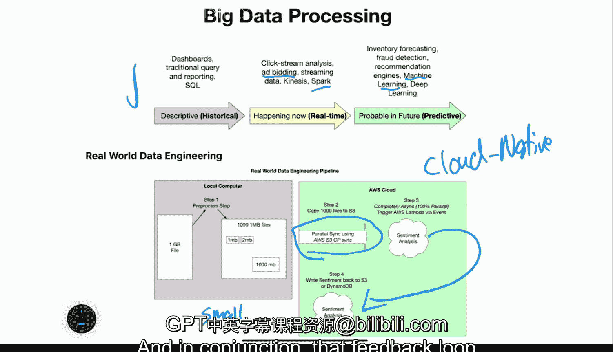

#  022：大数据处理 🚀

在本节课中，我们将要学习一个典型的大数据处理流程。我们将了解数据处理在时间维度上的不同分类，并探讨一个从本地开发扩展到云端的实际数据工程案例。

---

## 大数据处理的时间维度

大数据处理可以根据数据的时间特性分为三个主要类别：历史数据处理、实时数据处理和未来预测处理。每一类都有其独特的工具和技术需求。

上一节我们介绍了大数据处理的基本概念，本节中我们来看看具体的时间分类。

### 历史数据处理 📊

历史数据处理关注过去发生的事件。其目标是报告和分析过去的数据。

以下是历史数据处理的典型应用场景：
*   创建描述性仪表板，展示公司过去的销售数据。
*   分析历史客户数量。

这类处理需要能够高效执行查询的专业化工具。

### 实时数据处理 ⚡

实时数据处理关注当前正在发生的事件。其目标是对即时数据流做出快速响应。

以下是实时数据处理的典型应用场景：
*   广告竞价网络，实时决定出价。
*   使用Spark等工具进行实时预测分析。

### 未来预测处理 🔮

未来预测处理旨在基于数据预测未来趋势或结果。其核心是机器学习和高级分析。

以下是未来预测处理的典型应用场景：
*   机器学习与深度学习模型。
*   欺诈检测系统。
*   推荐引擎。

处理大数据时，必须意识到历史、实时和预测这三种不同维度。由于基于时间处理方式的本质不同，每一类都会使用略有差异的工具和技术。

---

## 一个真实世界的数据工程案例

让我们进一步探讨，看一个真实世界的数据工程问题。很多时候，无论是学生还是组织机构处理数据，流程往往从本地开始，并随着需求增长而扩展到云端。

以下是构建一个情感分析管道的典型步骤：
1.  **本地预处理**：从处理一个1GB的文件开始，在本地计算机上进行数据预处理。
2.  **需求扩展**：逐渐意识到需要使用更专业的工具，因此需要将流程分解为多个步骤。
3.  **数据上云**：执行某种并行复制操作，例如将一千个文件复制到S3数据湖中。
4.  **自动触发分析**：配置一个情感分析系统，使其在文件复制到S3的事件上自动触发。
5.  **结果存储**：将情感分析的结果存储到键值数据库中以供查询。

这是一个处理真实世界数据工程管道时的自然工作流程。它始于小规模的本地处理，但随着现实需求的引入，云原生工具被用来解决流程中的其他环节。

另一个关键要点是，大数据处理通常涉及笔记本电脑和云平台的协同工作。这种反馈循环共同构成了完整的大数据处理管道。

---

本节课中我们一起学习了大数据处理的三个时间维度：历史、实时和预测。我们还通过一个从本地扩展到云端的情感分析管道案例，了解了真实世界数据工程项目的典型演进路径。理解这些概念对于设计和构建可扩展的云计算解决方案至关重要。