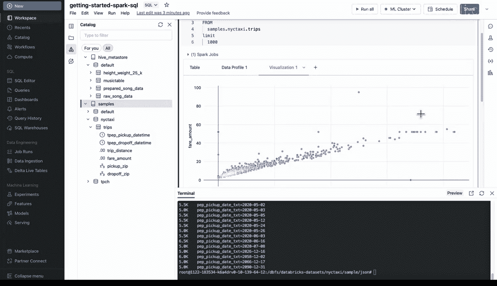

#  025：使用 Databricks Spark SQL 转换数据

在本节课中，我们将学习如何使用 Databricks 平台上的 Spark SQL 来查询和探索数据。我们将从浏览文件系统开始，然后执行 SQL 查询，最后利用数据分析和可视化工具来理解数据。

## 开始使用 Spark SQL

Spark SQL 是一种使用 SQL 语言查询整个 Databricks 文件系统的方法。

让我们首先查看这里的目录。

如果查看此处，可以看到这些目录，以及示例数据。我们看到 `sample`、`default`、`New York Taxi`、`TPCH`。

我们也可以从另一个视图查看。如果打开底部面板。

它提供了从终端进行查询的能力。如果我输入 `ls dbfs:`。

这个命令会显示 Databricks 文件系统内部的内容。

我也可以查看实际的数据集。我们可以输入 `datasets`。

如果我想查看，例如，`nyc.sample`。我们可以看到，实际上，数据就存储在那里。

我甚至可以 `cd` 进入该目录。执行最后的导航命令进入。

然后我们可以看到，例如，有一个包含 JSON 文件的目录。在里面。

有许多不同的文件。实际上，我可以执行 `du` 命令。

这个命令会显示整个示例数据集的大小。

我们也可以单独查看，可以看到文件大小差异很大，例如 70 MB、105 MB。

这是一个很好的方式来探索和了解本地 Databricks 文件系统的情况。

但我们也可以用 SQL 来查询它。SQL 是我们的默认语言。

如果我进入这里。我可以输入 `SELECT *`。

我们可以说 `FROM`。我们可以指定 `samples` 数据库。我们将查询 `nyc_taxi` 数据。

让我们查看 `trips` 表。我们执行查询，并 `LIMIT` 结果，只获取大约 1000 行。

现在，这是一个 SQL 查询，但我可以使用笔记本的高级功能来稍微清理一下格式，让它看起来更好。

如果我点击这里的这个选项。它会运行查询。

但我想选择这个选项，它写着 `Format SQL`。让我们运行它。

好了。现在我们有了一个格式更好的 SQL 查询。然后如果我运行这个查询。

将会启动一个大型的 Spark 作业，我甚至可以检查它的运行情况。

总的来说，好处在于我能够查看这些数据，查看不同的视图，例如排序。我还可以做另一件事。

点击这个加号图标，有两种模式可以深入探索。

我们可以进入可视化模式，这通常是一个很好的起点，或者进入数据概要分析模式。

让我们先进行数据概要分析，这样我们可以找到诸如描述性统计信息，这通常是我查看数据时首先想做的。

我想了解这里发生了什么，我们可以看到特定列的标准偏差是某个值。

我可以查看中位数，对于某些列可能没有意义。

但对于这里的行程距离，我们可以看到中位数是 1.63。

这很有趣。我们可以看到数据严重偏向极短的行程。同时，我们可以查看车费金额，分布更广一些。

虽然仍有偏斜，但我们可以看到车费的中位数是 9。

然后，如果我们查看上车邮政编码或下车邮政编码，我们可以通过数据概要分析来感受数据，这非常方便。

不过，我们也可以点击这个加号进行可视化。

让我们也进行可视化。

让我们从比条形图更有趣的内容开始。我们可以查看散点图或气泡图，让我们做气泡图。

然后我们可以选择要在散点图上展示的内容。如果我们浏览这里。

我们可以选择，例如，行程距离和车费金额，这些比较有意思。好了。

我们得到了一个不错的对数关系图。在达到某个点之前，它是线性的。

从这里开始，似乎进入了对数曲线。这可能是因为一旦你到达城市的某个特定区域。

可能是固定费率之类的。但总的来说。

通过查看这个，我们能够获得一个很好的可视化效果。

如果我愿意，我还可以点击保存。然后我就能够在笔记本中保存这个可视化。

这是一个为组织立即创造价值的绝佳方式。

可以看到，使用 SQL 并不太难。进行一些描述性统计。

获得一些很棒的可视化效果，显然，如果我点击这里的分享。

我可以与组织中的其他人分享这个可视化。

在本节课中，我们一起学习了如何使用 Databricks 的 Spark SQL 来探索和查询数据。我们从浏览文件系统和数据集开始，然后执行了 SQL 查询来获取数据样本。接着，我们利用数据概要分析功能来获取关键统计信息（如中位数和标准偏差），以理解数据分布。最后，我们创建了可视化图表（如气泡图）来直观地探索变量之间的关系（如行程距离与车费）。这些步骤展示了如何快速上手，并使用 SQL 和内置工具从数据中获取洞察。