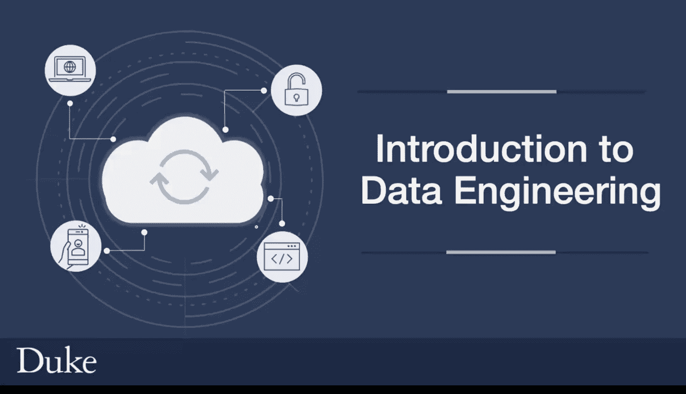
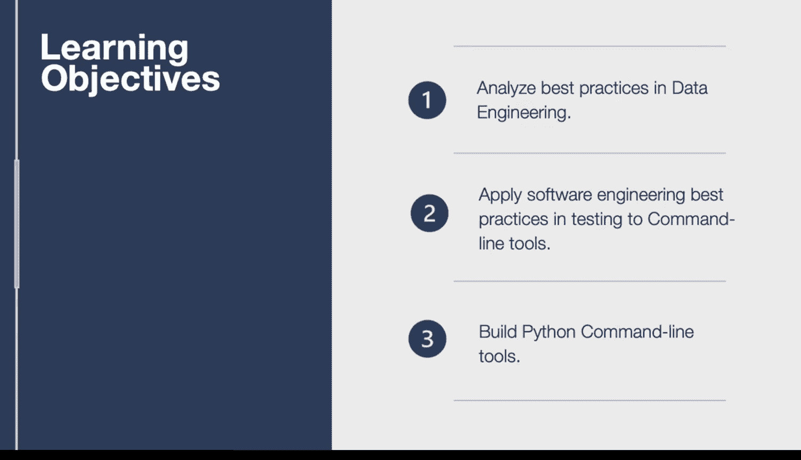

#  026：课程概述与学习目标 🎯

在本节课中，我们将要学习数据工程的基础概念，并探索构建健壮数据处理工具的核心技能。我们将从宏观视角理解数据工程，然后深入探讨不同类型的数据处理模式，并最终学习如何利用现代Python工具链来构建和测试命令行工具。



## 什么是数据工程？

数据工程是设计、构建和维护数据基础设施与管道的实践。它确保数据能够被可靠地、高效地从源头移动到存储系统，并最终为数据分析、机器学习等下游应用提供支持。

上一节我们介绍了数据工程的基本定义，本节中我们来看看数据处理的不同模式。

## 批处理 vs. 流处理 vs. 事件处理

数据工程问题可以根据数据处理的时间特性分为不同类型。以下是三种主要模式：

*   **批处理**：定期（例如，每天或每月）对累积的数据块进行处理。其核心思想是**在固定的时间间隔处理一批数据**。
*   **流处理**：在数据到达时持续不断地进行处理。其核心思想是**实时或近实时地处理连续的数据流**。
*   **事件处理**：响应特定的事件或触发器进行处理，通常与消息队列和微服务架构相关。

理解了数据处理的基本模式后，我们将聚焦于一个关键技能：构建可靠的数据处理工具。

## 构建命令行工具

在数据工程中，命令行工具是自动化数据管道任务（如数据提取、转换、加载）的基石。我们将学习使用Python的`click`框架来构建强大且用户友好的命令行工具。

以下是使用`click`创建一个简单命令行工具的示例代码：

```python
import click

@click.command()
@click.option('--count', default=1, help='Number of greetings.')
@click.option('--name', prompt='Your name', help='The person to greet.')
def hello(count, name):
    """Simple program that greets NAME for a total of COUNT times."""
    for _ in range(count):
        click.echo(f"Hello, {name}!")

if __name__ == '__main__':
    hello()
```

掌握了基础命令行工具构建后，我们进一步探讨如何将其现代化和标准化。

## 容器化命令行工具

容器化是一种将应用程序及其所有依赖项打包在一起的技术。对于数据工程和机器学习工程，容器化命令行工具能确保环境一致性，简化部署。

其核心优势可以用一个**公式**表示：**应用代码 + 运行环境依赖 = 可移植的容器镜像**。这意味着工具在任何支持容器的系统上都能以相同的方式运行。

构建出工具后，确保其质量至关重要。接下来我们将学习如何对其进行全面测试。

## 高级代码测试技术

将软件工程的最佳实践应用于数据工程工具，特别是测试，是保证管道可靠性的关键。我们将涵盖多种测试方法。

以下是几种核心的测试类型：

*   **单元测试**：使用如`pytest`框架测试单个函数或模块。
*   **功能测试**：验证整个命令行工具按预期执行。
*   **命令行测试运行器**：使用工具模拟用户输入并检查输出。

学习了测试方法后，我们将完成一个完整的实践循环。

## 将函数映射为命令行工具

本节将综合运用所学知识，演示如何将一个纯粹的数据处理Python函数，通过`click`装饰器、参数解析和容器化，转变为一个生产就绪的、可测试的命令行工具。这体现了从开发到部署的端到端工作流程。



---


本节课中我们一起学习了数据工程的核心概念，区分了批处理、流处理和事件处理。我们重点掌握了使用Python `click`框架构建命令行工具的方法，探讨了通过容器化提升工具可移植性的现代实践，并学习了应用`pytest`等进行全面测试以确保代码质量。这些技能是构建可靠、可维护的大规模数据解决方案的基础。