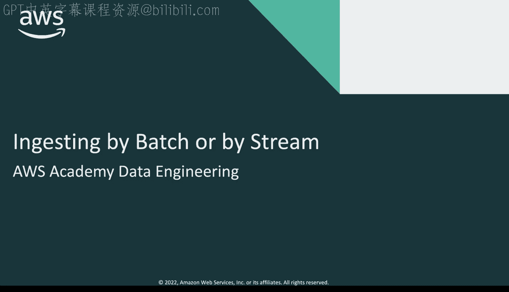
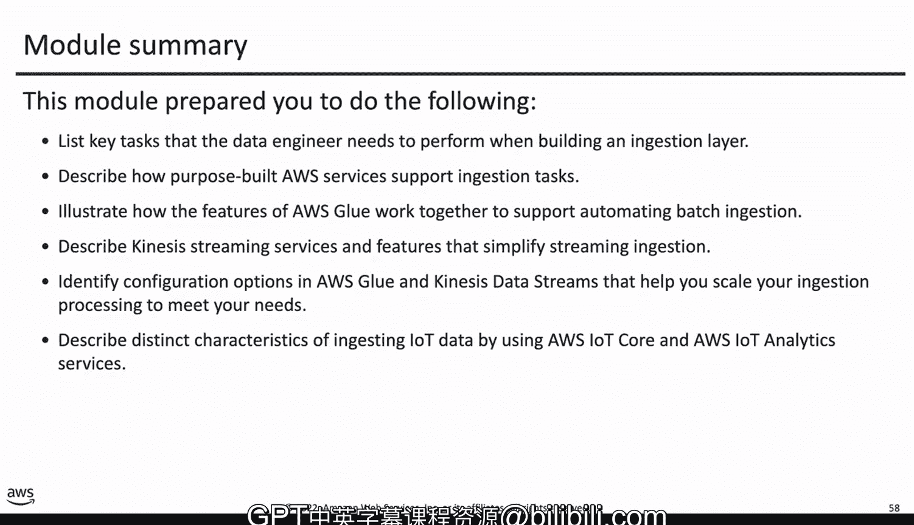

#  030：批处理与流式数据摄取

在本节课中，我们将要学习数据工程中的核心概念：批处理与流式数据摄取。我们将探讨两者的区别、适用场景，并详细介绍AWS提供的相关服务，如Glue、Kinesis和IoT服务，以帮助你构建高效的数据管道。

## 概述：批处理与流式处理

首先，我们来谈谈批处理和流式处理的含义。数据工程师的关键任务之一是设计数据摄取流程。你可以使用AWS服务，如Glue和Kinesis。流式处理也可以通过Amazon Kinesis Streams提供帮助。我们还将简要讨论IoT Core和IoT Analytics。

## 批处理与流式处理工作流的区别

上一节我们介绍了数据摄取的基本概念，本节中我们来看看批处理和流式处理工作流的具体区别。

**批处理摄取**涉及运行批处理作业，这些作业查询数据源，将结果数据移动到管道中的持久存储，然后执行转换。批处理作业可以按需启动、按计划启动或由事件触发。这是过去几十年来许多数据处理任务的经典方式。例如，仪表板非常适合批处理，而传统的提取、转换、加载（ETL）过程就使用批处理。

**流式处理**则不同。一旦流处于活动状态，记录可以持续到达并被放入流中。然后，消费者从流中读取记录并在一个滑动时间窗口内处理它们。这意味着数据可以立即用于实时分析。

以下是驱动选择批处理还是流式处理的关键因素：
*   **数据量**：管道在特定时间间隔内需要处理的数据量。
*   **数据到达模式**：例如，需要摄取持续不断的数据流，还是定期到达的较大单个记录。这两种情况都涉及高数据量，但数据到达的速度（即速度）截然不同。

因此，我们可以这样总结两者的核心差异：
*   **批处理**：运行作业以查询数据源、转换数据并加载到管道中。传统ETL即用于此目的。
*   **流式处理**：记录持续到达并被放入流中，消费者在数据可用时立即处理。流式摄取的一大优势是能够立即审查结果并采取行动，数据可以低延迟地准备好进行分析。流式处理的理念是处理**高容量、高速度的非结构化数据**。

## 深入探讨批处理

现在，让我们更详细地探讨批处理。

数据摄取和准备过程通常包括以下步骤：连接数据源并选择要摄取的数据；识别源模式并定义目标模式以正确映射字段；安全地将数据传输到管道中；然后执行转换并将处理后的数据加载到持久存储中。

这里的核心思想是，你每月执行一系列任务，并编写脚本来执行这些步骤。为了避免在命令行上重复操作，你需要一种自动化的方式。

考虑到开发框架的需求，我们需要灵活性，同时也希望非开发人员能够使用。因此，需要考虑许多不同的参数。确保处理效率和数据完整性的一个方法是使用编排工具来处理作业间的依赖关系。这是数据处理中的一个重大问题：你不仅需要自动化，还需要管理依赖关系。

因此，**批处理摄取**允许你编写脚本来执行ETL并创建作业。**工作流编排**将帮助你管理作业的依赖关系并处理故障管理。在选择批处理摄取组件时，你需要考虑：需要使用该系统的团队、要摄取的数据量和类型，以及扩展性和成本结构是否适合你的用例。

### 数据源与批处理选项

以下是几种可以考虑的批处理数据源和选项：
*   **Amazon AppFlow**：一项SaaS服务，可用于创建从SaaS源读取数据的连接并进行筛选。它可以对记录执行验证，并安全地将数据传输到S3。
*   **AWS DMS（数据库迁移服务）**：可以指向数据库等数据源，进行筛选和表映射，然后将其摄取到AWS内部数据库中。这对于将其他云中的数据库迁移到AWS平台非常有效。
*   **AWS DataSync**：从文件系统摄取数据的好方法。你可以对文件子集添加筛选器，在自管理存储系统和存储服务之间传输数据，并使用CloudWatch指标监控文件传输性能。
*   **AWS Data Exchange**：允许你查找和订阅数据源，预览数据字典，将数据集复制到S3，并接收来自AWS Data Exchange的事件。

关键要点是：摄取工具的选择很大程度上取决于你使用的数据类型。Data Exchange简化了查找和使用第三方数据集的过程。

### 使用AWS Glue进行批处理

接下来，我们谈谈用于批处理摄取的AWS Glue。

Glue是一项出色的服务，因为它允许你自动化并执行ETL操作，并轻松地将它们放入你的管道中。其优势之一是能够从半结构化数据自动生成模式。

Glue系统的一个优点是，你可以将其指向S3或数据库等数据源，然后创建模式。它还与Athena等其他服务集成，允许你编排复杂的ETL任务，并让你能够监控、排查问题等。

Glue Data Catalog存储元数据，包括模式。这让你可以查看数据类型等信息。一旦有了元数据，你就可以执行各种强大的操作。

Glue Studio提供了一个用于创作ETL作业的图形用户界面（GUI）。这意味着你可以从S3、Kinesis或JDBC源拉取数据，进行转换、采样，并通过模式指定目标。你还可以查看托管作业等。AWS Glue运行时也使用开源的Apache Spark系统。

以下是使用Glue进行ETL时需要考虑的几点：
*   你可以用它来设计多作业或多爬网程序的ETL流程。
*   你可以按需或按计划运行工作流。
*   你还可以使用作业书签，以便在按计划间隔重新运行时处理新数据。
*   它与CloudTrail集成，因此可以记录谁在做什么，这对于数据治理非常有用。

简而言之，Glue通过以下特性简化了ETL：它可以生成目录模式信息，自动创建ETL脚本，然后在Apache Spark运行时中运行这些批处理作业。

### 批处理的扩展性

现在，我们来谈谈批处理的扩展性。批处理的一个问题是，你需要在特定的时间范围内完成作业，并且希望在给定的预算内以高准确性完成。这时你需要弄清楚一些细节。你可以在初始扩展时进行最佳猜测，或者让一些自动扩展功能为你处理。

实现这一点的一种方法是使用Glue自动扩展。使用Glue自动扩展，你只需为ETL作业时间付费，而不是手动处理。

数据处理单元（DPU）是衡量单位，单个DPU相当于一个工作线程。Glue有几种不同类型的工作线程，它们针对不同类型的问题。例如，如果你想避免内存不足错误，可以选择内存更大的工作线程。

在考虑文件大小和压缩的权衡时，文件格式通常是影响实际效果的重要因素。Spark可以并行处理许多文件，但这会增加一些开销，而处理单个大文件则可能不同。Apache Parquet是一个很好的权衡例子，因为它是一种可分割的文件格式，并且是开源的。你也可以使用这种格式来扩展工作线程。

需要考虑的是，批处理的性能目标应侧重于具体用例。Glue作业提供了水平扩展（增加工作线程数量）或垂直扩展（增加单个工作线程资源）的选项。

## 深入探讨流式处理

上一节我们详细讨论了批处理，本节中我们来看看流式处理管道。

流式管道的主要思想是：生产者将记录放入流中，流提供持久存储，然后消费者从流中读取记录并以批次方式处理它们。这被称为生产者-消费者工作流。流式管道支持对高速数据的实时处理。随着数据流经摄取、处理和分析阶段，它们会独立且松散地耦合构建组件。

我们可以将Amazon Kinesis Data Streams视为满足传统流式服务特征的流式服务。生产者将数据放入Kinesis数据流中，该流为该数据提供持久存储。多个生产者可以向流中写入数据，消费者可以从流中获取数据并进行处理。流本质上是传入数据与数据处理器之间的缓冲区，一个流可以有多个消费者。

Kinesis数据流由数据记录组成，记录存储在分片中。记录可以具有唯一的序列号、分区键和数据块。我们可以使用Amazon Kinesis Client Library（KCL）从流中读取数据并进行处理。AWS Lambda函数也可以是流的消费者。

流式处理默认以安全的方式摄取和处理数据。你还可以配置Kinesis使用AWS身份和访问管理（IAM）策略来授予访问权限，并自动加密敏感数据。

Kinesis Data Firehose旨在将流数据摄取并传送到Amazon S3上的数据湖，并处理数据存储和分析服务，如Redshift和Amazon OpenSearch Service。Kinesis Data Firehose还能够运行内置的转换。

Kinesis Data Firehose的一个常见用例是将数据流式传输到数据湖，然后将其转换为分析所需的格式，而无需执行其他操作，这是一个非常有用的用例。

Kinesis Data Analytics是一个专为流数据构建的分析系统。它还具有滑动时间窗口功能，然后你可以将结果写入像OpenSearch Service这样的服务。Apache Flink是处理流数据的流行框架。基本上，Kinesis Data Analytics为Flink应用程序提供了底层基础设施，这意味着它将处理核心功能，如配置计算资源和自动扩展。你可以使用Java、Scala或SQL来编写Flink应用程序。还有Kinesis Data Analytics Studio，它可以为你运行和生成Flink应用程序，这意味着你可以使用笔记本，并使用SQL、Python和Scala。

总结一下流式处理：
*   流记录存储在分片中，包含序列号、分区键和数据块。
*   Kinesis Producer Library（KPL）简化了将记录放入Kinesis数据流的编写生产者的过程。
*   Kinesis Data Firehose旨在将流数据直接传送到存储。
*   Kinesis Data Analytics是一个专为对流数据执行实时分析而构建的系统。

### 流式处理的扩展特性

流式处理的扩展特性是什么？基本上，这是一种使用指标来检查处理是否受到限制的思考方式。如果你考虑这如何表明需要读写容量，这些指标将突出显示过期的记录，然后你可以确保你的流运行时间足够长，以便消费者获取并处理数据。

对于Kinesis数据流，保留期是一个关键组件。默认是24小时，但你甚至可以将其增加到365天。写入容量由分配给流的分片数量控制。读取容量通过消费者的吞吐量来扩展。

CloudTrail和CloudWatch与Kinesis数据流集成，这意味着你可以查看Kinesis数据流的指标，并据此调整扩展考虑因素。Kinesis数据流允许你扩展数据在流上保留的时间、流的读取容量和流的写入容量。

## IoT数据摄取

IoT数据通常通过流式摄取，但也可以允许你通过批处理摄取数据，这取决于你的具体调整。现在，让我们深入了解一下IoT需要考虑的一些事项，可以分为五类：
1.  **设备**：硬件，如带有微控制器或CPU内存的设备。
2.  **接口**：可以是传感器。
3.  **通信**：可以通过协议进行通信，如HTTP协议。
4.  **云服务**。
5.  **应用程序**。

IoT系统使用MQTT（消息队列遥测传输）协议，它采用发布-订阅模型，将消息创建者与消息消费者解耦。这意味着发布者不需要了解订阅者的任何信息，他们只需发布到主题。

借助AWS IoT Core，你可以连接、处理设备数据并据此执行操作，即使设备处于离线状态。这意味着IoT Core是AWS上IoT的核心。

关于IoT Core需要考虑的一些事项：
*   **设备网关**：是IoT设备连接到AWS的入口点。
*   **消息代理**：为设备提供安全机制。
*   **注册表**：静态元数据的目录。
*   **规则引擎**：使用规则操作。
*   **身份服务**：在AWS云中提供安全性的共同责任。

需要考虑的是，Kinesis Data Firehose可以将数据插入DynamoDB表。一个常见场景是，Amazon S3中的IoT数据将流入Kinesis流式服务，流式管道也将与Kinesis一起用于流处理。这实际上是IoT反馈循环的一部分。

IoT Analytics包含多个组件：
*   **通道**：从主题收集数据。
*   **管道**：从通道消费消息并对其进行处理。
*   **数据存储**：管道将处理后的消息存储在数据存储中。数据存储不像数据库，它基本上类似于S3存储桶。
*   **数据集**：通过创建数据集从数据存储中检索数据，该数据甚至可以包含用于查询的SQL。
*   **查询**：最后，你可以使用IoT Analytics并从Amazon QuickSight查询你的数据。

IoT设备使用发布-订阅模型相互通信。在发布-订阅模型中，发布者将消息发送到主题，订阅者订阅该主题。

## 总结

本节课中我们一起学习了构建支持批处理或流式处理的摄取层的过程。我们还讨论了涉及的不同AWS服务，包括简化批处理摄取任务的方法，如Amazon AppFlow、AWS DMS、AWS DataSync和AWS Data Exchange。我们还探讨了AWS Glue以及如何使用它来自动化批处理摄取。我们研究了Kinesis系列产品的一些特性，并介绍了使用AWS Glue、Kinesis数据流可以做什么。最后，我们讨论了AWS IoT Core和AWS IoT Analytics，这些服务与之前的服务相结合，构成了摄取和转换流式IoT数据的一部分。