#  031：使用Click构建CLI工具


## 概述 📖

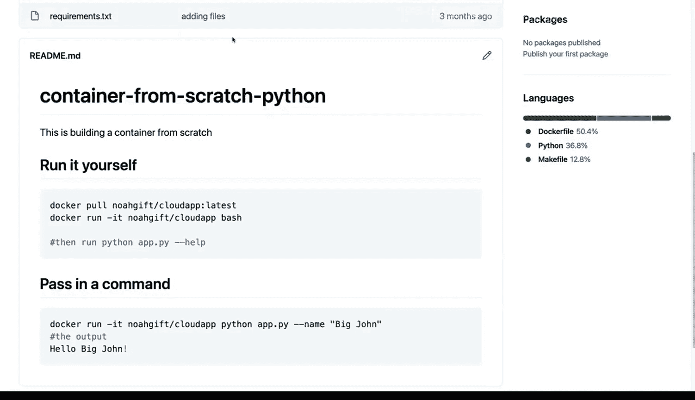


在本节课中，我们将学习如何利用GitHub的现代化开发工具链，构建一个专业的Python命令行工具。我们将使用GitHub Codespaces作为云端开发环境，结合GitHub Actions实现持续集成/持续部署，并使用Click库来构建功能强大的命令行界面。整个过程将遵循DevOps的最佳实践，确保代码质量和自动化流程。

---

## 使用GitHub Codespaces搭建云端开发环境 💻

我们将使用GitHub，并利用名为Codespaces的功能来构建命令行工具。Codespaces是一个开发环境，允许你直接在GitHub内部进行工作。

上一节我们介绍了课程目标，本节中我们来看看如何搭建开发环境。

首先，我需要访问一个GitHub仓库。我将创建一个全新的仓库来演示这个过程。

以下是创建新仓库的步骤：
*   点击“New”按钮创建新仓库。
*   将仓库命名为“Codespace-Devops”。
*   添加描述：“This is a Python for DevOps codespace repo”。
*   勾选“Add a README file”选项。
*   添加一个针对Python的`.gitignore`文件。
*   点击“Create repository”完成创建。

创建完成后，我就可以使用Codespaces了。虽然它目前处于测试阶段，但其功能已经相当完善。Codespaces允许我在GitHub内部的Docker容器中编写代码，这个概念类似于AWS Cloud9或Google Cloud Shell。

在仓库页面，我点击“Code”按钮下的“Codespaces”标签页，然后选择“Create codespace on main”。这将为我创建一个基于Visual Studio Code的云端开发环境。对于DevOps工作而言，这种基于浏览器的开发流程非常高效。

## 配置GitHub Actions实现CI/CD 🔄

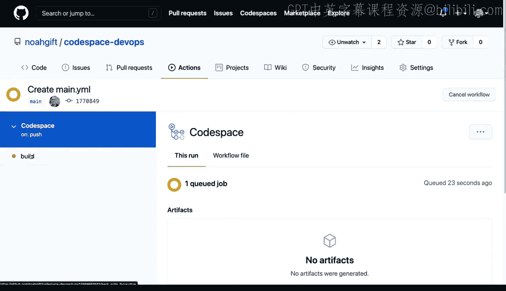

上一节我们搭建了云端开发环境，本节中我们来看看如何配置自动化构建流程。

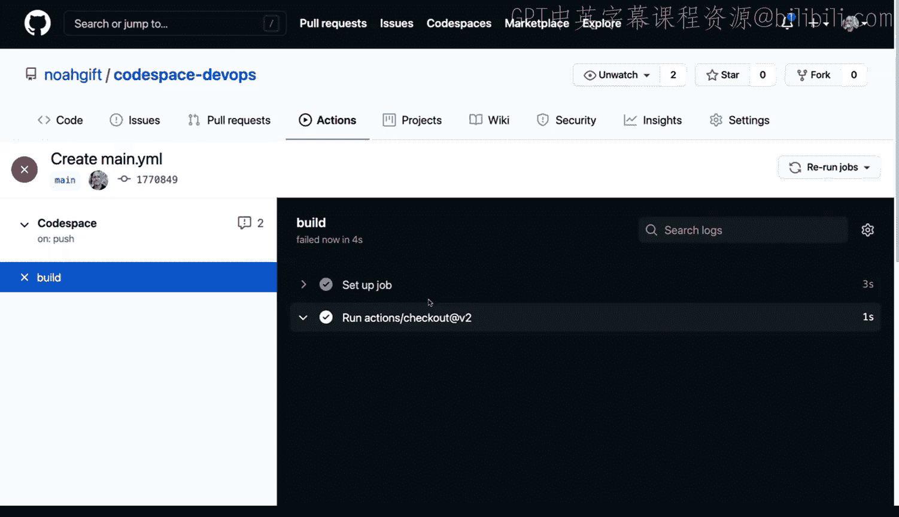

接下来，我将设置GitHub Actions集成，以实现持续集成。这不是测试功能，任何人都可以使用。

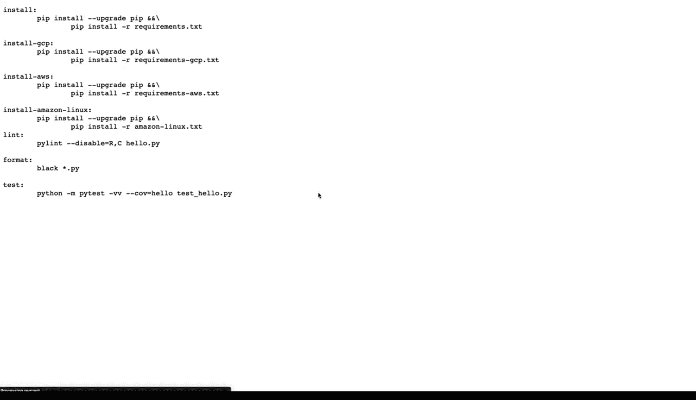


我将为这个仓库设置一个新的工作流。我可以从一个已有的示例项目中复制一个工作流配置作为模板。

以下是初始的GitHub Actions工作流配置步骤：
*   在仓库中创建 `.github/workflows` 目录。
*   在该目录下创建一个YAML文件，例如 `ci.yml`。
*   从示例中复制基础工作流配置。
*   将工作流名称修改为“codespace”。
*   确保使用的Python版本是3.8。
*   定义一个安装依赖项的步骤，这里计划使用 `make install` 命令。

提交这个工作流文件后，GitHub Actions会自动触发第一次构建。不出意外，这次构建会在 `make install` 步骤失败，因为我们还没有创建 `Makefile` 和项目依赖文件。

## 构建Python项目基础结构 🏗️

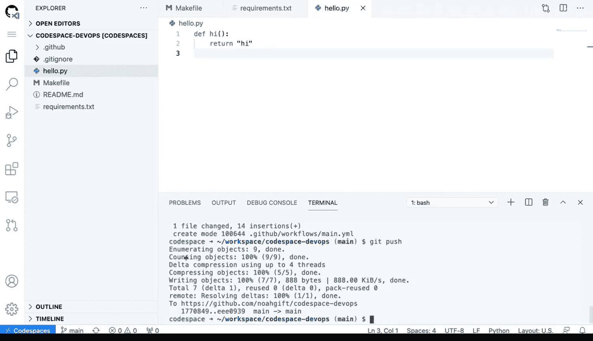

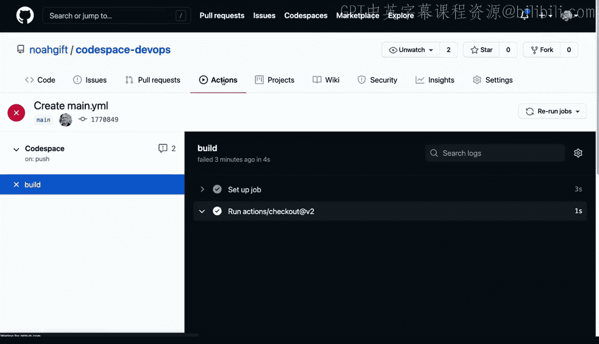

上一节我们的CI流程因缺少文件而失败，本节中我们来完善项目的基础结构。

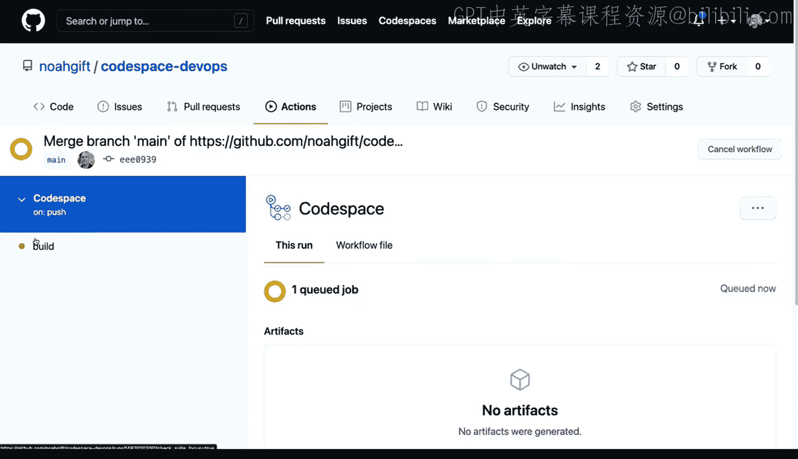

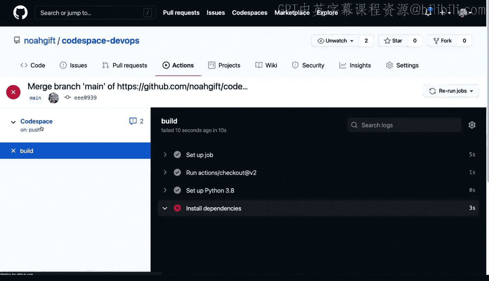

现在，我需要回到Codespaces环境中，创建项目所需的基础文件，以便 `make install` 能够成功执行。

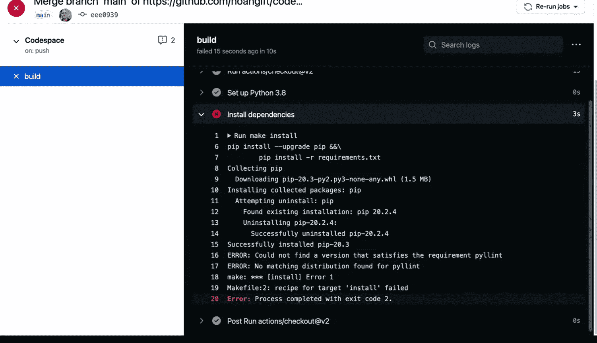

首先，我创建一个 `Makefile`。我通常会为Python项目准备一个包含安装、代码检查、格式化和测试等步骤的Makefile。

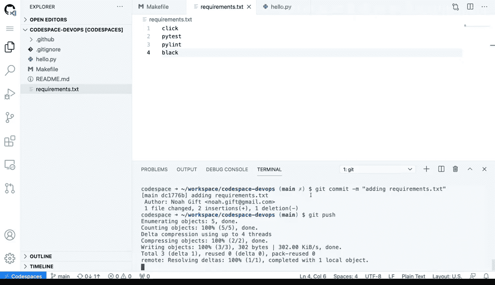

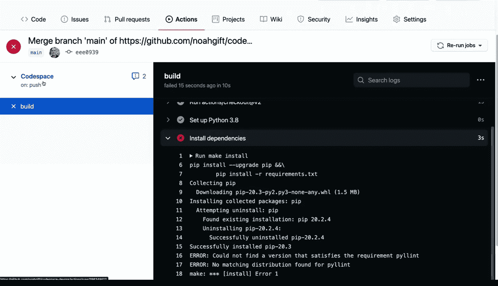

以下是 `Makefile` 的核心内容：
```makefile
install:
    pip install -r requirements.txt

lint:
    pylint --disable=R,C hello.py

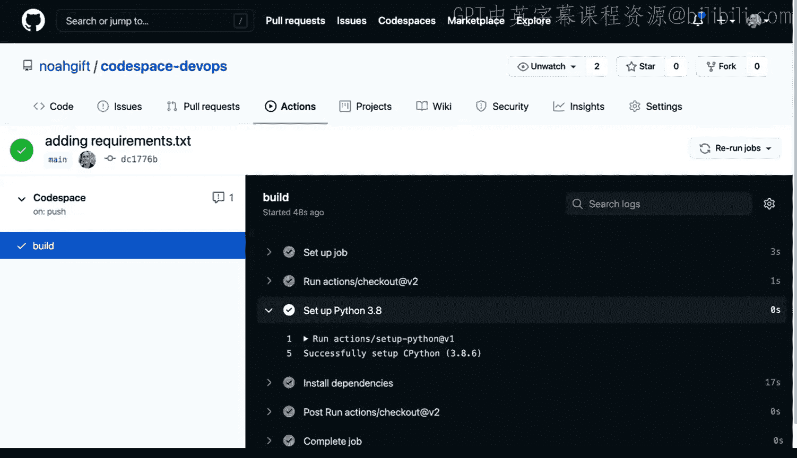

test:
    python -m pytest -v --cov=hello test_hello.py

format:
    black *.py
```

接着，我需要创建 `requirements.txt` 文件，列出项目依赖。对于命令行工具，`click` 库是核心。此外，我们还需要测试和代码检查工具。

以下是 `requirements.txt` 文件的内容：
```
click
pytest
pylint
black
pytest-cov
```

然后，我创建一个基础的Python脚本文件 `hello.py`，目前它只包含一个简单的函数。最后，使用Git命令将这些文件添加到仓库并推送。推送后，GitHub Actions会再次运行，这次应该能成功安装依赖。

## 创建虚拟环境与开发CLI工具 🛠️

上一节我们配置了项目依赖，本节中我们开始在隔离的环境中开发命令行工具。

在Codespaces中，系统自带的Python版本可能与我们项目所需的不一致。为了隔离开发环境，最佳实践是创建一个Python虚拟环境。

在终端中，我运行以下命令来创建并激活虚拟环境：
```bash
python3 -m venv ~/.codespace-venv
source ~/.codespace-venv/bin/activate
```
激活后，使用 `which python` 命令可以确认当前使用的是虚拟环境中的Python解释器。现在，我可以运行 `make install` 来在虚拟环境中安装项目依赖。

依赖安装完成后，就可以开始构建命令行工具了。我将使用 `click` 库来创建一个功能强大的CLI。这里我计划构建一个用于在文件系统中搜索特定类型文件的工具。

以下是使用Click构建的搜索工具的核心代码框架：
```python
import click
import glob

@click.command()
@click.option('--path', default='.', help='Path to search')
@click.option('--ftype', default='*', help='File type to search')
def search(path, ftype):
    """A tool that searches for patterns like *.csv"""
    results = glob.glob(f'{path}/**/*.{ftype}', recursive=True)
    click.echo(click.style('Found files:', fg='red'))
    for result in results:
        click.echo(click.style(result, fg='blue'))

if __name__ == '__main__':
    search()
```
通过 `@click.command()` 和 `@click.option()` 装饰器，可以轻松定义命令和参数。代码逻辑是使用 `glob` 库递归搜索文件，并使用Click的 `style` 方法为输出着色。

保存文件后，我首先使用 `chmod +x hello.py` 命令使其可执行，然后运行 `./hello.py --help` 来查看自动生成的帮助菜单。我也可以直接在装饰器中添加文档字符串，这些内容会显示在帮助信息里。

现在，可以运行工具进行测试了。例如，执行 `./hello.py --path . --ftype py` 可以搜索当前目录下所有的Python文件。

## 添加测试与完善CI流程 ✅

上一节我们完成了CLI工具的核心功能，本节中我们通过添加测试来保证代码质量，并完善CI流程。

一个健壮的项目必须包含自动化测试。我将为命令行工具编写测试。Click提供了一个方便的 `CliRunner` 类用于测试。

首先，创建测试文件 `test_hello.py`。在测试中，我使用 `CliRunner` 来模拟调用命令行工具，并断言其输出或退出码符合预期。

以下是测试用例的示例代码：
```python
from click.testing import CliRunner
from hello import search

def test_search():
    runner = CliRunner()
    result = runner.invoke(search, ['--path', '.', '--ftype', 'py'])
    assert result.exit_code == 0
    assert '.py' in result.output
```
编写完测试后，可以运行 `make test` 来执行测试并查看覆盖率报告。如果之前没有安装 `pytest-cov`，需要先运行 `make install`。

现在，我的本地开发流程已经完善：`make install` 安装依赖，`make lint` 检查代码风格，`make test` 运行测试，`make format` 使用Black自动格式化代码。

接下来，我需要更新GitHub Actions工作流，让它也执行这些步骤，而不仅仅是安装依赖。这样就能在代码推送时自动进行全面的质量检查。

以下是更新后的GitHub Actions工作流步骤片段：
```yaml
- name: Lint
  run: make lint
- name: Test
  run: make test
- name: Format
  run: make format
```
我将修改后的工作流文件、主程序 `hello.py`、测试文件 `test_hello.py` 和更新后的 `requirements.txt` 一并提交并推送到GitHub。推送会再次触发Actions工作流，这次它将依次执行安装、代码检查、测试和格式化步骤。

工作流执行成功后，我还可以在仓库的README文件中添加一个状态徽章，直观地展示构建状态。

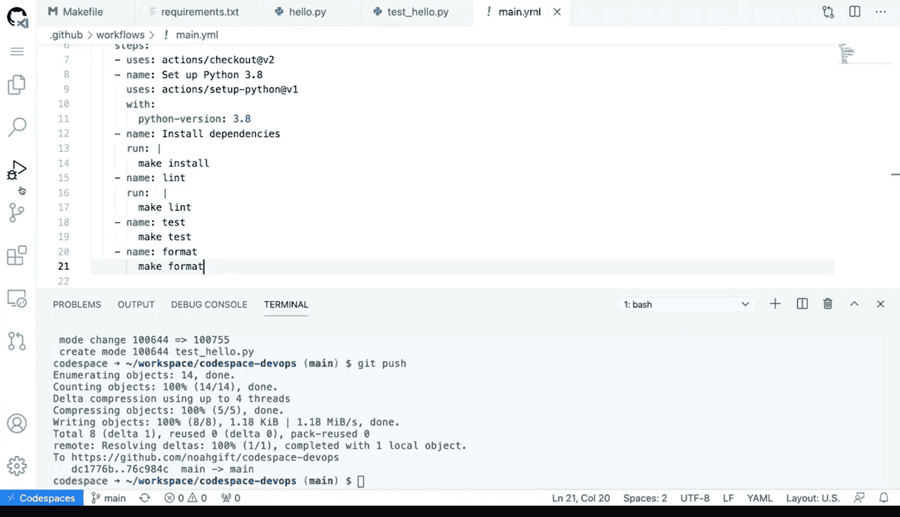

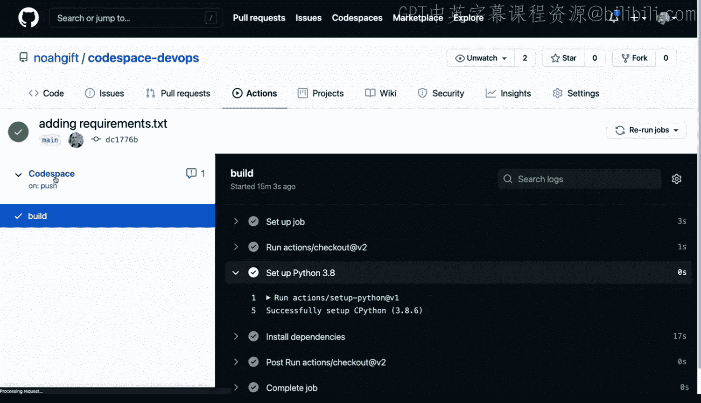

## 体验CI/CD的价值：拦截错误代码 🚨

上一节我们建立了完整的自动化流水线，本节中我们通过一个实际例子来感受它的价值。

持续集成的核心价值在于自动发现错误，防止有问题的代码进入代码库甚至生产环境。让我来演示一下。

我故意在 `hello.py` 中引入一个错误，比如一个错误的缩进。然后我尝试在本地运行 `make lint`，代码检查工具会立即发现这个错误并报错。

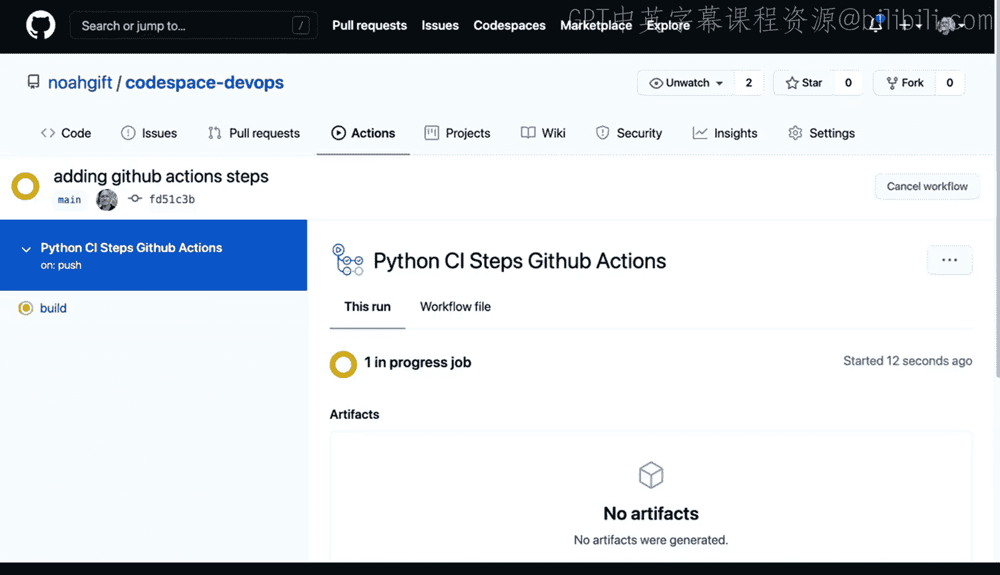

如果我忽略这个本地错误，仍然将代码提交并推送，GitHub Actions会在“Lint”步骤失败，整个工作流会被标记为失败。这样，我就被明确阻止将错误的代码合并到主分支。

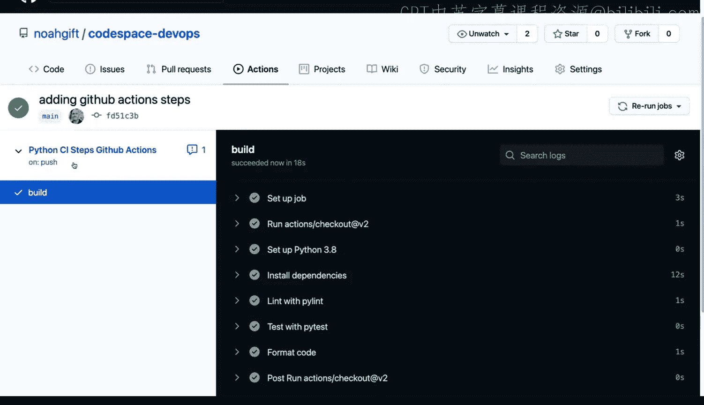

我可以直接在Actions的日志中查看具体的错误信息，然后回到Codespaces中修复这个缩进错误。修复后，再次提交推送，这次工作流就会全部通过。

这个过程清晰地展示了CI/CD如何作为一个安全网，强制保证代码库的质量。

---

## 总结 🎯

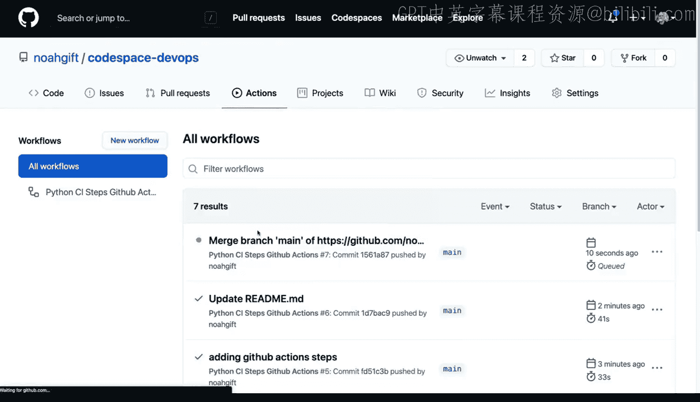

本节课中我们一起学习了如何利用GitHub的生态系统进行现代Python开发。我们从零开始，使用**GitHub Codespaces**建立了一个云端开发环境，避免了本地配置的麻烦。我们使用**Click库**构建了一个功能完整的命令行工具，并通过装饰器轻松定义了参数和帮助信息。

更重要的是，我们实践了DevOps的核心流程：通过**GitHub Actions**配置了自动化的CI/CD流水线，实现了代码提交后自动进行依赖安装、代码风格检查（`make lint`）、自动化测试（`make test`）和代码格式化（`make format`）。最后，我们通过一个故意引入的错误，亲身体验了持续集成如何作为质量关卡，有效防止低质量代码进入代码库。

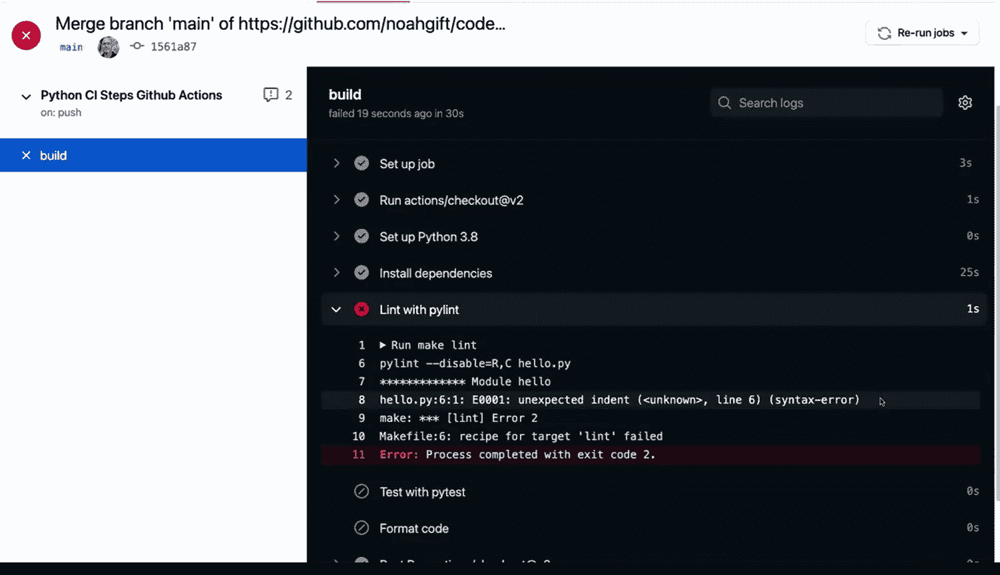

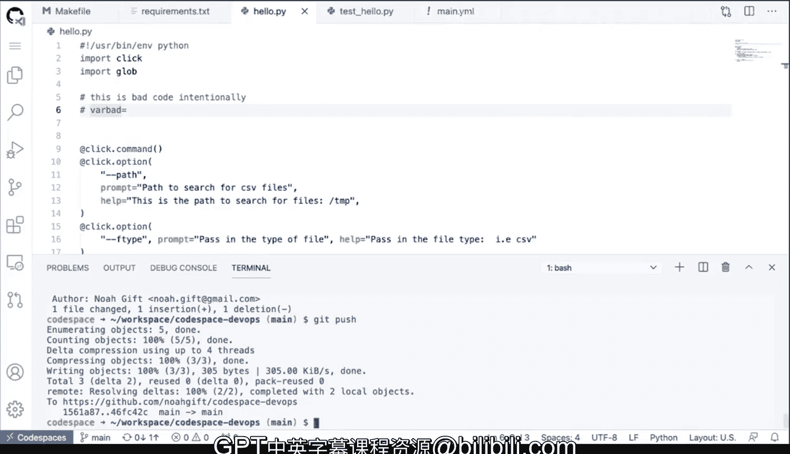


这套以**GitHub Codespaces + GitHub Actions + Makefile标准化流程**为核心的开发模式，提供了一个高效、可靠且可复现的Python项目脚手架，非常适合用于构建和维护高质量的应用程序。