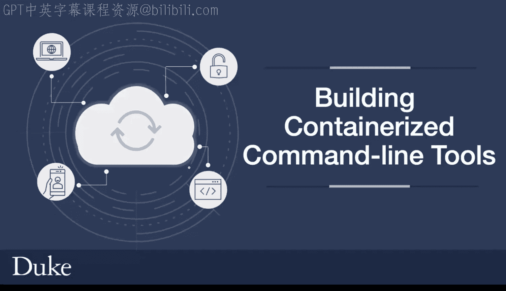
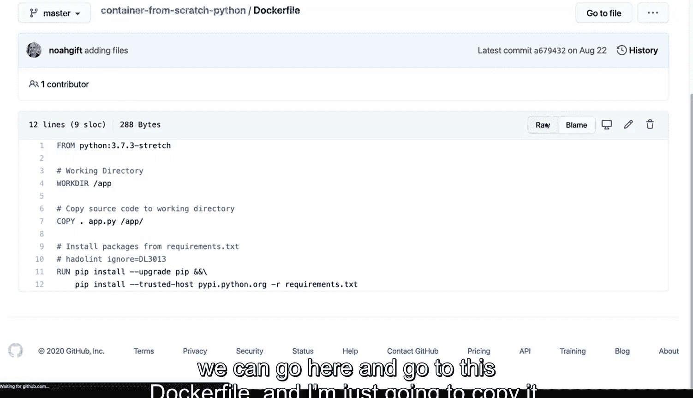
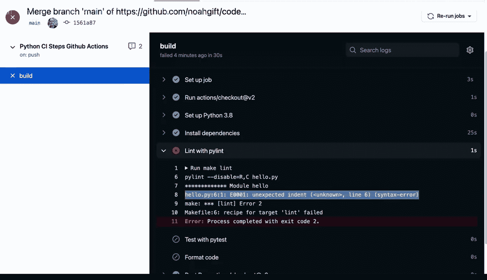
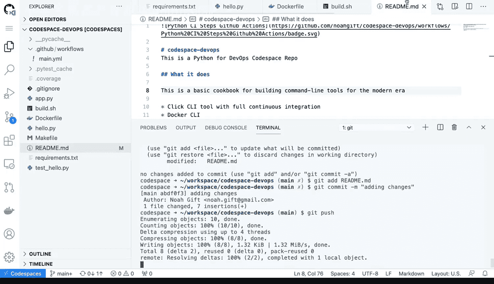
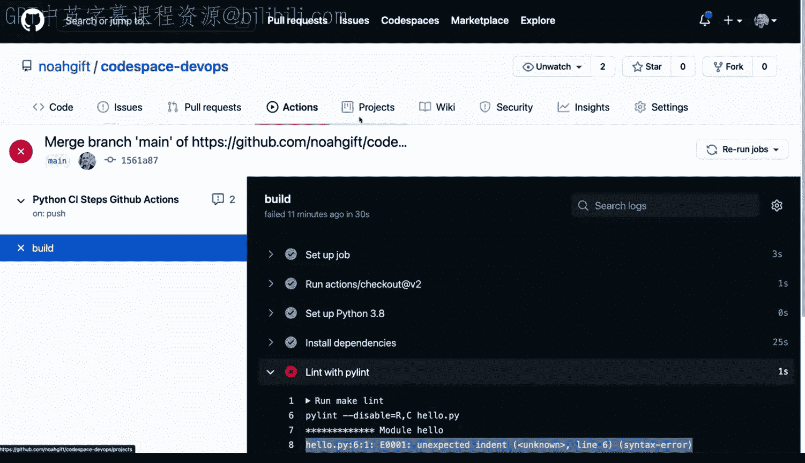
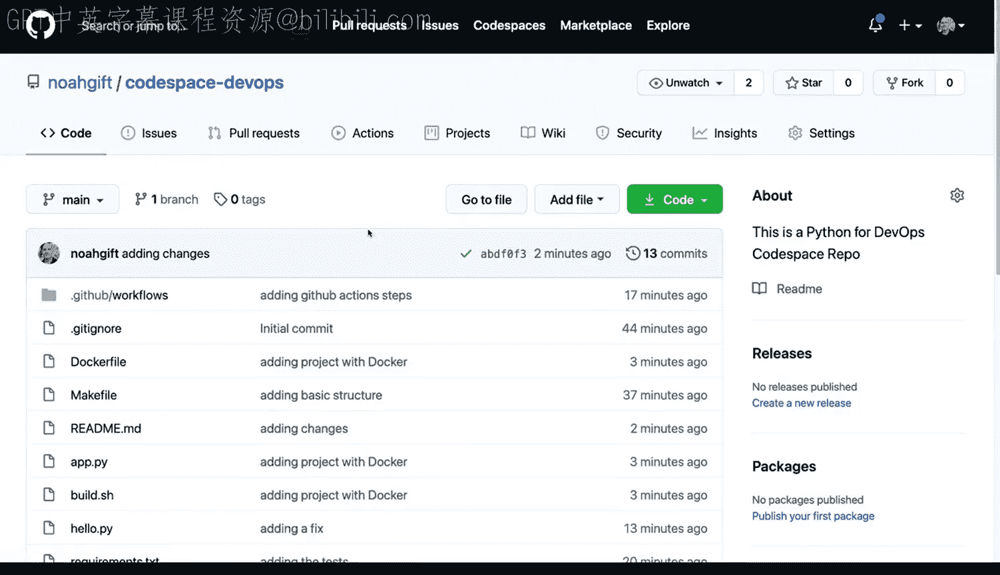
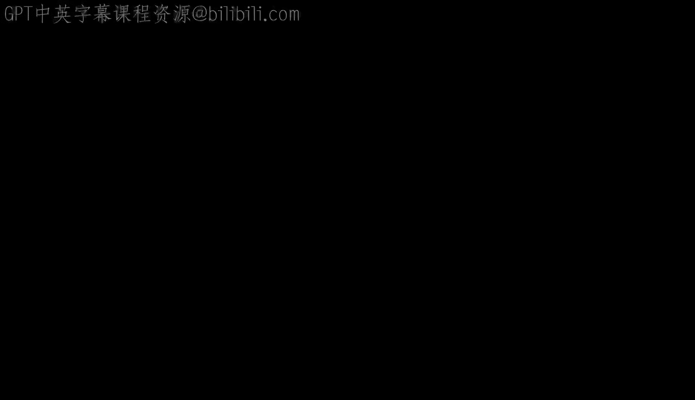

#  032：构建容器化命令行工具

## 概述
在本节课中，我们将学习如何将命令行工具（CLI）容器化。我们将探讨容器化CLI的优势，并一步步演示如何创建一个Docker镜像，将其作为命令行工具运行，以及如何将其推送到容器注册中心。

---

## 为何容器化命令行工具？
上一节我们介绍了使用CLI快速构建反馈循环。本节中我们来看看容器化CLI的另一个优势。

容器对于命令行工具而言非常有趣，因为你可以将运行时环境打包到一个容器中。实际上，你可以将这个运行时环境打包成一个CLI工具。这意味着你可以将代码推送到类似Docker Hub的平台上。

以下是如何在代码空间中实际工作的演示。

---

## 逐步构建容器化CLI
让我们继续推进，逐步构建这个应用。

首先，我将开始构建，并会从另一个项目中逐步引入一些内容。

### 1. 检查现有命令
首先，如果你注意到这里有一个命令，它允许我在本地运行这个命令行工具。让我们来看看。

回到代码空间，我们可以这样操作。我将远程命令作为命令行工具运行。让我们开始执行。

它下载容器并在本地运行。下载容器通常需要一秒钟。下载完成后，请注意，我们实际上运行了那个命令行工具。

这个工具的巧妙之处在于它实际上运行了Click并执行了各种操作。它基本上就是输出一个“Hello World”。这只是回显了我在里面写的一些内容。

对我来说，这是分发命令行工具的一个绝佳方式。你只需将这个命令传递给同事，说：“嘿，我构建了一个执行某项工作的命令行工具，不用担心我在这里做了什么，直接运行这段代码就行。”

### 2. 创建Dockerfile
接下来，我将创建一个Dockerfile，这是创建容器的方式。

我们转到这个Dockerfile。我将复制它。

回到这里，我们看看这个Dockerfile。注意它也被识别出来了。它询问是否要安装Docker的推荐扩展，当然安装。

基本上，我们回到Dockerfile，它看起来已经被识别了。我将指定基础镜像为`Python:3.7.3`。不过，因为这里运行的是Python 3.8.3，让我们使用相同版本的Python，所以将其改为`3.8.3`。

我将在容器中创建一个`/app`目录结构，并将应用程序复制到`app.py`文件。然后安装所需的包。

### 3. 创建应用程序文件
我好像缺少这个`app.py`文件，所以让我们创建它。执行`touch app.py`。这是一个非常简单的命令行工具。

让我们看看这个文件做了什么。它几乎什么都没做。让我们快速运行一下，看看它的效果。执行`python app.py --name Dawin`。它只是回显了里面写的内容。

### 4. 构建Docker镜像
现在，我有了这个简单的命令行工具和Docker容器。如何在本地测试并将其容器化呢？

我可以执行`docker build`。我通常喜欢把步骤放在一个shell脚本里。我将在这里放一个shell脚本，让我可以运行Docker命令。

我可以这样做，比如创建一个Bash脚本。让我们开始吧。执行`touch build.sh`。在里面，我可以放入我想运行的步骤。我们称这个镜像为`click-echo`。

你并不一定需要这样做，但拥有一个流程，让你不必总是查找所有命令，是很好的。

我们可以加入`docker image ls`来列出镜像。如果我让这个脚本可执行，然后运行`./build.sh`，我们可以看到它开始构建。

它说找不到Python 3.8，所以让我们改用Python 3.7。这样它就能找到Python 3.7并开始本地构建。完成后，它会显示本地有一个容器。

现在，我有了这个本地容器。

### 5. 运行容器化CLI
现在我可以运行之前使用的相同命令。我可以查看历史记录，命令大概是这样的。我甚至可以将这个运行命令放入构建流程中。

我们可以看到运行容器的命令。执行`docker run click-echo --name Dawin`。这理论上应该和之前做同样的事情。我可以直接运行这个Docker命令。这应该会运行相同的应用程序。

### 6. 推送至容器注册中心
现在我们知道，理论上我可以将这个镜像推送到Docker Hub、Amazon容器注册中心或其他注册中心。

简而言之，使用像GitHub Codespaces这样的环境的一大好处是，它确实加快了开发速度，并且在Click工具中使用容器也是如此。

---

## 集成与自动化
让我们继续将这些文件提交到Git。

添加Dockerfile、app.py和build.sh文件。提交更改，添加项目描述。

我们还可以做更多高级的事情。

例如，Docker可以以编程方式构建。我相信在GitHub Actions内部，你可以创建一个新的工作流。事实上，我认为这里有一个容器工作流。你可以搜索不同的工作流，但你可以自动构建容器。

你也可以以编程方式将其推送到Docker Hub。例如，构建一个Docker容器并将其发布到Google容器注册中心。

如果我想部署到Amazon或Google Cloud等，这将非常直接。让我快速展示一下：如果我想部署到GKE，我只需要拥有安全存储在这里的密钥，然后将其推送到Google的容器注册中心，构建项目，一旦它被推送到容器注册中心，你就可以用Kubernetes部署它，并让它在进程中运行。

这已经非常接近这个沙盒项目的设置了。你可以用这个沙盒项目做很多事情。

---

## 总结
本节课中，我们一起学习了如何将命令行工具容器化。我们探讨了容器化CLI的优势，并实践了从创建Dockerfile、构建镜像、本地测试到准备自动化推送的完整流程。掌握这些技能，可以帮助你更高效地分发和部署命令行工具。