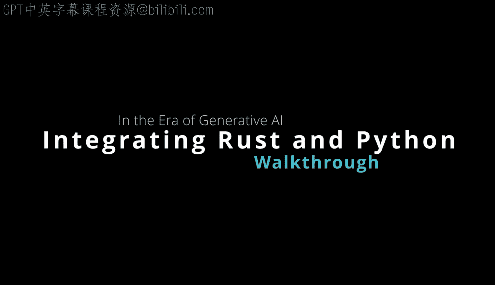
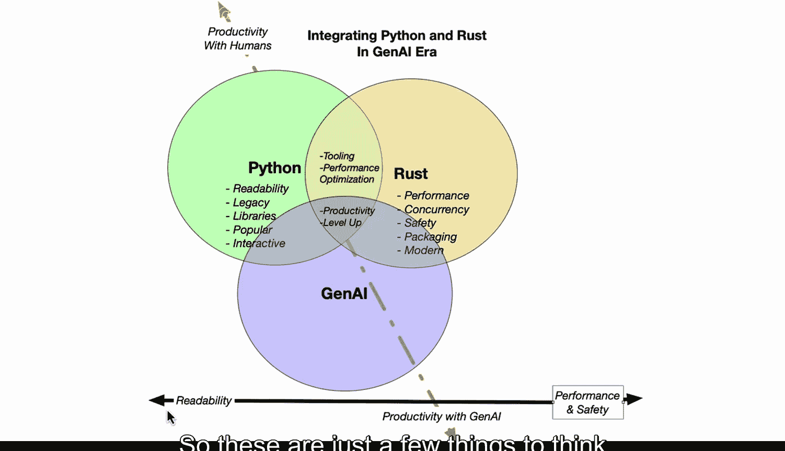
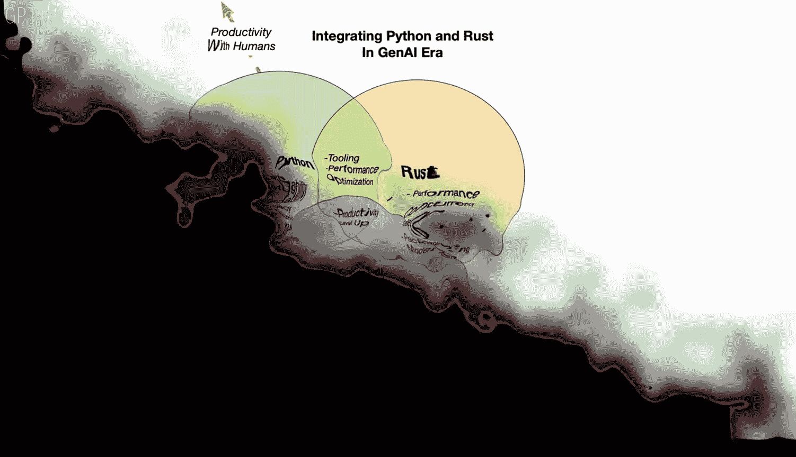

#  033：Rust与Python在生成式AI时代的集成 🦀🐍

在本节课中，我们将探讨在生成式人工智能时代，如何将Rust与Python这两种语言进行集成。我们将分析两种语言各自的优势，确定最佳的集成点，并理解生成式AI如何增强这两种语言的能力。

## Python的优势与定位

上一节我们提到了集成两种语言的必要性，本节中我们来看看Python的核心优势。Python的设计初衷是服务于人类开发者，其特点主要体现在以下几个方面：

以下是Python的主要优势：
*   **可读性与易用性**：语法简洁清晰，易于学习和编写。
*   **庞大的生态系统**：拥有极其丰富的第三方库支持，尤其在数据科学、机器学习和Web开发领域。
*   **高开发效率**：交互式反馈循环优秀，能快速构建原型、Web应用、命令行工具或脚本。
*   **流行度**：是全球最流行的编程语言之一，社区活跃。

因此，Python的核心价值在于**为人类开发者提供极高的生产力**。

## Rust的优势与定位

了解了Python为生产力而生的特点后，我们再来看看Rust如何解决一些更深层次的问题。Rust作为一种现代语言，其设计针对了Python存在的一些局限性。

以下是Rust的主要优势：
*   **现代内存安全与并发模型**：编译器能检查数据竞争等并发错误，生成健壮的代码。`Rust编译器保证内存安全，无需垃圾回收。`
*   **真正的多线程支持**：提供系统级线程，而Python受全局解释器锁（GIL）限制。
*   **卓越的性能**：具有接近机器码级别的运行性能，能效高。
*   **简洁统一的包管理**：`Cargo`工具集（构建、包管理、测试）统一且健壮，避免了Python历史上多种打包方案并存的问题。

Rust诞生于多核系统普及、安全性日益重要的时代，因此能够规避Python因历史设计产生的一些问题。

## 集成点：强强联合

既然两种语言各有千秋，那么它们在哪里结合能发挥最大效用呢？两者的交集主要体现在工具链和性能优化领域。

以下是常见的集成场景：
*   **性能关键型工具**：例如，用纯Python编写的代码检查（Linting）工具可能运行缓慢。将其核心部分用Rust重写（如Ruff项目），性能可提升**10倍或更多**。对于大型代码库，这种优化意义重大。
*   **高性能服务包装**：对于推理服务器、Web服务器或其他任何类型的后端服务，通常不适合用Python直接编写以实现最佳性能。常见的做法是**用Rust编写高性能核心，然后通过Python进行封装和调用**，从而兼顾性能与开发效率。

## 生成式AI带来的新变化 🚀

前面的讨论基于传统开发模式，而生成式AI的兴起为这两种语言带来了新的变数。它能自动生成大量代码（可能高达80%），从而放大了两种语言的核心特性。

*   **对Python的增强**：Python本就为人类设计，生产力高。生成式AI能进一步加速开发流程，快速生成可读的脚本、API或数据处理代码。
*   **对Rust的增强更为显著**：Rust虽然生产力也不错，但学习曲线和编写难度较高。生成式AI与Rust的结合潜力巨大，原因如下：
    1.  Rust更接近性能层面的代码，AI生成的代码性能潜力大。
    2.  **Rust编译器是强大的安全网**：生成式AI可能产生“幻觉”代码或错误。Rust编译器会在编译时严格检查内存安全、并发问题等，捕获许多此类错误。而Python没有编译器，缺乏内置的运行时错误检查或安全特性，它更依赖开发者和测试。

因此，在生成式AI时代，我们可以观察到一种趋势：天平开始向Rust倾斜。因为Rust本身的健壮性恰好能弥补AI生成代码可能的不稳定性。

## 总结

本节课中，我们一起学习了在生成式AI背景下集成Rust与Python的思考框架。

*   **Python**的核心是**为人类服务的高生产力**，拥有丰富的库和快速的反馈循环。
*   **Rust**的核心是**为机器服务的性能与安全**，提供内存安全、真正并发和顶尖性能。
*   **传统集成点**在于用Rust优化性能瓶颈，并用Python进行粘合与快速开发。
*   **生成式AI的新影响**在于，它可能使编写Rust代码变得更容易，因为Rust编译器能有效校验AI生成的代码，从而在**不牺牲安全性的前提下，提升Rust的开发效率**。

最终，在选择使用哪种语言或如何集成时，需要根据具体任务（是重性能安全，还是重快速迭代）、团队技能以及生成式AI工具的使用程度来综合决策。在生成式AI时代，Rust在代码库中的占比可能会因其安全性与AI辅助开发的良好结合而变得更加具有吸引力。