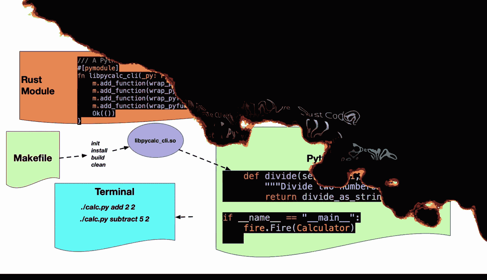
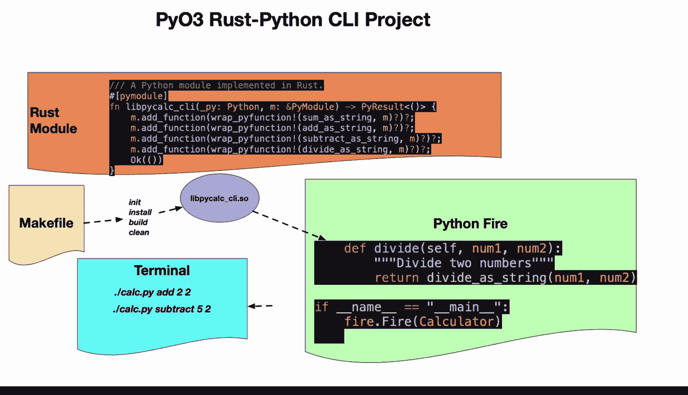
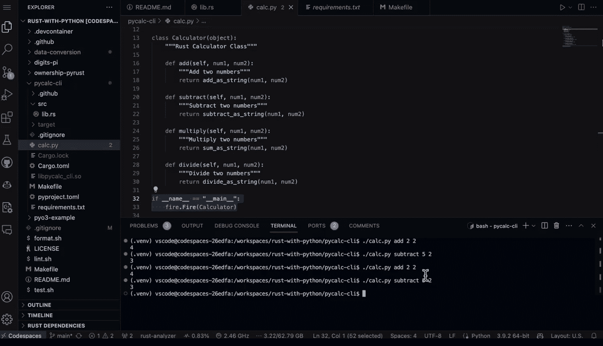
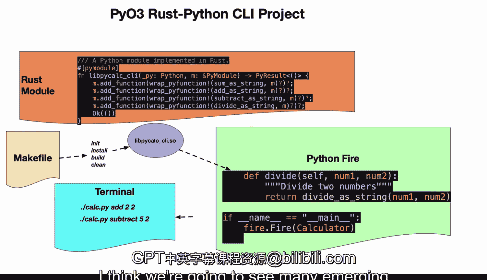

#  034：Rust与Python集成实战


在本节课中，我们将学习如何将Rust的高性能计算能力与Python的易用性和丰富的生态系统相结合，构建一个命令行计算器。我们将通过一个具体的项目示例，展示如何用Rust编写核心计算逻辑，并使用Python Fire库将其包装成一个易用的命令行工具。

## 概述

上一节我们介绍了Rust与Python集成的优势。本节中，我们来看看一个具体的实战项目：一个名为`pcalc`的命令行计算器。这个项目清晰地展示了如何在真实世界中结合两种语言的优势。

## 项目架构解析

以下是该项目的核心工作流程示意图：


首先，你需要用Rust构建所需的核心部件。在这个案例中，核心部件是计算逻辑。这可以是任何内容，例如使用第三方库、编写MLOps代码，或者实现某种在Rust中运行效率极高的自定义算法。

然后，在这一部分，你需要将这些Rust函数包装起来，并全部放入一个共享库中。

## 项目代码详解

接下来，让我们深入代码，看看各个部分是如何实现的。

### 1. Rust核心库 (`lib.rs`)





第一步是查看源代码。在`lib.rs`文件中，我们定义了一个计算器函数。

```rust
// 使用pyo3库来创建Python可调用的Rust函数
use pyo3::prelude::*;

#[pyfunction]
fn add_string(a: &str, b: &str) -> PyResult<String> {
    let a_num: i32 = a.parse().unwrap();
    let b_num: i32 = b.parse().unwrap();
    Ok((a_num + b_num).to_string())
}

// 类似地，定义 subtract_string, multiply_string, divide_string 函数...
// ...

#[pymodule]
fn pcalc(_py: Python, m: &PyModule) -> PyResult<()> {
    m.add_function(wrap_pyfunction!(add_string, m)?)?;
    // 暴露其他函数...
    Ok(())
}
```

首先，我们使用`pyo3`库。然后，我们包装了一系列Rust代码。这只是一个传统的Rust函数，但我们为其添加了`#[pyfunction]`属性，使其能够被`pyo3`调用。请注意，我们对`subtract_string`、`divide_string`等函数也做了同样的处理。最后，在`#[pymodule]`部分，我们将这些函数暴露出来，以便在构建成`.so`共享库后供Python使用。

### 2. 构建脚本 (`Makefile`)

现在，让我们看看Makefile。使用Makefile的好处是，一些构建命令非常繁琐，我们不需要记住它们，只需输入`make build`即可。

```makefile
build:
	cargo build --release
	cp target/release/libpcalc.so ./
```

在Makefile中，我们定义了一个`build`目标。它首先执行`cargo build --release`来编译Rust代码。接着，它将生成的共享库文件（例如`libpcalc.so`）复制到当前工作目录。一旦所有设置完成，唯一需要做的另一件事就是转到`calc`目录。

### 3. Python包装层 (`calc.py`)

我们需要实际使用Python Fire库。让我们看一下`requirements.txt`文件，其中指定了依赖。

```
python-fire==0.5.0
```

这里我们将版本固定为Python Fire 0.5.0。固定版本是一个好习惯，可以确保创建可复现的示例。

回到`calc.py`文件，我们在这里导入那些Rust函数。

```python
import pcalc  # 导入我们编译的Rust模块
import fire

class Calculator:
    def add(self, a, b):
        """加法"""
        return pcalc.add_string(str(a), str(b))

    def subtract(self, a, b):
        """减法"""
        return pcalc.subtract_string(str(a), str(b))

    def multiply(self, a, b):
        """乘法"""
        return pcalc.multiply_string(str(a), str(b))

    def divide(self, a, b):
        """除法"""
        return pcalc.divide_string(str(a), str(b))

if __name__ == '__main__':
    fire.Fire(Calculator)
```

这非常直接，就像导入任何其他常规Python模块一样。最后，我们利用Python Fire CLI库的强大功能。这是一个非常精巧的库，因为我所需要做的就是在这里创建一个名为`Calculator`的类，然后将那些Rust函数作为这个类内部的方法来使用。

我在这里创建了一个良好的抽象。我定义了`add`、`subtract`、`multiply`、`divide`方法。美妙之处在于，一旦我将其放入`fire.Fire()`，这个`Calculator`类就通过终端暴露出来了。

## 运行演示

我认为这是Rust与Python集成的一个绝佳范例。我们已经看到它的使用，但让我们再操作一次以便加深理解。

在终端中，我们可以这样使用：

```bash
# 假设已安装依赖并构建完成
python calc.py add 2 2
# 输出：4

python calc.py subtract 5 2
# 输出：3
```

## 核心优势总结



如果我们回顾之前的架构图，并思考其中发生的过程，我认为这是一种更高级的集成Rust与Python的方式。


这种方式的核心在于**发挥各自所长**：
*   **利用Rust的优势**：高性能计算、能效、内存安全。
*   **利用Python的优势**：构建良好的抽象、快速开发、丰富的库生态。

通过将两者结合在一起，我们有望在许多新兴的数据工程和MLOps工作流中看到这种模式的应用。

## 总结



本节课中，我们一起学习了如何构建一个结合Rust与Python优势的命令行计算器项目。我们分析了从Rust核心逻辑编写、使用`pyo3`暴露接口，到通过Makefile自动化构建，最后用Python Fire创建友好CLI的完整流程。这种集成方式让你既能享受Rust的性能与安全，又能利用Python的灵活与易用性，是处理高性能计算任务的强大模式。