#  037：使用AWS CodeBuild进行高级测试 🧪

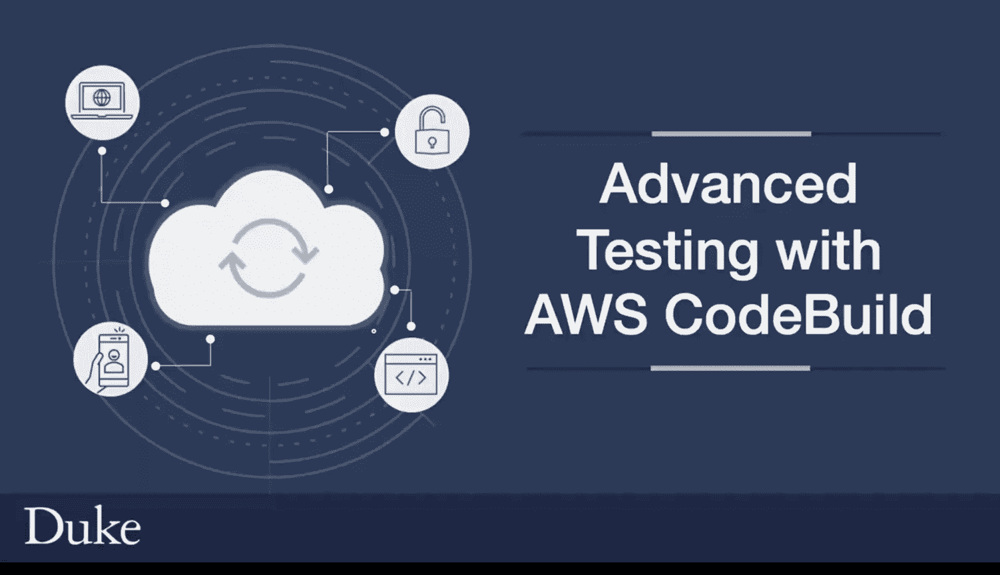

在本节课中，我们将学习如何在AWS环境中使用CodeBuild服务来设置一个自动化测试流程。我们将创建一个构建项目，配置其从GitHub拉取代码，并执行一系列测试命令，最终实现代码的持续集成。

上一节我们介绍了使用GitHub Actions进行测试，本节中我们来看看如何在AWS原生环境中实现类似的功能。

## 概述

AWS CodeBuild是一项完全托管的持续集成服务，可以编译源代码、运行测试并生成可随时部署的软件包。它类似于GitHub Actions，但深度集成在AWS生态系统中，特别适合需要在AWS内部进行部署的项目。

## 创建CodeBuild项目

首先，我们需要在AWS控制台中创建一个新的构建项目。

1.  登录AWS管理控制台，导航到CodeBuild服务。
2.  点击“创建构建项目”。
3.  在项目配置部分，为项目命名，例如 `advanced-testing`。
4.  在“源”部分，选择源代码的提供者。这里我们选择GitHub，并授权CodeBuild访问我们的仓库。
5.  选择我们想要测试的GitHub仓库，例如 `NOAA-gift-advanced-testing`。
6.  在“Webhook”部分，配置为在每次代码推送时自动触发构建。

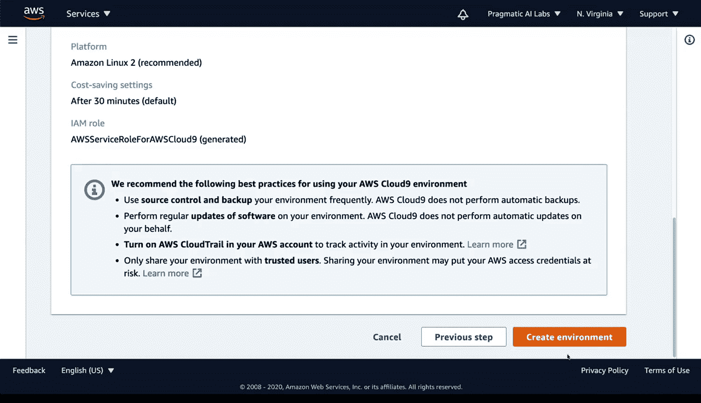

以下是项目配置的核心部分：

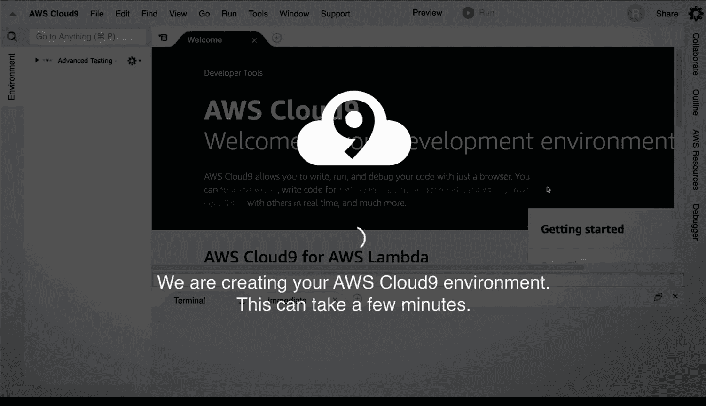

```yaml
# 项目名称
project-name: advanced-testing
# 源代码提供商
source:
  type: GITHUB
  location: https://github.com/your-username/NOAA-gift-advanced-testing
# 触发方式
triggers:
  webhook: true
  filter-groups:
    - - type: EVENT
        pattern: PUSH
```

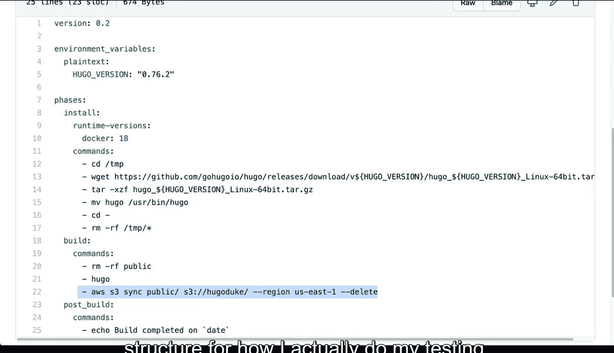

## 配置构建环境

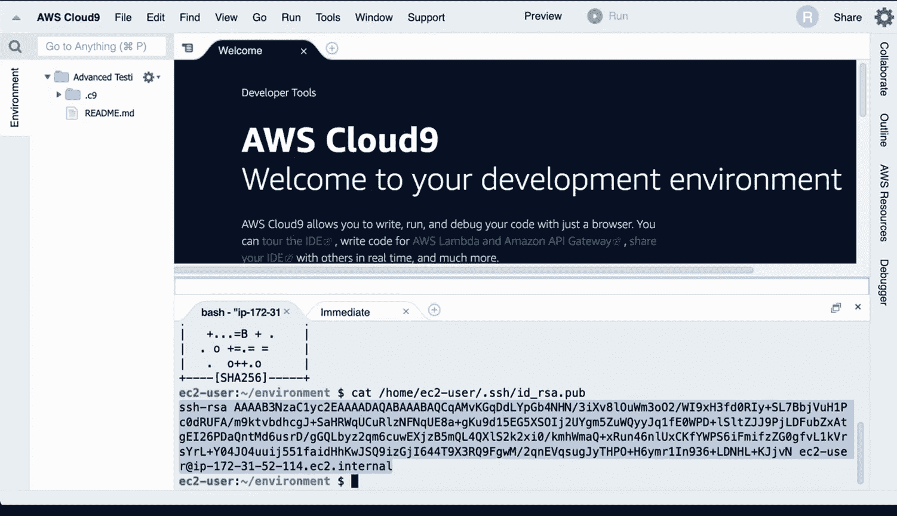

接下来，我们需要指定构建代码的环境。

1.  在“环境”部分，选择“托管镜像”。
2.  选择操作系统为“Amazon Linux 2”，这是AWS基于Red Hat的Linux发行版。
3.  运行时选择“标准”，镜像选择最新的 `Amazon Linux 2 x86_64 standard:3.0`。
4.  环境类型选择“Linux”。（注意：如果需要测试GPU代码，也可以选择相应的环境，这对于Python机器学习项目很有用。）
5.  对于此示例，我们不需要构建Docker镜像，因此使用默认设置。
6.  使用CodeBuild自动创建的服务角色即可。如果后续需要执行部署操作，则需要创建具有相应权限的IAM角色。

环境配置的关键参数如下：

```yaml
environment:
  type: LINUX_CONTAINER
  image: aws/codebuild/amazonlinux2-x86_64-standard:3.0
  compute-type: BUILD_GENERAL1_SMALL
```

## 编写构建规范文件

CodeBuild通过一个名为 `buildspec.yml` 的YAML文件来定义构建的各个阶段和命令。我们选择使用文件而非在控制台内联输入命令，这样配置更清晰且易于版本控制。

我们需要在项目根目录创建此文件。以下是其基本结构：

```yaml
version: 0.2

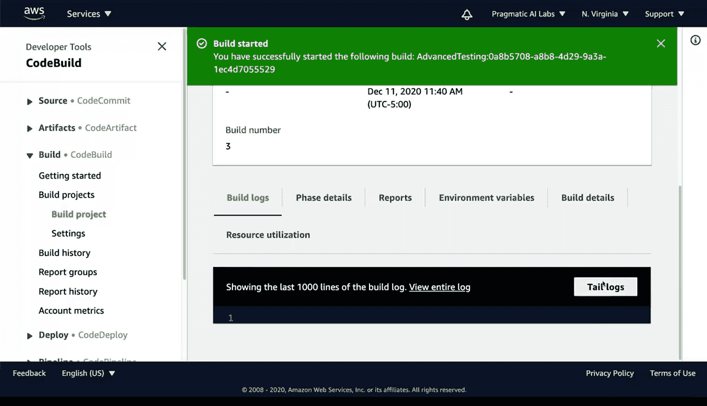

phases:
  install:
    commands:
      - make install
  build:
    commands:
      - make lint
      - make test
  post_build:
    commands:
      - echo “测试完成”
```

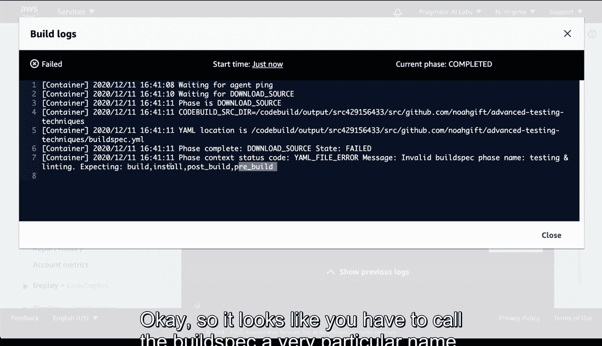

这个文件定义了三个阶段：
*   **install**：安装项目依赖。
*   **build**：执行代码风格检查（lint）和单元测试。
*   **post_build**：构建后步骤，这里仅输出一条完成信息。

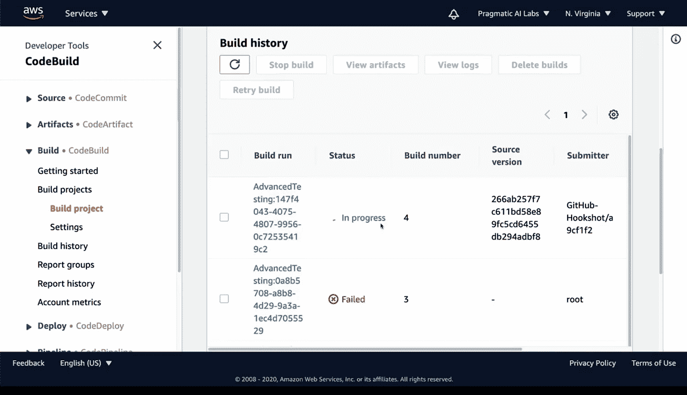

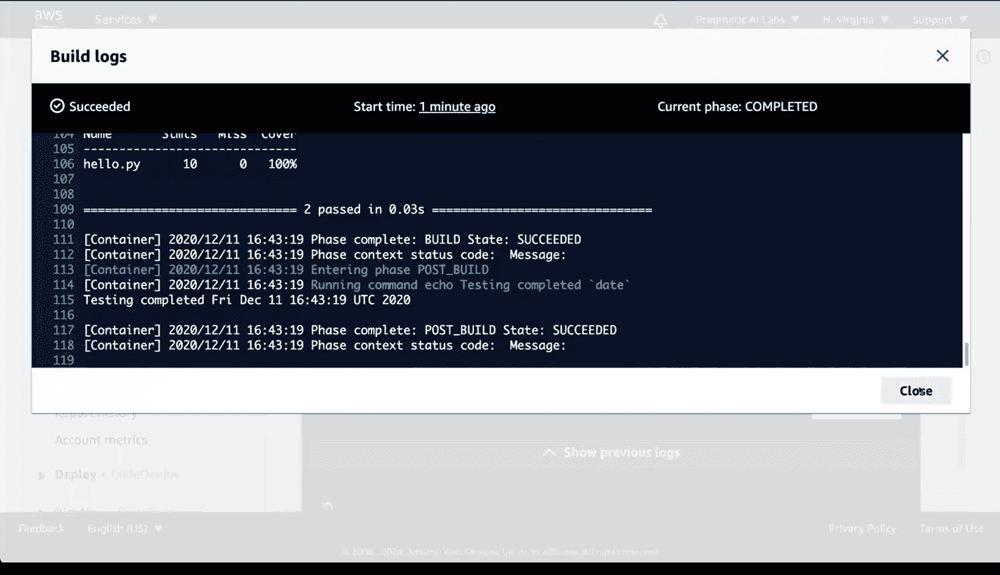

## 使用Cloud9准备测试环境

为了创建和测试 `buildspec.yml` 文件，我们可以使用AWS Cloud9，这是一个基于云的集成开发环境。

1.  在AWS控制台打开Cloud9服务，创建一个新环境，命名为 `advanced-testing-env`。
2.  环境配置选择创建一个新的EC2实例（例如 `t2.micro` 类型），并选择Amazon Linux 2操作系统。
3.  环境创建后，首先需要生成SSH密钥并添加到GitHub账户，以便克隆代码仓库。
4.  在Cloud9终端中，克隆项目仓库并进入目录。
5.  创建一个Python虚拟环境并激活它。
6.  运行 `make install` 和 `make test` 等命令，验证本地环境一切正常。
7.  最后，创建并编辑 `buildspec.yml` 文件，内容如上节所示，然后提交到GitHub仓库。

以下是关键的命令行步骤：

```bash
# 生成SSH密钥
ssh-keygen -t rsa
# 克隆代码仓库
git clone git@github.com:your-username/NOAA-gift-advanced-testing.git
cd NOAA-gift-advanced-testing
# 创建并激活虚拟环境
python3 -m venv ~/advanced-testing-venv
source ~/advanced-testing-venv/bin/activate
# 安装依赖并运行测试
make install
make test
# 创建构建规范文件
touch buildspec.yml
# ... 编辑文件内容 ...
# 提交更改
git add buildspec.yml
git commit -m “添加用于AWS测试的buildspec文件”
git push
```

## 触发并监控构建

提交 `buildspec.yml` 文件后，CodeBuild项目会自动触发一次构建。

1.  回到CodeBuild控制台，在项目详情页可以看到构建历史。
2.  点击正在进行的构建，可以实时查看详细的构建日志。
3.  观察 `install` 和 `build` 阶段的输出，确认所有命令成功执行。
4.  构建成功后，状态会显示为“成功”。如果失败，可以查看日志定位问题。

## 扩展：测试命令行工具

为了展示更复杂的测试场景，我们可以为项目添加一个简单的命令行工具并进行测试。

1.  使用 `click` 库创建一个命令行接口（CLI）工具，例如一个执行加法运算的工具 `hello_cli.py`。
2.  编写相应的功能测试，使用 `click.testing.CliRunner` 来模拟调用命令行并断言输出。
3.  更新 `Makefile`，确保新的测试文件能被测试覆盖率工具覆盖。
4.  提交这些更改。由于CodeBuild和GitHub Actions都执行 `make test` 命令，因此无需修改CI配置，两个系统会自动运行新增的测试。

以下是命令行工具测试的示例代码：

```python
# test_hello_cli.py
from click.testing import CliRunner
from hello_cli import call_add

def test_cli():
    runner = CliRunner()
    result = runner.invoke(call_add, [‘—x’, ‘1’, ‘—y’, ‘2’])
    assert result.exit_code == 0
    assert ‘3’ in result.output
```

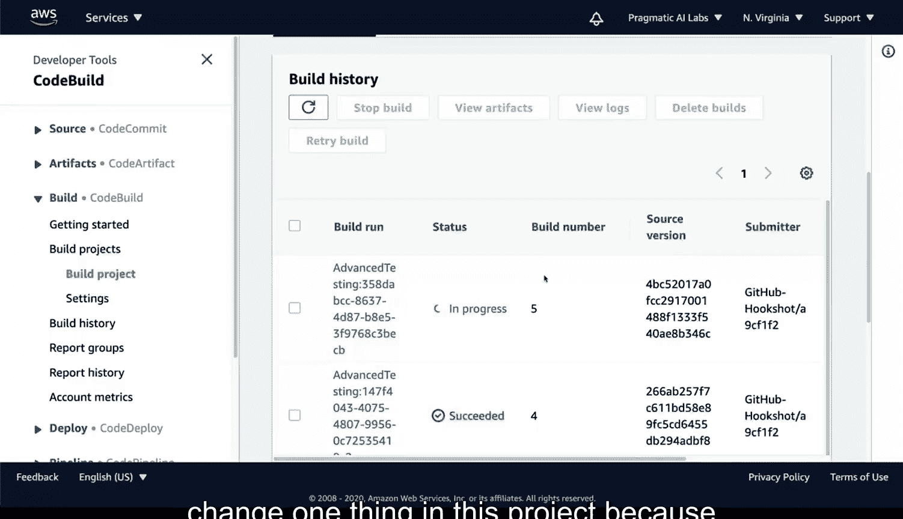

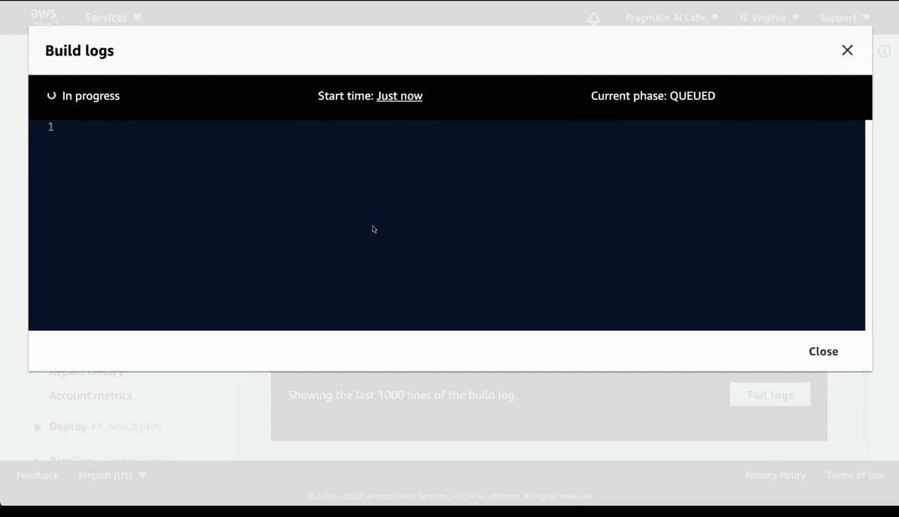

## 总结

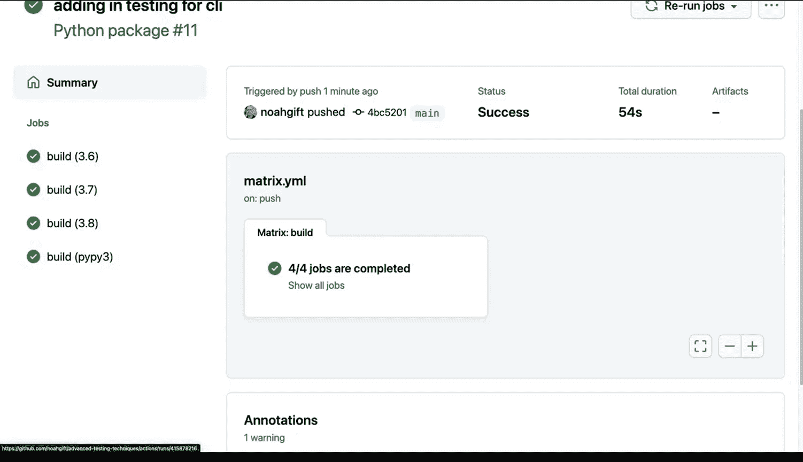

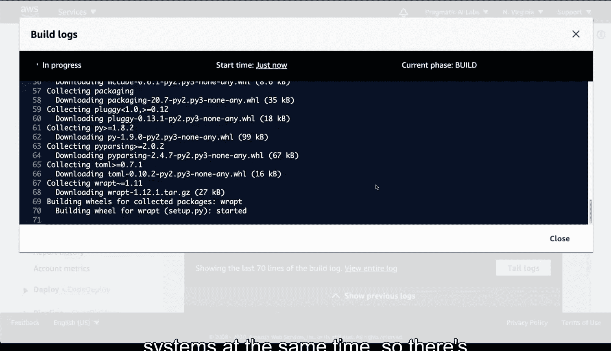


本节课中我们一起学习了如何利用AWS CodeBuild设置一个自动化测试流水线。我们完成了从创建项目、配置环境、编写 `buildspec.yml` 构建规范，到使用Cloud9进行准备工作和最终触发监控构建的完整流程。此外，我们还扩展了测试范围，为命令行工具添加了功能测试，并验证了基于 `Makefile` 的配置可以在多个CI系统（如GitHub Actions和AWS CodeBuild）中无缝工作。这种方法将构建逻辑保存在代码仓库中，提高了可维护性和一致性。