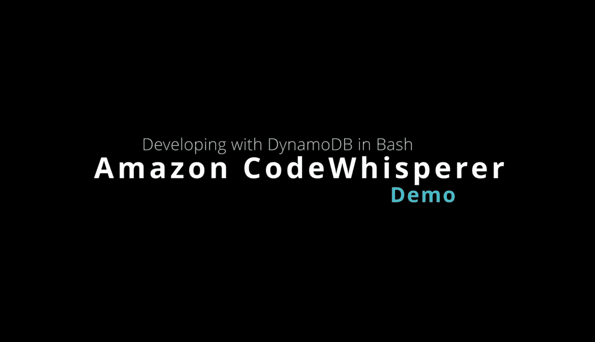
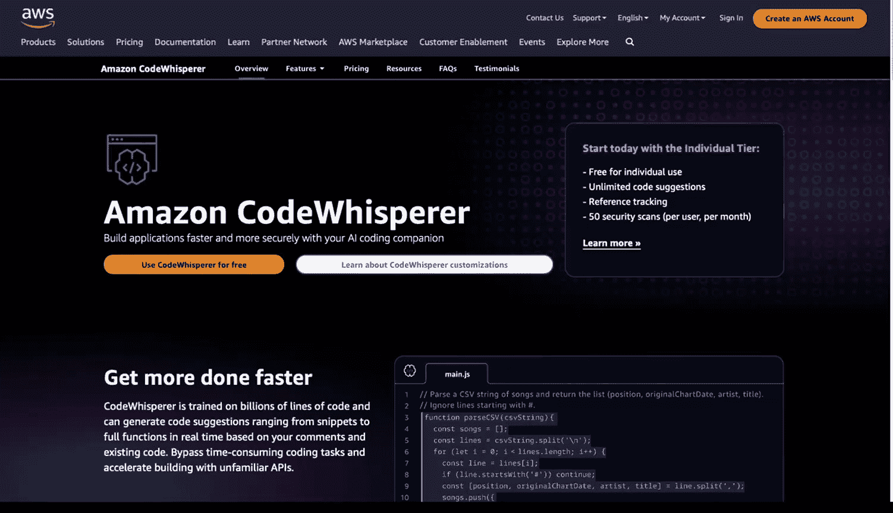
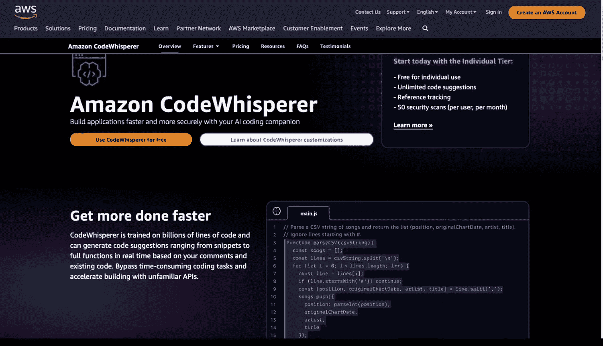
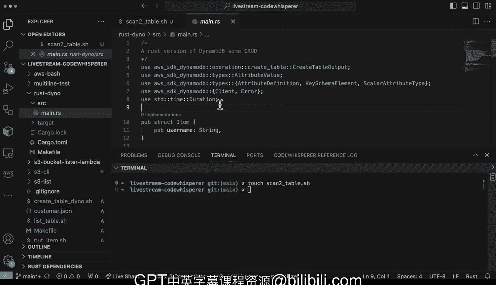

#  041：AWS CodeWhisperer SDK 🚀



在本节课中，我们将要学习如何使用 AWS CodeWhisperer 这一强大的 AI 编程助手来提升开发效率，特别是在 AWS 工作流和 DynamoDB 编程方面。

Amazon CodeWhisperer 是一个提升 DynamoDB 编程技能的绝佳工具。它提供无限的代码建议，并且完全免费。该工具基于数十亿行代码进行训练，并针对 AWS 工作流进行了优化。因此，它是一个能显著提高生产力的优秀工具，支持包括 Python、Ruby、Bash 在内的多种语言。

上一节我们介绍了 CodeWhisperer 的基本概念，本节中我们来看看如何在开发环境中实际使用它。

## 环境设置与启动 🛠️

如果我们在 Visual Studio Code 环境中，如何开始使用 CodeWhisperer？首先，需要找到扩展。它集成在 AWS Toolkit 扩展中。



将鼠标悬停在 AWS Toolkit 上，可以看到它支持 CodeWhisperer、CodeCatalyst 以及对 Lambda、S3 等服务。这个工具的强大之处在于，我可以直接在这个环境中启用并切换不同的设置。



以下是检查 CodeWhisperer 是否安装并运行的步骤：

1.  在扩展市场中搜索并安装 “AWS Toolkit”。
2.  安装后，在 VS Code 侧边栏找到 AWS 图标并点击。
3.  在 AWS 面板中，可以找到 CodeWhisperer 的相关选项。

如果我想确认它是否已安装，可以查看底部状态栏。CodeWhisperer 若已选中，则会显示激活状态。

在 AWS 菜单中，可以看到 CodeWhisperer 已被选中。将鼠标悬停在此处，可以确认其状态。如果需要停止代码建议，可以在此处停止；如果需要运行建议，也可以在此处操作。

此外，CodeWhisperer 还具有安全扫描功能，这有助于查找安全漏洞。它还能提供代码引用，显示代码片段的来源，这对于学习优秀的代码示例非常有帮助。

## 实战：在 Bash 工作流中使用 💻

接下来，让我们看看如何在一个基于 Bash 的工作流中实际使用 CodeWhisperer。

为了开始，一个有趣的尝试是创建一个新的 Bash 文件。我们可以先执行 `git pull` 获取最新更改，然后使用 `touch` 命令重新创建一个我之前已经创建过的系统文件，我们可以将其命名为 `scan_table.sh`。

查看这个文件时，我首先要做的是添加 Shebang 行（`#!/bin/bash`）。这时，CodeWhisperer 的奇妙之处就显现了：它已经知道我要写什么，并帮助我自动完成。

它甚至可以帮助我编写文档注释。例如，如果我输入文档注释来说明这个脚本的作用：

```bash
#!/bin/bash
# 此脚本将扫描 DynamoDB 中的 “customers” 表。
```

输入之后，CodeWhisperer 可以给我更多关于后续操作的建议。先编写文档的好处在于，CodeWhisperer 能自动根据我的意图给出正确的命令建议，例如展示如何执行扫描表的操作。

我认为开始使用 CodeWhisperer 较简单的方式之一，就是深入 Bash 脚本编写，让它帮助你进行代码补全。最初，这可能会带来最高的性价比：如果 AWS 上的某个服务支持像这样的命令行界面，你可以在这里构建一些小型的 Bash 脚本，让它为你自动补全。你可以看到，这在提升生产力方面是一个巨大的胜利。

你同样可以看到，它也可以用于构建其他语言的项目。例如，我这里有一些 Rust 项目代码，显然你可以在 Rust 语言中使用它，也可以用于 Python 等。

## 核心要点与总结 ✨

本节课中我们一起学习了 AWS CodeWhisperer 的核心应用。



最重要的收获是：如果你正在构建 AWS 相关的代码，使用 CodeWhisperer 的自动补全功能将带来巨大的效率提升。它还具有许多独特功能，包括**安全扫描**，以及**代码溯源**（显示代码片段的原始出处）。这些功能使其成为一个功能全面且强大的开发助手。