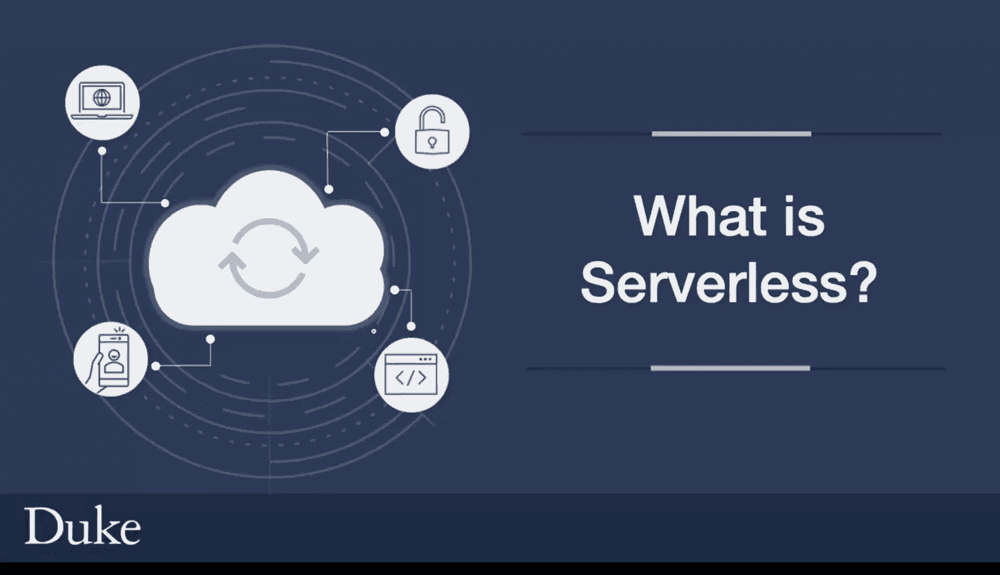

#  044：什么是无服务器 🚀

在本节课中，我们将要学习无服务器计算的核心概念。这是一种现代云计算技术，它允许开发者专注于编写业务逻辑，而无需管理底层的基础设施。

## 无服务器概念解析

无服务器是一种技术，它使用了一种抽象层，使得开发者无需关心执行所有工作的底层服务器。

例如，AWS Lambda 在底层可能使用 Kubernetes 或 Docker 容器来完成所有繁重的计算任务，但开发者无需考虑这些。开发者只需编写一个执行某些工作的 Python 函数，并可能将其附加到一个触发器上。

## 无服务器技术示例

除了计算服务，还有其他类型的无服务器技术。

以下是另一个典型的无服务器服务示例：
*   AWS Athena 可以查看 S3 存储桶，整合大量数据并对其执行 SQL 查询，而开发者同样无需关心服务器本身。

## 核心理念总结

上一节我们看到了具体的例子，现在我们来总结其核心思想。

无服务器的核心理念并非指服务器不存在，而是指开发者无需操心服务器管理，可以只专注于业务逻辑。

本节课中，我们一起学习了无服务器计算的定义、典型示例及其“无需管理服务器，专注业务逻辑”的核心价值。这是一种提升开发效率、降低运维复杂性的重要云原生架构模式。