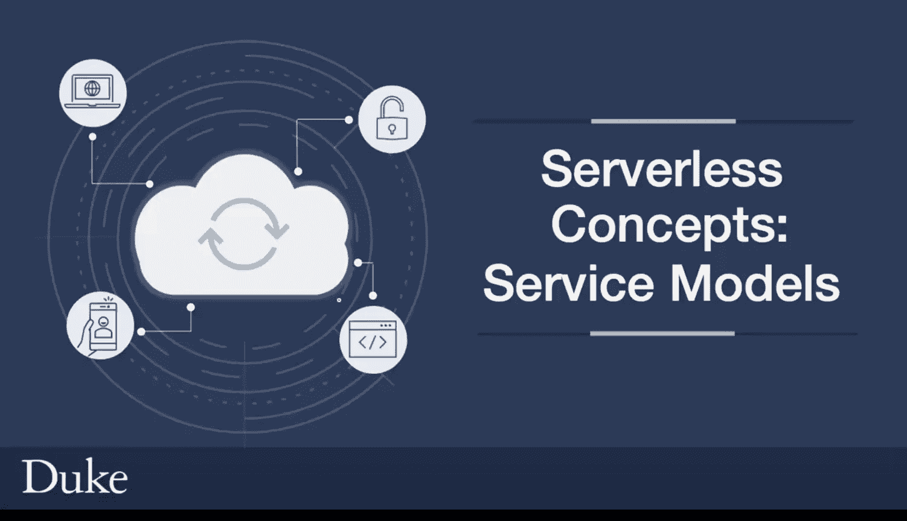
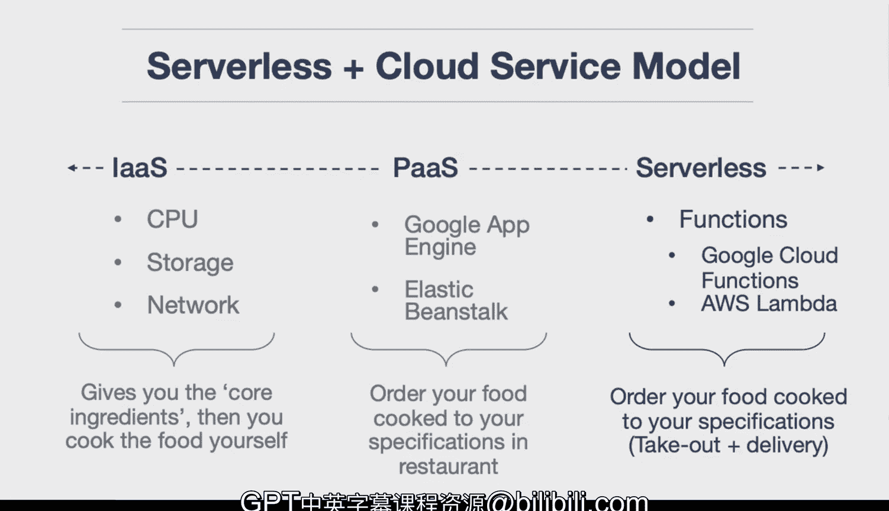
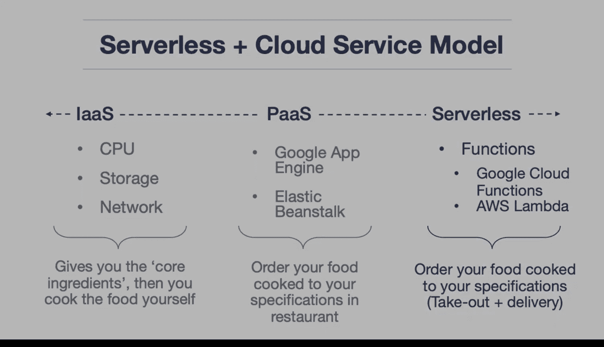

#  045：服务模型 🚀

在本节课中，我们将学习云计算中的无服务器概念，重点探讨其服务模型。我们将了解基础设施即服务、平台即服务和无服务器之间的区别，并通过类比帮助初学者理解这些抽象概念。

---

上一节我们介绍了无服务器是云计算中一个强大的工具。本节中，我们来看看云计算的服务模型，这是理解无服务器的基础。

在云中构建解决方案时，存在一个服务模式的谱系。以下是三种主要的服务模型：

1.  **基础设施即服务**：这是最底层的模型。你获得的是低层级的组件，例如CPU、存储和网络，并且需要明确地控制每一个组件。这就像在现实世界中，你去一家大型商店购买面粉、糖、肉类、蔬菜等原材料，但需要自己烹饪食物。在云中，使用IaaS可以低成本地构建资源，然后将其作为服务出售给其他公司，这类似于餐厅老板的商业模式。

2.  **平台即服务**：这个模型层级更高一些。它更像是一家餐厅，你可以直接点餐，并且在一定程度上可以定制。例如，你可以告诉厨师你的卷饼里想要鸡肉和米饭。你不需要购买鸡肉和米饭，但仍然能控制构建的内容。在云中，类似的服务包括Google App Engine或AWS Elastic Beanstalk。使用这些服务时，你仍然需要做一些工作，但服务器本身大部分由云供应商管理。很多时候，开发者倾向于使用PaaS，因为它避免了处理底层基础设施的繁重工作，让你更专注于解决问题。

3.  **无服务器**：这是更简单、更高层级的模型。延续餐厅的类比，无服务器就像点外卖。你通过电话或网站下单，食物就会送到你家，你无需做任何准备工作。你提出请求，就能获得结果。无服务器的美妙之处在于，它在自动化方面提供了最高层级的抽象。这意味着你可以专注于业务逻辑，并且这些逻辑直接对应你想要构建的功能。无服务器的典型例子包括**Google Cloud Functions**和**AWS Lambda**。

---

总结来说，无服务器的核心理念是让你从亲力亲为管理一切中解放出来。你不再需要启动虚拟机、挂载存储或配置网络连接，而是使用高级服务来自动化这些任务。如果你是一名构建者，希望专注于开发技术本身，那么无服务器很可能就是你想要重点关注的领域。正如课程所提到的，云供应商们目前也将大部分精力集中在这一领域。