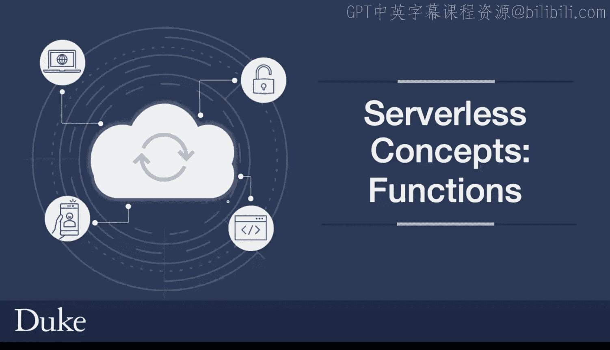
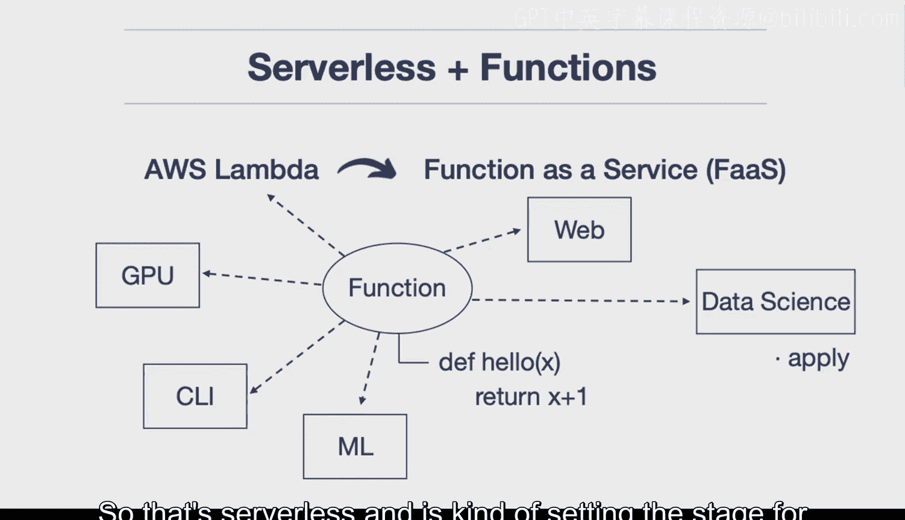
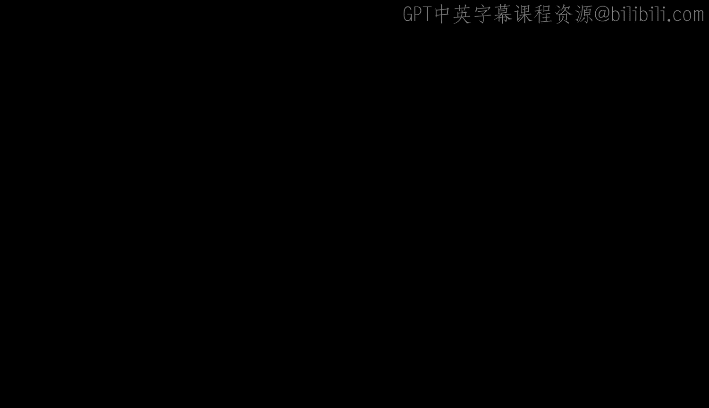

#  046：函数 🧩



在本节课中，我们将要学习无服务器计算的核心概念——函数。我们将探讨函数如何作为无服务器架构的基本构建块，以及它在云计算和其他计算领域中的广泛应用。

上一节我们介绍了无服务器计算的基本理念，本节中我们来看看其核心执行单元：函数。

## 函数即服务（FaaS）的核心

无服务器计算的一个关键特性是它利用了**函数**这一概念。以AWS为例，它是无服务器领域的领导者，其核心服务是 **AWS Lambda**。从本质上讲，你可以将AWS Lambda视为 **FaaS**，即**函数即服务**。

这意味着，你构建的任何无服务器应用的核心都是一个函数。它可能非常简单，例如一个Python函数：

```python
def hello(x):
    return x + 1
```

这短短几行代码，就可能是构建某个无服务器资源所需的全部。将这个函数部署到AWS Lambda后，它可以与整个AWS生态系统集成。你可以为其附加触发器、构建Web服务。因此，无服务器的心脏就是一个函数——一段可以接受输入、进行处理并返回结果的简短代码。理解这一点对于构建无服务器技术至关重要。

## 函数概念的广泛应用

然而，函数的概念非常有趣，它并不仅限于云构建。这一概念同样可以应用于其他计算机科学技术。

以下是函数可以应用的一些领域：

*   **GPU编程**：你可以拥有一个函数，并在其上方附加一个装饰器，指示其使用GPU。然后，你可以快速地将此函数分发并在一个GPU集群上运行数百万次。整个过程的核心就是那个函数，而你只需添加一个装饰器。
*   **命令行工具**：通过在某物之上附加装饰器，你可以构建命令行工具。
*   **Web服务**：你可以构建一个Flask应用，而其核心同样可以只是一个函数。
*   **数据科学**：以Pandas为例，许多有用的操作都需要你构建一个`apply`函数。你会使用`.apply()`方法，然后该函数会作用于每一行数据以执行操作。

## 总结：分布式系统的核心单元

本节课中我们一起学习了函数在无服务器计算中的核心地位。实际上，当你深入思考云计算时，其本质是一个**分布式系统**。而“拥有一小段代码，并用它来执行任务”这一概念，与之配合得天衣无缝。

这段代码可以是一个云函数、一个能并发处理海量数据（如1000万行）的GPU操作、一个命令行工具、一个Web应用、一个数据科学应用，甚至是一个机器学习任务。有时，它仅仅需要几行代码。





我认为，这正是无服务器技术如此有趣的关键原因。一旦你理解了将功能封装在少量代码中，然后将这些代码片段连接起来的强大之处，你就掌握了无服务器的精髓。这也为我们接下来要讨论的其他内容奠定了基础。