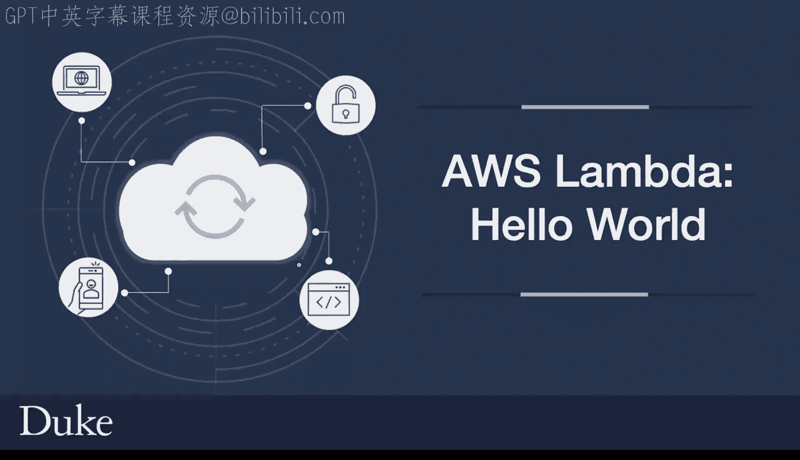
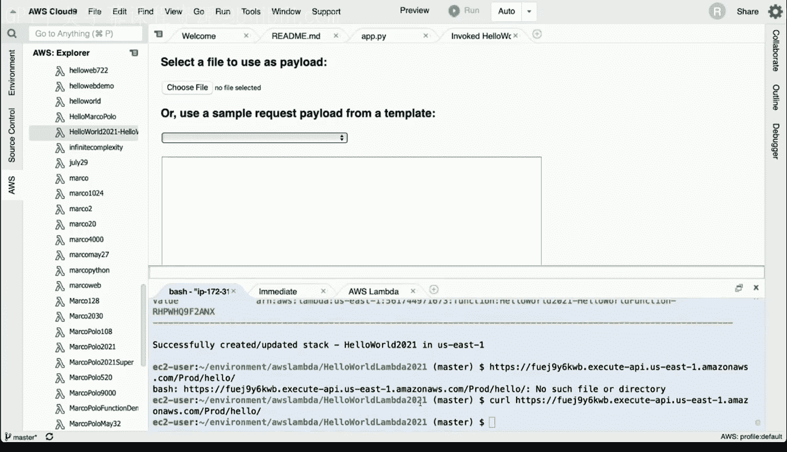
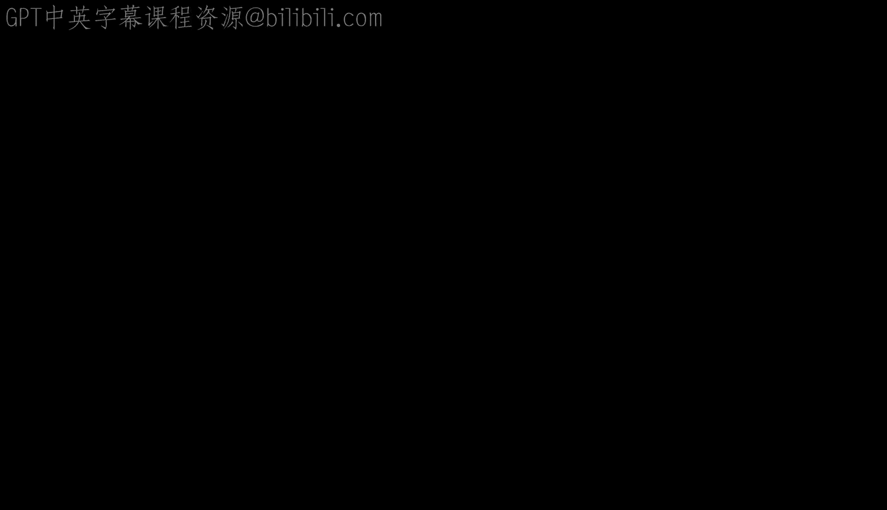

#  051：AWS Lambda Hello World 实践 🚀



在本节课中，我们将学习如何构建一个简单的 AWS Lambda 函数，并通过 API Gateway 将其部署为可公开访问的 API。整个过程将涵盖从环境准备、代码初始化、本地测试到云端部署的完整流程。

## 概述

我们将使用 AWS Cloud9 集成开发环境和 AWS SAM（Serverless Application Model）工具链，创建一个基于容器镜像的 Python Lambda 函数。教程将演示如何配置开发环境、初始化项目、构建容器镜像、本地测试，并最终将其部署到 AWS 云端。

## 环境准备与项目初始化

首先，我们需要准备开发环境并获取初始代码。我们将克隆一个包含实用脚本的代码仓库，并配置必要的 SSH 密钥以访问 GitHub。

以下是配置 SSH 密钥并克隆仓库的步骤：
1.  生成 SSH 密钥对。使用命令 `ssh-keygen -t rsa`，连续按回车键接受默认设置。
2.  打印公钥内容。使用命令 `cat ~/.ssh/id_rsa.pub` 查看公钥。
3.  复制输出的整个文本块。
4.  登录 GitHub，进入 Settings -> SSH and GPG keys。
5.  点击 “New SSH key”，为其命名（例如 “AWS Lambda Dev”），并粘贴复制的公钥。
6.  回到终端，使用 `git clone` 命令克隆目标仓库。

克隆完成后，进入项目目录。目录中包含一个名为 `resize.sh` 的脚本，用于扩展 Cloud9 环境的默认磁盘空间。默认情况下，Cloud9 为 Lambda 开发环境分配的磁盘空间较小，运行以下命令可将其扩容至 20GB：
```bash
chmod +x resize.sh
./resize.sh
```
扩容后，可使用 `df -h` 命令验证磁盘空间已增加。

## 使用 SAM 初始化 Lambda 项目

环境准备就绪后，我们使用 AWS SAM 命令行工具初始化一个新的 Lambda 函数项目。

运行 `sam init` 命令启动交互式初始化向导。向导会引导我们完成以下选择：
1.  选择使用快速启动模板。
2.  选择构建产物类型。我们选择 **2**，即容器镜像，它将上传到 Amazon ECR（Elastic Container Registry）。
3.  选择基础镜像。在众多编程语言选项中，我们选择 **4**，即 `amazon/python3.8-base` 镜像。
4.  为项目命名，例如 `HelloWorldLambda-2021`。
5.  选择应用程序模板。我们选择 “Hello World Lambda Image Application”。

初始化完成后，SAM 会创建一个包含 `README.md` 文件的项目目录，其中详细说明了后续步骤。我们进入该目录：`cd HelloWorldLambda-2021`。

## 构建与本地测试

上一节我们使用 SAM 初始化了项目框架，本节中我们来看看如何构建项目并在本地进行测试，这是部署前验证功能的关键步骤。

首先，我们需要构建项目。在项目根目录下运行 `sam build` 命令。此命令会启动一个 Docker 容器，在模拟的生产环境中构建我们的 Lambda 函数。容器化构建的优势在于能确保本地环境与云端运行环境的一致性。

构建完成后，我们可以查看应用程序代码。主逻辑位于 `hello_world` 目录下的 `app.py` 文件中。其核心是一个简单的 `lambda_handler` 函数，目前仅返回 “Hello World”：
```python
def lambda_handler(event, context):
    return {"statusCode": 200, "body": "Hello World"}
```
如需修改返回信息，可在此处编辑代码。

接下来进行本地测试。运行 `sam local invoke` 命令，该命令会在本地容器中模拟调用 Lambda 函数。如果终端输出包含 “Hello World” 的响应，则表明函数在本地运行正常。

## 部署到 AWS 云端

在本地测试通过后，下一步是将我们的 Lambda 函数部署到 AWS 云端，使其成为一个可通过 HTTP 访问的服务。

我们使用引导式部署命令：`sam deploy --guided`。此命令会交互式地询问部署参数：
1.  **堆栈名称**：为这个 CloudFormation 堆栈命名，例如 `hello-world-stack-2021`。
2.  **AWS 区域**：选择部署区域，如 `us-east-1`。
3.  **镜像仓库**：需要指定一个 Amazon ECR 仓库来存储容器镜像。在此之前，我们需要先创建一个 ECR 仓库。
    *   前往 AWS 管理控制台的 ECR 服务。
    *   创建新仓库，命名为 `hello-world-repo`（注意名称需全小写）。
    *   创建成功后，复制仓库的完整 URI（格式如 `123456789.dkr.ecr.region.amazonaws.com/hello-world-repo`）。
4.  在 `sam deploy --guided` 的交互过程中，将复制的 URI 粘贴到 “Image Repository for HelloWorldFunction” 的提示处。
5.  后续提示关于确认部署、允许 SAM 创建 IAM 角色等，均选择允许或确认。

部署过程开始后，SAM 会执行以下操作：
*   将本地构建的容器镜像推送到指定的 ECR 仓库。
*   使用 AWS CloudFormation（基础设施即代码服务）自动创建和配置所有必要的 AWS 资源，包括 Lambda 函数、API Gateway 以及相关的权限。

部署完成后，终端会输出一个 API Gateway 的端点 URL。这个 URL 就是我们的 “Hello World” API 的访问地址。

## 验证与多种调用方式

部署成功后，我们可以通过多种方式来验证和调用已上线的 Lambda 函数，确保其按预期工作。

最直接的验证方式是使用 `curl` 命令测试 API Gateway 端点：
```bash
curl <你的API-Gateway-端点URL>
```
如果返回 `{"message": "Hello World"}` 或类似内容，则说明部署成功。你也可以将该 URL 直接粘贴到浏览器中访问，会看到相同的结果。

此外，还有多种调用方式：
*   **AWS 管理控制台**：在 Lambda 服务控制台中，找到名为 `HelloWorldLambda-2021` 的函数，可以直接在控制台内创建测试事件并调用。
*   **查看触发器**：在 Lambda 函数控制台的 “触发器” 标签页，可以看到关联的 API Gateway，并获取其调用 URL。
*   **Cloud9 AWS Explorer**：在 Cloud9 环境的侧边栏 AWS 资源管理器中，找到该 Lambda 函数，右键点击选择 “Invoke on AWS” 进行调用。

对于简单的 Hello World 应用，使用命令行（`curl`）进行测试通常是最快捷高效的方式。

## 总结





本节课中我们一起学习了从零开始构建和部署一个容器化 AWS Lambda 函数的完整流程。我们首先准备了 Cloud9 开发环境并初始化了 SAM 项目，随后在本地构建并测试了函数逻辑，最后通过 SAM 工具链将函数部署至 AWS 云端，并通过 API Gateway 暴露为 HTTP 服务。这个过程展示了如何使用现代 Serverless 工具实现快速开发、本地模拟和一站式部署，是构建云原生应用的基础实践。