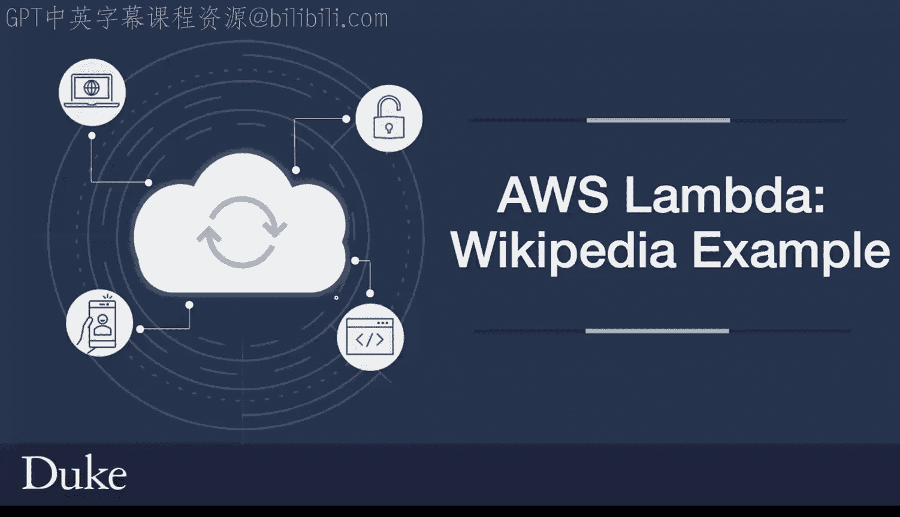
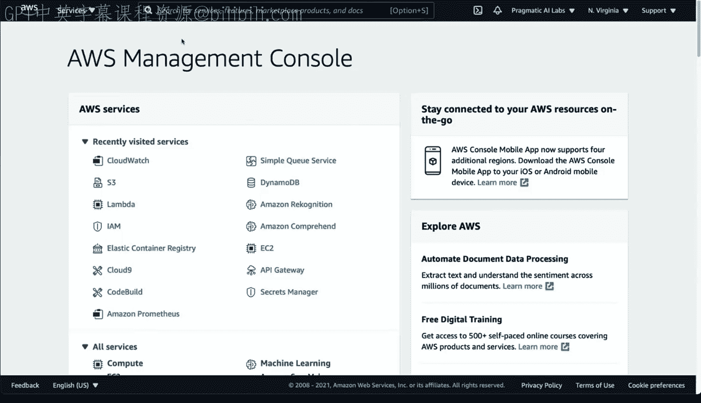
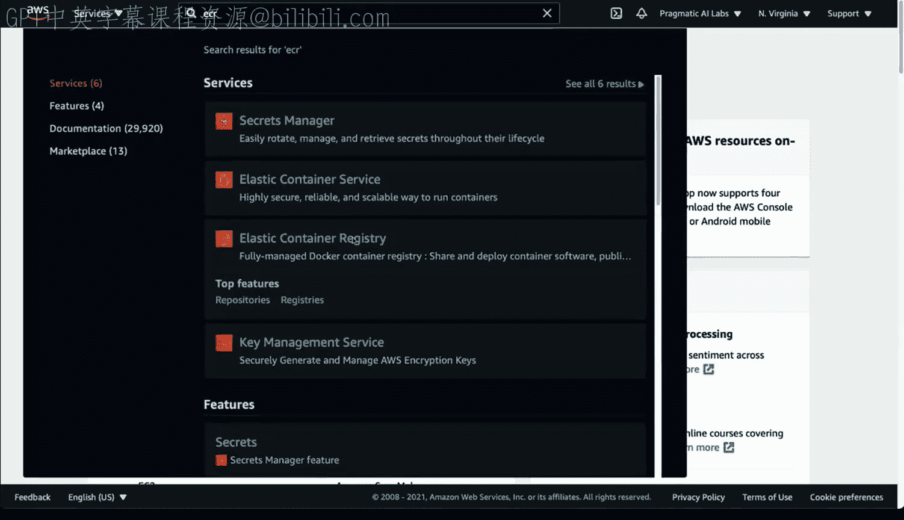
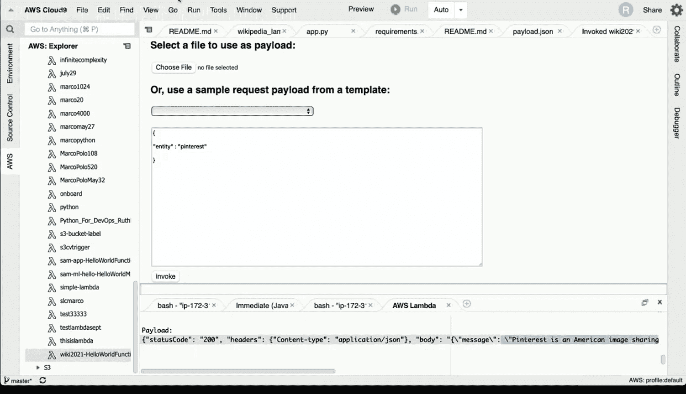
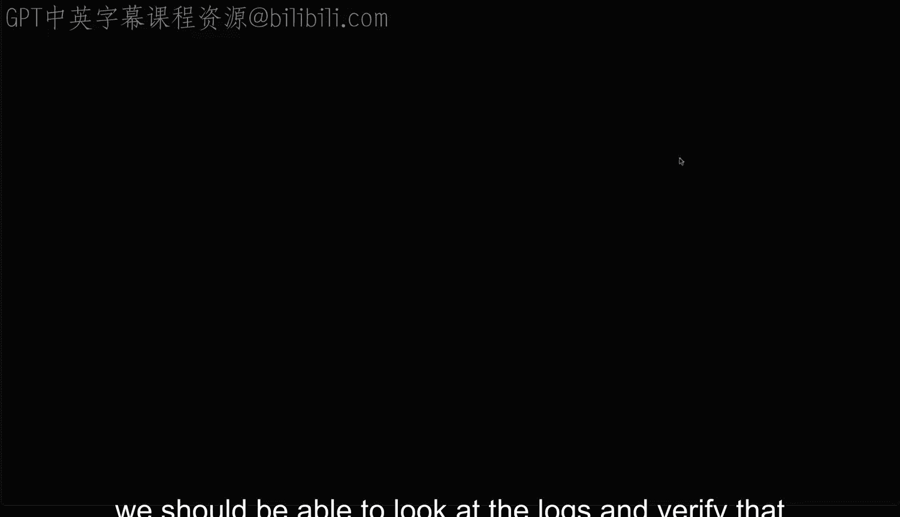
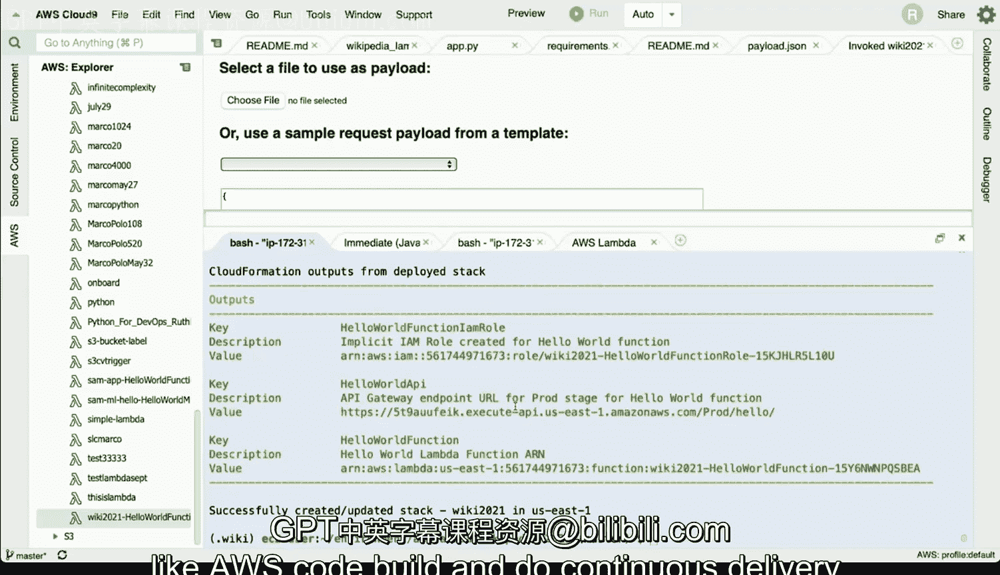

#  053：构建一个更复杂的AWS Lambda函数（维基百科示例）🚀



在本节课中，我们将学习如何构建一个更复杂的AWS Lambda函数。这个函数将接受一个公司名称（例如Google、Facebook），然后调用维基百科API来获取并返回该公司的摘要信息。我们将使用AWS SAM（Serverless Application Model）框架来本地开发、测试和部署这个无服务器应用。

---

## 概述

我们将创建一个能够查询维基百科的Lambda函数。整个过程包括：编写函数代码、使用SAM在本地构建和测试、配置依赖、创建测试事件，最后将应用部署到AWS云端。通过这个示例，你将掌握使用SAM进行无服务器应用开发的完整工作流。

---

## 编写Lambda函数代码

首先，我们来看一下核心的Lambda函数代码。这个函数使用Python编写，主要功能是接收一个包含公司名称的事件，然后从维基百科获取该公司的摘要。

```python
import json
import wikipedia

def lambda_handler(event, context):
    # 从传入的事件中获取公司名称
    entity = event.get('entity', '')
    # 使用wikipedia库获取摘要，限制为1句话
    summary = wikipedia.summary(entity, sentences=1)
    # 构建并返回响应
    response = {
        'statusCode': 200,
        'body': json.dumps(summary)
    }
    return response
```

**代码解释**：
*   `lambda_handler` 是AWS Lambda的入口函数。
*   `event` 参数包含了调用时传入的数据，我们从中提取 `entity` 字段。
*   `wikipedia.summary(entity, sentences=1)` 调用维基百科库，获取指定实体的摘要，并限制返回一句句子。
*   最后，函数返回一个包含状态码和摘要文本的JSON响应。

---

## 使用SAM初始化项目

上一节我们介绍了函数的核心逻辑，本节中我们来看看如何用SAM搭建项目框架。AWS SAM可以帮助我们快速初始化一个包含模板和配置的无服务器项目。

我们通过终端命令 `sam init` 来开始。在引导过程中，我们需要做出一些选择：

1.  选择模板来源：我们使用 `1 - AWS Quick Start Templates`。
2.  选择包类型：由于我们将使用容器镜像，选择 `2 - Image (artifact is an image uploaded to an ECR repository)`。
3.  选择基础镜像：对于Python 3.8环境，选择 `4 - amazon/python3.8-base`。
4.  输入项目名称：例如 `wikipedia-2021`。
5.  选择示例函数：我们从一个简单的 `Hello World Lambda Image` 示例开始。

命令执行后，SAM会创建一个包含标准目录结构的项目。

---

## 配置项目依赖

项目初始化完成后，我们需要配置其依赖项，主要是Python库。

以下是需要检查和修改的关键文件：

*   `requirements.txt`： 此文件列出了Python项目所需的第三方库。我们需要在其中添加 `wikipedia` 库。
    ```
    wikipedia
    ```
*   `app.py`： 这是Lambda函数的入口文件。我们需要用之前编写的维基百科查询代码替换掉默认的“Hello World”代码。
*   `template.yaml`： 这是SAM的部署模板，定义了AWS资源（如Lambda函数、API网关）。在初始阶段，我们通常无需修改它。

---

## 在本地构建和测试

配置好代码和依赖后，我们可以在本地构建和测试函数，确保其正常工作后再部署到云端。

### 创建虚拟环境

首先，我们进入函数代码目录，并创建一个Python虚拟环境来隔离依赖。

```bash
# 进入项目目录
cd wikipedia-2021/hello_world
# 创建虚拟环境（例如在用户主目录下）
python3 -m venv ~/.wiki
# 激活虚拟环境
source ~/.wiki/bin/activate
# 安装依赖项
pip install -r requirements.txt
```

### 使用SAM构建

接下来，我们需要在项目根目录（即包含 `template.yaml` 的目录）下使用SAM构建项目。这会根据我们的配置创建一个容器镜像。

```bash
# 退回项目根目录
cd ..
# 执行构建命令
sam build
```

### 创建测试事件并本地调用

为了测试函数，我们需要模拟一个调用事件。我们创建一个JSON文件作为测试负载（payload）。

创建一个名为 `payload.json` 的文件，内容如下：
```json
{
  "entity": "Google"
}
```

现在，我们可以使用SAM在本地调用Lambda函数，并传入这个测试事件。

```bash
sam local invoke -e payload.json
```





**注意**： 有时维基百科的查询可能对某些名称不精确匹配（如“Google”可能无法直接匹配）。如果遇到错误，可以尝试更换 `entity` 的值，例如使用“Twitter”、“Amazon”等。这是一种常见的调试过程。

### 使用交互式Python进行调试

除了SAM本地调用，我们还可以在激活的虚拟环境中使用Python交互式环境（REPL）直接测试 `wikipedia` 库的功能，这有助于快速验证逻辑。

```bash
# 确保在激活的虚拟环境中
python
>>> import wikipedia
>>> print(wikipedia.summary("Twitter", sentences=1))
```

---

## 部署到AWS

在本地测试通过后，就可以将应用部署到AWS云环境了。

### 准备ECR仓库

由于我们创建的是镜像类型的Lambda函数，需要先将容器镜像推送到Amazon ECR（弹性容器仓库）。我们需要在AWS管理控制台创建一个新的ECR仓库，例如命名为 `wiki`，并记下其URI。

### 执行部署

我们使用SAM的引导式部署命令，它会一步步引导我们完成配置。

```bash
sam deploy --guided
```

在引导过程中，你需要输入：
*   堆栈名称（Stack Name）： 例如 `wiki-2021`。
*   AWS区域（AWS Region）： 例如 `us-east-1`。
*   镜像仓库URI（Image Repository）： 粘贴上一步创建的ECR仓库URI。
*   确认其他默认配置。

SAM会自动完成以下工作：
1.  将本地构建的容器镜像推送到指定的ECR仓库。
2.  根据 `template.yaml` 创建或更新CloudFormation堆栈，包括Lambda函数、必要的IAM角色和权限。
3.  如果配置了HTTP端点（如通过API Gateway），它还会创建相应的API。

部署完成后，终端会输出函数的ARN（Amazon资源名称）和可调用的端点URL（如果配置了API）。

---

## 在云端测试与验证

部署成功后，我们可以在AWS管理控制台验证和测试生产环境的函数。

1.  **在Lambda控制台测试**：
    *   导航到AWS Lambda控制台，找到刚部署的函数（如 `wiki-2021`）。
    *   点击“测试”选项卡。
    *   创建一个新的测试事件，输入JSON负载，例如 `{"entity": "Twitter"}`。
    *   点击“测试”按钮，观察执行结果和返回的摘要信息。

2.  **查看监控日志**：
    *   在Lambda函数控制台，点击“监控”选项卡。
    *   在这里可以查看函数的调用次数、持续时间、错误率等指标。
    *   点击“查看CloudWatch中的日志”可以深入查看每次调用的详细日志输出，这对于调试生产环境问题至关重要。

3.  **使用端点URL调用（如果配置了API Gateway）**：
    *   如果部署时创建了API Gateway，你可以在输出中找到端点URL。
    *   你可以使用 `curl` 命令或Postman等工具，向该URL发送POST请求，请求体为JSON负载，来远程调用你的Lambda函数。

---

## 总结

本节课中我们一起学习了构建和部署一个复杂AWS Lambda函数的完整流程。我们从编写一个查询维基百科的Python函数开始，然后使用AWS SAM框架在本地初始化项目、管理依赖、构建容器镜像并进行测试。之后，我们将应用部署到AWS云端，包括创建ECR仓库和使用SAM进行引导式部署。最后，我们在AWS控制台验证了生产环境函数的运行情况，并了解了如何查看监控日志。







这个流程展示了无服务器开发的强大之处：**快速本地迭代、基于基础设施即代码（IaC）的可重复部署，以及轻松的云端扩展和管理**。掌握了这个流程后，你可以将其作为模板，开发更复杂的、由事件驱动的云原生应用。下一步，你可以探索将此流程集成到CI/CD管道（如AWS CodeBuild）中，实现持续集成和持续部署。