#  055：AWS无服务器实践指南 🚀

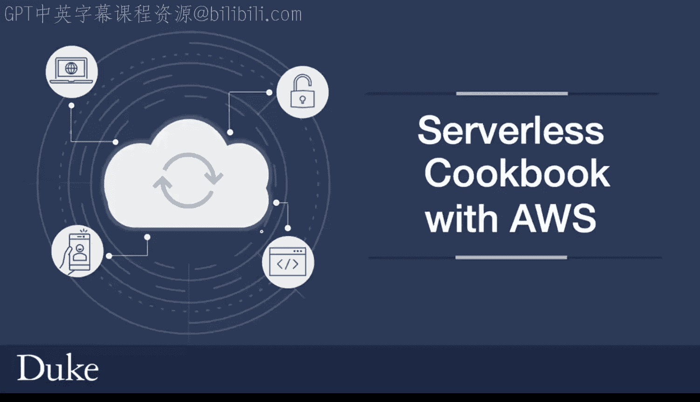

在本节课中，我们将学习无服务器架构的核心概念，并通过一个具体的“Marco Polo”示例，在AWS Lambda平台上实践如何创建、测试、部署和监控一个无服务器函数。我们将理解为何无服务器是现代DevOps的最佳实践，并探索其相较于传统单体架构的优势。

## 概述：从传统架构到无服务器架构 🔄

上一节我们介绍了云计算的基本概念，本节中我们来看看无服务器架构如何革新应用开发。

传统架构（约1970年至2005年）通常基于**单体框架**。这种模式依赖关系型数据库（RDB）、CGI Web请求模型和服务器端模板渲染。其核心问题是**计算效率低**、**调试困难**且**存在安全漏洞**。服务器需要持续运行，消耗大量资源。

现代DevOps实践（约2010年至今）倡导**微服务**和**无服务器**架构。微服务专注于单一、专门的任务，**复杂度低**，易于维护。更重要的是，无服务器架构是**事件驱动**的，函数只在被触发时运行，按需付费，这带来了更高的效率和更低的成本。

## 无服务器核心概念与优势 ⚡

以下是理解无服务器架构的关键点：

*   **事件驱动模型**：函数执行由特定事件（如HTTP请求、文件上传、定时任务）触发，而非持续运行的服务器进程。
*   **按需付费**：您只需为函数实际执行的时间和资源付费，无需为闲置的服务器容量付费。
*   **自动扩展**：云平台自动处理函数的并发执行和扩展，无需手动配置。
*   **简化运维**：基础设施管理（如服务器维护、操作系统更新）由云提供商负责。

我们可以用一个简单的类比来理解事件驱动：想象车库里的电灯。

*   **传统方式（持续轮询）**：让电灯24/7常亮，无论是否需要。这就像持续运行的服务器，浪费电力（资源）。
*   **事件驱动方式**：电灯仅在特定事件发生时亮起，例如：
    1.  **开门事件**：门打开时，灯自动亮起。
    2.  **手动事件**：手动按下开关。
    3.  **定时事件**：在特定时间（如午夜到凌晨1点）自动亮起作为防盗措施。

无服务器架构就像这种智能电灯系统，它**更强大**、**更高效**，并且能构建**更复杂**的解决方案。其优势可以概括为：

*   **效率更高**：`成本 ∝ 实际执行时间`
*   **能力更强**：支持多种事件源和触发器。
*   **更环保**：减少因闲置服务器运行而产生的能源浪费。

## 实践：创建第一个AWS Lambda函数 🛠️

现在，让我们将理论付诸实践，在AWS Lambda中创建一个简单的函数。

### 步骤1：登录并创建函数

1.  登录AWS管理控制台。
2.  导航到 **Lambda** 服务。
3.  点击 **“创建函数”**。
4.  选择 **“从头开始创作”**。
5.  输入函数名称，例如 `Marco2030`。
6.  选择运行时，例如 **Python 3.8**。
7.  点击 **“创建函数”**。

创建后，您将进入一个内置的代码编辑器界面。

### 步骤2：编写函数代码

我们将创建一个经典的“Marco Polo”游戏函数。其逻辑是：如果输入事件中包含名字“Marco”，则返回“Polo”；否则返回“No”。

在代码编辑器中，替换默认代码为以下内容：

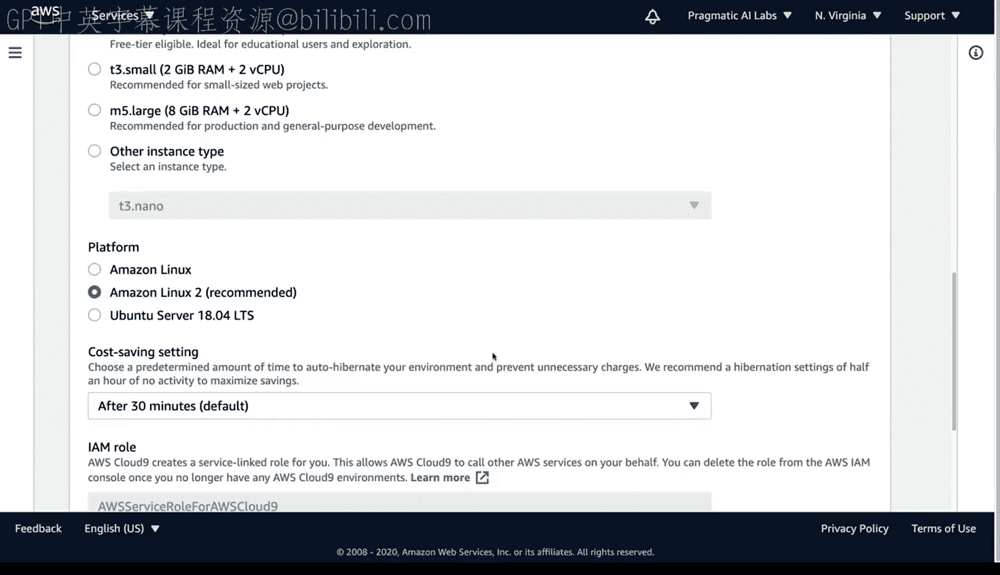

```python
import json

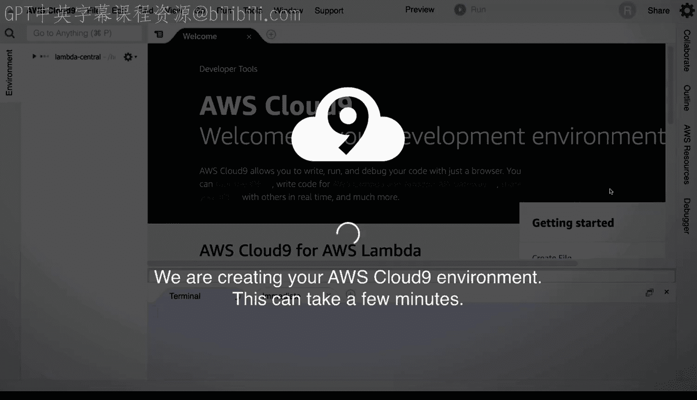

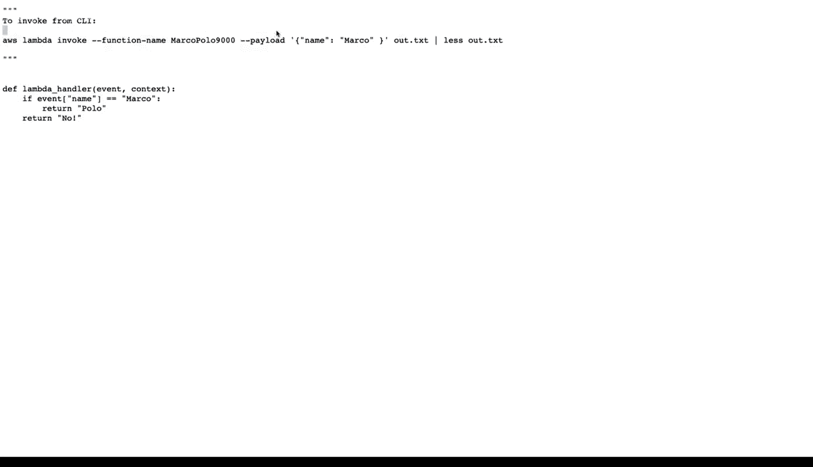

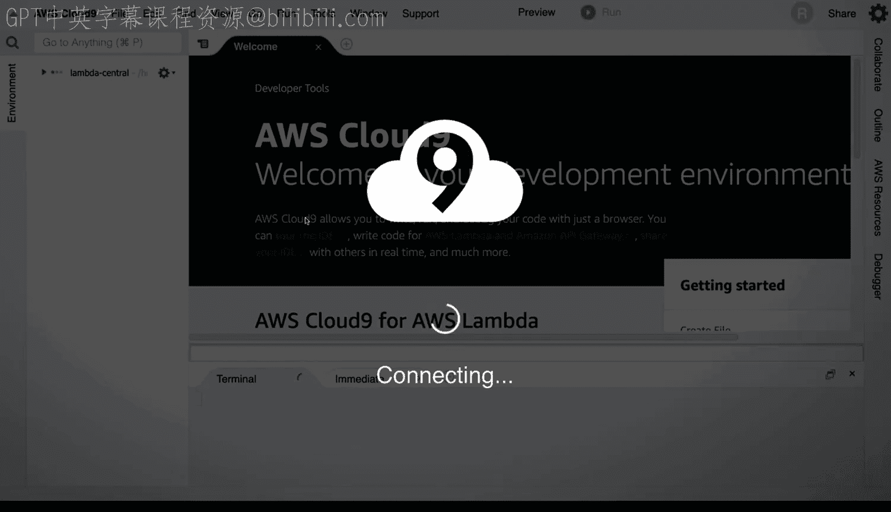

def lambda_handler(event, context):
    # 检查事件中是否包含‘name’字段，且其值是否为‘Marco’
    if ‘name‘ in event and event[‘name‘] == ‘Marco‘:
        return {
            ‘statusCode‘: 200,
            ‘body‘: json.dumps(‘Polo‘)
        }
    else:
        return {
            ‘statusCode‘: 200,
            ‘body‘: json.dumps(‘No‘)
        }
```

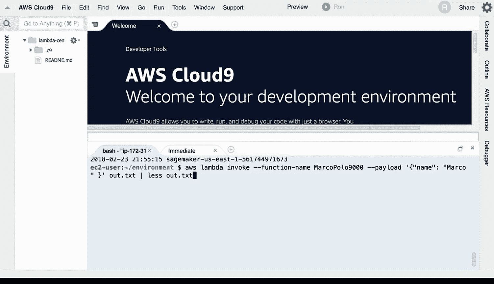

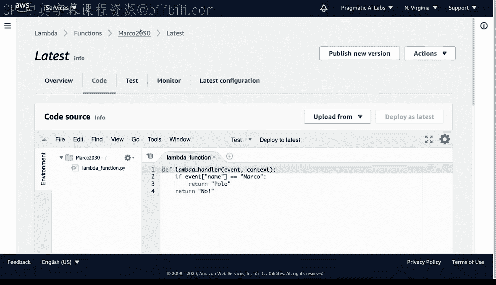

### 步骤3：部署与测试

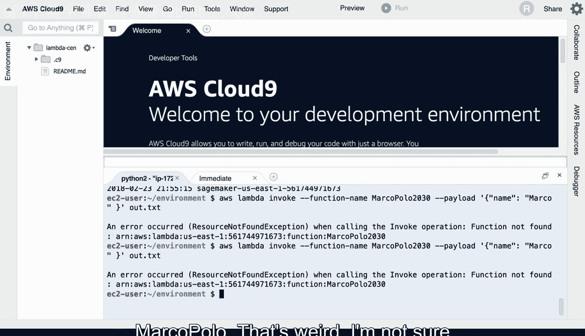

1.  点击 **“部署”** 按钮保存并发布您的函数。
2.  点击 **“测试”** 按钮配置测试事件。
3.  创建一个新的测试事件，输入以下JSON作为事件负载：
    ```json
    {
      “name“: “Marco“
    }
    ```
4.  点击 **“测试”**。您应该看到执行结果返回 `“Polo“`。
5.  再创建一个测试事件，负载为 `{“name“: “Bob“}`，测试应返回 `“No“`。

## 进阶操作：CLI调用与日志记录 🔧

上一节我们在控制台测试了函数，本节中我们来看看如何通过命令行调用并添加日志功能。

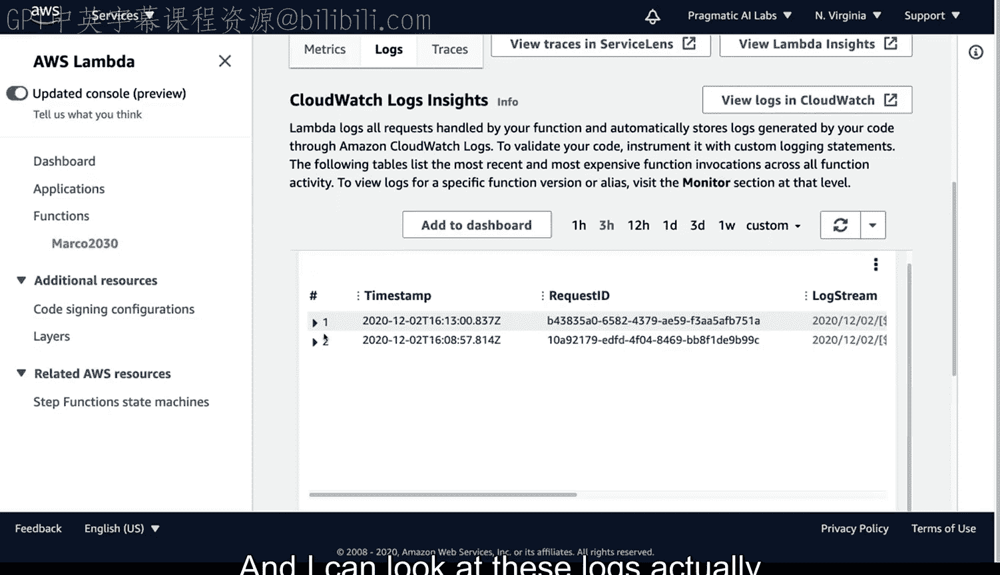

### 通过AWS CLI调用Lambda

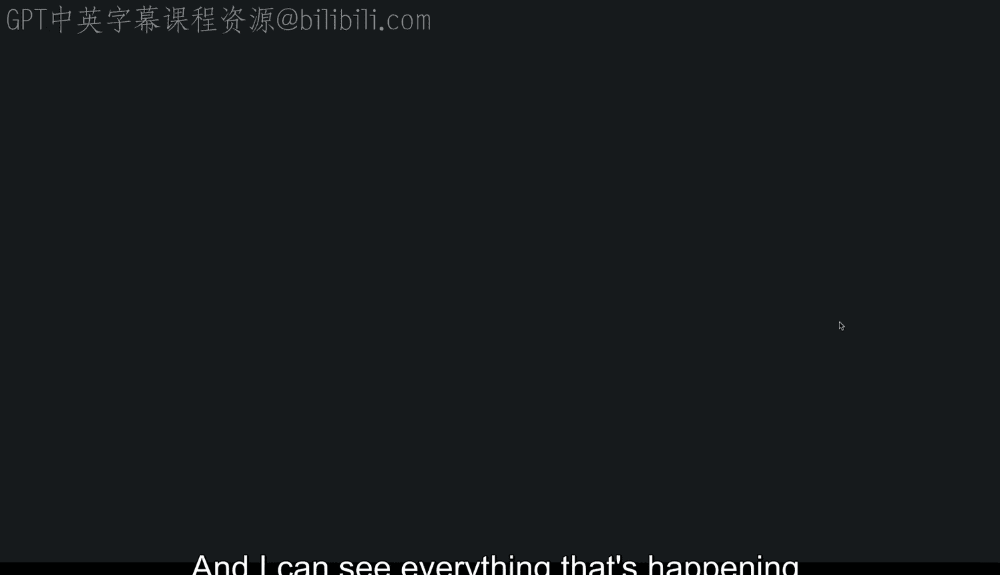

您可以在已配置AWS CLI的环境中（如AWS Cloud9）使用命令调用函数。这便于自动化脚本和集成测试。

```bash
aws lambda invoke \
  --function-name Marco2030 \
  --payload ‘{“name“: “Marco“}‘ \
  response.json && cat response.json
```
此命令会调用函数并将响应输出到 `response.json` 文件，然后显示其内容。

### 为函数添加日志

在Lambda中，使用 `print` 语句即可将日志输出到Amazon CloudWatch Logs。这有助于调试和监控。

更新您的 `lambda_handler` 函数，添加日志语句：

```python
import json

def lambda_handler(event, context):
    # 打印原始事件，用于调试
    print(f“Raw event received: {event}“)

    if ‘name‘ in event and event[‘name‘] == ‘Marco‘:
        print(“This event was for Marco.“)
        return {
            ‘statusCode‘: 200,
            ‘body‘: json.dumps(‘Polo‘)
        }
    else:
        print(“This event was not for Marco.“)
        return {
            ‘statusCode‘: 200,
            ‘body‘: json.dumps(‘No‘)
        }
```
部署后，再次测试函数。然后可以在Lambda控制台的 **“监控”** 选项卡下，点击 **“查看CloudWatch日志”** 来查看 `print` 语句输出的日志信息。

## 使用AWS Step Functions编排工作流 ⛓️

单个Lambda函数能力有限，本节中我们来看看如何使用AWS Step Functions将多个Lambda函数串联成复杂的工作流。

Step Function允许您以可视化方式定义一系列步骤（状态机），其中一个步骤的输出可以作为下一个步骤的输入。

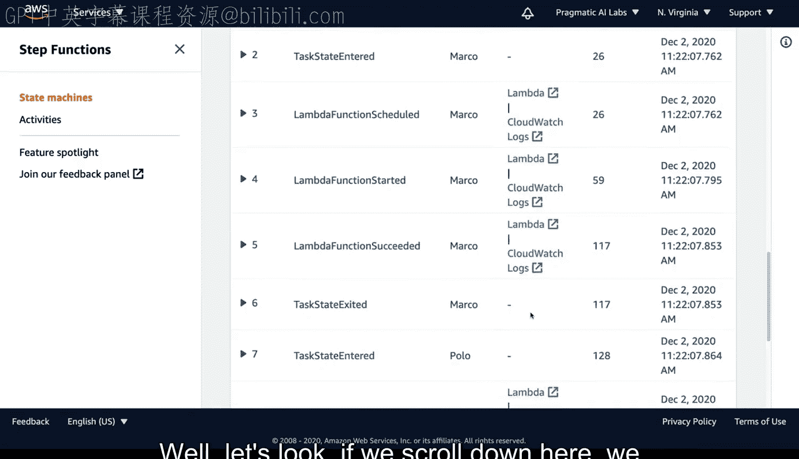

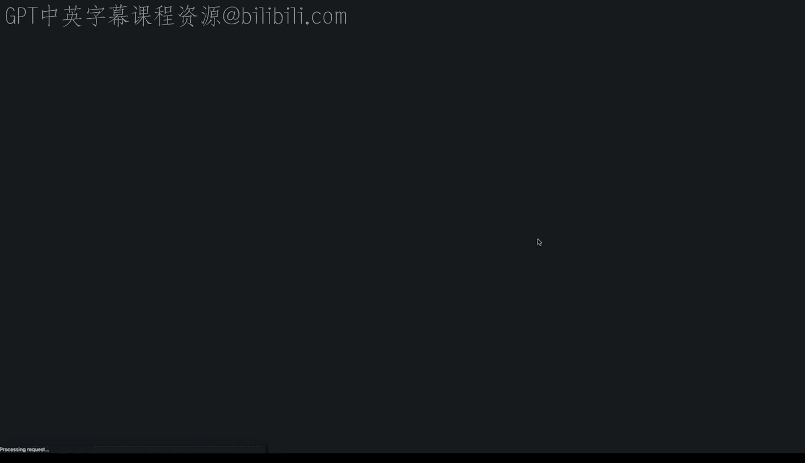

### 创建一个简单的Step Function

1.  在AWS控制台导航到 **Step Functions** 服务。
2.  点击 **“创建状态机”**。
3.  选择 **“使用代码编写工作流”**。
4.  在定义中，使用Amazon States Language (ASL) 描述工作流。例如，一个串联“Marco”函数和“Polo”函数的简单流程：

```json
{
  “Comment“: “A simple Marco-Polo workflow“,
  “StartAt“: “MarcoFunction“,
  “States“: {
    “MarcoFunction“: {
      “Type“: “Task“,
      “Resource“: “arn:aws:lambda:REGION:ACCOUNT_ID:function:Marco2030“,
      “Next“: “PoloFunction“
    },
    “PoloFunction“: {
      “Type“: “Task“,
      “Resource“: “arn:aws:lambda:REGION:ACCOUNT_ID:function:AnotherPoloFunction“,
      “End“: true
    }
  }
}
```
> **注意**：您需要将 `REGION` 和 `ACCOUNT_ID` 替换为您的实际信息，并确保 `AnotherPoloFunction` 已存在（它应接收“Polo”并返回“Marco”或其他逻辑）。

5.  后续步骤中配置IAM角色并创建状态机。
6.  创建后，您可以**启动执行**，提供初始输入（如 `{“name“: “Marco“}`），并可视化地跟踪每个步骤的执行状态、输入和输出，这对于调试复杂业务流程非常强大。

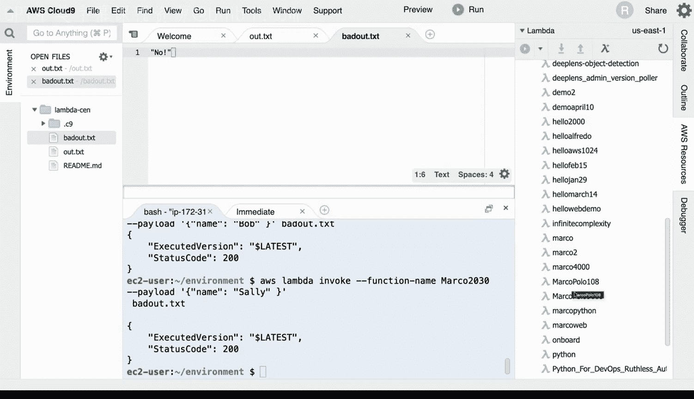

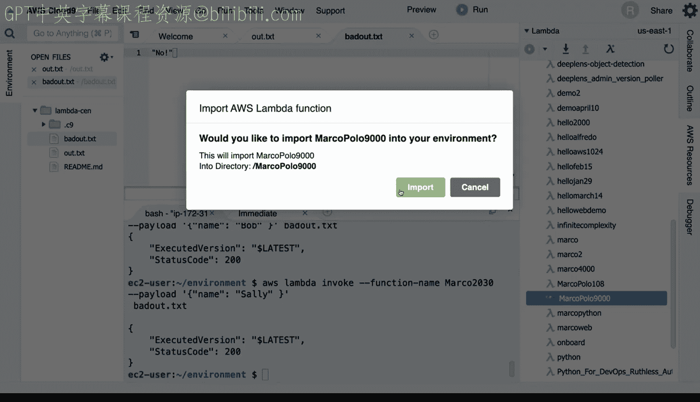

## 总结与展望 📚

本节课中我们一起学习了无服务器架构的核心价值，并在AWS平台上进行了实践。

*   **我们理解了** 从低效的传统单体架构向事件驱动的微服务和无服务器架构演进的必要性。
*   **我们实践了** 如何在AWS Lambda上创建、编写、部署和测试一个无服务器函数。
*   **我们探索了** 通过CLI调用函数、添加日志监控以及使用Step Functions编排多函数工作流等进阶功能。

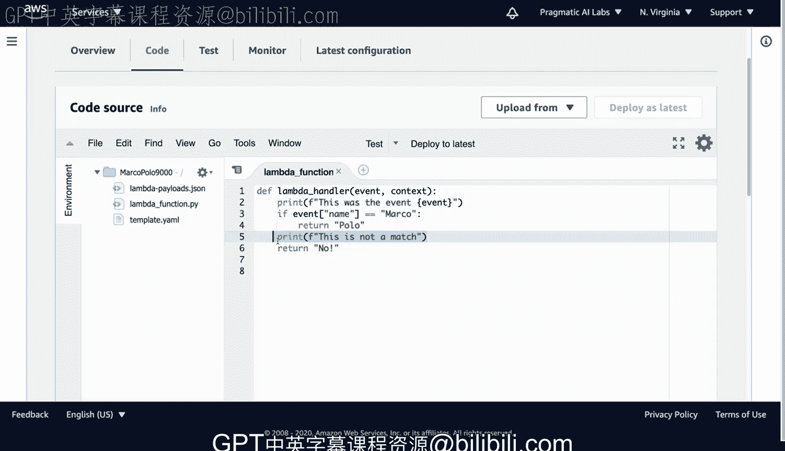

无服务器计算，特别是AWS Lambda，提供了强大的能力、极致的效率以及优秀的可观测性工具，代表了现代云原生应用开发的方向。结合容器镜像支持、丰富的触发器类型和可视化工作流编排，它使得开发者能够快速构建弹性、可扩展且成本优化的应用程序。