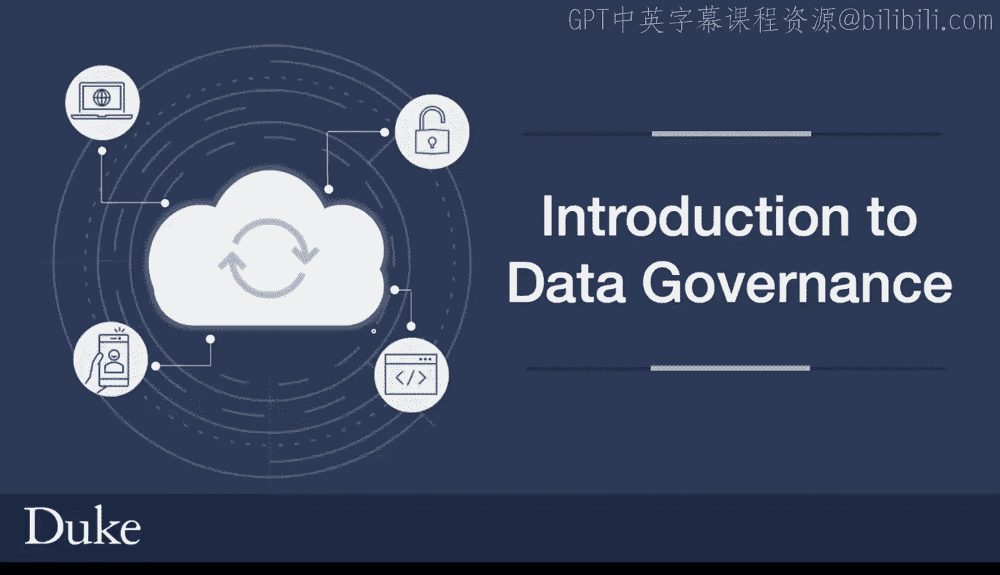
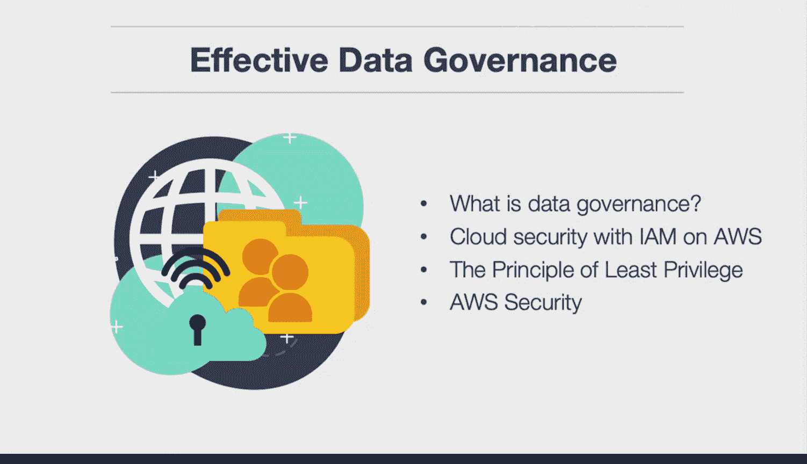
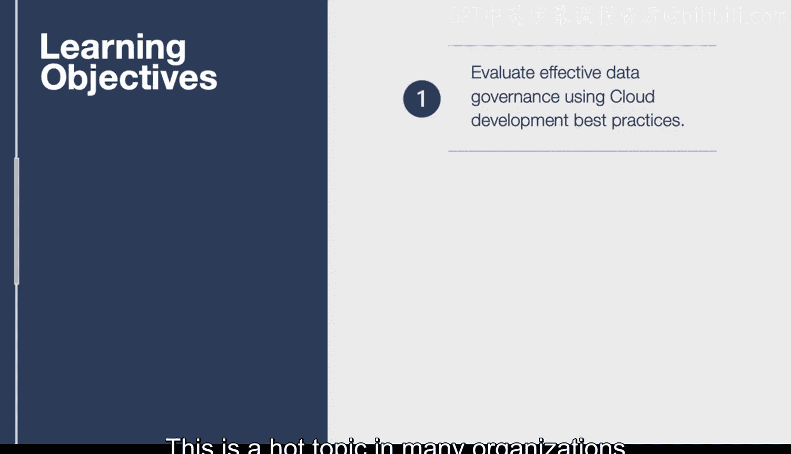
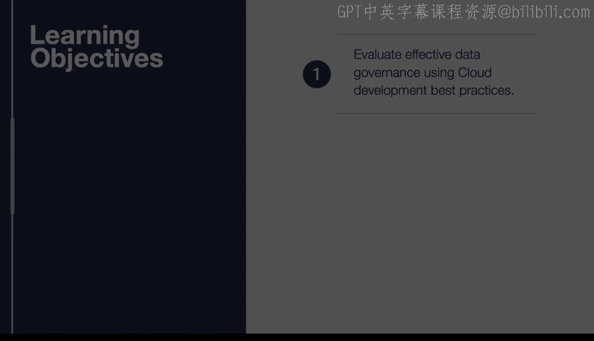

#  057：数据治理导论

在本节课中，我们将学习如何实施有效的数据治理。首先，我们将探讨数据治理的定义。接着，我们将深入探讨AWS上的云安全，特别是身份和访问管理（IAM），了解可以分配的角色和权限。然后，我们将介绍“最小权限原则”，这是安全领域的一个重要概念，其核心是从授予最少的权限开始。最后，我们会讨论一些AWS安全的核心基础知识。

## 🎯 课程学习目标



上一节我们介绍了课程的整体内容，本节中我们来看看具体的学习目标。

在本课程中，我们将评估有效的数据治理。随着许多组织迁移到云端，数据治理已成为一个热门话题，我们将在本节课中详细探讨。

## 🔐 什么是数据治理

数据治理是一套确保组织内数据资产得到有效管理和保护的流程、策略、标准与实践。它涉及数据的可用性、完整性、安全性和隐私性。

## ☁️ AWS云安全与IAM

理解了数据治理的基本概念后，我们来看看其在云环境中的具体实现，特别是通过AWS的身份和访问管理（IAM）。

IAM是AWS中用于安全控制访问的核心服务。它允许您管理用户、组、角色及其对AWS服务和资源的访问权限。

以下是IAM中的核心组件：

*   **用户**：代表一个可以与AWS交互的人或应用程序。
*   **组**：是IAM用户的集合，可以方便地批量分配权限。
*   **角色**：是一种可以被实体（如用户、应用程序或AWS服务）临时“代入”的身份，它带有特定的权限集。
*   **策略**：定义权限的文档，采用JSON格式。策略可以附加到用户、组或角色上。

一个基本的IAM策略示例如下：
```json
{
    "Version": "2012-10-17",
    "Statement": [
        {
            "Effect": "Allow",
            "Action": "s3:ListBucket",
            "Resource": "arn:aws:s3:::example-bucket"
        }
    ]
}
```

## ⚖️ 最小权限原则



在了解了如何通过IAM分配权限后，我们必须遵循一个关键的安全原则来指导我们的权限分配决策，即“最小权限原则”。

最小权限原则是信息安全的一个基本原则。它要求只授予实体（用户、应用程序、服务）完成其任务所必需的最小权限，不多也不少。这有助于减少因权限过大而导致的安全风险，例如数据泄露或误操作。

其核心思想可以用一个简单的公式表示：
**授予的权限 = 完成任务所需的最小权限集**

## 🛡️ AWS安全核心基础

遵循最小权限原则是构建安全架构的基石。在此基础上，我们还需要了解一些AWS安全的核心基础，以构建全面的防护体系。

以下是几个关键的AWS安全基础概念：



*   **共享责任模型**：AWS负责“云本身的安全”（如基础设施、硬件、软件），而客户负责“云内部的安全”（如客户数据、平台和应用程序的安全配置）。
*   **加密**：保护静态数据（存储在磁盘上）和传输中数据（在网络中移动）的安全。AWS提供如KMS（密钥管理服务）等工具来管理加密密钥。
*   **监控与日志记录**：使用AWS CloudTrail记录账户活动，使用Amazon CloudWatch监控资源和应用程序，以便及时发现和响应安全事件。
*   **网络安全性**：利用VPC（虚拟私有云）、安全组（充当虚拟防火墙）和网络访问控制列表来隔离和控制网络流量。



## 📝 总结

本节课中，我们一起学习了有效数据治理的基础知识。我们从数据治理的定义开始，然后深入探讨了在AWS上实现安全访问控制的IAM服务。我们强调了“最小权限原则”在安全实践中的重要性。最后，我们概述了包括共享责任模型、加密、监控和网络安全在内的AWS核心安全基础。掌握这些概念是设计和维护安全、合规的云解决方案的关键第一步。