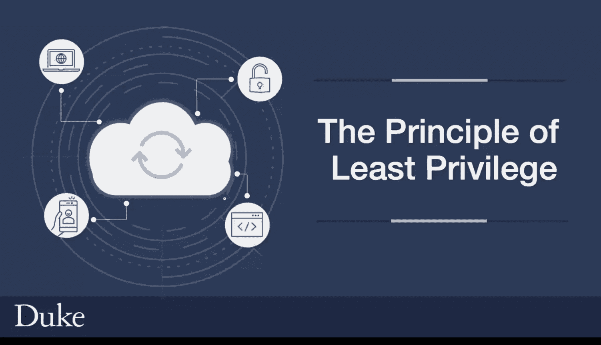
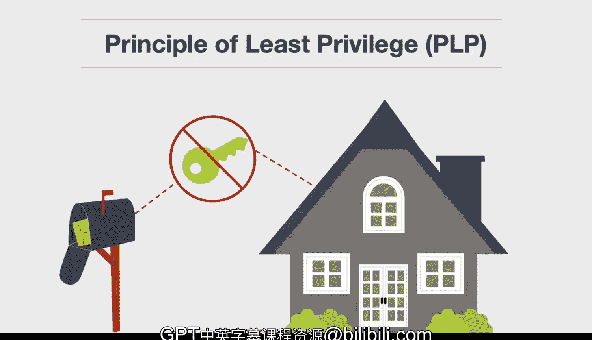

构建大规模云计算解决方案：03：最小权限原则

在本节课中，我们将要学习一个重要的安全目标——最小权限原则。我们将通过一个简单的比喻来理解其核心思想，并探讨它在云计算和IT安全中的具体应用。

## 概述

最小权限原则是信息安全领域的一个基础概念。它要求系统或用户只应被授予完成其任务所必需的最小权限，而不应拥有超出此范围的任何额外权限。这有助于减少潜在的安全风险。

## 理解最小权限原则

上一节我们介绍了最小权限原则的基本定义，本节中我们来看看如何通过一个日常生活中的例子来直观地理解它。

想象你有一个邮箱和一所房子。邮递员需要给你送信。对他们来说，最简单的方式是打开你的邮箱，把信放进去。这样做的好处是，他们不需要拥有你房子的钥匙。他们不需要进入你的房子，也就不会意外地让你的婴儿或宠物跑出来，或者干扰你在房子里进行的其他活动。因为他们不需要进入你的房子就能完成送信的任务。

这就是最小权限原则的核心概念。即使在你和邻居关系最好的情况下，给予他们不需要的访问权限也不是一个好做法。因为你不仅将房子里的其他资源置于风险之中，也让邻居本人暴露在风险之下。

## 在云计算中的应用

理解了基本概念后，我们来看看这个原则如何应用于更广泛的领域。

这与云计算或任何IT安全的情况是相同的。你应该始终只给予某人他们需要访问的权限。这可能只是云环境中的一小部分，例如他们需要处理的文件，或者他们需要使用的服务。通过这种方式，每个人都能得到保护。你不是在制造一个巨大的安全漏洞，而是默认限制了权限范围。这确实是建立安全体系的最佳方式之一。

以下是实施最小权限原则的几个关键点：
*   **按需授权**：只授予完成特定任务所必需的权限。
*   **权限分离**：将不同的权限分配给不同的角色或用户，避免权力集中。
*   **定期审查**：定期检查和调整权限设置，确保其仍然符合当前的需求。

## 总结

本节课中我们一起学习了最小权限原则。我们通过邮箱和房子的比喻理解了其核心思想：只授予完成任务所必需的最小权限。我们探讨了为何过度授权会带来风险，并了解了在云计算中实施这一原则的重要性，即通过限制默认权限来保护系统和数据安全。遵循最小权限原则是构建健壮安全体系的基础步骤之一。