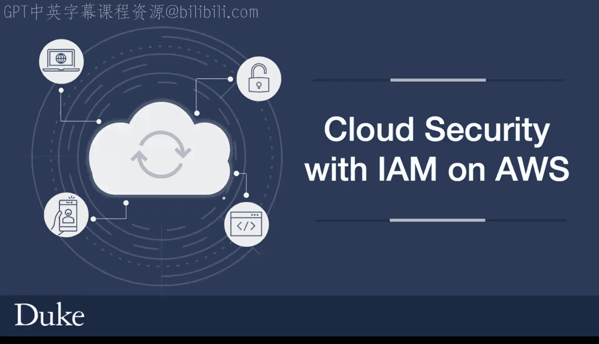
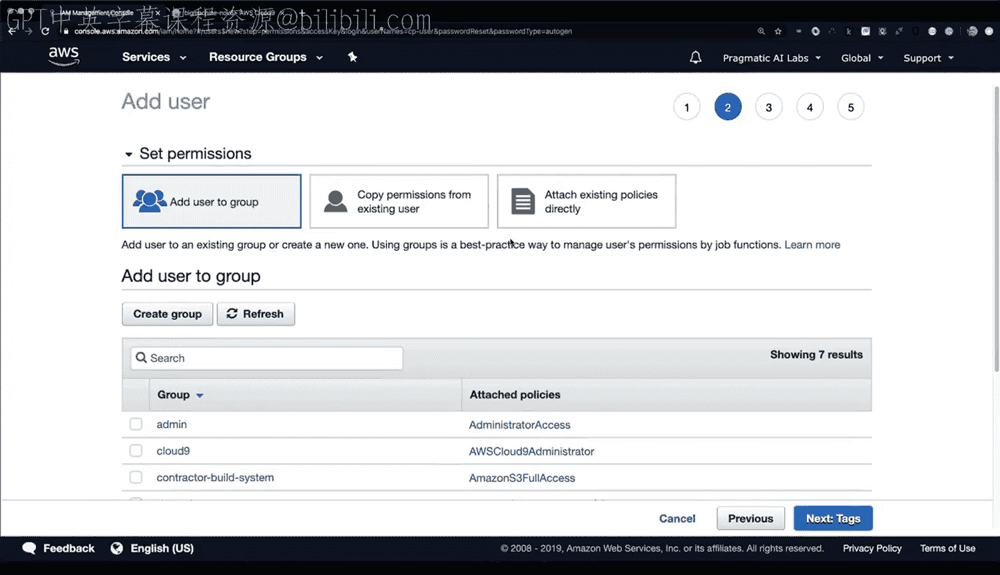
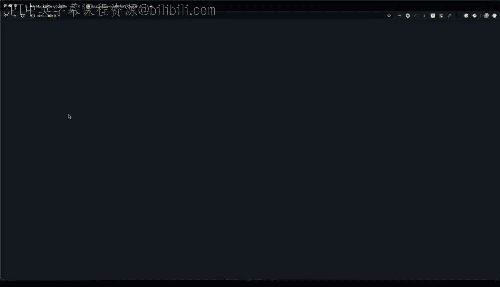
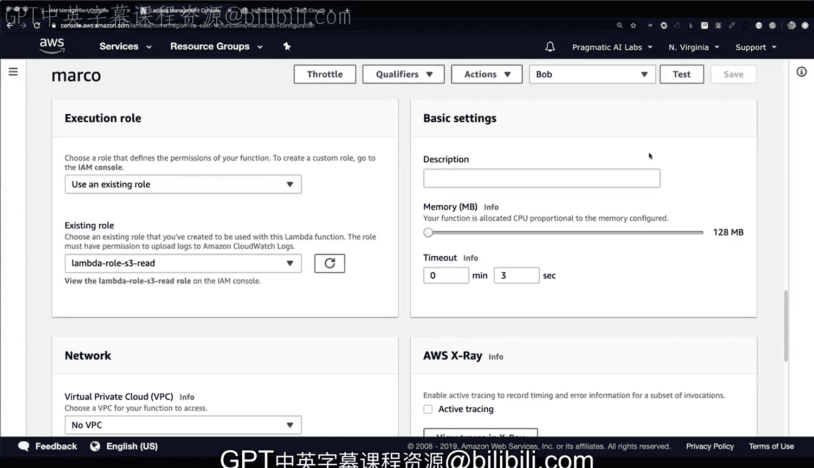

#  060：基于AWS IAM的云安全 🔐

在本节课中，我们将学习AWS身份和访问管理（IAM）的核心概念与实践。我们将了解如何创建和管理用户、组、角色以及策略，以在AWS云环境中实施安全且遵循最小权限原则的访问控制。

---

## 创建用户、组和角色

上一节我们介绍了IAM的重要性，本节中我们来看看如何在IAM控制台中实际操作，创建用户、组和角色。

在IAM控制台中，您可以创建用户、组、角色和策略，并查看其凭据。

### 创建用户

以下是创建新用户的步骤：

1.  进入IAM控制台的“用户”部分，点击“添加用户”。
2.  输入用户名，例如 `CP_user`。
3.  选择访问类型：
    *   **编程访问**：提供访问密钥ID和私有访问密钥，用于通过API、CLI或SDK访问AWS。
    *   **AWS管理控制台访问**：提供密码，用于登录AWS管理控制台。
4.  根据用户的实际需求选择。例如，开发人员可能需要编程访问来操作S3，而业务人员可能只需要控制台访问。遵循**最小权限原则**至关重要。
5.  点击“下一步：权限”。

### 管理权限与创建组

创建用户后，需要为其分配权限。直接为用户附加策略是一种方式，但更佳实践是通过组来管理权限。

以下是创建组并分配策略的步骤：

1.  在“设置权限”页面，选择“将用户添加到组”。
2.  点击“创建组”。
3.  为组命名，例如 `students`。
4.  为组附加策略。您可以选择：
    *   **创建策略**：手动定义精细的权限，例如仅授予S3的读取权限。
    *   **使用现有策略**：从AWS托管策略列表中选择，例如搜索并选择 `AmazonS3ReadOnlyAccess`。
5.  创建组后，可以将用户（如 `CP_user`）添加到该组中。
6.  完成用户创建流程后，系统会提供访问密钥（用于编程访问）和密码（用于控制台访问），您可以下载CSV文件或通过邮件发送。

通过组管理权限的优势在于集中控制。如果需要撤销整个组的权限，只需进入该组（如 `students`），在“权限”选项卡中**分离策略**，组内所有用户将立即失去相关权限。

### 为服务创建角色

上一节我们为用户和组分配了权限，本节中我们来看看如何为AWS服务（如Lambda函数或EC2实例）创建角色，使其能够代表您执行操作。

当您编写Lambda函数或配置EC2实例，并需要它们调用其他AWS服务API时，就需要为其分配一个具有相应权限的角色。

以下是创建Lambda函数执行角色的步骤：

1.  进入IAM控制台的“角色”部分，点击“创建角色”。
2.  选择可信实体类型为“AWS服务”，并选择使用案例，例如“Lambda”。
3.  点击“下一步：权限”。
4.  为角色附加策略。例如，如果Lambda函数需要从S3读取数据，可以附加 `AmazonS3ReadOnlyAccess` 策略。
    *   **注意**：为原型开发授予管理员权限虽简便但危险。最佳实践是始终遵循**最小权限原则**，只授予执行任务所必需的权限。
5.  点击“下一步：标签”（可选），然后点击“下一步：审核”。
6.  为角色命名，例如 `LambdaRole_S3Read`，并添加描述以便识别。
7.  点击“创建角色”。

创建角色后，您可以在Lambda函数配置中关联此角色。在Lambda函数的“配置”选项卡中，找到“执行角色”设置，将默认的无权限角色替换为您刚创建的 `LambdaRole_S3Read` 角色。保存后，该Lambda函数就获得了从S3读取数据的权限。

---

## 总结

本节课中我们一起学习了AWS IAM的核心操作。我们演示了如何创建用户和组，并通过附加策略来管理权限，强调了通过组进行集中权限管理和遵循**最小权限原则**的重要性。同时，我们也学习了如何为AWS服务（如Lambda）创建角色，使其能够安全地访问其他服务。牢记，始终只分配完成任务所必需的最小权限，这是避免重大安全漏洞的关键。