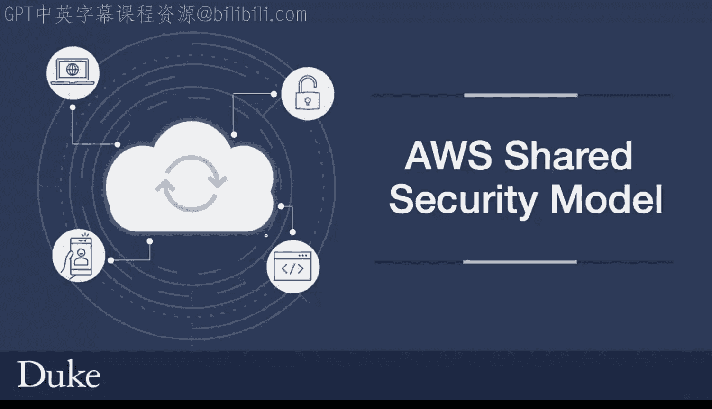
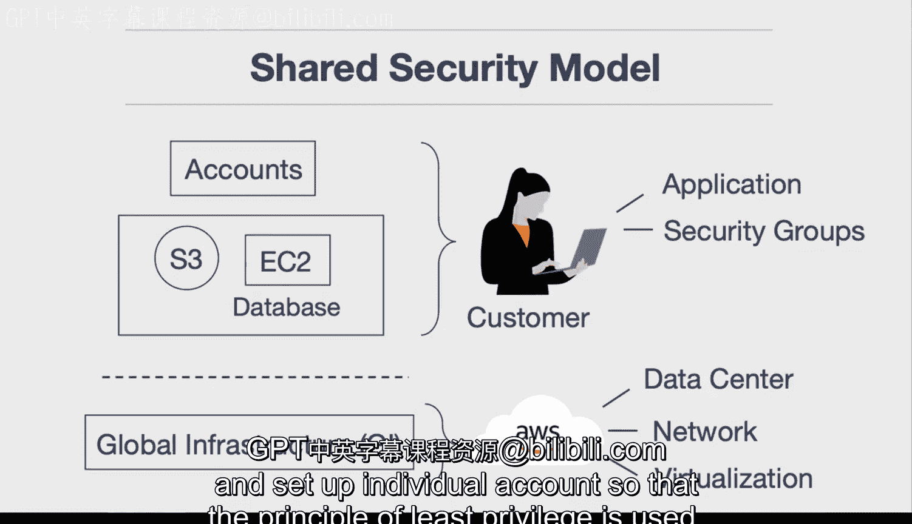

构建大规模云计算解决方案：03：AWS共享安全责任模型 🔐

在本节课中，我们将要学习AWS共享安全责任模型。理解这一模型对于在AWS云上安全地构建和部署应用至关重要。它明确了哪些安全责任由AWS承担，哪些需要由您作为客户来负责。

AWS云安全运维是容易被忽视，但实际上却是最重要的事项之一。近期发生了多起引人注目的安全事件，例如Capital One事件，其根源在于相关人员未能妥善保护其云基础设施。因此，我们将在接下来的部分详细讨论这个问题。

首先，我们来谈谈所谓的“共享安全责任模型”。这是一种让客户与AWS共同协作，以确保其应用安全的方式。

### 模型概述

在上图中，我们可以看到云安全的客户责任部分。这部分可能包括数据、操作系统等。图中的分界线则标示了AWS的责任范围，即AWS基础服务，包括计算、存储等所有基础设施组件，以及区域和可用区等概念。

这个模型的核心在于建立一种伙伴关系，双方各自负责特定的组件。例如，对于客户数据的安全，完全由AWS来决定如何保障是不现实的，云服务的运营者必须与AWS协同工作。同样，对于基础服务的安全，您不可能亲自前往AWS数据中心确保其物理安全，这需要AWS来负责。因此，这本质上是一种合作模式。

### AWS的责任：云本身的安全

上一节我们介绍了模型的整体概念，本节中我们来看看AWS具体负责哪些方面。AWS负责保障“云本身”的安全，主要包括：

以下是AWS承担的核心责任：

*   **物理安全**：确保对数据中心的物理访问受到基于需求的严格控制，并配备7x24小时安保和双因素认证。
*   **硬件基础设施**：确保服务器、存储设备等硬件配置安全。
*   **软件基础设施**：保障主机操作系统（Host OS）的安全。
*   **网络**：保护路由器、交换机、负载均衡器、防火墙和布线等网络组件的安全。
*   **虚拟化**：确保虚拟化层的隔离性，防止用户访问他人的账户。

在此共享责任模型下，AWS负责运营、管理和控制从主机操作系统、虚拟化层到设施物理安全的整个底层基础设施。

此外，对于一些更高级别的托管服务，AWS也承担部分管理责任。在托管服务中，AWS可能负责区域、可用区、边缘访问、防火墙配置的操作系统等。例如，在关系数据库服务（RDS）中，AWS会管理操作系统补丁。

对于DynamoDB、Redshift或EMR这类托管服务，AWS会处理基本的安全任务，如操作系统和数据库补丁、防火墙配置和灾难恢复。客户则无需担心这些。这正是您购买此类服务（例如RDS）时所融入的合作伙伴关系的一部分。

不过，有几个关键点需要注意：在补丁管理方面，AWS负责基础设施补丁，但客户有责任确保其客户操作系统（Guest OS）及时更新。在配置方面，AWS管理底层配置，但客户仍需负责其客户操作系统的配置。

### 客户的责任：云中的数据安全

了解了AWS的责任后，本节我们将重点转向客户需要负责的领域，即“云中的数据”安全。

如果您在AWS云中构建应用，您需要负责确保正确设置密码、为应用访问定义正确的角色，并实施账户管理，以区分生产环境和开发环境。这遵循了最小权限原则。

在由AWS保障安全的云基础设施中，客户需对自己放入云中的所有内容负责，包括数据和应用程序。

客户保留对其选择实施的安全控制的掌控权，管理自己的数据和操作系统。这意味着共享安全责任模型的具体划分，取决于客户实际使用了哪些AWS服务。

让我们通过一个例子来看看这是如何运作的。

假设我们有账户和凭证，以及一个包含S3、EC2实例的生态系统，并且在EC2实例中还有一个数据库（如RDS）。客户需要确保所有这些组件的安全。

以下是客户需要承担的安全责任：

*   **应用程序安全**：保护应用代码和逻辑。
*   **安全组配置**：管理谁可以访问S3、EC2等服务上暴露的端口。
*   **账户与访问管理**：控制哪些账户可以访问资源。

而全球基础设施（标记为“G”），即数据中心、网络安全和虚拟化层安全，则由AWS负责保护。

### 总结

本节课中我们一起学习了AWS共享安全责任模型。总结来说，客户负责管理客户操作系统、应用程序和安全组等。而AWS则负责保护全球基础设施。同时，保护AWS凭证、设置独立账户并遵循最小权限原则，是客户应当遵循的最佳实践。清晰理解这一责任共担模型，是构建安全云解决方案的基础。