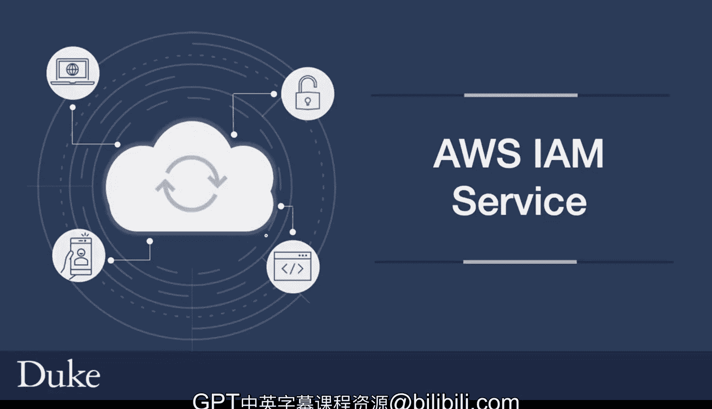
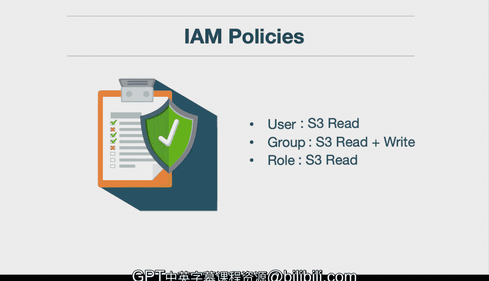

#  062：AWS IAM服务 🔐

在本节课中，我们将要学习AWS身份与访问管理服务。IAM是用于控制账户访问的核心服务，它允许你管理谁可以访问哪些资源以及如何访问。

---

## 概述

AWS IAM服务是管理对云基础设施访问权限的关键工具。通过IAM，你可以创建和管理用户、组和角色，并精确控制他们对AWS资源的访问权限。本节将详细介绍IAM的核心概念、最佳实践以及如何安全地配置访问控制。

---

## IAM服务简介

IAM服务是管理对基础设施访问权限的一种方式。通过IAM，你可以设置用户账户、组账户或角色账户。用户、组或角色的所有管理工作都通过IAM服务完成。这使你能够管理哪些资源可以被谁访问，以及他们如何访问，例如谁可以终止任何EC2实例。

以下是IAM的主要功能：
*   **管理用户及其访问权限**：你可以创建用户，并为他们分配独立的安全凭证，如访问密钥或密码。
*   **管理IAM角色和权限**：你可以管理哪些EC2实例可以调用特定的API。
*   **身份联合**：你可以将企业目录等服务连接到AWS安全生态系统中。

---

## IAM凭证类型

上一节我们介绍了IAM的基本功能，本节中我们来看看在IAM系统中你可能会遇到的各种凭证类型。

以下是几种常见的IAM凭证：
*   **电子邮件和密码**：这是传统上根账户的设置方式。
*   **IAM用户名**：用于访问AWS管理控制台。
*   **访问密钥和秘密访问密钥**：这些密钥用于访问命令行界面和软件开发工具包。AWS账户被入侵的常见原因之一，就是有人不小心将这些密钥放入了公开的源代码仓库。
*   **多因素认证**：这是一种增加额外安全层的方法，可以使用手机或物理设备作为第二层验证。基于手机的认证在某些情况下已被证明存在风险，因此最安全的多因素认证方式是使用能生成数字的物理设备。
*   **密钥对**：在使用EC2等服务时经常出现，即`.pem`文件，可用于通过SSH登录到机器。

---

## 根账户与IAM账户的区别

了解不同类型的凭证后，我们需要区分根账户和IAM账户。初学者常犯的错误是使用根账户而从不设置IAM账户。

根账户的问题在于你无法控制其权限，用户拥有完全访问权。如果你将根账户信息给了公司里的某人，而他不小心将API密钥或秘密访问密钥放入了源代码仓库，你的账户会立即被接管且无法恢复。

相比之下，IAM提供了更精细的控制。最佳实践是：删除根账户的访问密钥，永远不要设置根账户访问密钥；确保在IAM系统内设置一个管理员账户；启用多因素认证。你应该使用IAM凭证而非根凭证与AWS交互。根账户只是一个临时解决方案，直到你设置好IAM。使用IAM可以实现精细的权限控制，并遵循最小权限原则。

---

## 身份验证

上一节我们强调了使用IAM账户的重要性，本节中我们来看看身份验证的具体过程。身份验证是进入系统的第一步。

身份验证允许你使用ID和访问密钥进行验证。这是一种身份验证方法，能让你访问API、命令行工具以及软件开发工具包。

*   对于控制台访问，你可以使用账户ID、别名、IAM用户名和密码，还可以使用多因素认证。
*   对于编程访问，你需要使用访问密钥。

---

## 授权

身份验证让你进入系统，但授权决定了你能做什么。授权是决定授予人们哪些服务权限的方式。

实现授权的方法是使用IAM策略。策略的作用是设定特定组或用户可以访问哪些资源。通常，通过组来管理权限是一个好主意。例如，你可以创建一个“学生”组，该组只拥有从Amazon S3读取数据的权限。这样，学生就只能执行这一操作，你遵循了最小权限原则。大多数安全漏洞的发生，都是因为权限过高，授予了人们本不需要访问的资源。

---

## 多因素认证

为了进一步增强安全性，AWS支持多因素认证。你可能在其他账户中使用过它，这是一种通过要求两种不同登录方法来提高安全性的方式。

对于AWS服务和资源，可以通过控制台、CLI或SDK进行访问。使用MFA系统可以确保用户和系统必须经过双重认证。

MFA主要有两种选项：
*   **硬件设备**：一个特定的设备，可以生成验证码。
*   **软件设备**：可以与手机关联，由手机应用程序生成验证凭证。

此外，AWS还提供安全令牌服务，这是一项Web服务，使你可以为IAM用户请求临时特权凭证。

---

## IAM用户

现在，让我们深入了解IAM的各个组成部分，首先从用户开始。IAM用户是你在AWS中创建的实体，它提供了一种与AWS交互的方式。

默认情况下，新用户没有任何权限，你必须明确授予用户执行操作的权限。最佳实践是创建一个具有管理权限的独立用户账户。例如，如果你是学生并使用免费套餐账户，设置AWS账户后应首先创建一个管理员账户，以便从那里进行控制。如果你想给予他人系统访问权限，你应该为他们设置一个账户，并仅授予他们所需的特定权限。

---

## IAM组

上一节我们介绍了用户，本节中我们来看看如何通过组来更高效地管理用户权限。IAM组是用户的集合，你可以为特定的组指定权限。

例如，你可以创建一个“学生”组，并分配“从Amazon S3读取内容”的权限。这样，当你将新用户（例如一名学生）添加到该组时，你就不必担心数据被删除或有人启动EC2实例让你负责，你只需要担心与该用户共享数据。这可能是权限管理的良好起点。

关于组需要注意以下几点：
*   一个组可以包含多个用户。
*   一个用户可以属于多个组。
*   组不能嵌套，即组只能包含用户，不能包含其他组。
*   没有自动包含的默认组，你必须手动创建。

---

## IAM角色

角色是AWS中常被误解的部分，但它非常强大。基本上，角色是一种将权限分配给特定资源的方式。

使用角色，你可以创建临时特权。例如，你可以创建一个名为“AWS Comprehend”的角色，并将其分配给一个EC2实例。当启动该EC2实例时（假设你只使用它两小时，因为它是一个竞价实例），该实例可以为你调用相关API执行自然语言处理任务，而你无需在机器上管理API密钥。

这解决了一个非常复杂的问题：在公司中，如果你使用API密钥并将其传递给多台机器，当有人离开公司时，你必须更改所有机器上的API密钥。而基于角色的权限管理是更好的方式，特定资源只能执行非常具体的操作。当资源消失时，你无需删除密钥；当公司用户变动时，你也不必 constantly worrying about swapping keys out。

---

## IAM策略

之前我们提到了策略，现在让我们更详细地探讨它。基本上，你可以将策略附加到任何实体：用户可以拥有策略，组可以拥有策略，角色也可以拥有策略。

这些策略可以是这样的：
*   用户策略：`此用户拥有S3读取权限`
*   组策略：`此组拥有S3读写权限`
*   角色策略：例如，我们有一个SageMaker角色，并告诉SageMaker实例它只应拥有S3的读取权限，因为我们不希望数据科学家向S3写入数据，以免数据被破坏。

如果你发现将相同的策略附加到多个IAM用户，更好的做法是将其放入一个组中，然后将策略附加到该组。

---

## 总结

本节课中我们一起学习了AWS IAM服务的核心概念。我们了解了IAM如何通过用户、组和角色来管理访问权限，区分了根账户与IAM账户的重要性，并探讨了身份验证、授权以及多因素认证等安全机制。我们还学习了使用策略进行精细权限控制，以及通过角色为AWS资源分配临时权限的最佳实践。遵循最小权限原则和正确使用IAM组件，是构建安全、可扩展的云解决方案的基础。