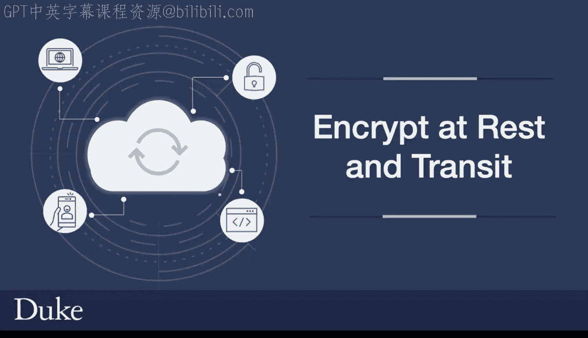
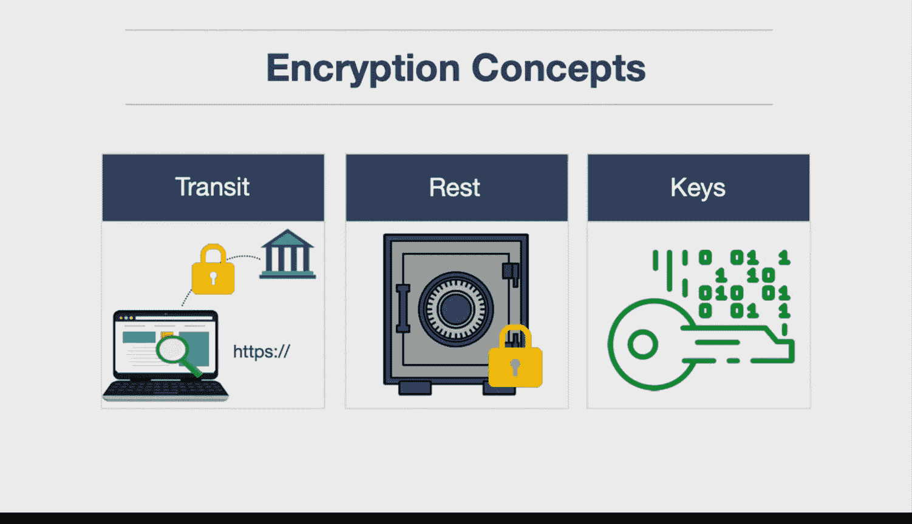

#  064：静态与传输加密

在本节课中，我们将要学习云计算中关于加密的三个核心概念：传输加密、静态加密和密钥管理。理解这些概念对于保护数据在传输和存储过程中的安全至关重要。

## 传输加密

上一节我们介绍了云计算的基础架构，本节中我们来看看如何保护数据在网络中流动时的安全。传输加密指的是数据在从一个服务传输到另一个服务的过程中被加密。这个概念至关重要，因为它确保了即使网络流量被拦截，数据内容也无法被读取。

例如，当您使用个人电脑访问银行网站时，您的电脑与银行服务器之间的通信应该被加密。如果您在咖啡馆使用公共Wi-Fi登录，即使有人截获了网络数据包，由于数据已被加密，他们也无法获取您的敏感信息。

以下是传输加密的关键点：
*   它保护数据在传输管道中的安全。
*   它是加密技术的基本原则之一。
*   常见的实现方式是**HTTPS**协议，用于保护网站和移动应用的数据传输。

## 静态加密

了解了数据在传输中的保护后，我们再来看看数据在存储时的安全。静态加密指的是数据在存储介质（如云存储）上处于静止状态时被加密。

这意味着，即使数据成功抵达服务器并被存储起来，数据文件本身也是加密的。假设后来有人入侵并窃取了这个存储文件，由于数据已加密，窃取者无法读取文件内容。这就像一个上了锁的保险箱，没有钥匙就无法打开。

因此，静态加密是行业最佳实践的第二条：不仅需要在传输过程中加密数据，在数据存储时也需要加密。这样，即使发生数据泄露事故，也能确保数据无法被轻易解密。

## 密钥管理

我们已经讨论了传输和静态加密，但还有一个更微妙且常被忽视的第三个机制：加密密钥的管理。密钥是加密和解密数据的唯一工具。

对于一个实施加密的组织来说，这一点极为重要。您可能认为已经完成了前两步：始终使用HTTPS并对静态数据加密，就遵循了最佳实践。但这里存在一个隐藏的关键点：**谁拥有加密数据的密钥？谁又拥有解密数据的密钥？**

如果您没有遵循最小权限原则（即只允许有必要权限的人访问数据和密钥），那么您仍然可能面临数据丢失的风险。您不能仅仅因为数据被加密就认为绝对安全，安全还取决于哪些人有权访问这些密钥。

因此，在组织内使用加密时，密钥的管理和访问控制是需要重点考虑的因素。

## 总结

本节课中我们一起学习了云数据安全的三大支柱。**传输加密**保护数据在网络中移动时的安全（如通过HTTPS）。**静态加密**保护存储在磁盘或数据库中的数据。而**密钥管理**则确保了加密密钥本身的安全，遵循最小权限原则，防止密钥落入不当之人手中。综合运用这三者，才能构建起有效的数据安全防线。