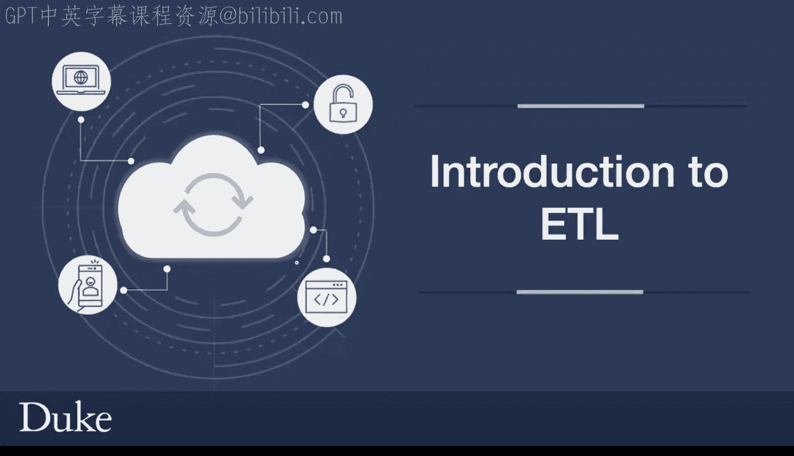
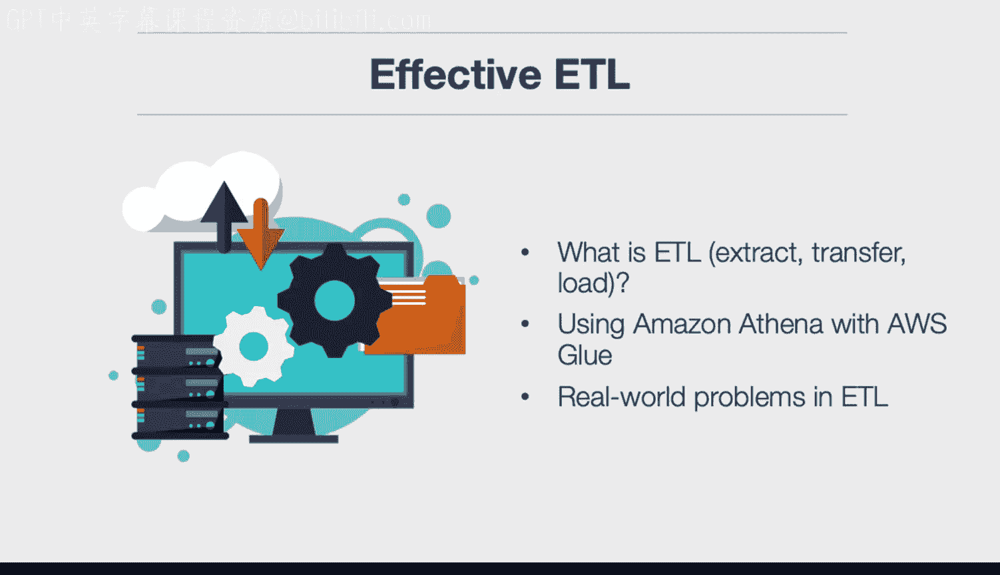
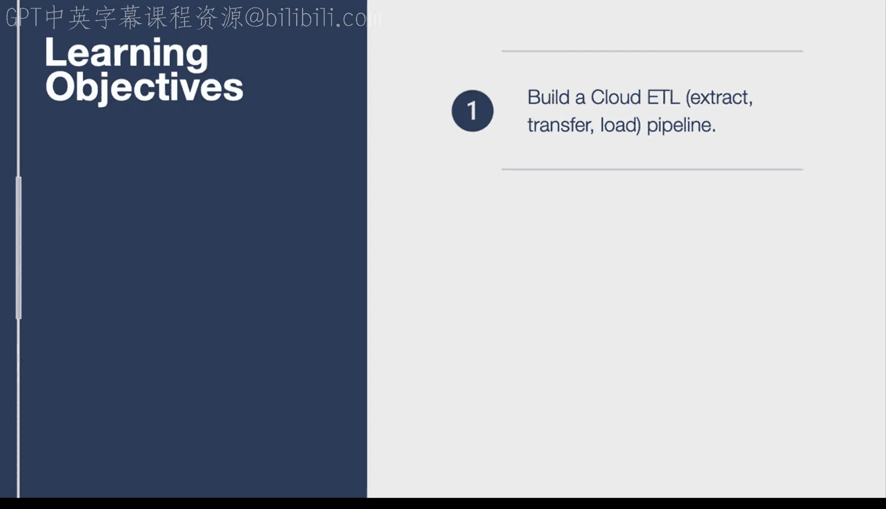

#  065：提取转换加载（ETL）导论 🚀

在本节课中，我们将要学习提取、转换、加载（ETL）的基本概念，了解如何使用AWS Athena与AWS Glue构建ETL管道，并探讨ETL在现实世界应用中的挑战，例如处理异常场景和流式数据。

## 什么是ETL？ 🔍

首先，我们来谈谈什么是ETL。ETL代表**提取（Extract）、转换（Transform）、加载（Load）** 这三个阶段。这是一个数据处理流程，用于从各种数据源收集数据，进行必要的清洗与转换，最后将处理好的数据加载到目标存储系统中，如数据仓库或数据库，以供分析使用。

## 使用AWS Athena与AWS Glue 🛠️

上一节我们介绍了ETL的基本概念，本节中我们来看看如何利用AWS云服务来构建ETL管道。AWS提供了一系列工具来简化这个过程。

以下是两个核心的AWS服务，它们常被结合用于构建无服务器ETL解决方案：

*   **AWS Glue**： 这是一项完全托管的提取、转换和加载（ETL）服务。它可以自动发现您的数据，并将其编入中央数据目录。然后，您可以使用基于Apache Spark的代码来转换和准备数据进行分析。其核心优势在于**无服务器架构**，您无需管理任何基础设施。
*   **AWS Athena**： 这是一项交互式查询服务，让您能够使用标准SQL语言直接分析Amazon S3中的数据。它通常与Glue Data Catalog集成，从而可以轻松查询已被Glue发现和编目的数据。

一个典型的工作流程是：使用AWS Glue进行数据提取和转换，然后将处理后的数据存储在S3中，最后通过AWS Athena对这些数据进行即席查询。

## 现实世界中的ETL挑战 ⚠️

了解了基础工具后，我们需要面对现实世界中的数据工程挑战。ETL管道在复杂环境中运行时，会遇到各种问题。

以下是两个常见的现实场景及其应对思路：

*   **处理异常场景**： 当数据源出现错误、数据格式异常或转换过程失败时，ETL管道需要具备**容错和监控机制**。例如，设计重试逻辑、将失败的任务和原因记录到日志或特定数据存储中，并设置警报通知相关人员。
*   **流式数据场景**： 传统ETL通常是批处理的（定期处理一批数据）。但在物联网、实时监控等场景下，数据是连续不断产生的。这就需要**流式ETL**（或称为ELT）架构，使用如Amazon Kinesis、Apache Kafka等流处理平台，实现数据的实时或近实时处理与加载。

## 总结 📝

本节课中我们一起学习了ETL（提取、转换、加载）的基础知识。我们了解到ETL是将原始数据转化为可用信息的关键流程。通过介绍AWS Athena和AWS Glue，我们看到了如何在云上构建高效、无服务器的ETL管道。最后，我们探讨了ETL在现实应用中需要应对的挑战，包括错误处理和对流式数据的支持，这些都是设计健壮数据管道时必须考虑的因素。