#  067：AWS数据摄取与预处理 📊

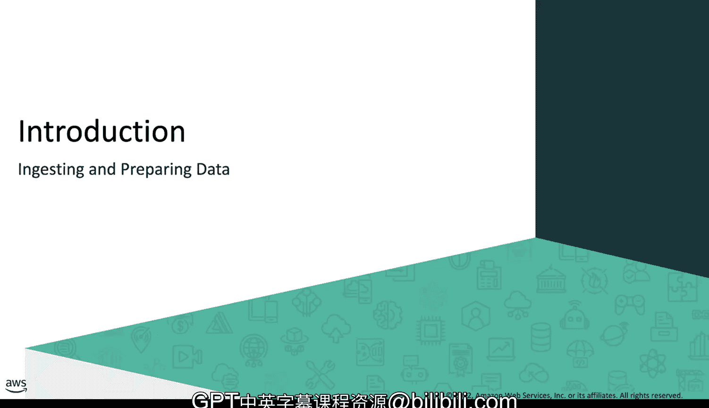

在本节课中，我们将要学习数据工程中的核心环节：数据摄取与预处理。我们将探讨两种主要的数据处理模式——ETL与ELT，并深入解析数据整理（Data Wrangling）的各个步骤，包括数据发现、结构化、清洗、丰富、验证和发布。理解这些概念对于构建高效、可靠的数据管道至关重要。

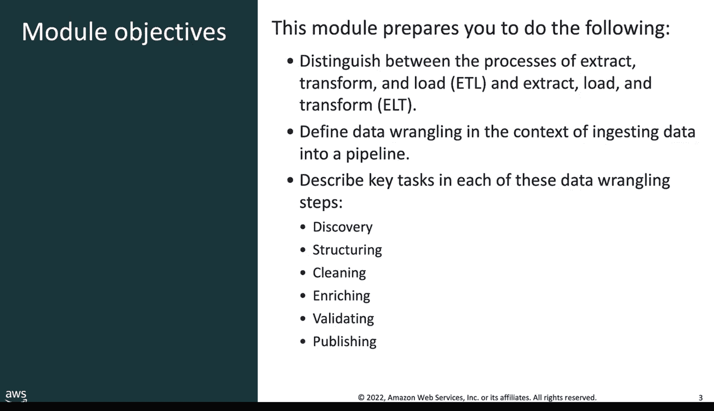

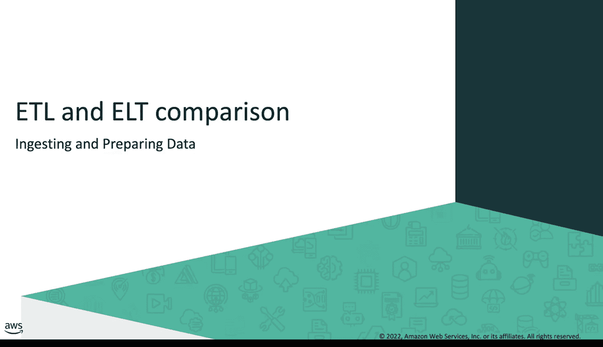

## ETL与ELT：数据处理的两大范式 🔄

上一节我们介绍了课程概述，本节中我们来看看数据处理的基础范式。数据摄取涉及从源头获取数据并进行存储与处理。这个过程通常包含从数据管道中尚不可用的源提取数据，将数据加载到临时存储位置，然后在数据加载到永久存储之前或之后通过转换来处理数据。转换的类型、范围及其在管道中发生的位置高度依赖于业务需求和所摄取数据的性质。

一个经典的例子是：你拥有两个数据库。从源数据库提取数据，转换某些列，处理数据，将其转换为某种格式，然后放入另一个数据库。

### 传统方法：ETL（提取、转换、加载）

在传统方法中，为分析而摄取和查询数据的方式是ETL。其流程可概括为：
1.  **提取（Extract）**：从源系统获取数据。
2.  **转换（Transform）**：将数据转换为适合分析应用程序使用的结构化格式。
3.  **加载（Load）**：将转换后的数据加载到数据仓库等结构化存储中。

随后，数据科学家或分析师会查询数据仓库，并可能在分析过程中执行额外的转换和处理。ETL方法非常适合处理**结构化数据**，它能提前准备好数据，为分析师节省时间。如果分析师总是需要对数据执行相同的转换，将这些转换纳入摄取过程就很重要。

ETL的优势在于，它用数据可用前的转换处理时间，换取了更快的查询能力（例如，用于仪表板）。另一个优势是，可以在前期转换中过滤掉PII（个人身份信息），以降低安全风险。核心原则是：**绝不存储敏感数据**。

### 现代趋势：ELT（提取、加载、转换）

随着数据架构从仅处理结构化数据，发展到需要处理海量**非结构化**和**半结构化数据**（例如数据湖中的数据），新的方法应运而生，即ELT。请注意，ETL和ELT的后两个字母顺序调换了。

在ELT方法中：
1.  **提取（Extract）**：从源获取数据。
2.  **加载（Load）**：仅进行足够转换以使数据可被消费，然后以相对原始的状态存储在数据湖（如AWSS3）中。
3.  **转换（Transform）**：针对特定用例所需的转换在后期进行。

这样，消费者再访问数据并基于其构建分析解决方案。ELT的优势在于，原始数据进入管道的速度更快，因为你没有在数据湖之前进行大量转换。其权衡在于，你需要在后期花费更多时间进行转换。

存储原始数据并仅在下游进行转换的一个优势是：对转换逻辑的更改（例如，添加新字段或更改格式）可以应用于已加载的所有历史数据。而如果转换发生在加载数据之前，更改可能只能应用于新摄取的数据，对历史数据应用更改可能很困难甚至不可能。

### 现代架构中的融合

在现代架构中，ETL和ELT的界限变得模糊。管道中的不同角色可能使用不同的工具和访问数据的方式，执行不同部分的摄取和转换任务。例如：
*   数据工程师可能在加载前执行通用的清洗操作和转换。
*   为特定分析用例提取数据时，可能发生额外的转换。
*   数据工程师需要监控管道，了解其访问和使用方式，并优化流程以提升性能和降低成本（例如，为频繁查询的仪表板设置缓存）。

以下是两种方法的核心对比：

*   **ETL流程**：`数据源 -> 转换 -> 数据仓库（结构化）`
*   **ELT流程**：`数据源 -> 数据湖（原始/半结构化）-> 按需转换`

**关键要点**：数据摄取是将数据拉入管道并应用转换的过程。使用ETL流程的摄取非常适合**结构化数据**。而ELT流程则适用于目的地为**数据湖**的**非结构化数据**。管道内的ETL和ELT处理也必须不断演进。

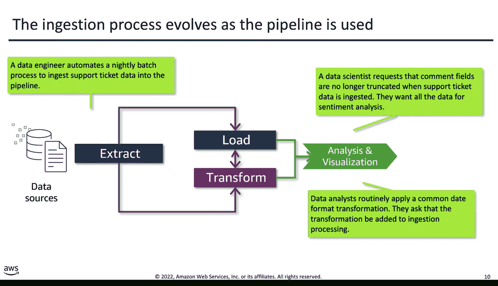

## 数据整理：处理复杂数据的多步流程 🧹

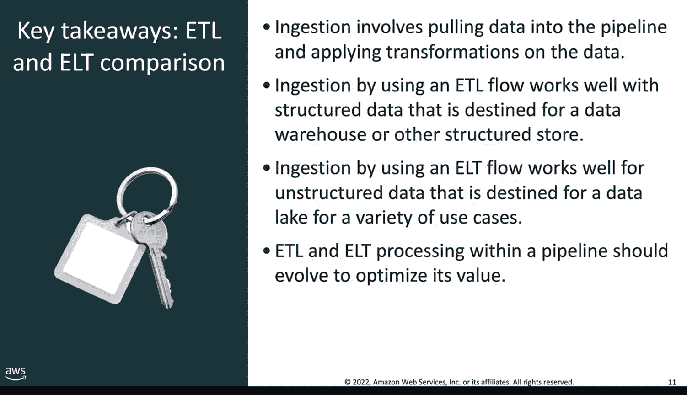

上一节我们比较了ETL和ELT，本节中我们将深入探讨数据整理。数据整理反映了将大量非结构化数据或多组非结构化数据（例如，来自多个数据库）转换为单一可用形式的复杂性和混乱性。对于机器学习等应用，通常需要进行大量数据整理工作，因为原始数据可能并不直接适用。

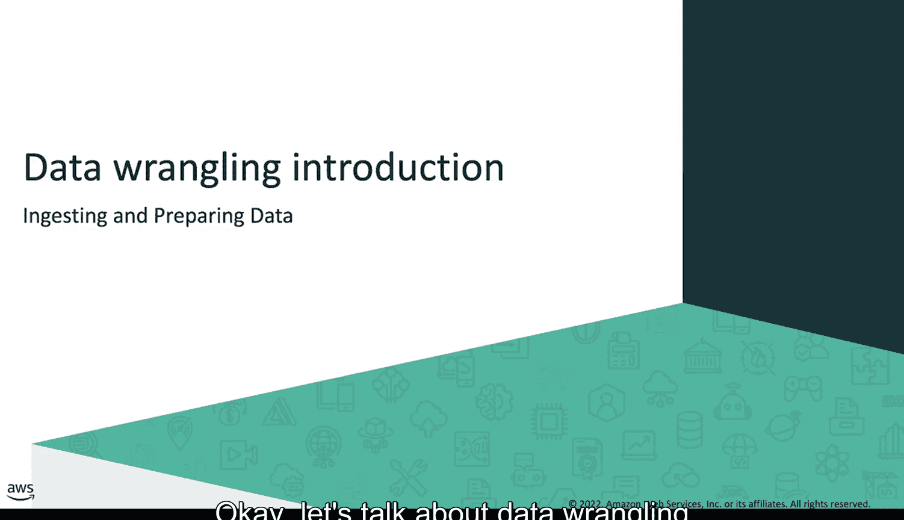

例如，一个组织可能查询本地数据库，以找出逾期未就诊的患者。如果使用公共医疗数据集，公司可能会将标识心脏病发作人口统计学风险因素的医疗数据与客户数据结合，为具有相同风险因素的患者个性化信息。如果患者有移动应用程序，他们甚至可能收到实时警报。数据整理员的工作就是将所有这些数据整合在一起。

整体摄取和数据整理可以像使用电子表格、操作列并直接上传到S3一样简单。传统的ETL过程则使用脚本、自动化转换步骤等工具，让分析师和数据科学家能够以非常易于消费的状态处理数据。

数据整理已存在很长时间，但在ELT背景下，它更多地涉及获取经过轻度转换的数据，因为你并不完全清楚其最终用途，需要使用工具更新来赋予管道处理这些数据的能力。

在现代数据架构中，可以考虑以下流程：
1.  **着陆区**（如S3存储桶）作为临时存储，用于清洗和验证数据。
2.  然后，可以将该数据用于其他用例。这类似于ELT：将数据转换为高度结构化的状态（如Redshift数据仓库）。
3.  随后，数据工程师或数据科学家会对该数据进行结构化、丰富和验证。

**关键要点**：数据整理是一个多步骤过程，步骤会根据数据源和用例重叠和迭代。数据整理的步骤包括：**发现、结构化、清洗、丰富、验证和发布**。在数据科学中，管道通常包括：摄取、探索性数据分析、建模（某些情况下）和得出结论。数据整理也存在类似的工作流程。

## 数据整理的具体步骤详解

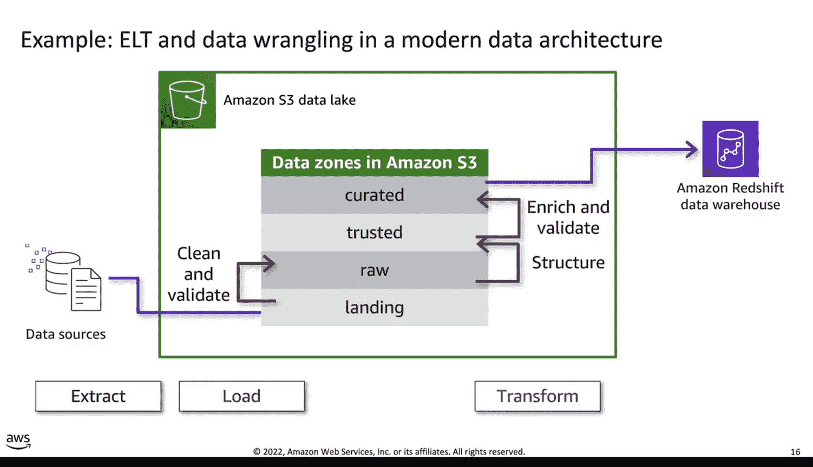

### 数据发现 🔍

数据发现是迭代性的，类似于数据科学中的探索性数据分析。你并不完全清楚自己在寻找什么，目标是找到可能有用的数据源。这个过程可能只需几小时，也可能长达一年，具体取决于所处理问题的类型。

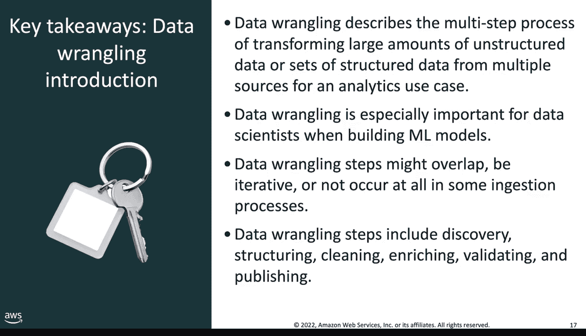

以下是数据发现的关键步骤：
*   判断数据源是否服务于业务目的。
*   识别数据源之间存在的关联。
*   确定数据格式（如CSV、Parquet、ORC）。
*   决定需要多少数据。
*   规划数据组织方式。
*   考虑能否围绕数据构建一些元数据。

在数据发现过程中，还需要考虑组织内的不同场景。最初可能从一个电子表格开始，将其放入电子表格中以获取对数据的更多想法。

**关键要点**：数据发现是迭代的。数据工程师必须弄清楚数据源之间的关系，并确定推进工作所需的工具和资源。

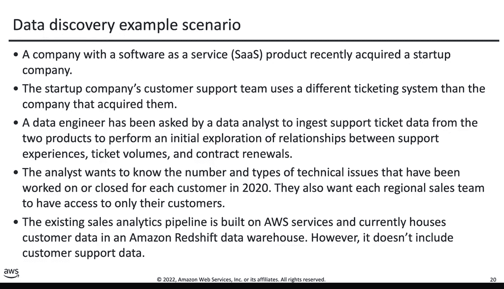

### 数据结构化 🏗️

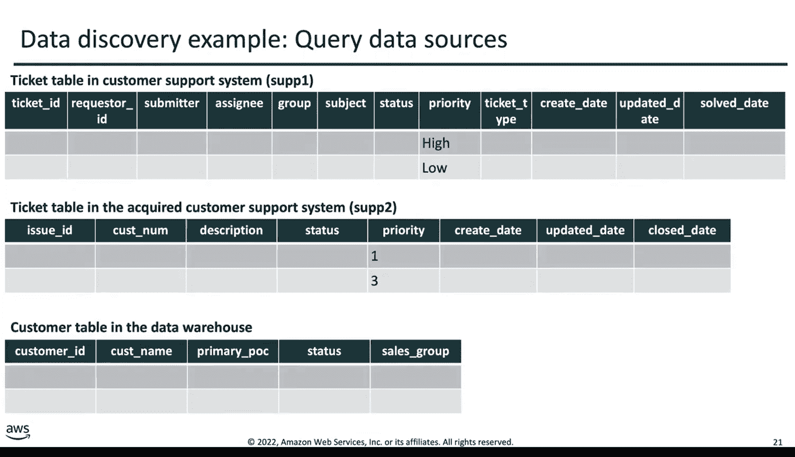

数据结构化涉及将原始数据映射为支持大规模存储并能与其他数据组合的格式。这需要基础设施来组织数据，还需要解析源文件并将其转换，例如处理字符串或模式。这是一个映射问题，需要弄清楚一个事物如何映射到另一个事物，以及如何将文件解析为相关字段和属性。

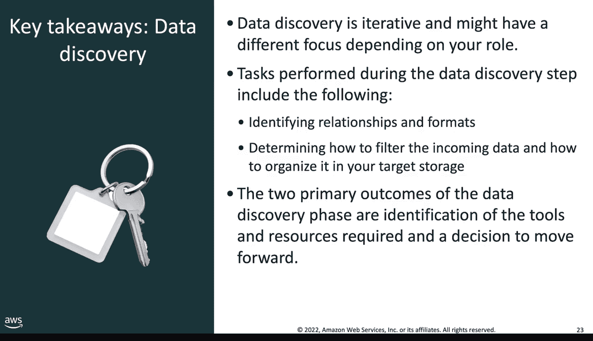

这构成了数据结构化复杂性的重要部分。例如，你可能会重命名列，执行额外的数据整理步骤，然后压缩文件并上传到S3存储桶。

**关键要点**：数据结构化是将来自一个或多个源文件的原始数据映射为一种格式，以支持大规模存储和与其他数据的组合。在结构化步骤中，需要解析文件、将字段映射到更大的目标、组织数据集，并最终找到优化文件大小的方法。

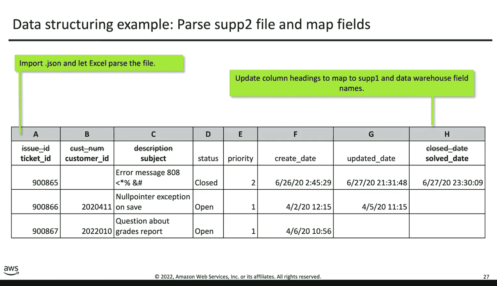

### 数据清洗 🧼

数据清洗是一个非常重要的步骤，因为数据永远不会完全符合你的期望。清洗过程需要考虑：
*   移除不想要的数据。
*   填充缺失的数据值。
*   验证或修改数据类型。
*   修正异常值。

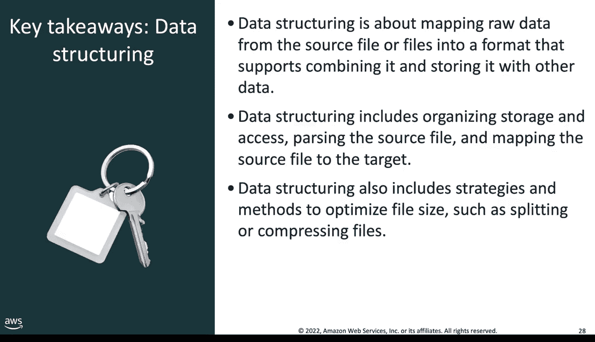

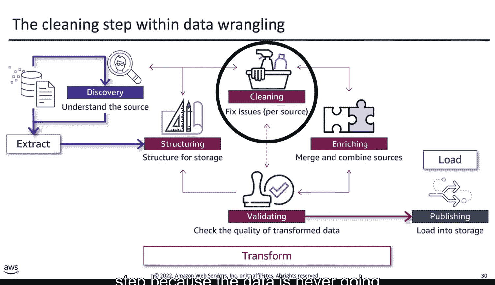

根据执行清洗的人员不同，操作也会有很大差异。可能出现的问题包括：字段损坏、存在错误字符、数据缺失等。另一个清洗任务可能是将不同字段从一种格式映射到另一种格式，例如更改日期格式。数据清洗中的问题种类几乎是无穷无尽的。

**关键要点**：数据清洗是为在管道中使用而准备原始数据的过程。清洗是按数据源进行的，包括移除重复项、修正值、确保数据类型正确等任务。

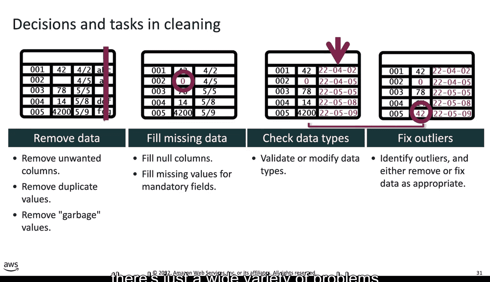

### 数据丰富 ✨

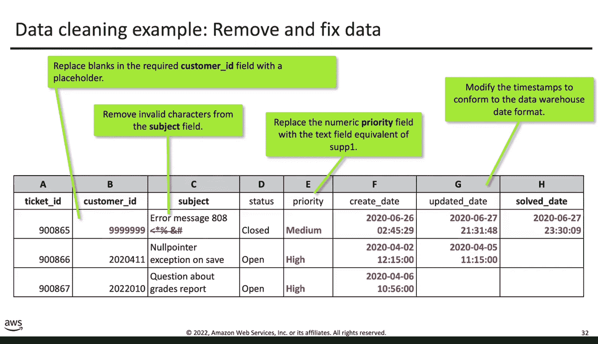

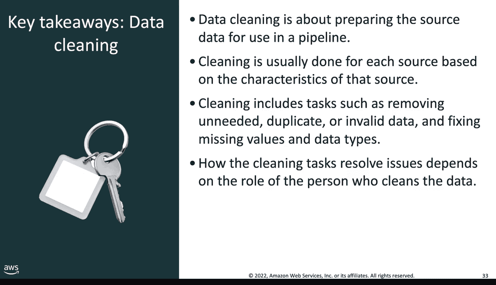

数据丰富是数据整理中的一个重要主题，其步骤可能更加复杂。这可能涉及处理合并的字段，然后向这些字段添加额外的计算，例如创建一个由两个不同字段组合而成的合成列，从而生成一些新特征。

在丰富数据时，还需要考虑这将如何影响下游问题（如机器学习问题）的表现。

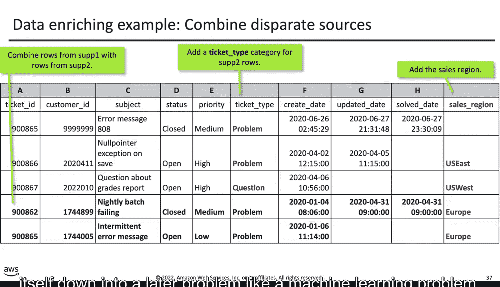

**关键要点**：数据丰富是从不同来源提取数据以创建所需数据集的过程。在丰富过程中，可能会合并数据源、添加额外字段，甚至计算新值。

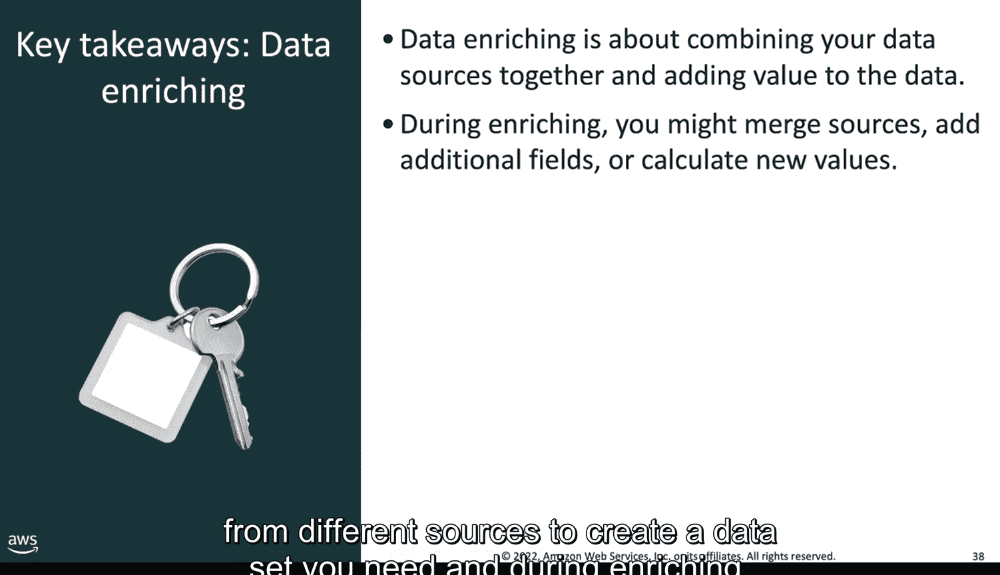

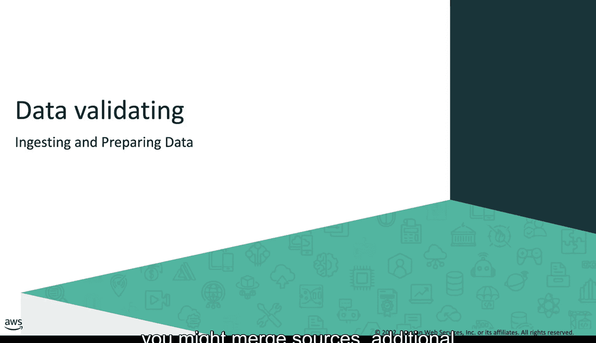

### 数据验证 ✅

验证是另一个重要步骤。在清洗过程中，你可能要确保电子邮件字段具有正确的数据类型值。但在验证过程中，你需要核实电子邮件地址及其域名是否代表有效值。例如，人们常会输入虚假的电子邮件地址。

数据工程师将专注于验证自动化结构、清洗或丰富过程的准确性，并确保没有包含个人身份信息的字段。可以进行的验证包括将事物从一种格式映射到另一种格式，然后核实所看到的值实际上是有效值。

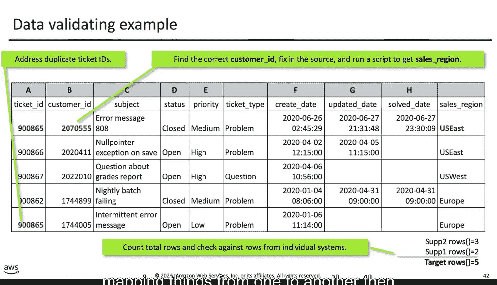

**关键要点**：验证的目的是确保数据的完整性。验证任务可能与清洗任务重叠。目标是确保数据不仅有效，而且能够成功加载。这是一个迭代过程，需要修复错误并重新运行。

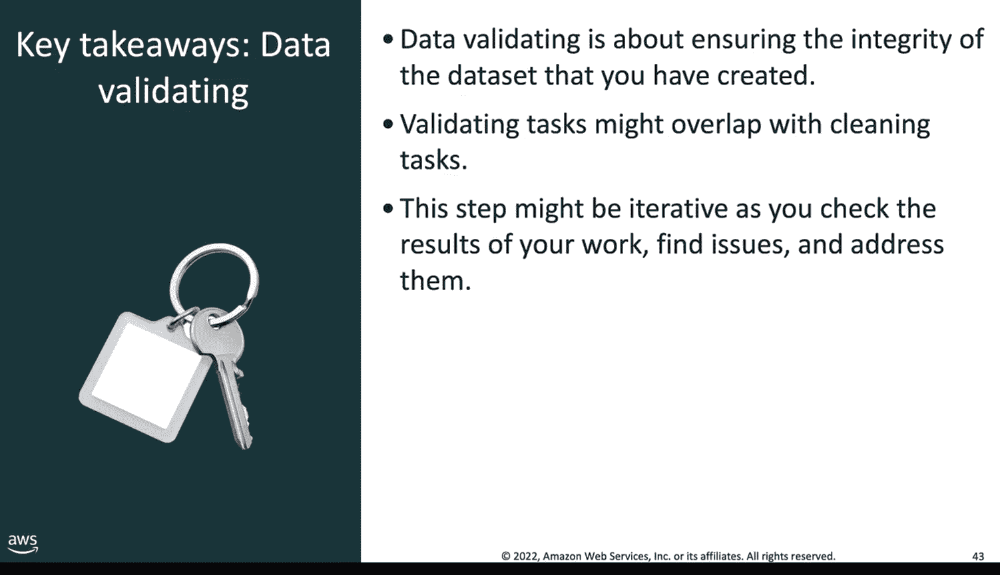

### 数据发布 📤

数据发布涉及将数据写入适当的文件夹或分区，并应用文件管理技术。作为发布过程的一部分，还需要确保存储位置已设置，并以最小权限原则配置访问方式，即只授予用户完成工作所需的最低权限。

例如，数据工程师登录其账户，指定一个存储桶，然后将数据上传到不同区域。最后，像AWS Glue这样的服务可以创建一个可重复的过程。Glue会爬取数据并创建数据目录。数据目录的好处在于，你无需再次查询数据本身，只需查询目录，然后所需的数据就会被激活。

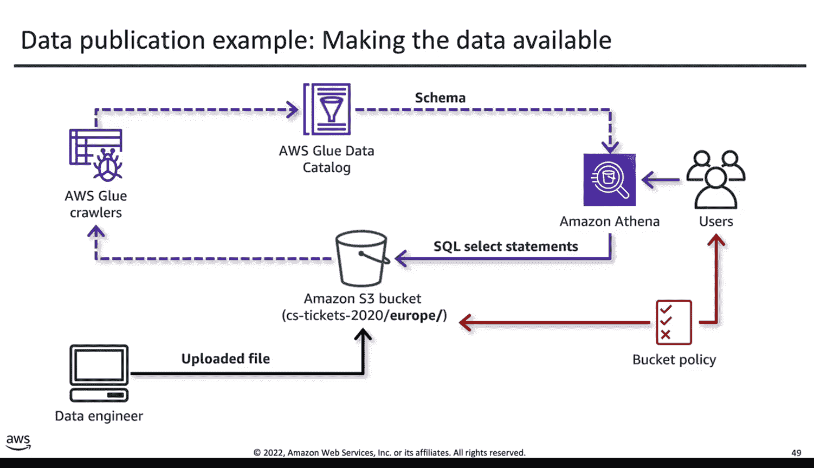

**关键要点**：数据发布是关于在管道内使数据可用。要发布数据，需要根据在结构化步骤中做出的决策，将数据移动到目标存储。为了持续提供数据，还需要建立一种方法，以便及时更新数据。

## 总结 📝

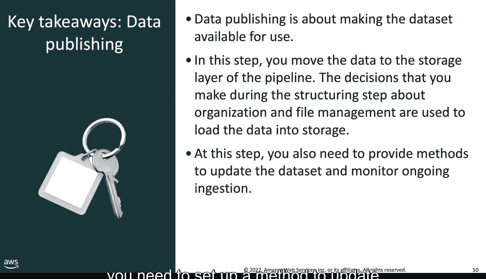

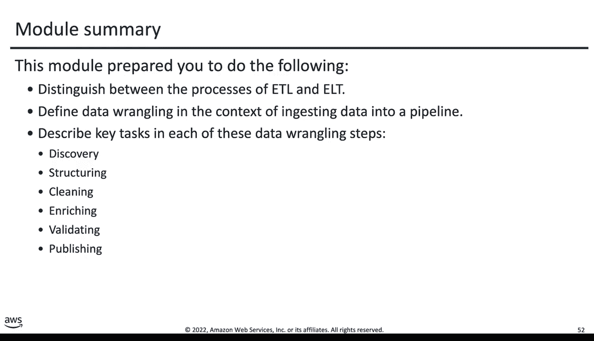

本节课中我们一起学习了数据摄取与预处理的核心概念。我们详细探讨了**ETL（提取、转换、加载）**和**ELT（提取、加载、转换）**这两种数据处理范式，理解了它们各自的适用场景、优势与权衡。随后，我们深入剖析了**数据整理（Data Wrangling）**的多步骤流程，包括**数据发现、结构化、清洗、丰富、验证和发布**。每个步骤都有其特定的目标和挑战，共同确保了原始数据能够被转化为可靠、可用且适合下游分析（如机器学习）的高质量数据。

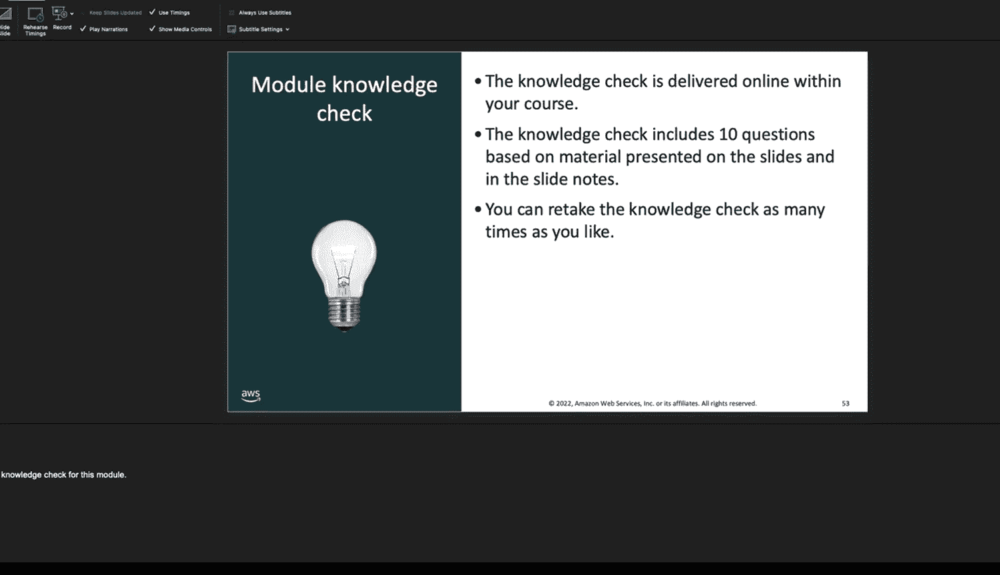

要真正掌握并巩固这些信息，最好的方法是亲自进行数据整理和数据工程实践。在构建数据管道时，遵循这些步骤，以确保创建一个可重复且可靠的过程。