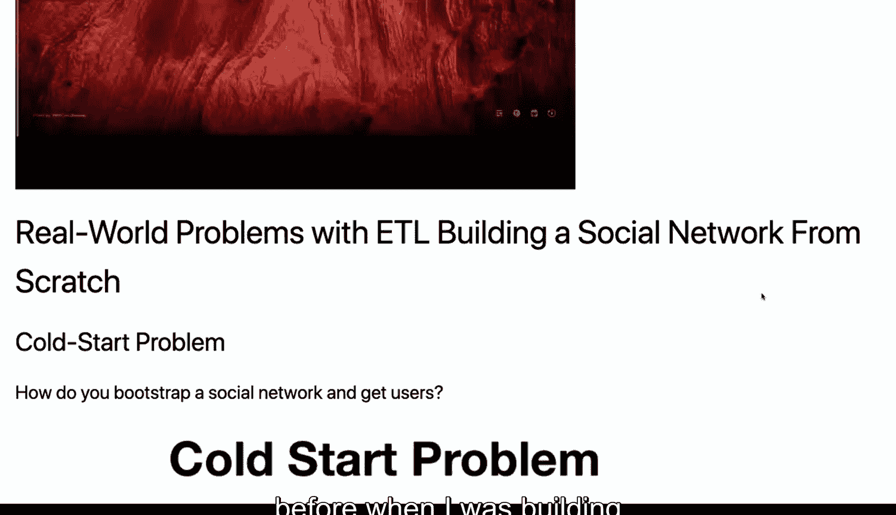
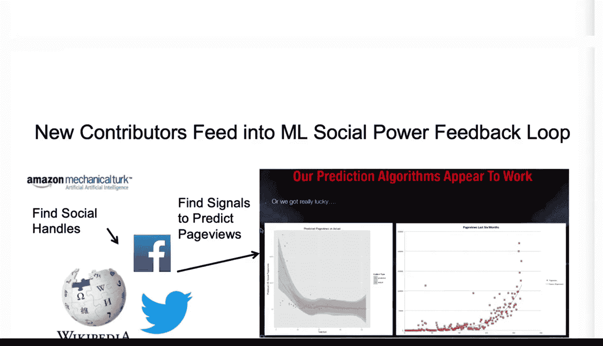
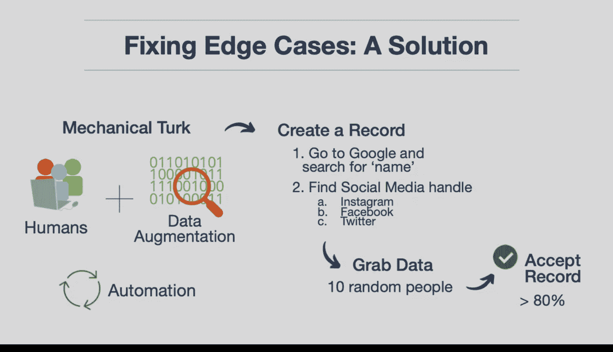

#  069：ETL实际场景问题 🧩

在本节课中，我们将通过一个构建社交网络时遇到的实际问题，来探讨数据工程（ETL）流程中的挑战与解决方案。我们将看到，从原始数据到可用的机器学习模型，中间需要经历复杂的数据获取、清洗和验证过程。

## 一个真实世界的挑战

上一节我们讨论了ETL的基本概念，本节中我们来看看一个具体的应用场景。几年前，我在从零开始构建一个社交网络时，遇到了一个核心问题：如何吸引用户加入。一个有效的方法是现在被称为“网红营销”的策略。

这个策略的核心是与已有大量粉丝的社交媒体用户合作，让他们在我们的平台上发布内容。但首先，我们需要确定与哪些人合作。

## 数据获取与初步处理

为了找到合适的合作对象，我需要建立一个潜在合作者的数据库。以下是初始步骤：

1.  **从第三方系统获取原始数据**：我首先从一个第三方系统获取了美国乃至全球体育界人士的名单，包括像C罗这样的著名足球运动员。
2.  **将原始数据存入数据库**：例如，我获得了乔·蒙塔纳的信息，包括他曾为49人队效力，并将这些信息存入数据库。
3.  **建立定时任务框架**：我构建了一个任务框架，可以定期运行数据处理任务。大多数机器学习或数据工程框架都允许你设置运行间隔、指定数据源和输出目标。

## 数据清洗：众包的力量

原始数据并不完整，特别是缺少关键的社交媒体账号信息。为了解决这个问题，我引入了数据清洗环节。

我创建了一个亚马逊Mechanical Turk任务。这是一种众包模式，我让世界各地的人帮忙查找目标人物的社交媒体账号（如Twitter、Instagram、Facebook）。然后，我会收集10个人的查询结果。

如果其中大多数人（例如8人）就某个账号达成一致，我就认为这个信息是准确的，并创建完整的记录。例如，勒布朗·詹姆斯的记录可能包含：Twitter账号 @KingJames，维基百科页面等。

这个清洗后的数据会再次被存入数据库。至此，我们完成了数据工程流水线的第一步：获取不完整的原始记录，并通过众包清洗来补全数据。

## 数据增强与机器学习建模

一旦获得了真实的社交媒体账号，下一步就是增强数据并用于预测。

1.  **获取社交媒体元数据**：我创建了第二个任务，去查询Twitter、Facebook、Instagram的API，获取用户的元数据，例如：
    *   粉丝数量
    *   互动率
2.  **构建机器学习模型**：我利用这些元数据（来自第三方平台）以及这些用户在我们平台上实际产生的流量数据，来构建一个预测模型。该模型的目标是**预测每个帖子能为我们平台带来多少页面浏览量**。

这个模型帮助我们识别出哪些合作者能带来最大的流量。一个成功的例子是，我们与一位NFL四分卫合作，他围绕NFL选秀发布的帖子因为太受欢迎，几乎让我们的系统过载。

从高层次看，这个流程是：**亚马逊Mechanical Turk -> 获取社交媒体账号 -> 查询元数据 -> 训练预测模型 -> 实现流量指数级增长**。这是一个构建真实数据工程流水线所需的迭代过程。

## 架构设计与核心挑战

这一切都始于顶层设计。你必须从高层次规划系统的工作流程，而且通常会有多个循环。从获取原始数据开始，你需要持续运行多个其他任务来完善数据。让整个数据流水线完全正确可能耗时长达一年，这凸显了完成ETL和数据识别的巨大难度。

接下来，我想分享在从零开始构建此类机器学习流水线时遇到的一些边界案例。

## 边界案例：脏数据的代价

一个常见的边界案例是：人们很容易忘记，**数据输入是构建机器学习系统时最具挑战性的部分**。

这意味着，在构建数据流水线的初始阶段，如果数据本身有问题，会在后端导致大量的额外工作。我们最初让公司实习生手动收集数据，效果很差，因为这项工作非常枯燥且困难。结果，大约50%的记录是坏数据。

一个很好的例子是“安东尼·戴维斯”。NFL有一位球员叫安东尼·戴维斯，他的职业生涯并不辉煌，社交媒体粉丝可能只有1万左右。而NBA也有一位超级巨星叫安东尼·戴维斯（不久前刚和勒布朗·詹姆斯一起赢得总冠军），他在2014/15年就有数百万粉丝。

这两个人的信号（影响力）天差地别。如果错误地将NFL的安东尼·戴维斯的数据（仅有1万粉丝）输入机器学习系统，就会导致下游的预测模型准确率极差。这是一个微妙的问题：数据看似被正确输入，却会导致模型准确率低下。

问题的根源在于人工参与。当人类从事如此枯燥、高强度的工作（例如需要建立10万用户的资料库）时，会不断犯错。如果我们想构建一个准确的机器学习预测模型，这就会带来严重问题。

## 解决方案：自动化与混合智能

那么，解决方案是什么？如何避免记录混淆或信息错位这类错误？答案是**自动化**。

我们最终采用的解决方案是充分利用Mechanical Turk系统，它代表了一种更大的趋势：**人类与技术的混合**。

以下是具体做法：

1.  **设计明确的任务指令**：我们会给全球的众包工人讲一个非常具体的故事。例如：“请去谷歌搜索‘X人物’，并找到他的A) Instagram账号、B) Facebook账号、C) Twitter账号，然后将信息填入表格。”
2.  **多人验证与共识机制**：针对同一个人，我们会让10个不同的随机工人执行该任务。
3.  **基于共识接受数据**：如果10人中有8人（达到法定人数）就社交媒体账号达成一致，我们才接受这条记录。这样，错误率实际上接近于零。

这里的修复方案表明，你不能仅仅依赖单个人类为机器学习流水线输入数据。你必须借助更复杂的工具。人们开始依赖的正是这种混合模式：在拥有数据增强能力（如Mechanical Turk系统）的更大系统中，让人类输入数据，并由系统整合并通过API提供给你。

---

**本节课中我们一起学习了**：如何通过一个真实的社交网络案例，理解ETL流程在实际应用中的复杂性。我们从数据获取、众包清洗、元数据增强，一直讲到机器学习建模。关键收获在于认识到**数据质量是机器学习系统的基石**，而通过**自动化工具与人类智能相结合**的混合方法，可以有效地解决数据输入中的边界案例和脏数据问题，从而构建出稳健的数据工程流水线。