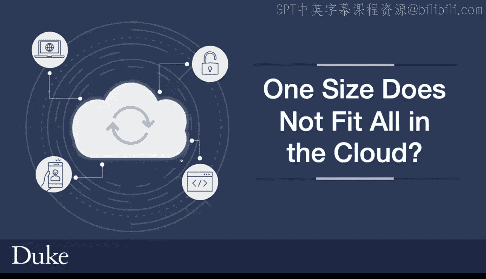

#  071：云环境中没有万能解决方案

在本节课中，我们将探讨一个核心原则：在云环境中，不存在适用于所有场景的单一数据库解决方案。我们将了解为什么需要根据具体任务选择不同类型的数据库。

---

几年前，亚马逊的首席技术官沃纳·沃格尔斯曾提到，**“一种尺寸的数据库不适合任何人”**。他的意思是，数据库根据你所要解决的问题类型，具有多种不同的特性。

例如，对于银行操作这类场景，事务型数据库或传统的关系型数据库可能非常合适，因为一切都需要保持**一致性**。

然而，对于一个基于Web的应用程序，比如内容管理系统，**最终一致性**的数据库可能是更合适的选择。

在其他场景下，能够查看社交网络中不同关系的**图数据库**，可能是另一种类型的数据库选择。

因此，当你在云环境中构建应用时，例如在AWS上，可能有**多达十几种不同的数据库**可供选择。你的任务是根据手头的具体工作，选择最合适的数据库。

仅仅依赖单一数据库本身，可能并非恰当的解决方案。

---

本节课中，我们一起学习了在云计算中选择数据库的核心思想：没有万能解决方案。关键在于理解不同数据库的特性（如强一致性、最终一致性、图关系处理等），并根据具体的应用场景（如金融交易、内容管理、社交网络）来做出明智的选择。