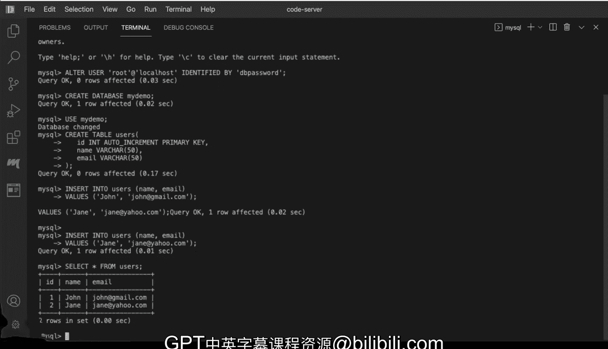

#  073：终端操作MySQL 🗄️


在本节课中，我们将学习如何在终端环境中操作MySQL数据库。我们将从登录开始，逐步完成创建数据库、定义表结构、插入数据以及查询数据等核心操作。通过这个过程，你将建立起对数据库基本工作流的直观理解。

## 登录MySQL

首先，我们需要登录到MySQL服务器。我们将以`root`用户身份登录，这是新安装MySQL后的默认管理员账户。

在终端提示符后，输入以下命令：
```bash
mysql -u root
```
执行此命令后，你将进入MySQL的命令行交互界面。

## 修改用户密码

成功登录后，一个常见的后续操作是修改`root`用户的密码，以增强安全性。

以下是修改密码的SQL命令：
```sql
ALTER USER 'root'@'localhost' IDENTIFIED BY 'DB_password';
```
请将`DB_password`替换为你想要设置的新密码。执行此命令后，`root`用户的密码即被更新。

## 创建数据库

新安装的MySQL默认没有用户数据库，因此我们需要创建一个。

使用以下SQL语句创建一个名为`my_demo`的数据库：
```sql
CREATE DATABASE my_demo;
```
执行成功后，你就拥有了一个全新的、空白的数据库。

## 选择数据库

在操作表和数据之前，必须明确指定要使用哪个数据库。

输入以下命令以选择我们刚刚创建的`my_demo`数据库：
```sql
USE my_demo;
```
现在，所有后续的SQL命令都将在`my_demo`数据库的上下文中执行。选择数据库后不会有直接输出，直到我们创建表结构。

## 创建数据表

数据库中的数据存储在表中。你可以将表想象成一个电子表格，它由行和列组成。在创建表时，必须为每一列定义数据类型。

以下是一个创建`users`表的示例SQL语句。该表包含`id`、`name`和`email`三列：
```sql
CREATE TABLE users (
    id INT AUTO_INCREMENT PRIMARY KEY,
    name VARCHAR(100),
    email VARCHAR(100)
);
```
*   `id`列是整数类型，设置为主键且自动递增。
*   `name`和`email`列是可变长度字符串类型，最多可存储100个字符。

执行此命令后，表结构就创建好了。

## 向表中插入数据

表结构创建完成后，就可以向其中添加数据了。

以下是向`users`表中插入两条用户记录的SQL语句：
```sql
INSERT INTO users (name, email) VALUES
('John', 'john@gmail.com'),
('Jane', 'jane@yahoo.com');
```
这条命令会在`users`表中创建两行数据。执行后，通常会返回类似“2 rows affected”的提示，表示数据已成功插入。

## 查询数据

数据插入后，我们就可以从数据库中检索信息了。这是数据库最核心的功能之一。

使用`SELECT`语句来查询`users`表中的所有数据：
```sql
SELECT * FROM users;
```
执行此命令后，终端将返回一个结果集，显示表中所有的行和列，即我们刚刚插入的John和Jane的信息。

## 总结



本节课中，我们一起学习了在终端中操作MySQL数据库的完整基础工作流。我们从登录MySQL开始，依次完成了修改密码、创建数据库、选择数据库、定义表结构、插入数据以及最终查询数据的所有步骤。在终端中直接操作数据库，能帮助你清晰地理解每一个命令背后的执行过程，是打好数据库基础的重要实践。掌握这个从零开始的工作流，是进行更复杂数据工程和机器学习应用开发的基石。