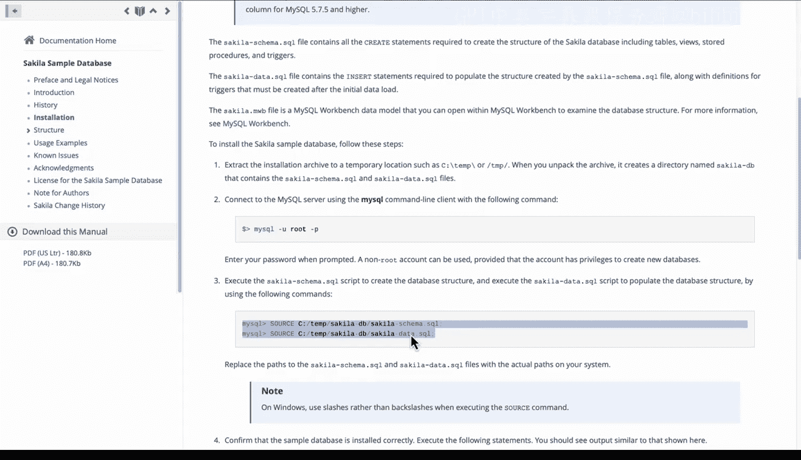
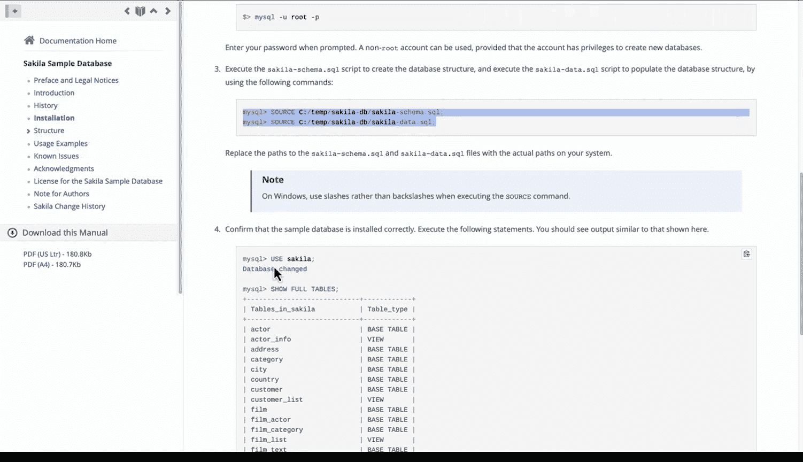
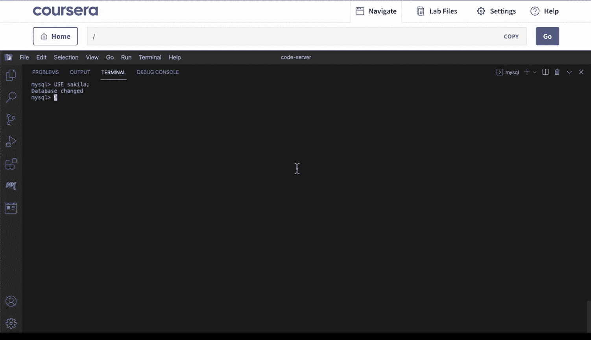
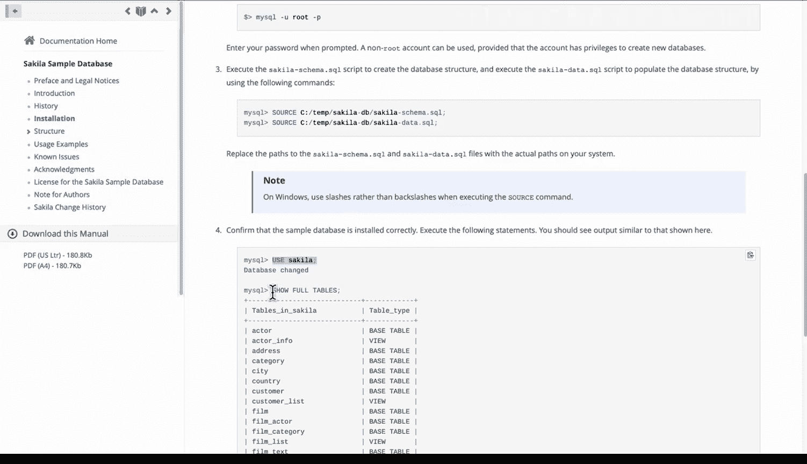
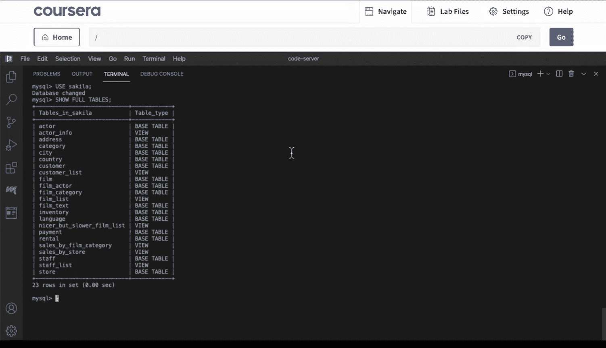
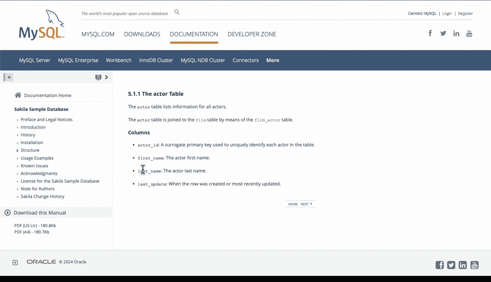
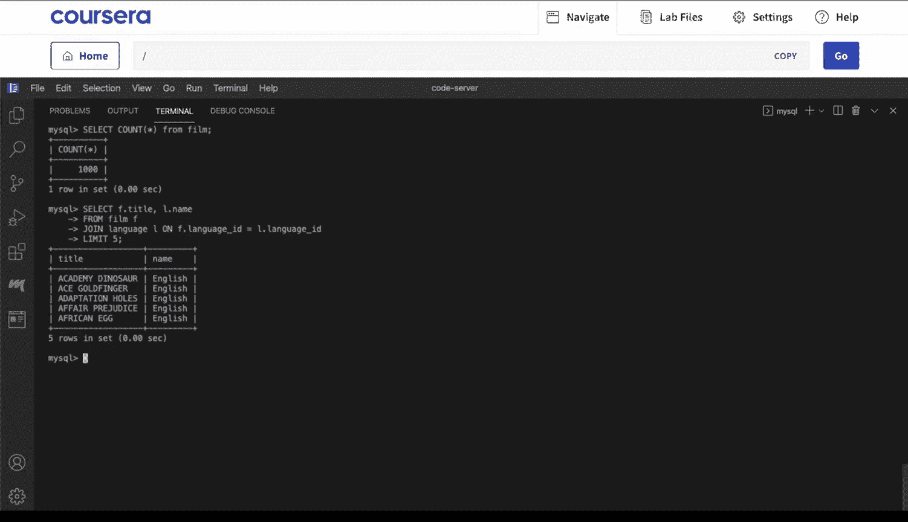

#  075：导入外部Sakila数据库 🗄️


在本节课中，我们将学习如何将一个名为Sakila的示例数据库导入到MySQL中。这是一个经典的参考数据库，常用于学习和测试数据库操作。我们将通过终端命令行完成整个导入过程，并初步探索数据库的结构与内容。

## 概述与准备



上一节我们介绍了数据库的基本概念，本节中我们来看看如何实际操作一个外部数据库。首先，你需要获取Sakila示例数据库。该数据库的官方文档和下载文件可以从MySQL开发者网站获取。

访问 `dev.mysql.com/doc/index-other.html` 即可找到下载链接。下载包通常包含三个文件：
*   一个**模式文件**：用于创建数据库的表结构。
*   一个**数据文件**：用于向表中填充数据。
*   一个 **`.mwb`文件**：专供MySQL Workbench图形化工具使用，本教程中我们不需要它。

## 导入数据库

我们将使用MySQL命令行工具来完成导入。这个过程主要分为两步：首先导入模式以创建表结构，然后导入数据以填充这些表。




以下是具体的操作步骤：



1.  **登录MySQL**：打开终端，使用以下命令以root用户身份登录MySQL服务器。系统会提示你输入密码。
    ```bash
    mysql -u root -p
    ```



2.  **导入模式文件**：登录成功后，在MySQL提示符下，使用 `SOURCE` 命令执行模式文件。你需要提供该文件在电脑上的完整路径。
    ```sql
    SOURCE /你的路径/sakila-schema.sql;
    ```
    此命令会创建所有必要的数据库和空表。

3.  **导入数据文件**：模式创建完成后，使用 `SOURCE` 命令执行数据文件，将样本数据填充到表中。
    ```sql
    SOURCE /你的路径/sakila-data.sql;
    ```
    这个过程可能需要一些时间，具体取决于数据文件的大小。





## 验证与探索数据库

成功导入后，我们可以验证数据库是否已就绪，并开始探索其内容。

首先，切换到新创建的 `sakila` 数据库，并查看其中的所有表。
```sql
USE sakila;
SHOW FULL TABLES;
```
这个命令会列出数据库中的所有表，例如 `actor`, `film`, `category` 等。

为了更深入地理解数据库结构，查阅官方文档中的**模式图**非常有帮助。这张图清晰地展示了表与表之间的关系（如外键连接），这对于设计复杂查询至关重要。

## 执行基础查询

了解结构后，我们可以尝试一些基础的SQL查询来与数据交互。

1.  **查看表结构**：在查询具体数据前，使用 `DESCRIBE` 命令查看表的列信息是一个好习惯。
    ```sql
    DESCRIBE actor;
    ```

2.  **检索数据**：使用 `SELECT` 语句从表中获取数据。初始探索时，使用 `LIMIT` 子句限制返回的行数是个明智的做法。
    ```sql
    SELECT * FROM actor LIMIT 5;
    ```

3.  **尝试连接查询**：Sakila数据库的威力在于其关联的表。我们可以执行连接查询来获取更丰富的信息。例如，以下查询连接了 `film`、`film_actor` 和 `actor` 表，以列出电影及其对应的演员。
    ```sql
    SELECT f.title, f.rental_rate, a.first_name, a.last_name
    FROM film f
    JOIN film_actor fa ON f.film_id = fa.film_id
    JOIN actor a ON fa.actor_id = a.actor_id
    LIMIT 10;
    ```

4.  **使用聚合函数**：我们还可以使用像 `COUNT` 这样的聚合函数来获取汇总信息。
    ```sql
    SELECT COUNT(*) AS total_films FROM film;
    ```



## 总结


本节课中我们一起学习了如何将外部的Sakila示例数据库导入到MySQL中。我们完成了从下载文件、通过命令行导入模式与数据，到验证导入成功并进行基础查询和探索的完整流程。利用Sakila这样拥有完善文档的标准化数据库进行练习，是提升SQL技能和理解数据库设计的有效途径。你可以继续根据官方文档中的模式图，尝试设计更复杂的查询，以加深对关系型数据库操作的理解。