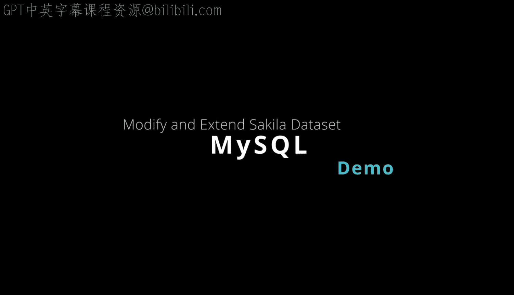
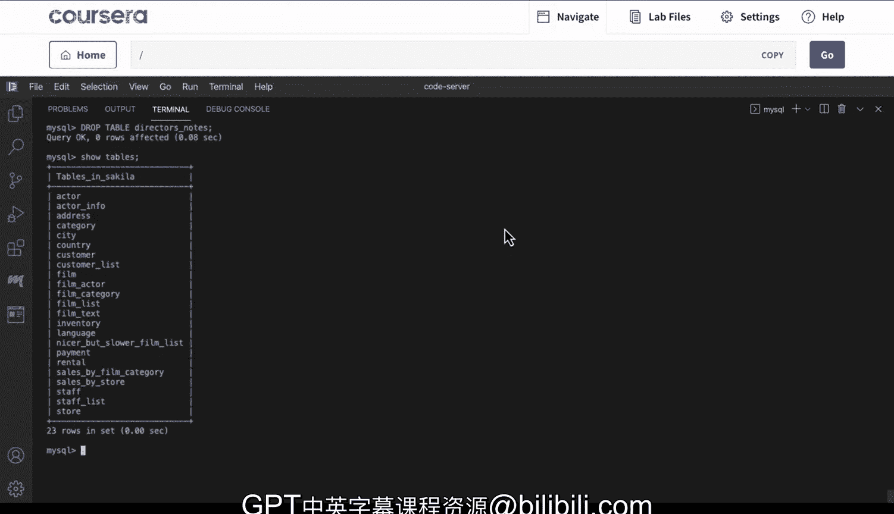

#  076：修改Sakila数据库 🗄️



在本节课中，我们将学习如何扩展一个现有的MySQL示例数据库（Sakila数据库）。我们将通过创建一个新表、插入数据、查询数据，最后清理实验性表来演示基本的数据库操作流程。

## 概述

Sakila是MySQL自带的一个关于电影行业的示例数据库，其中包含了演员、电影等信息。本节我们将扮演一位导演，需要为电影库中的影片添加后期制作笔记。我们将通过一系列SQL语句来扩展这个数据库，以满足新的业务需求。

## 连接到数据库并查看现有结构

首先，我们需要登录到MySQL服务器并查看已有的数据库和表。这是了解当前数据环境的必要步骤。

以下是我们需要执行的初始命令：

1.  使用 `mysql -u root -p` 命令登录MySQL。
2.  输入密码后，使用 `SHOW DATABASES;` 命令查看所有数据库，确认 `sakila` 数据库存在。
3.  使用 `USE sakila;` 命令切换到sakila数据库。
4.  使用 `SHOW TABLES;` 命令查看该数据库中的所有表，例如 `actor`、`category`、`film` 等。

## 创建新表以存储导演笔记

上一节我们查看了数据库的现有结构，本节中我们来看看如何为导演的笔记创建一个专用的数据表。

假设导演需要在影片的后期制作阶段记录一些修改意见，例如调整音效或剪辑场景。我们需要创建一个名为 `director_notes` 的表来存储这些信息。

以下是创建该表的SQL语句：

```sql
CREATE TABLE director_notes (
    note_id INT AUTO_INCREMENT PRIMARY KEY,
    film_id INT,
    director_note TEXT,
    edit_date DATE
);
```

这段代码创建了一个包含四个字段的表：
*   `note_id`：笔记的唯一标识，使用 `AUTO_INCREMENT` 实现自动递增。
*   `film_id`：关联到 `film` 表中影片的ID。
*   `director_note`：存储导演笔记的文本内容。
*   `edit_date`：记录笔记的编辑日期。

执行此语句后，`director_notes` 表就被成功创建了。

## 向新表中插入示例数据

表创建完成后，我们需要向其中添加一些数据。以下是向 `director_notes` 表插入两条示例记录的SQL语句。

```sql
INSERT INTO director_notes (film_id, director_note, edit_date)
VALUES
    (1, 'Fix the sound in minute 20.', '2023-10-26'),
    (2, 'Shorten the battle scene.', '2023-10-27');
```

这段代码执行了以下操作：
*   向 `film_id` 为1的影片插入一条笔记：“Fix the sound in minute 20.”，编辑日期为2023年10月26日。
*   向 `film_id` 为2的影片插入另一条笔记：“Shorten the battle scene.”，编辑日期为2023年10月27日。

## 关联查询以生成有用视图

仅仅查看笔记表本身信息有限，本节我们将通过关联查询，将笔记与影片信息结合起来，生成一个对导演更有用的视图。

为了清晰地看到哪部电影对应哪些笔记，我们可以执行一个连接查询（JOIN）。以下SQL语句将 `director_notes` 表与 `film` 表关联起来。

```sql
SELECT f.title, dn.director_note, dn.edit_date
FROM film f
LEFT JOIN director_notes dn ON f.film_id = dn.film_id
ORDER BY f.title;
```

执行此查询后，我们将得到一个结果列表，显示所有电影的标题，并仅在《Academy Dinosaur》和《A Goldfinger》这两部电影旁边显示我们刚刚添加的导演笔记和编辑日期。这种查询结果非常适合作为应用程序中供导演查看的界面。

## 清理实验性数据表

在完成实验或需要重新设计时，清理不再需要的表是一个好习惯。假设 `director_notes` 表只是一个临时实验，我们可以将其删除。

以下是删除该表的SQL语句：

```sql
DROP TABLE director_notes;
```

执行 `DROP TABLE` 命令后，`director_notes` 表将从数据库中永久移除。我们可以再次运行 `SHOW TABLES;` 命令来确认该表已不存在。

## 总结



本节课中我们一起学习了如何扩展一个现有的MySQL数据库。我们逐步完成了从登录数据库、查看结构，到创建新表、插入数据、执行关联查询，最后清理临时表的完整操作流程。这是一个在真实样本数据库上进行实践练习的绝佳方式，建议你尝试在自己的环境中进行类似操作，以加深对数据库基本操作的理解。