#  079：基于提示工程的BigQuery应用 🚀


在本节课中，我们将学习如何结合提示工程与Google BigQuery，以更高效地构建和优化数据查询。我们将通过一个具体的例子，展示如何利用大型语言模型来理解、修改和增强SQL查询。

## 概述

BigQuery是一个强大的云数据仓库，但编写复杂的SQL查询有时具有挑战性。提示工程为我们提供了一种新方法：通过与AI模型（如ChatGPT）对话，我们可以获得查询解释、代码修改建议，甚至生成新的查询逻辑。本节将演示这一交互式工作流程。

## 从解释查询开始

上一节我们介绍了BigQuery的基本操作，本节中我们来看看如何利用AI辅助理解现有查询。一个很好的起点是让AI模型解释一段你不熟悉的SQL代码。

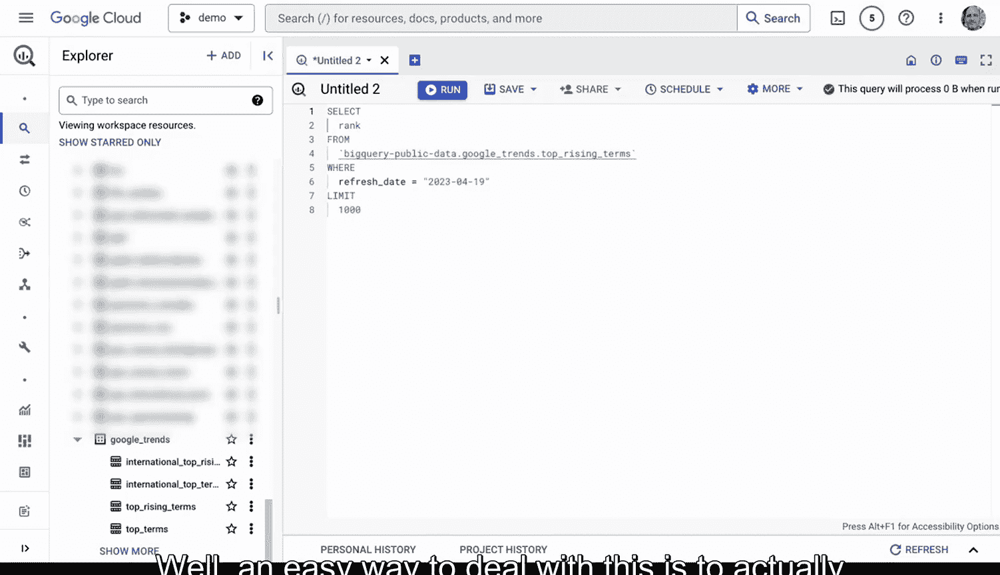

例如，我们可以将一段Google Trends数据集的查询代码提交给ChatGPT，并要求解释。

```sql
SELECT
  term,
  SUM(score) AS total_score
FROM
  `bigquery-public-data.google_trends.international_top_terms`
WHERE
  refresh_date = DATE_SUB(CURRENT_DATE(), INTERVAL 1 DAY)
GROUP BY
  term
ORDER BY
  total_score DESC
LIMIT 100
```

向模型提问：“请为我解释这个Google BigQuery查询。”

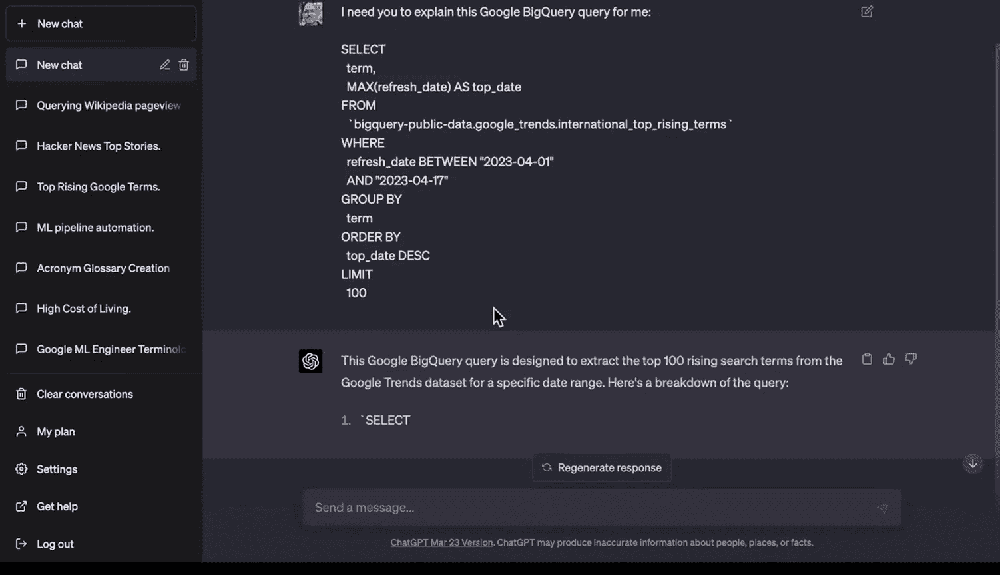

模型可能会返回如下解释：
> 此查询旨在从特定日期范围的Google Trends数据集中提取前100个上升最快的搜索词。它首先筛选出昨天的数据，然后按搜索词分组并计算总分，最后按总分降序排列并限制返回100条结果。

这种方式能帮助你快速理解复杂查询的意图和结构。

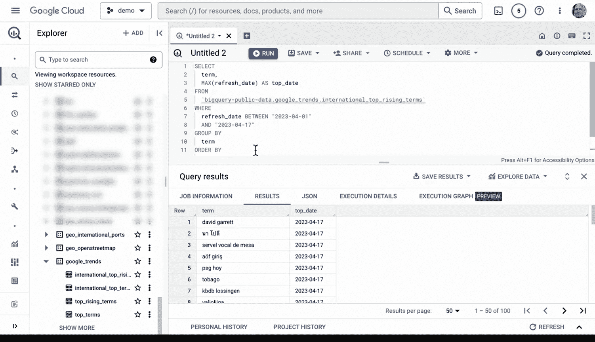

## 修改与优化查询

理解了基础查询后，我们通常需要根据具体需求进行调整。以下是使用提示工程迭代优化查询的几个步骤。

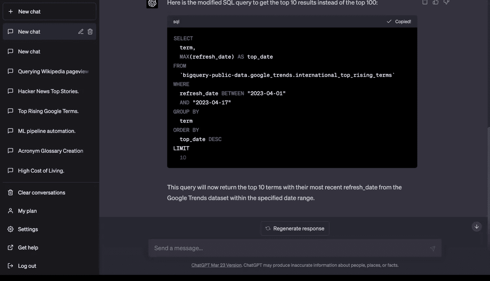

### 1. 限制返回结果数量

假设我们只需要前10个结果，而不是100个。我们可以向AI提出修改请求。

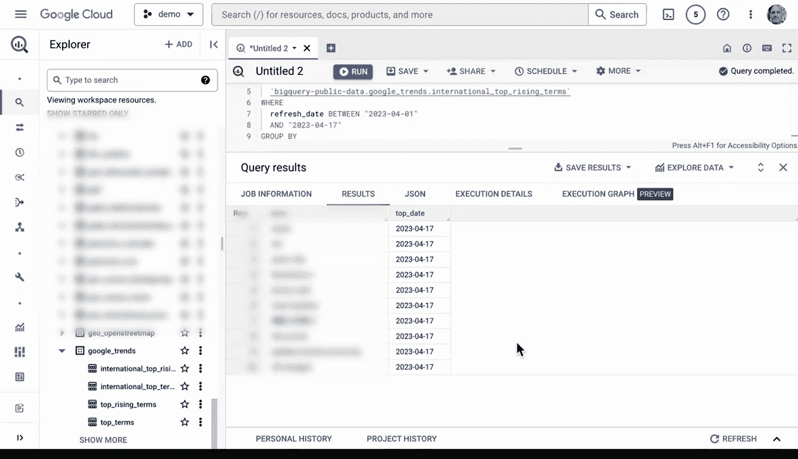

**请求**：“请修改上面的查询，只显示前10个结果。”

模型可能会生成修改后的代码，主要变化是将 `LIMIT 100` 改为 `LIMIT 10`。

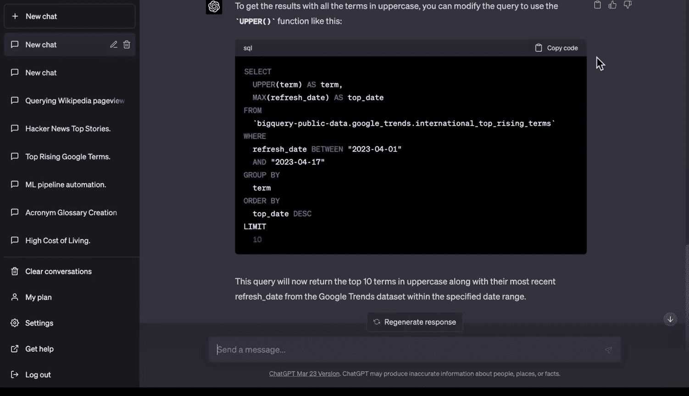

### 2. 格式化查询结果

接下来，我们可能希望将所有结果转换为大写字母。

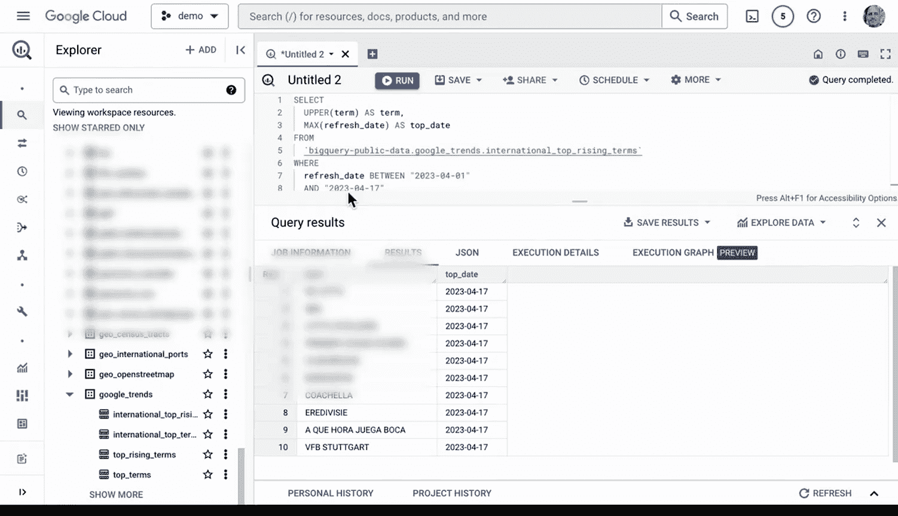

**请求**：“现在我需要所有结果以大写形式显示。”

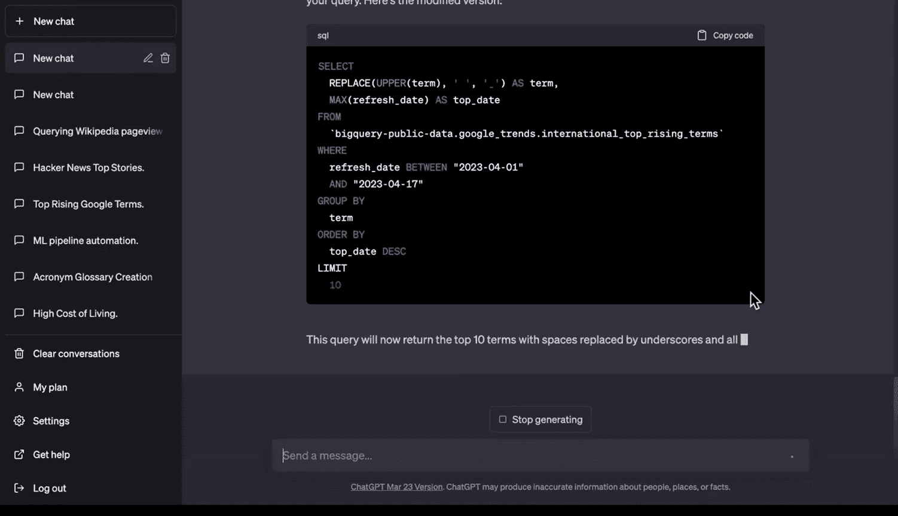

模型会建议在SELECT子句中使用 `UPPER()` 函数，例如 `SELECT UPPER(term) AS term, ...`。

### 3. 替换结果中的字符

为了便于后续处理，我们可能需要将词条中的空格替换为下划线。

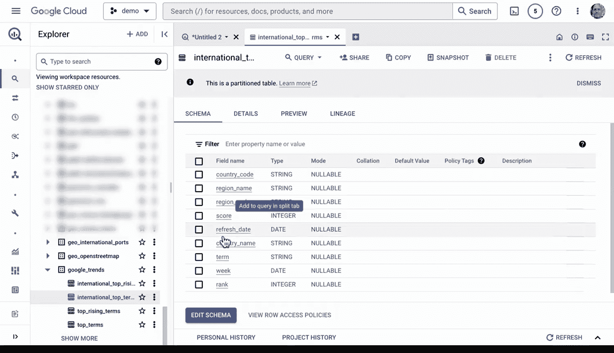

**请求**：“请将结果中所有的空格替换为下划线。”

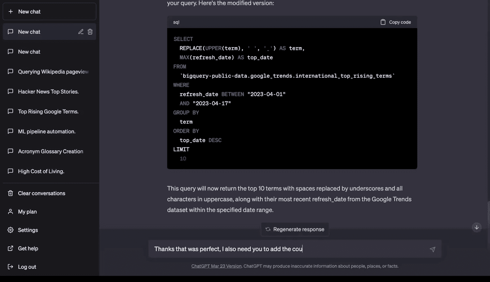

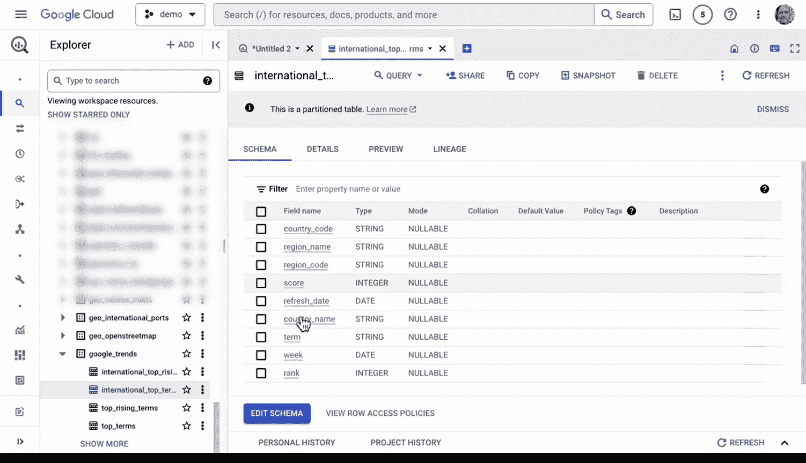

模型会推荐使用 `REPLACE()` 函数，例如 `SELECT REPLACE(term, ‘ ‘, ‘_’) AS term, ...`。

### 4. 添加更多数据维度

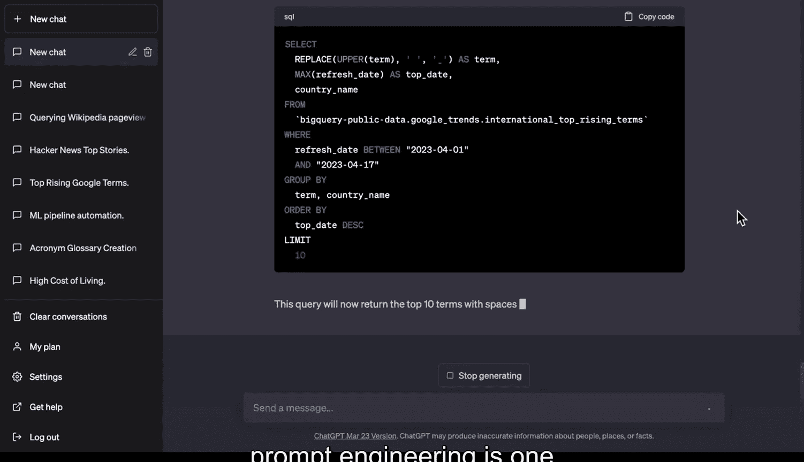

原始查询只返回了搜索词和分数。如果我们还想知道这些趋势来自哪些国家，就需要添加国家代码和名称字段。

**请求**：“请在查询中添加国家代码和国家名字段。”

模型会指导我们在SELECT子句中添加 `country_code` 和 `country_name`，并确保它们也出现在GROUP BY子句中。

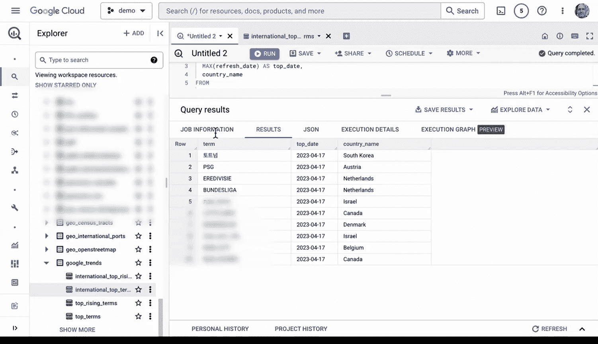

### 5. 进行复杂聚合与扩展

最后，我们可能想进行更复杂的分析，例如将结果扩展到前50名，并新增一列来统计每个国家出现的词条数量。

**请求**：“请将查询扩展为返回前50个结果，并添加一个我们自己生成的列，用于按国家统计每个词条出现的次数，并包含在输出中。”

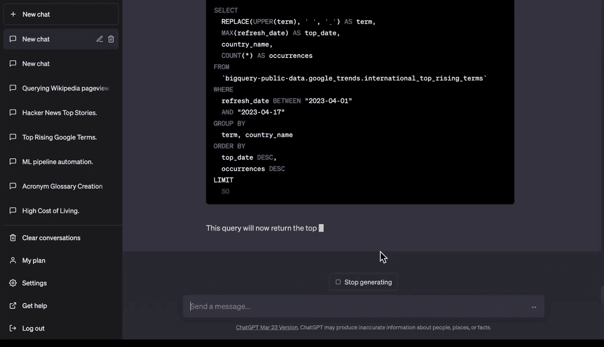

这是一个更复杂的自然语言指令。模型需要理解并执行以下操作：
*   将 `LIMIT` 改为 50。
*   在SELECT中添加 `COUNT(*) OVER (PARTITION BY country_name) AS country_occurrence` 或类似的窗口函数，以统计每个国家的出现次数。
*   确保所有新增字段被正确分组或聚合。

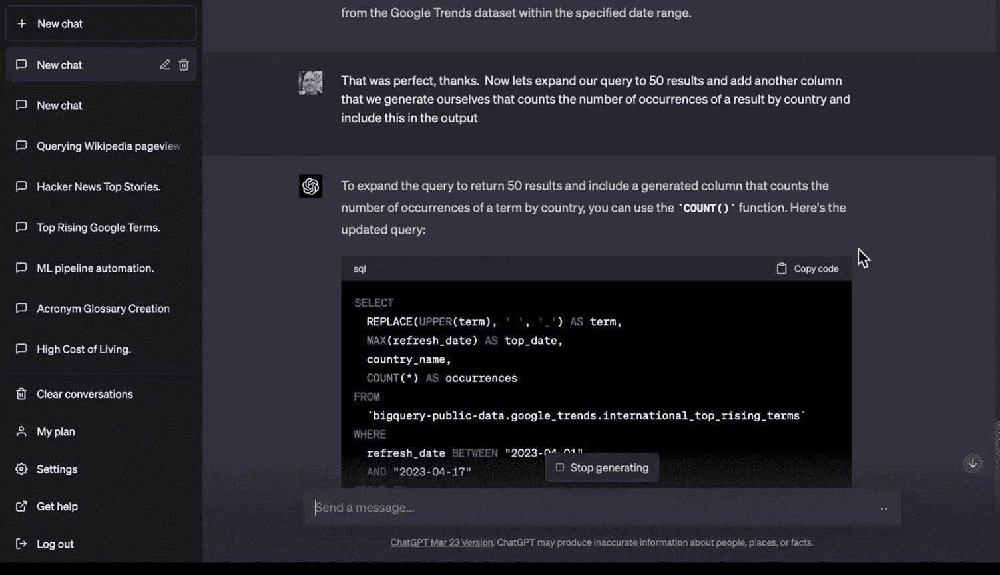

通过这一系列逐步的、增量的提示，我们可以从一段基础查询出发，构建出一个功能丰富、符合特定需求的复杂查询，而无需从头开始编写所有SQL代码。

## 总结

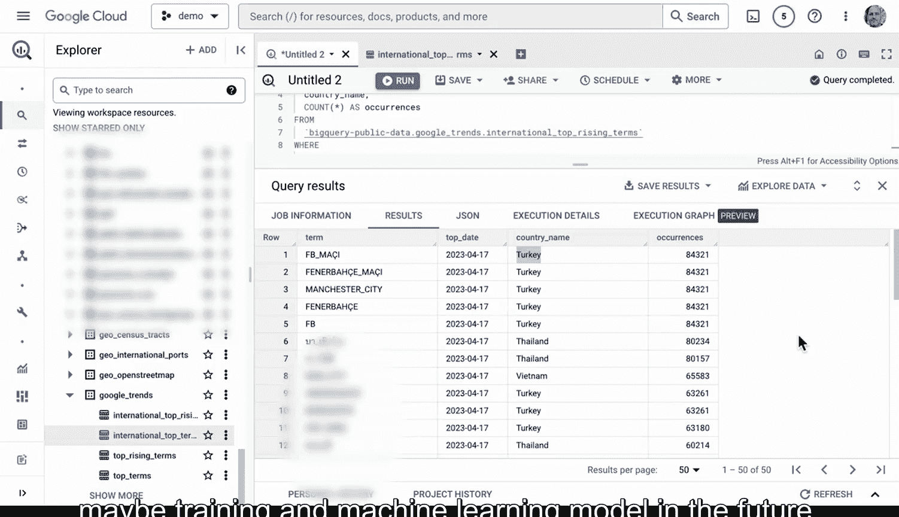

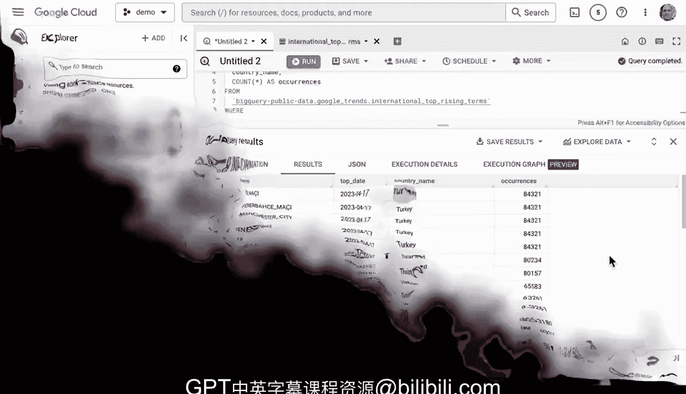

本节课中我们一起学习了如何将提示工程应用于BigQuery。我们演示了从解释查询、逐步修改（如限制结果、格式化文本、添加字段）到执行复杂聚合的完整流程。这种方法如同身边坐着一位数据库专家，能够通过对话快速获得代码建议和解决方案，极大地提升了数据查询与探索的效率和灵活性，为后续可能进行的机器学习模型训练等任务做好了数据准备。