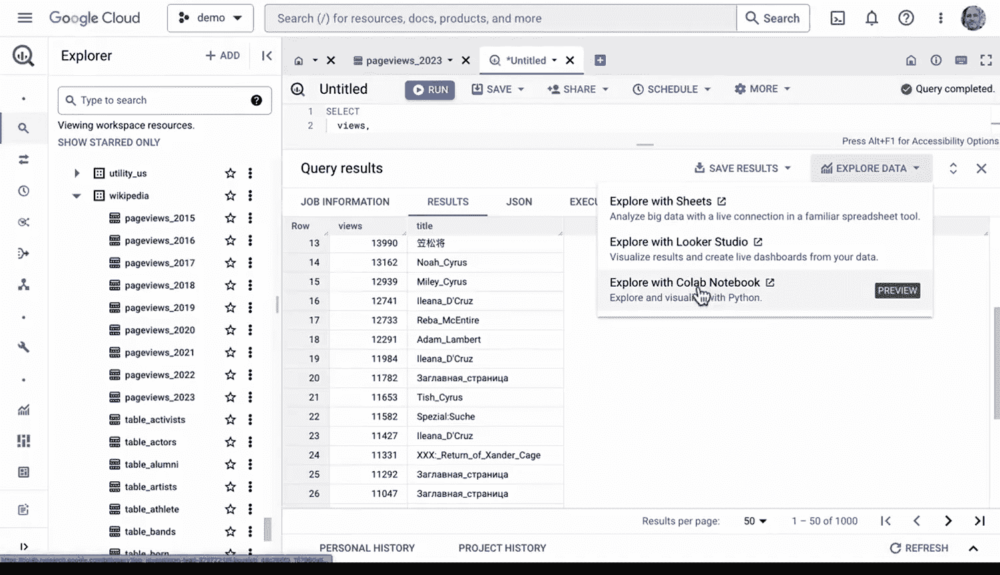
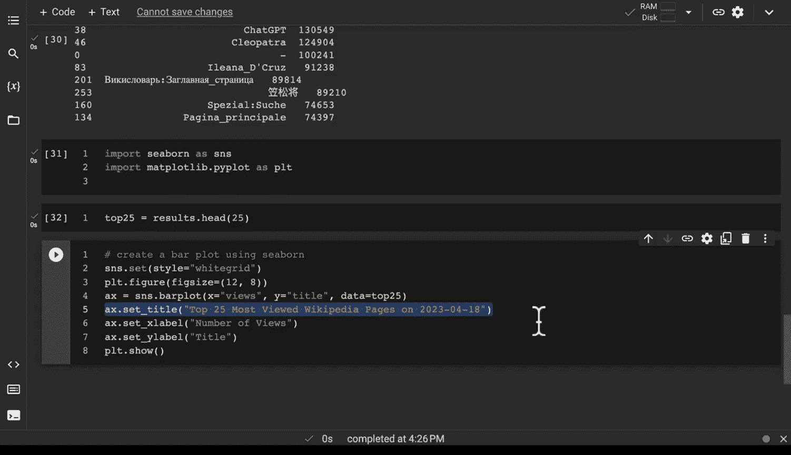
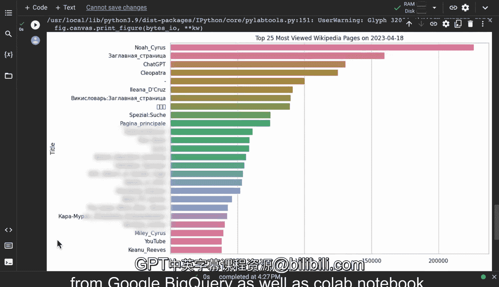

#  080：使用 BigQuery 与 Colab 构建数据流水线 🚀


在本节课中，我们将学习如何构建一个现实的数据清洗与可视化流水线。我们将使用 Google BigQuery 进行数据查询和处理，并借助 Google Colab 笔记本进行更深入的分析和可视化。整个过程将展示如何从原始数据中提取有价值的信息。

## 概述

我们将从一个 Wikipedia 页面浏览量的数据集开始。目标是找出特定日期（4月18日）最受欢迎的页面。这个过程涉及多个步骤：初始查询、数据清洗、使用 Python 进行进一步处理，以及最终的可视化。

---

## 初始数据查询

首先，我们需要在 BigQuery 中查看数据。数据表包含 `hour`、`wiki`、`title`、`views` 等字段。

以下是我们的初始查询，旨在获取 2023年4月18日浏览量最高的前1000条记录：

```sql
SELECT views, title
FROM `bigquery-public-data.wikipedia.pageviews_2023`
WHERE DATE(datehour) = ‘2023-04-18’
ORDER BY views DESC
LIMIT 1000
```

运行此查询后，我们得到了一些结果，但其中包含了许多我们不需要的条目，例如 “Main_Page” 或包含 “Special:” 的页面。这些是 Wikipedia 的系统页面，并非我们关心的热门内容。

---

## 数据清洗与过滤

上一节我们执行了初始查询，但结果中包含了许多无关条目。本节中，我们将通过修改 SQL 查询来清洗数据，过滤掉这些我们不感兴趣的页面。

我们需要在 `WHERE` 子句中添加条件，排除特定类型的标题。以下是优化后的查询：

```sql
SELECT views, title
FROM `bigquery-public-data.wikipedia.pageviews_2023`
WHERE DATE(datehour) = ‘2023-04-18’
  AND title NOT LIKE ‘Main_Page’
  AND title NOT LIKE ‘Special:%’
  AND title NOT LIKE ‘Wikipedia:%’
  AND title NOT LIKE ‘%Talk:%’
ORDER BY views DESC
LIMIT 1000
```

运行这个查询后，结果质量有所提升。但我们发现，一些其他语言的主页（如 “Hauptseite”）仍然存在。因此，我们需要继续迭代优化查询。

我们可以添加更多排除条件。以下是进一步清洗的查询示例：

```sql
SELECT views, title
FROM `bigquery-public-data.wikipedia.pageviews_2023`
WHERE DATE(datehour) = ‘2023-04-18’
  AND title NOT LIKE ‘Main_Page’
  AND title NOT LIKE ‘Special:%’
  AND title NOT LIKE ‘Wikipedia:%’
  AND title NOT LIKE ‘%Talk:%’
  AND title NOT LIKE ‘Hauptseite’ -- 排除德文主页
ORDER BY views DESC
LIMIT 1000
```

通过这种迭代方式，我们逐步得到了更干净、更相关的数据列表。

---

## 在 Colab 中使用 Python 进行分析

通过 SQL 进行初步过滤后，我们可以将分析工作转移到 Google Colab 笔记本中。这允许我们使用 Python 进行更灵活的数据处理和探索。

首先，我们需要在 Colab 中设置环境并连接到 BigQuery。以下是必要的初始设置代码：

```python
# 安装并导入必要的库
!pip install google-cloud-bigquery pandas-gbq -q

from google.colab import auth
auth.authenticate_user()

# 设置项目ID
project_id = ‘your-project-id’ # 请替换为你的实际项目ID
```

接下来，我们将之前在 BigQuery 中优化好的 SQL 查询复制到 Colab 中执行，并将结果加载到 Pandas DataFrame 中。

```python
import pandas as pd

# 你的 SQL 查询
query = “””
SELECT views, title
FROM `bigquery-public-data.wikipedia.pageviews_2023`
WHERE DATE(datehour) = ‘2023-04-18’
  AND title NOT LIKE ‘Main_Page’
  AND title NOT LIKE ‘Special:%’
  AND title NOT LIKE ‘Wikipedia:%’
  AND title NOT LIKE ‘%Talk:%’
  AND title NOT LIKE ‘Hauptseite’
ORDER BY views DESC
LIMIT 1000
“””

# 执行查询并将结果加载到 DataFrame
df = pd.read_gbq(query, project_id=project_id)
df.head()
```

加载数据后，我们可以使用 `describe()` 方法快速查看数据的统计摘要。



```python
df.describe()
```

---

## 进一步的数据处理

虽然 SQL 查询已经做了过滤，但数据中可能仍存在重复或需要聚合的情况。例如，同一个标题可能因为不同子页面或大小写问题而出现多次。

以下是我们可以对 DataFrame 进行的操作，例如按标题对浏览量进行求和，以得到每个页面的总浏览量：

```python
# 按标题分组并求和浏览量
df_aggregated = df.groupby(‘title’)[‘views’].sum().reset_index()
# 按总浏览量降序排列
df_aggregated = df_aggregated.sort_values(by=‘views’, ascending=False)
df_aggregated.head(20)
```

这个步骤帮助我们消除了潜在的重复，并得到了每个页面更准确的总浏览量排名。

---

## 数据可视化

处理完数据后，最后一步是将其可视化，以便更直观地理解结果。我们将使用 `seaborn` 和 `matplotlib` 库来创建图表。

首先，确保安装了必要的库并导入它们：

```python
!pip install seaborn matplotlib -q
import seaborn as sns
import matplotlib.pyplot as plt
```

接下来，我们选取总浏览量最高的前25个页面，并创建一个条形图。

```python
# 获取前25个结果
top_25 = df_aggregated.head(25)

# 设置图表样式
sns.set_style(“whitegrid”)
plt.figure(figsize=(12, 8))

# 创建条形图
bar_plot = sns.barplot(x=‘views’, y=‘title’, data=top_25, palette=“viridis”)
bar_plot.set_xlabel(‘Total Views’)
bar_plot.set_ylabel(‘Page Title’)
bar_plot.set_title(‘Top 25 Most Viewed Wikipedia Pages on 2023-04-18’)

plt.tight_layout()
plt.show()
```



运行这段代码后，我们将得到一个清晰的条形图，展示了 2023年4月18日 Wikipedia 上浏览量最高的25个页面。从图中我们可以直观地看到，例如 “NoA_Cyrus” 和 “ChatGPT” 等页面在那天非常受欢迎。

---

## 总结

本节课中，我们一起学习了一个完整的数据处理流水线。

1.  **数据查询**：我们首先在 Google BigQuery 中使用 SQL 查询原始数据。
2.  **数据清洗**：通过迭代修改 SQL 查询，我们过滤掉了无关的系统页面和噪声数据。
3.  **Python 分析**：我们将查询转移到 Google Colab，使用 Python 和 Pandas 进行更深入的数据加载、检查和聚合。
4.  **数据可视化**：最后，我们利用 Seaborn 库将处理后的数据创建成直观的条形图，清晰地展示了特定日期的热门页面。



这个流程展示了如何结合 BigQuery 的强大查询能力和 Colab 的灵活分析环境，来构建一个从数据提取到洞察呈现的端到端解决方案。