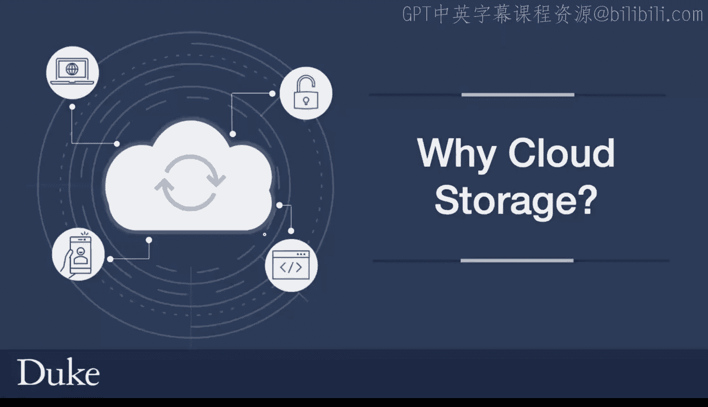

#  082：为什么需要云存储 💾

在本节课中，我们将探讨云存储的核心价值，理解其背后的经济学原理，以及它如何赋能个人与企业处理海量数据。

---

上一节我们介绍了云计算的基本概念，本节中我们来看看为什么云存储会成为现代数据解决方案的基石。其最重要的一个方面是**规模经济**的理念。

为了理解规模经济，我们可以参考一个日常生活中的例子。如果你去大型仓储超市，比如走到面粉区，购买一袋50磅装的面粉。这就是规模经济的一个绝佳例证。超市可以因为大批量采购而获得更低的进货成本，同时，由于他们销售的是大包装商品，你也能以更便宜的价格购买。你实际上在这里获得了双重好处。

云计算领域的情况与此完全相同。云服务提供商通过**批量采购**硬件与资源，能够以更低的成本运营。随后，他们可以将这些资源以低得多的价格出售给客户。因此，作为客户，如果你需要访问或存储海量数据，你实际上能够以远低于自建数据中心的成本获得这些服务。

所以，云计算和云存储的核心思想就在于**利用规模经济**。通过这种方式，你可以实现那些在没有云服务时通常无法做到的事情。

---

本节课中我们一起学习了云存储的核心理念——规模经济。我们通过日常类比理解了批量采购如何降低成本，并阐述了云服务提供商如何将这一优势传递给客户，使得处理大规模数据存储与访问变得经济可行。这正是云存储不可或缺的关键原因。