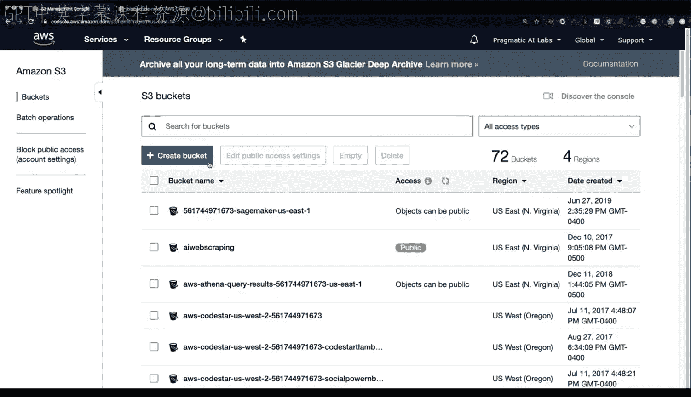
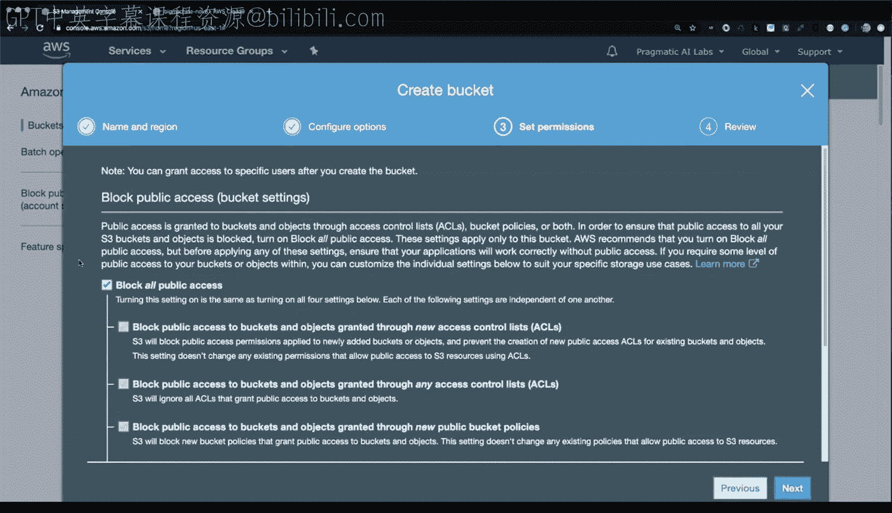
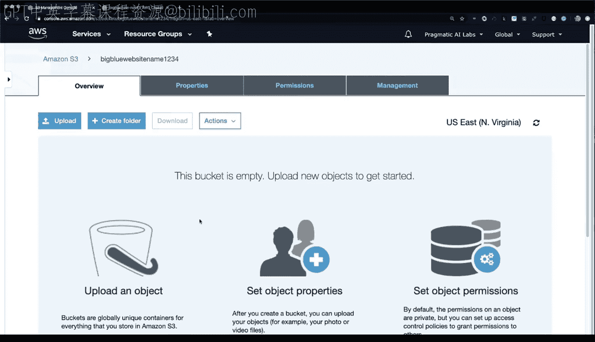
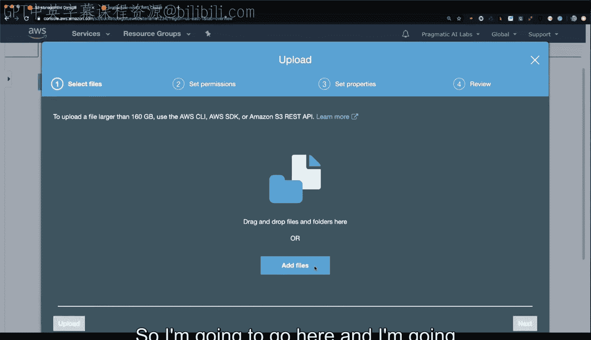
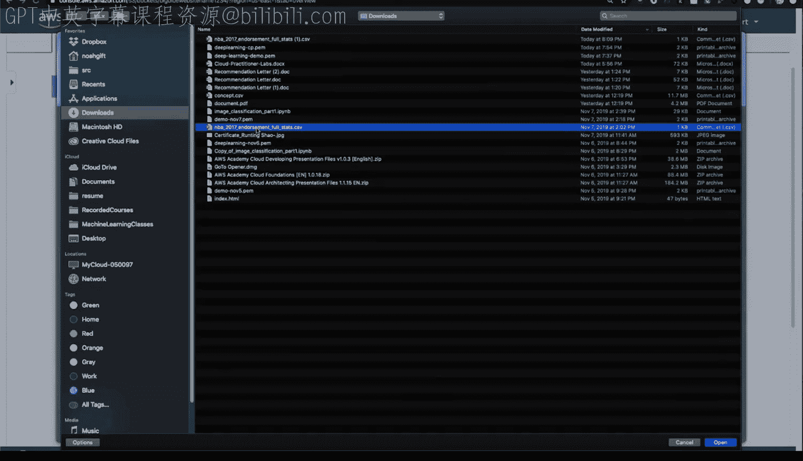
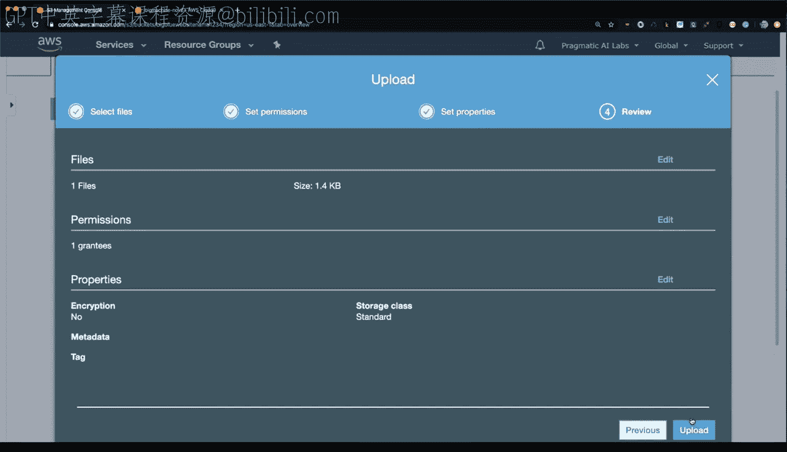
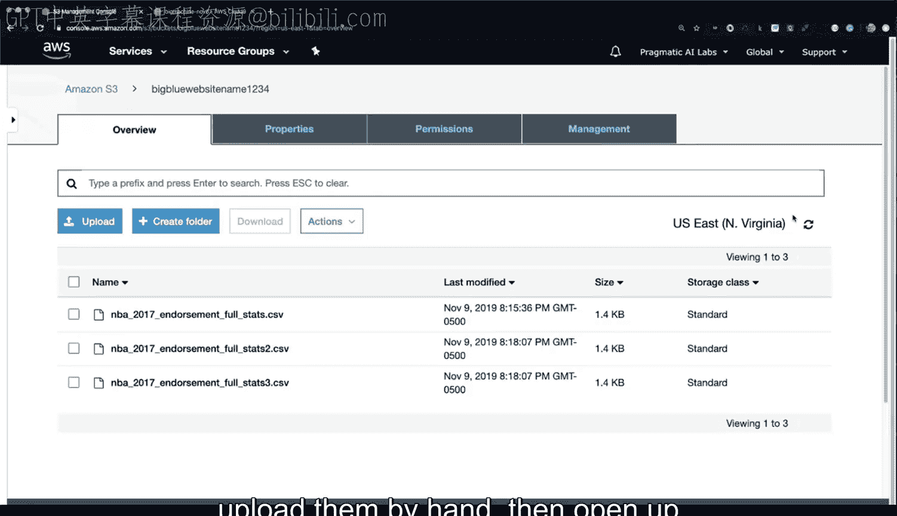

#  084：使用Amazon S3


在本节课中，我们将学习如何使用Amazon S3进行数据操作。我们将演示如何将数据上传到S3、如何同步数据以及如何在本地与S3之间移动数据。S3是处理数据操作的核心服务，尤其对于数据科学家、数据工程师或任何需要处理大量数据的场景至关重要。

## 创建S3存储桶



首先，我们需要创建一个新的S3存储桶。请记住，S3存储桶的名称在全球范围内必须是唯一的。

以下是创建存储桶的步骤：

1.  在AWS管理控制台中搜索并进入S3服务。
2.  点击“创建存储桶”按钮。
3.  为存储桶输入一个唯一的名称。在本演示中，我们使用 `bigbluewebsitename1234`。
4.  在配置选项中，保持所有默认设置。
5.  在设置权限时，选择“私有”，以确保只有您的AWS账户可以访问此存储桶。
6.  完成创建。



现在，我们已经拥有了一个名为 `bigbluewebsitename1234` 的私有存储桶。







## 通过控制台上传文件

创建存储桶后，下一步是向其中添加数据。一种简单的方法是直接通过AWS管理控制台上传文件。

操作步骤如下：

1.  进入您新创建的存储桶。
2.  点击“上传”按钮。
3.  选择您要上传的文件。在本例中，我们上传一个名为“NBA endorsement data”的CSV文件。
4.  在上传设置中，保持默认选项（例如，存储类别为“标准”，权限为私有）。
5.  开始上传。



上传完成后，文件会立即出现在您的存储桶中。S3是一个近乎无限的存储系统，非常适合存放深度学习训练数据、SQL文件、客户数据等各种类型的大规模数据。

## 使用AWS CLI同步数据

虽然通过控制台上传很方便，但在处理大量数据或需要自动化时，使用命令行工具会更高效。我们将使用AWS命令行界面在Cloud9环境与S3存储桶之间同步数据。

首先，我们需要从S3存储桶同步数据到本地。

1.  打开您的Cloud9开发环境。
2.  创建一个用于存放同步文件的目录，并进入该目录。
    ```bash
    mkdir files
    cd files
    ```
3.  使用 `aws s3 sync` 命令将S3存储桶的内容同步到当前目录。命令格式为：
    ```bash
    aws s3 sync s3://<您的存储桶名称> .
    ```
    将 `<您的存储桶名称>` 替换为您的实际桶名，例如 `bigbluewebsitename1234`。命令末尾的 `.` 代表当前目录。
4.  执行命令后，文件将从S3下载到您的 `files` 目录中。您可以查看或编辑这些本地文件。

## 双向同步与文件管理

上一节我们介绍了如何将数据从S3拉到本地。本节中我们来看看如何将本地更改同步回S3，实现双向数据流动。

假设我们在本地 `files` 目录中创建或修改了一些文件，现在需要将这些更新上传到S3存储桶。

只需再次使用 `aws s3 sync` 命令，但这次调换源和目标的位置。要将本地目录同步到S3存储桶，命令格式为：
```bash
aws s3 sync . s3://<您的存储桶名称>
```
这个命令会比较本地目录和S3存储桶中的文件，并上传本地新增或更改的文件到S3，使两端内容保持一致。

通过这种方式，您可以轻松地在本地环境与S3之间管理大量数据，无论是几GB还是几TB，为数据科学和工程项目提供了强大的工作流支持。

## 总结




本节课中我们一起学习了Amazon S3的基本操作。我们首先创建了一个全球唯一的S3存储桶，并通过控制台直接上传了文件。接着，我们深入使用AWS CLI命令行工具，掌握了如何使用 `aws s3 sync` 命令在本地目录与S3存储桶之间进行高效的双向数据同步。这套工作流对于需要处理海量数据的数据工程师和科学家来说，是一个非常实用且强大的工具。