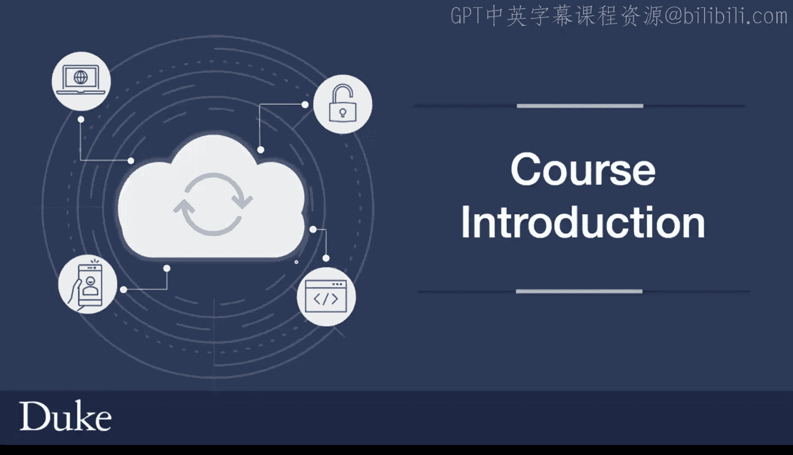
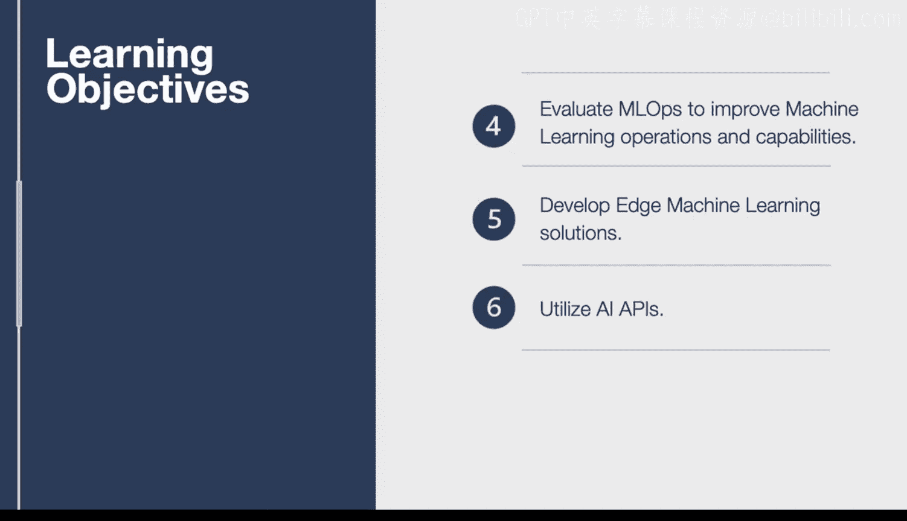

**机器学习工程：第1章：课程介绍**

在本课程中，我们将学习机器学习工程这一主题，涵盖一系列能帮助你掌握机器学习工程的新技术。让我们从第一个主题开始：开发机器学习应用。

---

### **概述**

本节课我们将要学习如何构建和部署机器学习应用，探索加速模型投入生产的最佳实践，并评估一些新兴的机器学习概念与策略。

---

### **1. 开发机器学习应用**

上一节我们介绍了课程主题，本节中我们来看看开发机器学习应用的具体细节。这部分内容将深入探讨构建机器学习应用的流程，并包含一些实现**运营化**的最佳实践。

**运营化**指的是将机器学习模型从实验环境部署到生产环境，使其能够持续、稳定地为实际业务提供服务的过程。

---

### **2. 评估AutoML概念与策略**

接下来，我们将探讨如何评估自动化机器学习的概念与策略。核心问题是：哪些方法和技术能够加速机器学习模型在生产环境中的部署？

以下是AutoML中常见的加速技术：
*   **自动化特征工程**：系统自动识别和创建有效的输入特征。
*   **自动化模型选择**：算法自动尝试多种模型架构并选择最优者。
*   **超参数自动优化**：使用如`贝叶斯优化`或`网格搜索`等技术，自动寻找模型的最佳参数组合。

---

### **3. 评估机器学习新兴主题**

在掌握了基础部署与自动化技术后，我们将进一步评估机器学习领域的新兴主题。这些主题代表了技术的前沿方向。

我们将重点关注以下两个方向：
*   **基于边缘设备的机器学习**：在终端设备（如手机、摄像头）上直接进行模型推理，减少对云端的依赖。
*   **利用计算机视觉解决独特问题**：探索如何应用图像识别、目标检测等技术处理特定的业务场景。

---

### **4. 学习目标详解**

现在，让我们详细阐述本课程的具体学习目标。以下是需要掌握的六个核心技能：

1.  **开发机器学习工程应用**：核心目标是编写能够投入生产环境的代码，并实际使用机器学习解决问题。
2.  **评估机器学习最佳实践**：学习哪些实践能确保机器学习在生产环境中稳定运行，以及如何维护这些应用。
3.  **利用AutoML增强组织能力**：探索如何运用自动化机器学习来加速整个组织的机器学习运营化进程。
4.  **评估MLOps以改进运营**：学习如何评估机器学习运维本身，以提升运营效率和能力。这包括：
    *   检测**数据漂移**（即生产数据分布与训练数据分布发生偏移）。
    *   监控模型性能，判断其是否仍提供最佳预测，或是否需要重新训练。
5.  **开发边缘机器学习解决方案**：构建能够部署在边缘设备上的轻量级机器学习模型。
6.  **使用AI API**：学习如何利用云服务提供商提供的预训练模型API，快速将AI能力部署到生产环境，借助现有平台的力量解决问题。

---

### **总结**

本节课中，我们一起学习了机器学习工程课程的总体框架。我们明确了课程将涵盖从开发应用到生产部署、从自动化工具到新兴技术（如边缘计算和AI API）的完整知识体系。接下来的章节，我们将深入每一个模块，逐步掌握构建大规模机器学习解决方案所需的技能。